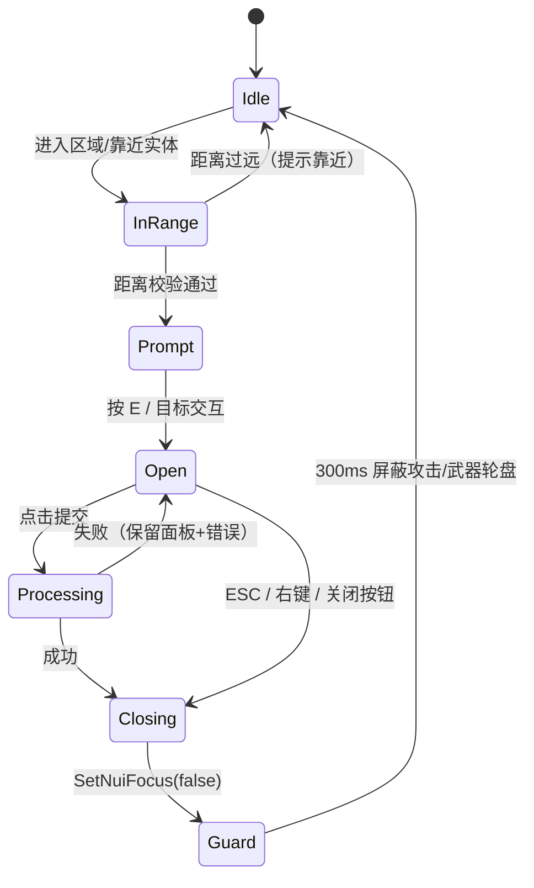
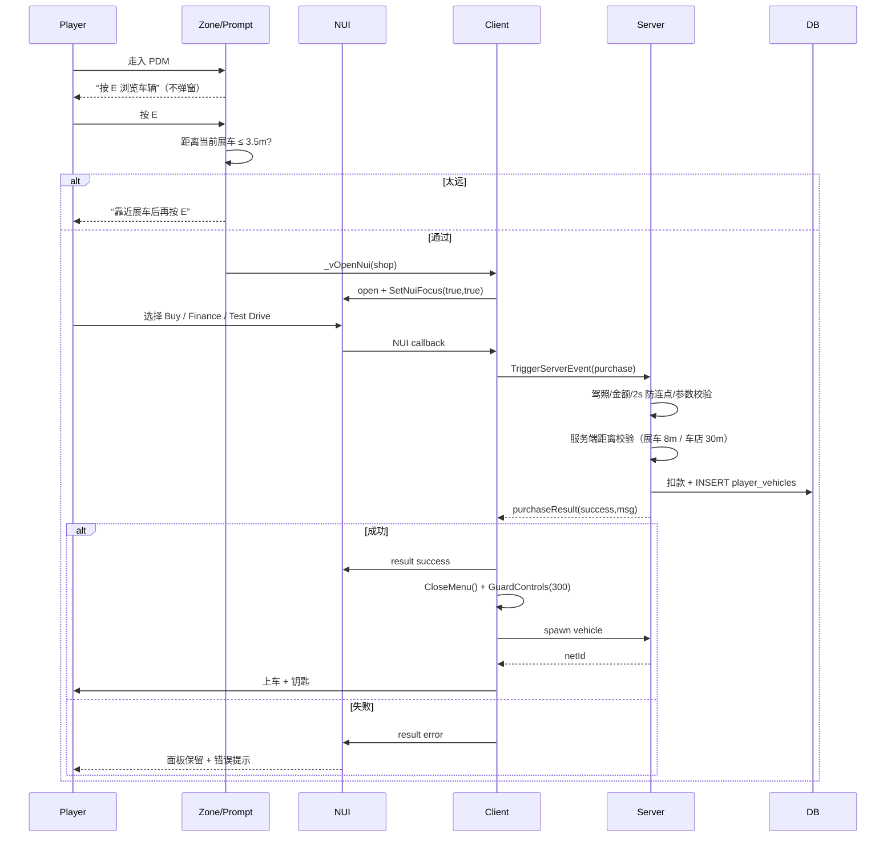
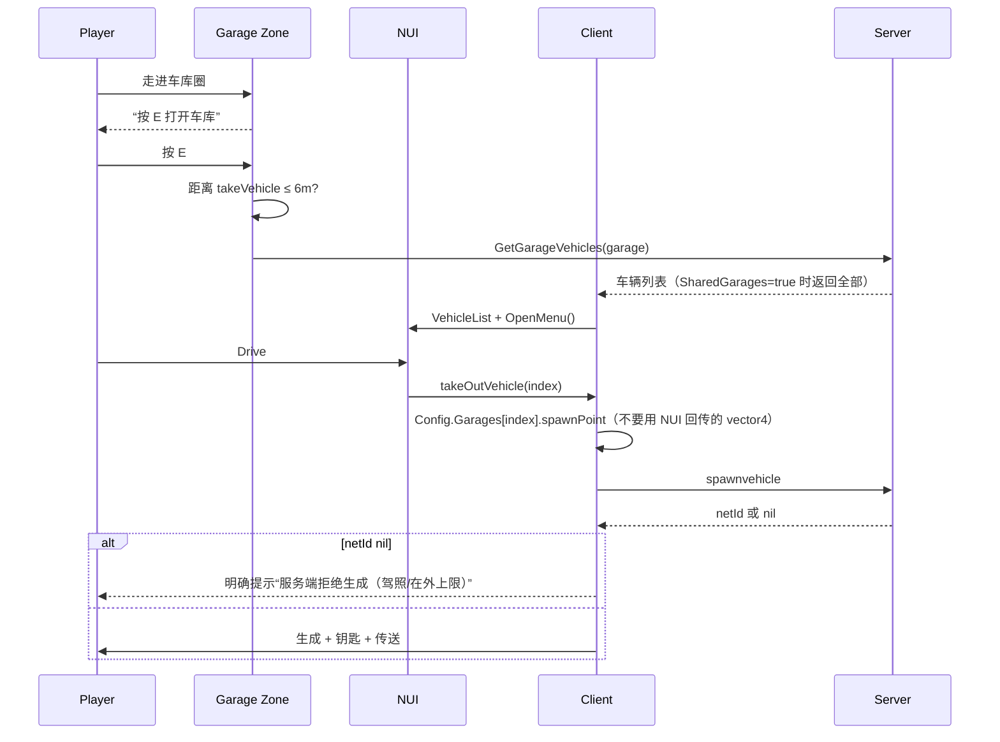

# 菜单交互设计规范（NUI / 世界交互）

> 目标：所有菜单统一生命周期，解决“自动弹窗、关闭打一拳、远处隔空交互、手机滚轮穿透”。
> 共享实现：`resources/[custom]/custom-ui`

---

## 1. 标准生命周期



关键点：

1. **不自动打开**：进入区域只提示，不劫持画面。
2. **距离校验**：客户端先判断，服务端再做一次权威校验。
3. **关闭保护**：`SetNuiFocus(false)` 后的 300ms 内禁用攻击/瞄准/武器轮盘，防止同一个鼠标点击落到游戏里。
4. **输入策略**：
   - 静态面板（车店/车库）：`keepInput = false`，完全接管输入。
   - 需要移动的界面（手机）：`keepInput = true` + 每帧 `DisableDisplayControlActions()`（qb-phone 的做法）。

## 2. 车店购物流程



### 为什么关闭会打一拳

NUI 的关闭按钮点击与 `SetNuiFocus(false, false)` 存在一帧竞态：焦点释放后，同一次鼠标事件可能被游戏当成攻击。解决不是“只加 Wait”，而是：

```lua
CloseMenu()          -- 内部 SetNuiFocus(false,false)
GuardControls(300)   -- 300ms 内 DisableControlAction(0, 24/257/25/...)
```

## 3. 车库流程



## 4. 手机输入（参考 qb-phone）

qb-phone 的做法：

```lua
SetNuiFocus(true, true)
CreateThread(function()
    while isOpen do
        DisableDisplayControlActions()
        Wait(1)
    end
end)
```

- 保留移动/驾驶输入；
- `DisableDisplayControlActions()` 负责屏蔽武器/电台轮盘；
- 关闭时 `SetNuiFocus(false, false)`，并配合 300ms 防误触。

本项目的 `custom-ui` 把这套逻辑封装为：

```lua
exports['custom-ui']:OpenMenu({ keepInput = true })   -- 手机
exports['custom-ui']:OpenMenu({ keepInput = false })  -- 车店/车库
exports['custom-ui']:CloseMenu()                     -- 内部 GuardControls
```

## 5. 共享 API（custom-ui）

| API | 作用 |
|-----|------|
| `OpenMenu({keepInput})` | 统一设置 NUI focus / keepInput |
| `CloseMenu({guardMs})` | 释放焦点 + 300ms 防误触 |
| `GuardControls(ms)` | 屏蔽攻击/瞄准/武器/电台轮盘 |
| `DistanceToCoords(coords, max)` | 客户端距离判断 |
| `IsMenuOpen()` | 当前状态 |

## 6. 新菜单接入清单

- [ ] 不自动打开，先提示按键
- [ ] 打开前做客户端距离判断
- [ ] 服务端对关键操作再做距离/频率/参数校验（车店已加 8m/30m）
- [ ] 打开用 `custom-ui:OpenMenu`
- [ ] 关闭用 `custom-ui:CloseMenu`（自动 300ms 防误触）
- [ ] 静态面板 `keepInput=false`；需要移动的界面 `keepInput=true` + `DisableDisplayControlActions`
- [ ] 失败保留面板并显示错误，不要乐观关闭
- [ ] 加 Playwright / Lua 回归测试

## 7. 当前接入情况

| 菜单 | 状态 |
|------|------|
| qb-menu（通用） | ✅ Open/Close 走 custom-ui |
| qb-vehicleshop | ✅ E 打开 + 3.5m 距离 + custom-ui + 关闭防误触 |
| qb-garages | ✅ E 打开 + 6m 距离 + custom-ui + index 取 spawnPoint |
| custom-phone | ✅ qb-phone 式 keepInput + DisableDisplayControlActions + 关闭防误触 |
| tcity-dashboard | ✅ Open/Close 走 custom-ui（含座椅浮层） |
