# qb-phone 调研报告

> **调研对象**：`qbcore-framework/qb-phone`（该 URL 301 到 `qbcore-fivem/qb-phone`），`main` @ `333e8132359b1c50c31c2bc6db8e8a64db6c93f6`，`fxmanifest.lua` version `1.5.0`。
>
> **方法**：直接读上游源码（`server.lua` 1104 行、`client.lua` 2234 行、`html/` 约 70KB 的 `index.html`、`qb-phone.sql` 102 行），对照 `qbx_phone` 与 `npwd`，并核对本地 `T-CityLite.base/resources/[custom]/custom-phone` 的现有接口。**没有做运行时压测**；带“估算/推测”的数字都按 48 人在线、历史数据量级做粗算，不当作 benchmark。
>
> **结论适用范围**：QBCore Lite、约 48 人、需要给警察 / EMS / 出租车 / mechanic 留职业 App 接口。

---

## 0. 一页结论

qb-phone 是一个**功能齐全、但架构明显停留在 2021 年**的 QB-Core 手机：服务端 16 个 callback、31 个 net event，客户端 29 个 net event，NUI 84 个 callback；所有 App 的 DOM 都塞在一个 `index.html` 里（JS/CSS 则每个 App 各一套），新增 App 靠 `app.js` 里的 `if/else` 链，而不是注册机制。

它值得抄的是**交互层**：锁屏也能看到的 OS 级通知、可操作的邮件按钮、App 网格 + 未读角标、职业/值班门控、短信事件推送、通话状态事件。这些在 48 人规模下成本低、体验收益高，而且和 custom-phone 现有 Svelte 结构兼容。

它最不该抄的是**数据层**：

- `phone_messages` 把整段聊天按“联系人对”存成 JSON 大字段，每发一条消息都把整段历史 `json.encode` 后**写两行**（`server.lua:907-948`），无上限、无单条消息 ID、并发写会丢更新；
- `GetPhoneData` 一次开机串行查 7 张表，且 **全程没有 `LIMIT`**（`server.lua:205-288`），把全部消息、全部邮件、全部相册、全服最近 12 小时推文都塞给客户端；
- 客户端**关闭手机也每 60 秒拉一次全量 `GetPhoneData`**，只为刷新联系人（`client.lua:2218-2233`）；
- 多处出现 N+1 或全表扫描：联系人头像按聊天数逐条 `LIKE '%number%'` 查 `players`（`server.lua:344-361`），发票按条回查（`:162-186`），车辆搜索按车回查（`:440-498`），发短信靠 `LIKE '%phone%'` 定位玩家（`:907-948`）；
- 职业 App 的权限只存在于 NUI（`job='police'` 时显示图标），服务端 MDT callback **没有任何 job 校验**（`server.lua:392-536`），客户端可以直接调用。

一句话：**抄它的 UX 和“职业 App”的产品形态，不要抄它的存储、查询、轮询和客户端鉴权。** 我们已经有更好的底子——custom-phone 是 Svelte + 按行存 `phone_messages` + 事件推送——真正缺的是**一个服务端权威、可注册的职业 App 协议**，而不是另一套手机。

三个关键数字（用于决策）：

| 指标 | qb-phone | 对 48 人意味着什么 |
|---|---:|---|
| 开机全量加载的 DB 查询 | 7 条串行 / 次 | 登录瞬间 `OnPlayerLoaded` + 500ms 线程各一次 → 48 人约 **96 次全量加载**（突发） |
| 关闭手机后的常驻轮询 | 每 60 秒 / 人 | 48 人约 **336 条查询/分钟（≈5.6 qps）**，且每次返回全量历史 |
| 新增职业 App 要改的文件 | 7~9 个（含 HTML/CSS/JS/客户端/服务端/SQL） | 每加一个职业就要复制一套，和“给警察/EMS/出租车留接口”的目标相反 |

> 说明：48 人下这些查询量本身不会压垮 MySQL；问题是**随玩家历史线性增长、没有上限、没有缓存失效策略**，并且登录/开屏有突发。真正会先出问题的是“加职业 App 的边际成本”和“服务端没有鉴权”。

---

## 1. 架构

### 1.1 分层图

```mermaid
flowchart LR
  subgraph NUI["NUI 层：html/index.html（约 70KB）"]
    N1["20 个固定 App 槽位<br/>18 个 *-app DOM 容器"]
    N2["jQuery + 7 个外链 CDN 脚本<br/>84 个 NUI callback"]
    N3["QB.Phone.Data<br/>DOM 常驻，只做 show/hide"]
  end

  subgraph CL["客户端：client.lua（2234 行）"]
    C1["PhoneData 内存缓存<br/>Config.PhoneApplications"]
    C2["SetNuiFocus / 动画 / 手机 prop"]
    C3["线程：1s 时间、1s 通话计时<br/>60s 全量轮询、开屏 Wait(1) 控键"]
  end

  subgraph SV["服务端：server.lua（1104 行）"]
    S1["16 个 QBCore callback<br/>31 个 net event"]
    S2["内存态：Calls / AppAlerts /<br/>Tweets / Hashtags / Adverts / Plates"]
    S3["无 service 层<br/>oxmysql await 直查"]
  end

  DB[("MySQL<br/>8 张表")]
  MD[("players.metadata<br/>JSON 字段")]

  NUI <-->|"SendNUIMessage / RegisterNUICallback"| CL
  CL <-->|"QBCore callback / TriggerServerEvent"| SV
  SV -->|"SELECT / INSERT / UPDATE / DELETE"| DB
  SV -->|"SetMetaData"| MD
```



### 1.2 各层职责

| 层 | 职责 | 关键事实 |
|---|---|---|
| **NUI** | 所有 App 的 UI、DOM 事件、表单、`$.post('https://qb-phone/...')` | 单页 `ui_page`，无构建步骤；18 个 `*-app` 容器、20 个槽位全部预置在 `index.html`；每个 App 一个 JS 文件，启动时全部 `<script>` 引入；84 个 NUI callback；没有 `setInterval`，但有大量 `setTimeout` 动画 |
| **Client Lua** | 手机开/关、NUI focus、动画、客户端缓存、NUI→Server 转发 | `PhoneData` 是全局表；`Config.PhoneApplications` 在客户端被“已安装 App”动态改写；打开手机时 `SetNuiFocus(true, true)`，关闭时 `SetNuiFocus(false, false)`；开屏有 `Wait(1)` 控键循环 |
| **Server Lua** | 数据读写、事件广播、业务规则 | 16 个 callback + 31 个 event；没有统一的 `PhoneService` / repository；大量 `MySQL.query.await` 串行；内存态与 DB 混用 |
| **MySQL** | 持久化联系人、消息、邮件、发票、推文、相册、加密交易、车辆 | 8 张表；没有外键；`phone_messages` 用 JSON 大字段；`phone_gallery` 无主键/无索引；`phone_tweets` 只有 `citizenid` 索引，按 `date` 查询会全表扫 |
| **QBCore metadata** | 手机设置、头像、背景、序列号、已安装 App | `players.metadata` 的 `phone` / `phonedata` 子对象，通过 `SaveMetaData`/`InstallApplication` 写回；和 DB 是两套持久化路径 |

### 1.3 状态到底存在哪里

| 状态 | 存放位置 | 生命周期 | 证据 |
|---|---|---|---|
| 联系人、消息、邮件、发票、推文、相册、加密交易 | MySQL | 持久 | `qb-phone.sql:1-102`；`server.lua:225-285` |
| 头像、背景、序列号、已安装 App | `players.metadata.phone` / `phonedata` JSON | 持久 | `server.lua:981-990`、`:1017-1033` |
| App 未读角标 | **服务端内存** `AppAlerts[citizenid][app]` | 重启丢失；无清理 | `server.lua:4`、`:50-77` |
| 被 @ 的推文 | **服务端内存** `MentionedTweets[citizenid]` | 重启丢失；无上限 | `server.lua:5`、`:43-48` |
| Hashtag 聚合 | **服务端内存** `Hashtags[handle]` | 重启丢失；无上限 | `server.lua:6`、`:801-812` |
| 通话状态 | **服务端内存** `Calls[citizenid].inCall` | 重启丢失；没有通话记录表 | `server.lua:7`、`:666-675` |
| 广告 | **服务端内存** `Adverts[citizenid]` | 重启丢失；广播全服 | `server.lua:8`、`:639-664` |
| 随机车牌查询结果 | **服务端内存** `GeneratedPlates[plate]` | 重启丢失；无上限 | `server.lua:9`、`:472-530` |
| 推文全局副本 | **服务端内存** `TWData` | 每次 `GetPhoneData` 覆盖 | `server.lua:13`、`:256-261` |
| 聊天/联系人/推文客户端缓存 | 客户端 Lua `PhoneData` | 重连重建；和 NUI 再存一份 | `client.lua:7-30` |
| 最近通话 | **仅客户端** `PhoneData.RecentCalls` | 重连丢失 | `client.lua:20`；`server.lua:950-965` |
| NUI 当前 App / 打开的聊天 | NUI `QB.Phone.Data` + DOM | 关屏不重置，只隐藏 | `html/js/app.js:16-30`、`:551-560` |
| 消息已读 | 无 DB 字段；客户端 `Unread` 计数 | 重连丢失（无已读回执） | `phone_messages` 无 `is_read`；`client.lua` 的 chat `Unread` |

> 结论：**同一个“聊天状态”存在 DB、客户端 Lua、NUI 三份**，且没有版本号/单一事实源。服务端只存 JSON blob，客户端改完再整体回写，天然会丢更新。

### 1.4 一次开机 / 一次打开手机的数据流

**登录时（手机还没打开）：**

1. `QBCore:Client:OnPlayerLoaded` → `LoadPhone()`（`client.lua:1512-1516`）。
2. 500ms 后另一个线程再次 `LoadPhone()`（`client.lua:2200-2206`）——登录阶段重复一次全量加载。
3. `LoadPhone` → `TriggerCallback('qb-phone:server:GetPhoneData')`（`client.lua:231-321`）。
4. 服务端串行查 7 张表（联系人、车辆、消息、推文、邮件、加密交易、相册），拼成 `PhoneData` 一次性 `cb` 回客户端（`server.lua:205-288`）。
5. 客户端把数据塞进 `PhoneData`，并 `SendNUIMessage({action='LoadPhoneData'})`。

**打开手机：**

1. `M` 键 / `/phone` → `OpenPhone()`（`client.lua:513-524`、`:323`）。
2. 先 `TriggerCallback('qb-phone:server:HasPhone')` 检查物品（`server.lua:538-548`）。
3. `SetNuiFocus(true, true)` + `SendNUIMessage('open')`（`client.lua:327-334`）。
4. 起一个 `while PhoneData.isOpen do DisableDisplayControlActions(); Wait(1) end` 线程（`client.lua:337-342`）。
5. 播放手机动画、250ms 后创建手机 prop；再查一次 `qb-garages:server:GetPlayerVehicles`。
6. 关闭：NUI `Close` → `SetNuiFocus(false, false)`，动画结束后 `isOpen=false`（`client.lua:586-605`）。

**打开某个 App：**

NUI 点击 → `app.js` 里的 `if/else` 链（`html/js/app.js:111-230`）→ 针对该 App 发 1~3 个 `$.post` → 客户端 `RegisterNUICallback` → 服务端 callback/event → DB → 原路返回。**打开手机本身不重拉全量；App 的明细数据多数在点图标时再拉（部分直接读登录时缓存的 `PhoneData`，如邮件/相册）。**

---

## 2. 事件与数据表清单

### 2.1 服务端 QBCore Callbacks（16 个）

| Callback | 用途 | 鉴权 / 边界 |
|---|---|---|
| `qb-phone:server:GetPhoneData` | 一次返回全部手机数据 | 仅校验玩家存在；**无分页/无 LIMIT** |
| `qb-phone:server:HasPhone` | 是否持有 `phone` 物品 | 玩家不存在时不回调 `cb`（挂起） |
| `qb-phone:server:GetCallState` | 查询目标是否在通话 | 无鉴权；`source` 未使用 |
| `qb-phone:server:GetInvoices` | 发票列表 + 发送者号码 | 按发票逐条查 `players`（N+1） |
| `qb-phone:server:PayInvoice` | 支付发票 + 抽成 + 邮件 | 有 `id + citizenid` 归属校验 |
| `qb-phone:server:DeclineInvoice` | 拒付发票 | 有归属 + `candecline` 校验 |
| `qb-phone:server:GetContactPictures` | 批量补聊天头像 | 按聊天逐条 `LIKE` 查 `players` |
| `qb-phone:server:GetContactPicture` | 单个聊天头像 | 同上 |
| `qb-phone:server:GetPicture` | 按号码取头像 | 同上 |
| `qb-phone:server:FetchResult` | MDT 玩家搜索 | **无 job 校验**；字符串拼 SQL；全表 `LIKE` |
| `qb-phone:server:GetVehicleSearchResults` | MDT 车辆搜索 | **无 job 校验**；N+1 |
| `qb-phone:server:ScanPlate` | MDT 扫描车牌 | **无 job 校验**；N+1 |
| `qb-phone:server:CanTransferMoney` | 转账前校验 IBAN | 服务端校验余额；余额不足会 `cb(false)`，但 `Player=nil` 时会直接索引 nil 报错 |
| `qb-phone:server:GetCurrentLawyers` | 在岗服务职业列表 | 硬编码 6 个 job 名 |
| `qb-phone:server:GetWebhook` | 返回截图 webhook | 把 webhook 明文发客户端 |
| `qb-phone:server:UploadToFivemerr` | 服务端代传 Fivemerr | 依赖 `screenshot-basic` |

### 2.2 服务端 Net Events（31 个，按域分组）

> 表内省略统一前缀 `qb-phone:server:`。

| 域 | 事件 |
|---|---|
| 联系人 | `AddNewContact`、`EditContact`、`RemoveContact`、`GiveContactDetails` |
| 消息 | `UpdateMessages`（客户端把整段聊天数组发上来，服务端覆盖写两行） |
| 通话 | `CallContact`、`CancelCall`、`AnswerCall`、`SetCallState`、`AddRecentCall` |
| 邮件 | `sendNewMail`、`sendNewEventMail`、`RemoveMail`、`ClearButtonData` |
| 发票/账单 | `BillingEmail`（遍历全服玩家） |
| 推文 | `UpdateTweets`、`DeleteTweet`、`UpdateHashtags`、`MentionedPlayer`（遍历在线玩家 + 逐人查 DB） |
| 广告 | `AddAdvert`、`DeleteAdvert` |
| 相册 | `addImageToGallery`、`getImageFromGallery`、`RemoveImageFromGallery` |
| App/设置 | `InstallApplication`、`RemoveInstallation`、`SetPhoneAlerts`、`SaveMetaData` |
| 金钱 | `TransferMoney`（无正数/余额二次校验） |
| 其他 | `AddTransaction`、`sendPing` |

### 2.3 客户端 Net Events（29 个，按域分组）

> 除 `QBCore:*` 外，表内省略统一前缀 `qb-phone:client:`。

| 域 | 事件 |
|---|---|
| QB 生命周期 | `QBCore:Client:OnPlayerLoaded`、`OnPlayerUnload`、`OnPlayerUpdated` |
| 消息/通知 | `qb-phone:client:UpdateMessages`、`NewMailNotify`、`UpdateMails`、`BillingEmail`、`CustomNotification`、`RemoveBankMoney` |
| 通话 | `GetCalled`、`CancelCall`、`AnswerCall`、`AddRecentCall`、`addPoliceAlert` |
| 社交 | `UpdateTweets`、`UpdateTweetsDel`、`UpdateHashtags`、`GetMentioned`、`UpdateAdverts`、`UpdateAdvertsDel` |
| 相册 | `refreshImages` |
| 银行 | `TransferMoney`、`qb-phone-new:client:BankNotify` |
| 其他 | `RefreshPhone`、`AddTransaction`、`AddNewSuggestion`、`GiveContactDetails`、`UpdateLapraces`、`RaceNotify` |

### 2.4 NUI Callbacks（84 个）

按 App 分组（完整名单见折叠区）：

| 组 | 典型 callback |
|---|---|
| 通话 | `CallContact`、`AnswerCall`、`DenyIncomingCall`、`CancelOngoingCall`、`GetMissedCalls` |
| 联系人/消息 | `AddNewContact`、`EditContact`、`DeleteContact`、`SendMessage`、`GetWhatsappChats`、`GetWhatsappChat` |
| 邮件/发票/银行 | `GetMails`、`RemoveMail`、`AcceptMailButton`、`GetInvoices`、`PayInvoice`、`TransferMoney`、`CanTransferMoney` |
| 推文/广告 | `PostNewTweet`、`DeleteTweet`、`GetTweets`、`PostAdvert`、`LoadAdverts` |
| 相册/相机 | `TakePhoto`、`GetGalleryData`、`DeleteImage` |
| 加密/赛车/房屋 | `GetCryptoData`、`BuyCrypto`、`JoinRace`、`GetPlayerHouses`、`SetGPSLocation` |
| MDT/服务/店 | `FetchSearchResults`、`FetchVehicleResults`、`FetchVehicleScan`、`GetCurrentLawyers`、`SetupStoreApps` |
| App/设置/杂项 | `InstallApplication`、`RemoveApplication`、`SetBackground`、`SharedLocation`、`track-vehicle` |

<details>
<summary>展开 84 个 NUI callback 全量名单</summary>

```
AcceptMailButton, AddNewContact, AnswerCall, BuyCrypto, CallContact,
CancelOngoingCall, CancelOutgoingCall, CanRaceSetup, CanTransferMoney,
ClearAlerts, ClearGeneralAlerts, ClearMentions, ClearRecentAlerts, Close,
DeclineInvoice, DeleteAdvert, DeleteContact, DeleteImage, DeleteTweet,
DenyIncomingCall, EditContact, FetchPlayerHouses, FetchSearchResults,
FetchVehicleResults, FetchVehicleScan, GetAvailableRaces, GetBankContacts,
GetCryptoData, GetCryptoTransactions, GetCurrentLawyers, GetGalleryData,
GetHashtagMessages, GetHashtags, GetInvoices, GetMails, GetMentionedTweets,
GetMissedCalls, GetPlayerHouses, GetPlayerKeys, GetProfilePicture, GetRaces,
GetRacingLeaderboards, GetSuggestedContacts, GetTrackData, GetTruckerData,
GetTweets, GetWhatsappChat, GetWhatsappChats, HasCreatedRace, HasPhone,
InstallApplication, IsAuthorizedToCreateRaces, IsBusyCheck, IsInRace,
JoinRace, LeaveRace, LoadAdverts, PayInvoice, PostAdvert, PostNewTweet,
RaceDistanceCheck, RemoveApplication, RemoveKeyholder, RemoveMail,
RemoveSuggestion, SellCrypto, SendMessage, SetAlertWaypoint,
SetApartmentLocation, SetBackground, SetGPSLocation, SetHouseLocation,
SetupGarageVehicles, SetupRace, SetupStoreApps, SharedLocation, StartRace,
StartTrackEditor, TakePhoto, TransferCid, TransferCrypto, TransferMoney,
UpdateProfilePicture, track-vehicle
```

</details>

### 2.5 数据表

| 表 | 关键列 | 索引 | 用途 / 问题 |
|---|---|---|---|
| `player_contacts` | `id, citizenid, name, number, iban` | `citizenid` | 联系人；**没有 `(citizenid, number)` 唯一约束**，可重复；`number` 无索引 |
| `phone_messages` | `id, citizenid, number, messages TEXT` | `citizenid`、`number` | 每个玩家与每个对端一行（双方各存一行），`messages` 是 `[{date, messages:[{message,time,sender,type,data}]}]` 的 JSON；无单条消息 ID、无长度上限；同一对话两行（双方各一行） |
| `player_mails` | `id, citizenid, sender, subject, message, read, mailid, date, button` | `citizenid` | 邮件；`button` 是 JSON 动作；`mailid` 是 6 位随机数，**无唯一索引**，有碰撞风险；按 `date` 排序无索引 |
| `phone_invoices` | `id, citizenid, amount, society, sender, sendercitizenid, candecline, reason` | `citizenid` | 发票/账单；金额 `int`；无状态字段（靠删除表示已付/拒付） |
| `crypto_transactions` | `id, citizenid, title, message, date` | `citizenid` | 加密交易流水；`title/message` 只有 50 字符 |
| `player_vehicles` | `id, citizenid, vehicle, plate, mods, state, ...` | `plate`、`citizenid`、`license` | 车辆；实际归 `qb-garages` 所有，qb-phone 只读（`qb-phone.sql` 里也重复建表） |
| `phone_gallery` | `citizenid, image, date` | **无主键、无索引** | 只存图片 URL；按 `citizenid` 过滤 + `date` 排序会全表扫 |
| `phone_tweets` | `id, citizenid, firstName, lastName, message, date, url, picture, tweetId` | `citizenid` | 推文；按 `date > NOW()-12h` 查询**没有 date 索引**，全表扫；`tweetId` 无唯一约束；`url/picture` 是 `text` |

**没有的表**：`phone_calls`（通话不落库）、`phone_apps`（App 不落库）、`phone_read_receipts`（已读不落库）。上游也**没有 InstaPic**；图片相关只有 Gallery + Camera，推文里的图片是 URL 字段。

### 2.6 关键数据结构

```lua
-- 客户端 PhoneData.Chats[number]
{
  name = "联系人名或号码",
  number = "555-0100",
  messages = {
    { date = "2026-10-23", messages = {
        { message = "hi", time = "12:30", sender = "citizenid", type = "message", data = {} },
        { message = "Shared Location", time = "12:31", sender = "citizenid", type = "location", data = { x = 1.0, y = 2.0 } },
        { message = "Photo", time = "12:32", sender = "citizenid", type = "picture", data = { url = "https://..." } },
    }},
  },
  Unread = 2, -- 仅客户端
}
```

```lua
-- Config.PhoneApplications[id]
{
  app = "meos", color = "#004682", icon = "fas fa-ad",
  tooltipText = "MDT", tooltipPos = "top",
  job = "police", blockedjobs = {}, slot = 15, Alerts = 0,
}
```

```lua
-- 服务端内存 Calls[citizenid]
{ inCall = true } -- 只有这一个字段；没有通话对象、开始时间、通话记录
```

---

## 3. 性能

### 3.1 打开 / 关闭：NUI focus 与渲染方式

**直接回答：不是整页重渲染，也没有 `setInterval`；是“单页静态 DOM + jQuery show/hide + 每次点 App 再拉数据”。**

证据：

- `ui_page 'html/index.html'`（`fxmanifest.lua:16`），`index.html` 70,359 字节，内含 20 个 `data-appslot` 和 18 个 `*-app` 容器（含通话界面 `phone-call-app`），例如 `meos-app`、`bank-app`。
- 打开：`SetNuiFocus(true, true)` + `SendNUIMessage({action='open'})`（`client.lua:327-334`）；NUI 只做底部滑入动画（`html/js/app.js:313-317` 的 `Open`/`BottomSlideUp`），所有 App DOM 早已存在，切换靠 `$("."+app+"-app").css({"display": show})`（`html/js/app.js:319-321`）。
- 关闭：`SetNuiFocus(false, false)`（`client.lua:600`），`PhoneData.isOpen=false` 延迟 500ms（`:601-603`）；NUI 不卸载 DOM、不清状态。
- App 内容按需拉：点击图标后走 `if/else`，例如 bank 一次发 `GetBankContacts` + `GetInvoices` 两个 `$.post`（`html/js/app.js:138-145`），twitter 最多 3 个（`:126-137`），mail 一个（`:160-166`）。
- 没有 `setInterval`（全 `html/js` 搜索为 0）；时间同步是 Lua 每 1 秒 `SendNUIMessage`（`client.lua:2208-2216`），通话计时也是 1 秒（`:471-486`）。
- 首次加载成本高：`index.html` 顶部从 CDN 引 7 个脚本（jQuery、jQuery Color、Bootstrap、moment、DOMPurify、emojionearea、clipboard，`html/index.html:7-36`），加上 17 个 App 的 JS 全部 eager 引入（`:1117-1135`）。**离线/被墙的 CDN 会直接让手机 UI 挂掉。**

### 3.2 服务端：每次都打 DB、N+1、全表查询

**直接回答：是。每个“读数据”动作都直接打 DB，没有服务端缓存；`GetPhoneData` 7 条串行查询且无 `LIMIT`；至少 4 处 N+1、4 处全表/前导通配符扫描。**

- `GetPhoneData`（`server.lua:205-288`）：
  - `player_contacts`（`:225`）
  - `player_vehicles`（`:234`）
  - `phone_messages`（`:239`，**无 LIMIT，返回全部历史**）
  - `phone_tweets`（`:256`，全服最近 `Config.TweetDuration=12` 小时，**date 无索引**）
  - `player_mails`（`:263`，**无 LIMIT**）
  - `crypto_transactions`（`:273`，**无 LIMIT**）
  - `phone_gallery`（`:282`，**无 LIMIT，无索引**）
  - 全部串行 `await`，没有并行；没有 cache；`cb` 只在 `Player ~= nil` 时调用（`:208-287`），玩家断开竞态会让客户端 callback 永久挂起。
- N+1：
  - `GetInvoices`：每张发票查一次在线玩家，不在线再查一次 `players`（`:166-180`）。
  - `GetContactPictures`：每个聊天查一次 `players WHERE charinfo LIKE '%number%'`（`:344-357`）。
  - `GetVehicleSearchResults`：每辆车查一次 `players`（`:444-470`）。
  - `MentionedPlayer`：遍历每个在线玩家，不匹配就查一次 `players`（`:755-775`）——**一次 @ 可能触发 48 次全表扫描**。
- 全表 / 前导通配符：
  - `FetchResult`：先 `SELECT * FROM apartments` 全表，再拼 `SELECT * FROM players WHERE ... charinfo LIKE "%..."`，**无 LIMIT、字符串拼 SQL**（`:392-438`）。
  - `UpdateMessages`：每发一条短信 `SELECT * FROM players WHERE charinfo LIKE '%号码%'`（`:910-911`），前导 `%` 无法用索引。
  - `GetContactPicture(s)` / `GetPicture`：同上（`:344-390`）。
  - `GetVehicleSearchResults` / `ScanPlate`：`plate LIKE '%...%'` + 回查（`:440-536`）。
- 写放大：
  - `UpdateMessages` 把客户端传来的**整段聊天数组** `json.encode` 后 `UPDATE` 两行（`:918-920`），新会话则 `INSERT` 两行（`:925-927`）。消息越多，每条新消息写的字节越多；两个客户端并发时后写覆盖先写。
- 无事务：`TransferMoney` 先加收款方再扣付款方（`:856-884`），中途失败会不一致；离线收款方直接改 `players.money` JSON（`:874-879`）。

### 3.3 消息 / 推送方式

| 数据 | 方式 | 评价 |
|---|---|---|
| 短信 | **事件推送**：发送后 `TriggerClientEvent('qb-phone:client:UpdateMessages', target, ...)`（`server.lua:922/929`） | 方向正确；但推送的是“整段聊天数组”，不是单条消息 |
| 联系人 | **60 秒轮询**：客户端每 60s 调 `GetPhoneData`，只取 `PlayerContacts` 再 `RefreshContacts`（`client.lua:2218-2233`） | 关屏也跑；为了刷新联系人付全量 7 查询的代价 |
| 邮件 | 事件推送，但每次推送前**重查全部邮件**再发全量列表（`server.lua:677-753`、`:694-736`） | 推送 + 全量列表；邮件多时浪费 |
| 推文 | 全服广播 `-1`，且把客户端传来的 `NewTweets` 原样转发（`:840-854`） | O(在线人数) fanout；客户端可伪造推文数组 |
| 广告 | 全服广播 `-1`（`:656`、`:663`） | 同上；数据在内存 |
| Hashtag | 全服广播 `-1`（`:811`） | 同上；无上限 |
| App 数据 | **打开 App 时拉取**（NUI `$.post`），不轮询 | 打开延迟 = 多次串行 callback；没有服务端缓存 |
| 通话 | 事件推送 + 1 秒计时 | 合理；但状态只在内存 |

### 3.4 图片 / 媒体

**直接回答：只存 URL，不存二进制；没有缩略图、没有大小/域名校验；图片托管依赖 Discord webhook 或 Fivemerr。**

- 相机：`TakePhoto` 用 `screenshot-basic` 上传到 webhook（`exports['screenshot-basic']:requestScreenshotUpload(hook, 'files[]', ...)`，`client.lua:1478-1490`），取 `image.attachments[1].proxy_url` 存进 `phone_gallery.image`。
- Fivemerr：走服务端 `UploadToFivemerr`（`server.lua:611-635`），服务端 `PerformHttpRequest` 上传后把 `response` 回客户端，客户端只存 URL。
- `phone_gallery` 只存 `VARCHAR(255)` 的 URL，**无主键、无索引**（`qb-phone.sql:85-89`）。
- `GetPhoneData` 把该玩家**全部图片 URL** 塞进响应（`server.lua:282-285`）；NUI 用 `` 直接加载外部地址，没有缩略图/懒加载/失败占位。
- `addImageToGallery` 接受客户端任意字符串（`server.lua:1035-1039`），没有 `http(s)` 前缀、域名白名单、长度校验。
- Discord 的 `proxy_url` 可能过期，玩家相册会在几周后出现裂图；`WebHook` 还是硬编码空字符串（`server.lua:10`），必须改源码。
- 上游**没有 InstaPic**；如果某些 fork 有，那是第三方扩展，不在本报告证据内。

### 3.5 客户端 `CreateThread` / `Wait(0)` 循环

| 位置 | 频率 | 作用 | 风险 |
|---|---:|---|---|
| `client.lua:337-342` | `Wait(1)`（约每帧） | 开屏时屏蔽约 18 个控制（鼠标、攻击、武器轮盘、电台、近战、ESC…） | 开屏期间每秒约 1,100 次 native 调用；低端机可感知；关屏即退出，空闲为 0 |
| `client.lua:1440-1499` | `Wait(0)`（每帧） | 相机预览：隐藏 HUD、`EnableAllControlActions`、按键拍照 | 相机打开期间每帧执行；属预期但偏重 |
| `client.lua:2208-2216` | `Wait(1000)` | 开屏时更新时间 | 每秒一次，可忽略；关闭时只做布尔判断 |
| `client.lua:471-486` / `:2114-2126` | `Wait(1000)` | 通话计时 | 每秒一次 |
| `client.lua:2218-2233` | `Wait(60000)` | 全量刷新联系人 | **关屏也跑**，最该优化的一条 |
| `client.lua:42-52` | `Wait(500)` | 手机动画循环检查 | 只在动画数据存在时跑 |
| `client.lua:55-64` / `:31-38` | `Wait(1)` | 加载模型/动画字典 | 短暂阻塞，常规写法 |

> 结论：qb-phone **空闲时不是 0 开销**（1s 时间线程 + 60s 全量轮询），开屏时是单线程 `Wait(1)` 控键循环；它没有“每帧 setInterval”式 NUI 重渲染，但“静态大 DOM + 全量数据”的组合让开屏/切 App 的 CPU 峰值偏高。

### 3.6 性能问题汇总表

| 问题 | 证据 | 影响 | 我们的对策 |
|---|---|---|---|
| **P1 关屏仍每 60s 全量拉取** | `client.lua:2218-2233` → `server.lua:205-288` | 48 人 ≈ 336 查询/分钟；每次返回全部历史；关屏不静默，违背 Phone-First 的“关闭即零占用” | 改成**事件失效 + 版本号**：联系人/设置变更由服务端 push `phone:client:contacts:invalidate`；开屏只拉一次增量；删除 60s 轮询 |
| **P2 登录重复全量加载** | `client.lua:1512-1516`、`:2200-2206`（500ms 线程）、`:2029-2034`（`RefreshPhone`） | 48 人登录/重启时约 96 次全量加载，形成 DB 突发；`RefreshPhone` 还会被账单等业务触发（`server.lua:1089`） | 服务端 `getPhoneData` 加 **登录去重 + 30s TTL**（custom-phone 已有，保留）；`RefreshPhone` 只推失效 key，不重拉全量 |
| **P3 全量数据无 LIMIT** | `server.lua:239`（消息）、`:263`（邮件）、`:273`（交易）、`:282`（相册）、`:256`（12h 推文） | 玩家历史越长，单次 payload 越大；Lua `json.decode` + NUI 克隆 + DOM 更新都可能卡顿；没有上限就无法做容量规划 | 所有列表 **cursor 分页**：`WHERE id < ? ORDER BY id DESC LIMIT 50`；首屏只给最近 30 条会话 + 每会话 20 条；相册/邮件分页 |
| **P4 推文按 date 查询无索引** | `qb-phone.sql:91-102`（仅 `KEY citizenid`）；`server.lua:256` | 每次 `GetPhoneData` 全表扫 `phone_tweets`；48 人/分钟 ≈ 48 次全表扫；推文越多越慢 | 加 `KEY idx_date (date)`；或改为“只查当前玩家关注/最近 N 条”，缓存 30s；不要每次全量 |
| **P5 相册无主键/无索引** | `qb-phone.sql:85-89` | `WHERE citizenid ORDER BY date` 全表扫；相册是增长最快的表之一 | 加 `PRIMARY KEY(id)` + `KEY (citizenid, date)`；分页 + 缩略图 URL；限制每人 N 张 |
| **P6 头像 N+1 + 前导 `%`** | `server.lua:344-361`、`:363-390`；调用方 `client.lua:1266-1270` | 50 个聊天 = 50 次 `SELECT * FROM players WHERE charinfo LIKE '%number%'`；每次全表扫 + 返回整行 JSON | 一次 `WHERE number IN (...)` 批量取；或建 `phone_profiles(number, avatar)` 映射表；**禁止前导 `%`** |
| **P7 发票/车辆 N+1** | `server.lua:162-186`、`:440-498` | 发票 I 条 → I+1 查询；车辆 V 条 → V+1 查询 | 用 `JOIN` 或 `WHERE citizenid IN (...)` 一次取；返回 DTO 而不是 `SELECT *` |
| **P8 短信靠全表 `LIKE` 找人** | `server.lua:907-948`（`:910-911`） | 每发一条短信全表扫 `players`；`charinfo` 是 JSON 文本，前导 `%` 无法索引；号码重复/格式变化会找错人 | 用 `phone_numbers(number)` 唯一索引直接查 citizenid；消息只写**单条行**，不写 JSON blob |
| **P9 聊天整段回写（写放大）** | `server.lua:918-920`、`:925-927`；表结构 `qb-phone.sql:24-32` | 1000 条历史、按每条 100B 粗估时，每条新消息写 ~100KB × 2 行；并发覆盖丢消息；TEXT 无上限 | 改成 `phone_messages(id, sender_number, receiver_number, message, type, meta, is_read, created_at)` 单条行；发送只 INSERT 一条；读取 `LIMIT` 分页 |
| **P10 单页 70KB + 18 个 App 容器全量 DOM + CDN** | `html/index.html` 70,359B；`:7-36` 外链 CDN；`:1117-1135` 全量 JS；`html/js/app.js:111-230` | 首次开屏解析/执行成本高；CDN 失败则 UI 不可用；新增 App 继续膨胀 | Svelte 按路由 **动态 import**；首屏只加载 shell + 当前 App；所有依赖本地打包（custom-phone 已本地化，保持）；App 清单化 |
| **P11 开屏每帧控键约 18 个** | `client.lua:337-342` + `:210-229` | 开屏期间每秒约 1,100 次 native；低端机可能掉帧；与相机 `Wait(0)` 叠加更明显 | 保留**一个** `Wait(0)` 线程，只 disable 必要控制（鼠标/攻击/武器轮盘）；用 `SetNuiFocusKeepInput` + 最小集合；不要为每个功能再起线程 |
| **P12 服务端内存无清理** | `server.lua:4-13`、`:43-77`、`:472-530`；无 `playerDropped` 处理 | `AppAlerts`、`MentionedTweets`、`Calls`、`GeneratedPlates` 随在线/查询增长；长开服内存缓慢上涨 | 所有 per-citizenid map 在 `playerDropped` 清理；`GeneratedPlates` 加 LRU/上限；广告/ Hashtag 加 TTL |

### 3.7 48 人容量粗算（估算，不是 benchmark）

假设 48 人在线、每人平均 200 条消息、50 封邮件、100 张相册、全服 5,000 条推文：

- **查询次数**：60s 轮询 → 48 × 7 = 336 条/分钟 ≈ 5.6 qps；登录突发 → 96 次全量加载（约 672 条查询）集中在几十秒内。
- **数据量**：每份全量 payload 粗估 50–200KB（消息 JSON + 邮件 + 相册 URL + 推文），48 人/分钟 ≈ 2.4–9.6MB/分钟的服务端→客户端事件流量。对 FiveM 整体流量不算大，**带宽不是主要瓶颈**。
- **真正成本**：Lua `json.encode/decode`、NUI 的 DOM/字符串拼接、MySQL 的全表扫（推文/相册/`LIKE`）、以及**历史增长**。48 人现在能跑，但加到 100 人、或玩家玩三个月后，P3/P4/P5/P9 会先恶化。
- **结论**：不要用“48 人还能跑”来证明架构没问题；要用“**关屏零轮询、所有列表有 LIMIT、职业 App 服务端鉴权**”来保证 48 人下的稳定余量。

### 3.8 非性能但会影响接口设计的发现

- **服务端没有职业鉴权**：MDT 的 `FetchResult`、`GetVehicleSearchResults`、`ScanPlate` 只靠 NUI 的 `job='police'` 隐藏图标；任何客户端都能直接 `TriggerCallback` 调用（`server.lua:392-536`）。我们的职业 App 必须服务端校验。
- **客户端可伪造写操作**：`UpdateMessages` 接受任意 `ChatMessages` 数组；`sendNewEventMail` 接受任意 `citizenid`；`UpdateTweets` 接受任意 `TweetData`（`server.lua:718-736`、`:840-854`、`:907-948`）。协议必须只接受“动作名 + 参数”，由服务端取身份。
- **SQL 拼接**：`FetchResult` 用字符串拼 `LIKE`（`:396-407`），`escape_sqli` 只转义引号；应全部参数化，并转义 `%`/`_`。
- **callback 可能永不返回**：`GetPhoneData`、`HasPhone` 在玩家不存在时没有 `cb`（`:205-288`、`:538-548`），NUI 会一直转圈；`CanTransferMoney` 在 `Player=nil` 时会直接索引 nil 报错（`:550-580`）。

---

## 4. 可扩展性：职业 App 是怎么挂的

### 4.1 现有机制：配置表 + 硬编码 switch，不是注册机制

**（1）配置层只描述图标，不描述行为。**

`Config.PhoneApplications` 的每一项包含 `app / color / icon / tooltipText / job / blockedjobs / slot / Alerts`（`config.lua:14-174`）。`job='police'` 只控制 NUI 是否渲染图标；`blockedjobs` 只控制“值班时隐藏”（`html/js/app.js:36-46`、`:63-83`）。

另有一个隐性不一致：`Config.MaxSlots = 20`（`config.lua:175`），但 NUI 的 `QB.Phone.Data.MaxSlots = 16`（`html/js/app.js:27`）；`SetupApplications` 只清理 1..16 槽（`app.js:52-61`），17-20 槽的旧图标不会被清掉。**配置写的和实际行为不是一套。**

**（2）NUI 行为是写死的 `if/else` 链。**

`html/js/app.js:111-230` 对 `settings / twitter / bank / whatsapp / phone / mail / advert / garage / crypto / racing / houses / meos / lawyers / store / trucker / gallery / camera` 逐个分支，各自决定 `$.post` 哪个接口、加载什么数据。新增一个 App 必须在这里加分支，否则图标能显示但点开无数据。

**（3）每个 App 的 DOM/CSS/JS 都是手工文件。**

`index.html` 里 18 个 `*-app` 容器；每个 App 一个 `html/js/*.js`（`bank.js`、`meos.js`、`twitter.js`…），启动时全部 `<script>` 引入（`index.html:1117-1135`）。`meos` 还有独立 `html/css/meos.css` 和 `html/img/politie.png` 特判（`app.js:70-72`）。

**（4）职业 App 只有一个 `meos`（MDT），且是“客户端门控”。**

`meos` 的 `job='police'`（`config.lua:164-173`），NUI 只在警察时显示；服务端三个 MDT callback 没有任何 job 检查（`server.lua:392-536`）。没有 `rank`、`org`、`cert`、`onduty` 的服务端概念。

**（5）Store 安装机制只解决“图标”，不解决“行为”。**

`Config.StoreApps`（`config.lua:177-193`）定义可安装 App；安装后写 `players.metadata.phonedata.InstalledApps`（`server.lua:1017-1024`），客户端 `LoadPhone` 时把已安装项塞回 `Config.PhoneApplications`（`client.lua:240-259`）。但 App 的 DOM/JS/服务端接口仍然要预先存在。

**（6）换职业时只重渲染图标。**

`QBCore:Client:OnPlayerUpdated` 的 `job` 分支会 `SendNUIMessage({action='UpdateApplications'})`，NUI 重新跑 `SetupApplications`（`client.lua:1543-1563`、`app.js:48-84`）；已打开的 App 不会被强制关闭，服务端也不重新鉴权。

### 4.2 新增一个职业 App 要改哪些文件

以上游加一个“出租车调度”App 为例（**7~9 处**）：

| # | 文件 | 改什么 | 是否可避免 |
|---|---|---|---|
| 1 | `config.lua` | 加 `Config.PhoneApplications['taxi'] = {app='taxi', job='taxi', slot=...}` | 配置化可以，但仍要手工 |
| 2 | `html/index.html` | 加 `<div class="taxi-app">...</div>` 整页标记；加 `<script src="./js/taxi.js">` | 用组件/注册机制可避免 |
| 3 | `html/css/taxi.css` | 新样式 | 组件内样式可避免 |
| 4 | `html/js/taxi.js` | App 逻辑、`$.post` 调 NUI callback | 用通用 schema 渲染可避免 |
| 5 | `html/js/app.js` | `if/else` 链加 `else if (PressedApplication == "taxi") { ... }` | 注册表可避免 |
| 6 | `client.lua` | 加 `RegisterNUICallback('taxiXxx')` 转发 | 通用 `appQuery/appAction` 可避免 |
| 7 | `server.lua` | 加 callback/event + SQL | 通用 dispatch + 职业 provider 可避免 |
| 8 | `fxmanifest.lua` | 若文件不在 `html/*` glob 内要补 `files` | 按目录 glob 可避免 |
| 9 | SQL / 迁移 | 新表或复用现有表 | 职业自己的数据表仍需要 |

**结论：qb-phone 没有“挂载”职业 App 的接口，只有“复制一套 App 的步骤”。** 这在我们需要警察 / EMS / 出租车 / mechanic 四个职业接口时，边际成本是线性增长的，而且每个 App 都会再引入一套 NUI callback 和客户端鉴权漏洞。

### 4.3 对照：qbx_phone 与 npwd

| 项目 | 架构 | 职业 App 扩展 | 对我们的意义 |
|---|---|---|---|
| **qb-phone** | 原生 HTML/JS + jQuery；单页 18 个 App 容器；84 NUI callback | 改 7~9 个文件；无注册；客户端门控 | 产品形态可抄，架构不可抄 |
| **qbx_phone** | qb-phone 的 Qbox 移植；仍是同一套 `html/index.html` + `app.js` `if/else`（`app.js:123-223`），`MaxSlots` 仍是 16 | 同样硬编码；只是底层换成 `ox_lib`/`qbx_core` | **不是解法**；换框架不等于换架构 |
| **npwd** | React + TypeScript；前端/游戏脚本 monorepo；外部 App 用 **Module Federation** 从 `https://cfx-nui-<resource>/web/dist/remoteEntry.js` 加载，导出 `config`，App 列表来自配置（`useExternalApps.tsx`） | 真正的插件式：独立仓库/构建、运行时加载；但工具链重、需要 Vite federation、对 48 人服偏重 | 方向可借鉴（manifest + 独立 bundle），但**MVP 不要上 Module Federation**；先用 schema 渲染覆盖 80% 职业 App |

> npwd README 宣称 “0.01 ms on idle and 0.05 while in use”，这是其自述指标，未在我们环境复测；但“React + 按需加载 + 外部 App”确实比 qb-phone 的静态大 DOM 更接近我们的目标。

### 4.4 可扩展性结论

- qb-phone 的 `job` / `blockedjobs` / `slot` 是**好的产品字段**，可以保留为 manifest 的一部分；
- 但它没有 **App 注册表、权限中间件、通用查询/动作通道、生命周期**；
- 我们新增职业 App 时，不应再走“配置 + 新 DOM + 新 JS + 新 callback”的老路，而应：
  - 服务端注册 manifest（含 audience / queries / actions）；
  - NUI 用 schema 渲染列表/详情/表单；
  - 所有读写走两个通用通道（`appQuery` / `appAction`）；
  - 职业数据放职业自己的表，手机只负责展示与消息适配。

---

## 5. 借鉴清单（12 条）

### A. 立刻可借鉴（低成本、直接改善体验）

| # | 做法 | qb-phone 证据 | 为什么适合我们（QBCore Lite / 48 人 / 多职业） |
|---|---|---|---|
| A1 | **OS 级通知**：手机没打开也能在屏幕角落弹出通知，点击再开对应 App | `QB.Screen.Notification`（`html/js/app.js:486-512`）；`qb-phone:client:CustomNotification`（`client.lua:2187-2198`） | custom-phone 目前通知只在手机内；警察/EMS 的“新警情/急救呼叫”必须锁屏可见，否则玩家不会开手机。实现成本低，只需一个 NUI toast + 队列。 |
| A2 | **可操作通知/邮件按钮**：通知带 `button`（JSON），点击触发客户端事件（资源可再转服务端） | `player_mails.button`（`qb-phone.sql:34-46`）；`AcceptMailButton`（`client.lua:607-613`） | 职业 App 的“接单/接受调度/拒单”可以直接复用这套模式；比让玩家进 App 再点两层快得多。 |
| A3 | **App 网格 + 每 App 未读角标**：服务端下发 `Alerts`，NUI 只更新角标数字 | `AppAlerts`（`server.lua:4`、`:50-77`）；`SetupAppWarnings`（`app.js:86-97`） | 48 人下轮询成本可忽略；警察/EMS/出租车各一个图标 + 未读数，信息密度高。注意角标要**服务端权威**，不能客户端自增。 |
| A4 | **职业 + 值班门控语义**：`job`、`blockedjobs`、`onduty` 三件套 | `config.lua:164-173`；`IsAppJobBlocked`（`app.js:36-46`）；`GetCurrentLawyers` 只列 on-duty（`server.lua:582-600`） | 我们已经有 `job.name` / `job.onduty` / `custom-career` 的 `rank_tier`；把这套语义产品化，警察下班自动隐藏 MDT，EMS 上班才接单。**但鉴权必须放服务端**（见 B1）。 |

### B. 需要改造（架构/数据层投入，但值得）

| # | 做法 | qb-phone 证据 | 为什么适合我们 |
|---|---|---|---|
| B1 | **职业 App 注册协议 + 服务端权限中间件**：manifest 注册，通用 `appQuery/appAction`，服务端按 job/role/org/tier/duty 校验 | qb-phone 反例：`config.lua` + `app.js:111-230` + 无鉴权 MDT（`server.lua:392-536`） | 这是本次调研的核心产出；没有它，每加一个职业就多一套漏洞。48 人下不需要微服务，一个 `server/apps.lua` 足够。 |
| B2 | **事件推送 + 缓存失效，替代 60s 全量轮询**：写操作只推“哪个 key 变了”，客户端按需增量拉 | 反例：`client.lua:2218-2233` 每 60s 全量 `GetPhoneData` | custom-phone 已有 30s TTL + 消息 push；把“联系人/设置/角标”也改成失效事件，关屏即零请求，符合 Phone-First 目标。 |
| B3 | **所有列表分页 + 索引 + 只取需要的列**：消息/邮件/相册/推文 cursor 分页；补 `date`、`(citizenid,date)`、`number` 索引；禁止 `SELECT *` | 反例：`server.lua:239/256/263/282` 无 LIMIT；`qb-phone.sql:85-102` 无索引；`GetPhoneData` 全列 | 48 人现在能跑，但历史数据线性增长；分页是一次性改造，之后容量可预测。custom-phone 的 `getPhoneData` 已有 `LIMIT 100`，继续把邮件/相册/通知也分页。 |
| B4 | **媒体走对象存储 + 缩略图 + 域名/大小白名单**：DB 存 object key，不存第三方临时 URL | 反例：`phone_gallery.image` 存 Discord `proxy_url`（`client.lua:1478-1490`、`server.lua:611-635`）；无索引（`qb-phone.sql:85-89`） | 警察截图/事故照片/出租车行车记录会长期使用；Discord URL 可能过期，必须自有存储（S3/R2/MinIO）+ 缩略图，否则相册半年后全是裂图。 |
| B5 | **NUI 按需加载 + 本地资源**：首屏只加载 shell + 当前 App；职业 App 动态 import；去掉 CDN | 反例：`index.html` 70KB + 7 个 CDN + 17 个 App JS eager（`:7-36`、`:1117-1135`） | custom-phone 是 Svelte + Vite，天然支持 code splitting；把 13 个 `import` 改成动态 import，首屏体积和解析时间都会下降，且离线可用。 |

### C. 不建议（明确的反模式）

| # | 做法 | qb-phone 证据 | 为什么不要 |
|---|---|---|---|
| C1 | **按“联系人对”存 JSON 大字段、每条消息整段回写** | `phone_messages.messages TEXT`（`qb-phone.sql:24-32`）；`UpdateMessages` 写两行（`server.lua:907-948`） | 写放大、并发丢更新、无法分页/检索/已读回执；我们的 `phone_messages` 已经是单条行模型，**不要为了兼容 qb-phone 退回去**。 |
| C2 | **单页 70KB + 84 个 NUI callback + 每个 App 一段 `if/else` 和独立 JS** | `index.html`、`app.js:111-230`、84 个 `RegisterNUICallback` | 新增 App 的边际成本高、首屏重、回调面大难审计；用注册表 + 通用通道 + schema 渲染替代。 |
| C3 | **客户端隐藏 = 权限**（`job='police'` 才显示图标，服务端不校验） | `config.lua:164-173`；`server.lua:392-536` 无 job 检查 | 任何作弊客户端都能直接调 callback；职业数据（玩家搜索、车牌、调度）会泄露。**服务端必须再校验一次，默认拒绝。** |

> 还有两个“不要学”的小项，不占正式条目：**全服 `-1` 广播**（推文/广告全量、Hashtag 增量，`server.lua:656/811/853`）和**无清理的服务端内存 map**（`server.lua:4-13`）。48 人下不致命，但会在长开服时变成噪声。

---

## 6. 职业 App 注册协议草案

### 6.1 目标与边界

**目标**：让警察 / EMS / 出租车 / mechanic 的 App 能以“一个 manifest + 一组 query/action”挂到 custom-phone，**不改手机壳、不改 NUI 路由、不加 NUI callback**；权限与数据范围由服务端裁决；消息/联系人复用现有 `phone_messages` / `phone_contacts`。

**边界**：

- MVP **不做** Module Federation / 外部 React 运行时；职业 App 的 UI 用 schema 渲染（列表/详情/表单/地图/发消息），复杂 App 再按需加 Svelte 组件。
- MVP **不做** 跨资源动态加载 UI bundle；先支持 custom-phone 内置 `server/apps/*.lua` + `web/src/apps/job/*`。
- 外部资源（如 `custom-police`）可以通过 `RegisterApp` + `PhoneAppDispatch` 接入，但 UI 仍走 schema；这是第二阶段。
- 不改变现有 `phone_messages` / `phone_contacts` 的读写路径；职业 App 发短信走适配器，最终仍写同一张表、触发同一组 `phone:client:newMessage` 事件。

### 6.2 Manifest（服务端注册的唯一定义）

```lua
---@class PhoneAppManifest
---@field id string                 -- 全局唯一，建议 'job.police.mdt' / 'job.taxi.dispatch'
---@field version integer           -- manifest 版本，变更时客户端重建缓存
---@field label string
---@field icon string               -- 图标 key（custom-phone 内置 svg/emoji 映射）
---@field color string
---@field slot integer|'auto'       -- 内置 App 占 1..20；职业 App 用 'auto' 或 21+
---@field audience PhoneAppAudience
---@field ui PhoneAppUI
---@field queries table<string, PhoneAppQuerySpec>
---@field actions table<string, PhoneAppActionSpec>
---@field provider string|nil       -- 默认 'custom-phone'；外部资源填资源名
```

```lua
---@class PhoneAppAudience
---@field jobs string[]|nil         -- QBCore job.name，如 {'police','sheriff'}
---@field roles string[]|nil        -- 归一化职业角色，如 {'police','ems'}（由 custom-career 映射）
---@field orgs string[]|nil         -- custom-career org_id，如 {'lspd'}
---@field min_tier 'entry'|'mid'|'leader'|nil
---@field require_duty boolean|nil -- 默认 true
---@field certs string[]|nil        -- 如 {'mdt','dispatch'}

---@class PhoneAppUI
---@field kind 'schema'|'component'
---@field home string               -- 首个 query 名
---@field schema_version integer

---@class PhoneAppQuerySpec
---@field scope 'self'|'job'|'public'
---@field page integer|nil          -- 默认 50，服务端硬上限 100
---@field cache_ttl integer|nil     -- 秒；0 表示不缓存
---@field params string[]|nil       -- 允许的参数名白名单

---@class PhoneAppActionSpec
---@field scope 'self'|'job'
---@field rate string|nil           -- 如 '3/1s'，默认 5/1s
---@field payload string[]|nil      -- 允许的字段白名单
```

**示例：警察 MDT**

```lua
-- server/apps/police_mdt.lua（签名/结构示例，非完整实现）
return {
  id = 'job.police.mdt',
  version = 1,
  label = 'MDT',
  icon = 'shield',
  color = '#1e40af',
  slot = 'auto',
  audience = {
    jobs = { 'police', 'sheriff' },
    roles = { 'police' },
    min_tier = 'mid',
    require_duty = true,
    certs = { 'mdt' },
  },
  ui = { kind = 'schema', home = 'incidents', schema_version = 1 },
  queries = {
    incidents = { scope = 'job', page = 50, cache_ttl = 5, params = { 'status', 'cursor' } },
    incident  = { scope = 'job', params = { 'id' } },
    roster    = { scope = 'job', cache_ttl = 10 },
  },
  actions = {
    dispatch = { scope = 'job', rate = '3/1s', payload = { 'incidentId', 'unitId', 'note' } },
    close    = { scope = 'job', rate = '5/1s', payload = { 'incidentId' } },
  },
  provider = 'custom-phone',
}
```

**示例：出租车调度**

```lua
return {
  id = 'job.taxi.dispatch', version = 1, label = 'Taxi', icon = 'car', color = '#f59e0b', slot = 'auto',
  audience = { jobs = { 'taxi' }, roles = { 'taxi' }, require_duty = true },
  ui = { kind = 'schema', home = 'requests', schema_version = 1 },
  queries = {
    requests = { scope = 'job', page = 20, cache_ttl = 3, params = { 'cursor' } },
    myRides  = { scope = 'self', page = 20 },
  },
  actions = {
    accept = { scope = 'job', rate = '2/1s', payload = { 'requestId' } },
    arrive = { scope = 'job', rate = '2/1s', payload = { 'requestId' } },
    complete = { scope = 'job', rate = '2/1s', payload = { 'requestId' } },
  },
}
```

### 6.3 服务端导出 / 事件

```lua
-- 注册（幂等；重复 id 且 provider 不同则拒绝）
---@return boolean ok, string|nil err
exports['custom-phone']:RegisterApp(manifest)

-- 注销（资源停止时调用）
exports['custom-phone']:UnregisterApp(appId)

-- 服务端推送 App 事件（只发给有权限的在线玩家）
exports['custom-phone']:SendAppEvent(citizenid, appId, event, payload)

-- 职业 App 发短信：写 phone_messages + 触发 phone:client:newMessage/newNotification
---@return boolean ok, string|nil err
exports['custom-phone']:SendAppMessage(receiverNumber, message, senderLabel, appId)

-- 注意：PhoneAppDispatch 由「provider 资源」导出，不是 custom-phone 导出。
-- 外部 provider 资源（如 custom-police）在自己的 server 脚本里写：
exports('PhoneAppDispatch', function(appId, kind, name, params, ctx)
  -- return { ok = boolean, data = any, error = string|nil }
end)
-- custom-phone 内部调用：exports[manifest.provider]:PhoneAppDispatch(...)
```

```lua
-- 两个通用 callback（客户端/NUI 只认这两个，不再为每个 App 加 callback）
QBCore.Functions.CreateCallback('phone:server:app:query', function(source, cb, appId, query, params, cursor)
  -- 1) Apps.CanAccess(source, appId)  2) 限流  3) 参数白名单  4) provider dispatch
  -- 返回 { ok=boolean, data=any, nextCursor=string|nil, error=string|nil }
end)

QBCore.Functions.CreateCallback('phone:server:app:action', function(source, cb, appId, action, payload)
  -- 1) CanAccess  2) action 白名单 + 限流  3) 服务端注入 ctx.citizenid/source  4) provider dispatch
  -- 返回 { ok=boolean, data=any, error=string|nil }
end)
```

```lua
-- 客户端只做转发，不做权限判断
RegisterNUICallback('appQuery', function(data, cb)
  QBCore.Functions.TriggerCallback('phone:server:app:query', cb,
    data.appId, data.query, data.params or {}, data.cursor)
end)

RegisterNUICallback('appAction', function(data, cb)
  QBCore.Functions.TriggerCallback('phone:server:app:action', cb,
    data.appId, data.action, data.payload or {})
end)

-- 服务端 push → NUI
RegisterNetEvent('phone:client:app:event', function(appId, event, payload)
  SendNUIMessage({ action = 'phone:app:event', appId = appId, event = event, payload = payload })
end)
```

### 6.4 权限校验（服务端，默认拒绝）

```lua
-- server/apps.lua（签名）
---@param src number
---@param manifest PhoneAppManifest
---@return boolean allowed, string|nil reason
function Apps.CanAccess(src, manifest)
  -- 1) QBCore player 存在
  -- 2) audience.jobs 命中 Player.PlayerData.job.name
  -- 3) audience.require_duty → Player.PlayerData.job.onduty
  -- 4) audience.roles/orgs/min_tier/certs → custom-career GetPlayerIdentity
  -- 5) 任一条件不满足 → false, 'forbidden'
end

---@param src number
---@param appId string
---@param kind 'query'|'action'
---@param name string
---@param params table
---@return { ok: boolean, data: any, error: string|nil }
function Apps.Dispatch(src, appId, kind, name, params)
  -- 1) app 存在且已注册
  -- 2) CanAccess（每次调用都查，防 TOCTOU）
  -- 3) spec 存在；params 只保留白名单字段；分页上限 100
  -- 4) 令牌桶限流（per src + appId + kind）
  -- 5) pcall provider；错误转 error code，不外泄堆栈
end
```

**规则**：

1. **NUI 传来的只有 `appId / query|action / params`**，绝不接受 `resource`、`event`、`citizenid`、SQL。
2. 每次 `app:query` / `app:action` 都重新 `CanAccess`，不能只依赖登录时的 app 列表。
3. `scope='self'` 只允许 `ctx.citizenid` 本人；`scope='job'` 只允许同 org/同 job 的聚合数据；`public` 才允许全服数据。
4. 参数白名单 + 类型/长度校验；分页 `page` 硬上限 100；payload ≤ 16KB。
5. 限流：query 10/s、action 3/s（可配）；超限返回 `rate_limited`，记日志。
6. 可选审计表：`phone_app_audit(id, citizenid, app_id, kind, name, params_hash, result, created_at)`，只记 action。

### 6.5 数据来源与现有 `phone_messages` / `phone_contacts` 兼容

**原则：职业 App 不直接写 `phone_messages`，统一走适配器；手机只存“通信”，职业业务数据放职业自己的表。**

```lua
-- server/phone_data.lua（签名）
Phone.Data.GetContacts(citizenid)                         -- -> phone_contacts 行
Phone.Data.ResolveNumber(number)                          -- -> { citizenid, name } | nil
Phone.Data.GetThread(citizenid, peerNumber, opts)         -- -> { messages, nextCursor }
Phone.Data.SendSms(senderNumber, receiverNumber, message, opts) -- -> ok, messageId
Phone.Data.GetCallLog(citizenid, opts)                    -- -> phone_calls 行（若启用）
```

**兼容映射（现有 custom-phone schema）：**

| 现有对象 | 字段 | 职业 App 用法 |
|---|---|---|
| `phone_messages` | `id, sender_number, receiver_number, message, gps, msg_status, is_read, timestamp` | 职业 App 发消息 → 写一行；`sender_number` 用 ≤20 字节的虚拟号/标签（ASCII，如 `LSPD`）（如 `LSPD`、`EMS`、`TAXI`）；接收方在现有 Messages App 里看到普通会话 |
| `phone_contacts` | `id, citizenid, name, number` | 职业 App 通过 `Phone.Data.GetContacts` / `ResolveNumber` 读取；不复制联系人表 |
| `phone_numbers` | `citizenid, number, is_primary` | 号码 → citizenid 的唯一索引查询；替代 qb-phone 的 `LIKE '%phone%'` |
| `phone_calls` | `caller, receiver, duration, status, timestamp` | 出租车/调度需要通话记录时由适配器写；没有就保持可选 |
| `phone_notifications` | `citizenid, title, content, is_read, timestamp` | 职业 App 的系统通知走这里；加 `app_id` 可选列用于深链 |

**可选迁移（不破坏现有查询）：**

```sql
ALTER TABLE phone_messages
  ADD COLUMN app_id VARCHAR(40) NULL,
  ADD COLUMN meta JSON NULL;

ALTER TABLE phone_notifications
  ADD COLUMN app_id VARCHAR(40) NULL;
```

- 旧代码 `SELECT *` 会多出两列，NUI 忽略即可；
- `app_id` 用于“点击通知直接打开对应职业 App/工单”；
- 不改变现有发送/已读/分页逻辑。

**职业 App 发消息示例（签名）：**

```lua
-- 警察给报案人发短信；最终落 phone_messages，接收方在 Messages App 看到 LSPD 会话
exports['custom-phone']:SendAppMessage(targetPhone, '我们已收到你的报案，警员正在路上。', 'LSPD', 'job.police.mdt')
```

**为什么这样兼容：**

- custom-phone 的 NUI 已经监听 `phone:client:newMessage`，会把它 append 到 `messagesList`；不需要为新 App 改 Messages UI。
- 现有 `phone_messages` 是单条行模型，天然支持分页/已读/检索；比 qb-phone 的 JSON blob 更适合职业消息。
- 职业业务数据（工单、调度、巡逻区）不塞进手机表，避免手机库变成业务库。

### 6.6 NUI 注册与生命周期

**NUI 注册（TypeScript 签名，不写实现）：**

```ts
export interface PhoneAppManifest {
  id: string;
  version: number;
  label: string;
  icon: string;
  color: string;
  slot: number | 'auto';
  ui: { kind: 'schema' | 'component'; home: string; schema_version: number };
}

export interface PhoneAppContext {
  appId: string;
  player: { citizenid: string; phone: string; job: string; rank_tier: string; onduty: boolean };
  query<T>(name: string, params?: Record<string, unknown>, cursor?: string): Promise<PhoneAppResult<T>>;
  action<T>(name: string, payload?: Record<string, unknown>): Promise<PhoneAppResult<T>>;
  on(event: string, handler: (payload: unknown) => void): () => void;
  close(): void;
}

export interface PhoneAppResult<T> {
  ok: boolean;
  data?: T;
  nextCursor?: string;
  error?: 'forbidden' | 'not_found' | 'rate_limited' | 'invalid_params' | 'provider_error';
}

/** 注册一个职业 App；schema 模式由手机壳统一渲染，component 模式挂载自定义 Svelte 组件 */
export function registerPhoneApp(
  manifest: PhoneAppManifest,
  renderer?: (host: HTMLElement, ctx: PhoneAppContext) => () => void
): void;

/** App 内取 context（仅在 renderer 内有效） */
export function usePhoneAppContext(): PhoneAppContext;
```

**NUI 数据通道（只这两个）：**

```ts
fetchNui<PhoneAppResult<unknown>>('appQuery',  { appId, query, params, cursor });
fetchNui<PhoneAppResult<unknown>>('appAction', { appId, action, payload });
```

**生命周期：**

1. **注册**：custom-phone 启动时加载 `server/apps/*.lua`；外部资源启动时 `exports['custom-phone']:RegisterApp(manifest)`。重复 id 且 provider 不同 → 拒绝并打日志。
2. **同步**：`QBCore:Server:PlayerLoaded` → 服务端计算可见 App + badge → `phone:client:apps:sync`；NUI 重建图标（只增删差异，不整页刷新）。
3. **变更**：`QBCore:Server:OnJobUpdate`、`custom-career` 的 tier/org 变更 → 重新 sync；若当前打开的 App 已无权限，NUI 强制回 home。（当前 custom-career 没有 server 侧 `tierChanged` 事件，需补一个或在 `OnJobUpdate` 时重算 identity。）
4. **打开**：NUI 进入 App → `appQuery(manifest.ui.home)`；服务端再次 `CanAccess`。
5. **动作**：`appAction` → 服务端 `CanAccess` + 限流 + 白名单 → provider；成功后可选 `SendAppEvent` 给相关玩家。
6. **下线**：`playerDropped` → 清理 per-src 的 badge/限流桶；不清理 manifest。
7. **注销**：provider `onResourceStop` → `UnregisterApp`；服务端拒绝后续调用；NUI 收到 `apps:sync` 移除图标。
8. **版本**：manifest.version 变化 → 客户端丢弃旧 schema 缓存，重新拉取。

**NUI 渲染策略（MVP）：**

- `kind='schema'`：手机壳内置 5 种 block：`list` / `detail` / `form` / `map` / `compose`，覆盖 80% 职业 App；
- `kind='component'`：custom-phone 内置 `web/src/apps/job/<id>.svelte`，通过 `registerPhoneApp(manifest, renderer)` 挂载；仅复杂 App（如实时地图调度）使用；
- **禁止**再做“一个 App 一个 `if/else` + 一个全局 NUI callback”。

### 6.7 与现有 custom-phone 的差异 / 迁移注意

| 现状 | 问题 | 迁移建议 |
|---|---|---|
| `server/main.lua:141` 读 `identity.primary_role` | custom-career 的 `GetPlayerIdentity` 实际返回 `job_name / org_id / rank_tier / certs`（`custom-career/server/main.lua:135-151`），**没有 `primary_role`**；导致 leader App 的 role / faction 可能为 nil | 协议统一用 `job_name + org_id + rank_tier`；需要 `police/ems/taxi` 角色时用映射表，不依赖 `primary_role` |
| `App.svelte:274-298` 手写 13 个 App 分支 | 新增职业 App 要改 Svelte 根组件 | 用 `registerPhoneApp` 动态组件/路由；内置 App 也走同一注册表 |
| `App.svelte:147-158` 领袖 App 硬编码 `mayor/police/gang` | 只支持 3 个领袖角色 | 职业 App manifest 的 `audience.roles` 取代硬编码 switch |
| `server/main.lua:123-256` 30s TTL 全量缓存 | 部分写操作（联系人/通知）会把 `phoneDataCache[citizenid]` 置空，下次开屏全量重查 | 保留 TTL，但拆成 per-key 失效（contacts / messages / notifications / jobboard），只重查变化的 key |
| `server/main.lua:260-273` job board 每 2 分钟全量刷新 | 全服共享缓存，但无版本号；写入后要等 2 分钟 | 发布/接单时主动刷新 + 版本号 push；2 分钟兜底 |
| `client/main.lua:88-151` 开屏 `Wait(0)` 控键循环 | 和 qb-phone 同款；开屏每帧约 30 个 native | 保留一个循环，收敛 disable 列表；不要在每个 App 再起循环 |
| `web/src/App.svelte:2-19` 所有 App 静态 import | 首屏 bundle 含全部 App | 动态 `import()`；职业 App 只在 sync 后加载 |

---

## 7. 参考链接

### qb-phone 源码（canonical）

- [qbcore-fivem/qb-phone](https://github.com/qbcore-fivem/qb-phone)（`qbcore-framework/qb-phone` 301 跳转）
- [server.lua](https://github.com/qbcore-fivem/qb-phone/blob/main/server.lua) — `GetPhoneData` [:205-288](https://github.com/qbcore-fivem/qb-phone/blob/main/server.lua#L205-L288)、发票 N+1 [:162-186](https://github.com/qbcore-fivem/qb-phone/blob/main/server.lua#L162-L186)、头像 N+1 [:344-390](https://github.com/qbcore-fivem/qb-phone/blob/main/server.lua#L344-L390)、MDT 无鉴权 [:392-536](https://github.com/qbcore-fivem/qb-phone/blob/main/server.lua#L392-L536)、消息回写 [:907-948](https://github.com/qbcore-fivem/qb-phone/blob/main/server.lua#L907-L948)
- [client.lua](https://github.com/qbcore-fivem/qb-phone/blob/main/client.lua) — 开屏 focus + `Wait(1)` [:323-361](https://github.com/qbcore-fivem/qb-phone/blob/main/client.lua#L323-L361)、关闭 [:586-605](https://github.com/qbcore-fivem/qb-phone/blob/main/client.lua#L586-L605)、相机 [:1437-1502](https://github.com/qbcore-fivem/qb-phone/blob/main/client.lua#L1437-L1502)、60s 轮询 [:2218-2233](https://github.com/qbcore-fivem/qb-phone/blob/main/client.lua#L2218-L2233)
- [config.lua](https://github.com/qbcore-fivem/qb-phone/blob/main/config.lua) — App 配置 [:14-174](https://github.com/qbcore-fivem/qb-phone/blob/main/config.lua#L14-L174)、`meos` job [:164-173](https://github.com/qbcore-fivem/qb-phone/blob/main/config.lua#L164-L173)、`MaxSlots` [:175](https://github.com/qbcore-fivem/qb-phone/blob/main/config.lua#L175)
- [qb-phone.sql](https://github.com/qbcore-fivem/qb-phone/blob/main/qb-phone.sql) — `phone_messages` [:24-32](https://github.com/qbcore-fivem/qb-phone/blob/main/qb-phone.sql#L24-L32)、`phone_gallery` [:85-89](https://github.com/qbcore-fivem/qb-phone/blob/main/qb-phone.sql#L85-L89)、`phone_tweets` [:91-102](https://github.com/qbcore-fivem/qb-phone/blob/main/qb-phone.sql#L91-L102)
- [html/js/app.js](https://github.com/qbcore-fivem/qb-phone/blob/main/html/js/app.js) — `SetupApplications` [:48-84](https://github.com/qbcore-fivem/qb-phone/blob/main/html/js/app.js#L48-L84)、硬编码 App 分支 [:111-230](https://github.com/qbcore-fivem/qb-phone/blob/main/html/js/app.js#L111-L230)、`MaxSlots=16` [:27](https://github.com/qbcore-fivem/qb-phone/blob/main/html/js/app.js#L27)
- [html/index.html](https://github.com/qbcore-fivem/qb-phone/blob/main/html/index.html) — 外链 CDN [:7-36](https://github.com/qbcore-fivem/qb-phone/blob/main/html/index.html#L7-L36)、App JS 全量引入 [:1117-1135](https://github.com/qbcore-fivem/qb-phone/blob/main/html/index.html#L1117-L1135)

### 对照项目

- [qbox-project/qbx_phone](https://github.com/qbox-project/qbx_phone) — Qbox 移植，仍是同一套 HTML/JS 硬编码（[app.js:123-223](https://github.com/qbox-project/qbx_phone/blob/main/html/js/app.js#L123-L223)）
- [project-error/npwd](https://github.com/project-error/npwd) — React + TypeScript；外部 App 用 Module Federation（[useExternalApps.tsx](https://github.com/project-error/npwd/blob/master/apps/phone/src/common/hooks/useExternalApps.tsx)）；性能自述见 [README Features](https://github.com/project-error/npwd#features)
- [FiveM NUI Focus](https://docs.fivem.net/docs/game-references/nui/) / [oxmysql](https://coxdocs.dev/oxmysql)

### 本地对照

- custom-phone 服务端：`T-CityLite.base/resources/[custom]/custom-phone/server/main.lua`（`getPhoneData` [:123-256](../../../T-CityLite.base/resources/%5Bcustom%5D/custom-phone/server/main.lua#L123-L256)、30s cache [:120-134](../../../T-CityLite.base/resources/%5Bcustom%5D/custom-phone/server/main.lua#L120-L134)、`SendSystemMessage` [:387-428](../../../T-CityLite.base/resources/%5Bcustom%5D/custom-phone/server/main.lua#L387-L428)）
- custom-phone 客户端：`.../client/main.lua`（开屏 focus [:25-46](../../../T-CityLite.base/resources/%5Bcustom%5D/custom-phone/client/main.lua#L25-L46)、开屏循环 [:88-151](../../../T-CityLite.base/resources/%5Bcustom%5D/custom-phone/client/main.lua#L88-L151)）
- custom-phone NUI：`.../web/src/App.svelte`（领袖 App 硬编码 [:147-158](../../../T-CityLite.base/resources/%5Bcustom%5D/custom-phone/web/src/App.svelte#L147-L158)、App 路由 [:274-298](../../../T-CityLite.base/resources/%5Bcustom%5D/custom-phone/web/src/App.svelte#L274-L298)）
- custom-phone 数据层：`.../web/src/stores/phone.ts`（`loadPhoneData` [:106-120](../../../T-CityLite.base/resources/%5Bcustom%5D/custom-phone/web/src/stores/phone.ts#L106-L120)）
- custom-career identity 字段：[`custom-career/server/main.lua:135-151`](../../../T-CityLite.base/resources/%5Bcustom%5D/custom-career/server/main.lua#L135-L151)

---

## 8. 收口（最后 6 行）

1. **抄①**：锁屏 OS 通知 + 可操作按钮（`button`/`AcceptMailButton`），让警察/EMS 的调度不用开手机也能接。
2. **抄②**：App 网格 + 服务端权威未读角标 + `job/onduty` 门控语义，产品形态直接复用。
3. **抄③**：短信事件推送、通话状态事件、1 秒计时这类“轻状态”做法；它们便宜且体验好。
4. **不抄①**：`phone_messages` 的“联系人对 JSON blob + 整段回写”；继续用 custom-phone 的单条行 + 分页。**不抄②**：70KB 单页 + 84 个 NUI callback + 每 App 一段 `if/else`；**不抄③**：客户端隐藏当权限、服务端不校验。
5. **MVP 服务端**：`RegisterApp(manifest)` + `app:query` / `app:action` 两个通用 callback + `SendAppEvent` + `SendAppMessage`（落 `phone_messages`）+ `CanAccess` 默认拒绝。
6. **MVP NUI**：一个 `registerPhoneApp(manifest, renderer?)` + 5 种 schema block（list/detail/form/map/compose）+ 动态 import；职业 App 不新增 NUI callback，不新增 Svelte 根路由。
