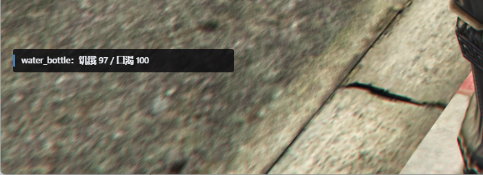

# 通知与交互提示 · UX 设计

> 横向模块：其余所有模块都通过它说话。覆盖 `custom-notify`（三层通知）、
> `custom-prompt`（交互提示）、`qb-core` 的 `QBCore:Notify`（历史通道）。

## 1. 调研（现状）

### 1.1 通道盘点（实测规模）

| 通道 | 调用点 | 外观 | 依据 |
|---|---|---|---|
| `QBCore:Notify`（带 type） | **987** | 屏幕右侧，黑底 + 左色条 + 图标 + 进度 | `T-CityLite.base/resources/[qb]/qb-core/client/functions.lua`:182 |
| `QBCore:Notify`（无 type） | **132** | 落到 GTA 原生 feed（左下） | 同上（轨 3）；2026-11-12 重扫（这次把 `TriggerClientEvent('QBCore:Notify')` 也算进来）：987 / 132 |
| `NativeNotify.Show/Advanced` | 20 | 左下黑条，可带头像 | `T-CityLite.base/resources/[qb]/qb-core/client/native_notify.lua`:95 |
| `DrawText` | 52（12 资源） | 屏幕左中，单条 | `T-CityLite.base/resources/[qb]/qb-core/client/drawtext.lua`:7 |
| `qb-target` 热区（带 label） | **19**（10 资源） | 长按 ALT 的世界物件面板，按住禁移动 | 扫描（`AddBoxZone`/`AddTargetEntity` 等） |
| `chat:addMessage` | 99 | 左上滚动历史 | — |
| 手机通知 | 14 | 手机内列表，无 toast 无音 | `T-CityLite.base/resources/[custom]/custom-phone/server/core/notify.lua`:156 |
| `custom-notify`（新） | 1（试点） | feed 左下 / toast 中央 / error 左下红（字号 12.5/12 px，见 1.3） | 本仓库新增 |
| `custom-prompt`（新） | 0（未迁移） | 准星下方单条 + 右侧 ≤3 | 本仓库新增 |

### 1.2 问题

| # | 问题 | 后果 |
|---|---|---|
| 1 | 没有"哪条消息走哪条通道"的规则 | 罚款、短信、NPC 台词、系统错误长一个样 |
| 2 | 同一件事可能同时发两条（NUI + 原生 feed） | 玩家看到重复 |
| 3 | `QBCore:Notify` 限流 **200ms/1 条** | 一次交易的第二条（"余额不足"）被静默丢掉 |
| 4 | 交互提示三套并存（DrawText / ALT 面板 / 原生 feed） | 玩家猜不到按什么 |
| 5 | 新 `feed` 字号只有原生的一半（12.5 px vs ≈25 px 等效），且写死 px 不随分辨率缩放 | 大窗口看不清；把原生通知搬过来等于可读性倒退（实测见 1.3） |

### 1.3 字号实测：原生 feed 是新 feed 的两倍

两张图取自同一次真机、同一窗口（2546×1434），截的是**同一块区域**（原像素 1:1，左下 700×254），所以字高可以直接对着量。




| 指标（窗口 2546×1434，像素 1:1 实测） | 图 A 原版 GTA 原生 feed | 图 B 现行 custom-notify feed | 倍率 |
|---|---|---|---|
| 等效字号 | **≈25 px**（整行墨迹 25 px，含升降部） | **12.5 px** title / 12 px body | **0.50×** |
| 大写高 / 汉字墨迹高 | 17–18 px（`You`、`F`） | 13 px（`饥饿`） | 0.74× |
| 行距（行顶到行顶） | 34 px | 16 px（1.3 × 12.5） | 0.47× |
| 单条高 | 87 px（2 行）/ 55 px（1 行） | 34 px（1 行） | — |
| 条宽 | 340 px（随内容） | 320 px（`width: 320px` 写死） | — |
| 字号 / 屏高 | 1.74 % | 0.87 % | **0.50×** |

三条结论：

1. **字小了整整一半**：图 B 的 12.5 px 只相当于图 A 的一半；原生那条在这个窗口下是 25 px 等效字号。
2. **缩放方向反了**：原生 feed 用的是 GTA 归一化文本单位（随分辨率缩放；本窗口实测占屏高 1.74 %），我们写死 px —— 窗口从 1080p 换到 1434p，原生不变、我们相对小掉 25 %。**这条是单窗口实测 + 引擎文本单位推断，未在第二个分辨率复核。**
3. **不能只改一个数**：条宽（`width: 320px`）、行高（`line-height: 1.3`）、`bottom: 148px` 也都是写死 px；字号放大后不同步加宽/加高，第一行就会折行。

**N-5 改完后的离线复核（A 档，2026-11-11）**：把 `T-CityLite.base/resources/[custom]/custom-notify/html/index.html` 直接在 2546×1434 视口里渲染、推两条通知后量：

| 指标 | 原生（图 A） | 现在的 feed | 判定 |
|---|---|---|---|
| 字号 | ≈25 px | title 24.4 px / body 21.5 px | ✅ 同量级 |
| 条宽 | 340 px | 341 px | ✅ |
| 左 / 底 偏移 | 18 / 148 px | 18.1 / 147.7 px | ✅ 位置没动 |
| 2 行条高 | 87 px | 78.8 px | 略紧（行高 1.3，可接受） |

真机还要复核一次（CEF 里字体渲染与浏览器有细微差别），等 PO 上线截同窗口对照图。

### 1.4 现在实际在用什么通道（2026-11-11 第二轮真机后的口径）

**PO 2026-11-12 问**：「现在是四种提示，feed 左侧和右侧都有，toast，手机提示也有对吧」。准确说是**四类宿主 + 两套遗留通道**：

| 宿主 | 位置 | 谁在渲染 | 状态 |
|---|---|---|---|
| `feed` | 左下（小地图上方 21vh） | `custom-notify` | ✅ 目标通道 |
| 右栏黑条 | 屏幕右侧 | qb-core 自带 NUI（`SendNUIMessage` → Quasar） | ✅ 2026-11-12 起被 N-1a 轨 0 接管（调用点保留，渲染走新标准） |
| `toast` | 中央偏上 16vh | `custom-notify` | ✅ 目标通道 |
| 手机通知 | 手机内列表 | `custom-notify` → `custom-phone` | ✅ 目标通道 |
| GTA 原生 feed | 左下两行（更高、20.9vh） | 引擎 | ✅ 2026-11-12 起无 type 也走 feed（轨 0），只在 custom-notify 不可用时回落 |
| `DrawText` | 屏幕左中单行 | qb-core 旧接口 | ⚠️ 53 处，N-2 要迁 |

也就是说"左侧"其实有**两种**：我们的窄条（可配字号/宽度）和 GTA 原生两行黑条（不可控）；"右侧"只有 qb-core 那一套。
最终只剩三种：`feed`（左下）/ `toast`（中央）/ `phone`（手机），右侧和原生两条在 N-1/N-2 完成后删除。

PO 的原话：「用 revive 之后还是用的原生的提示，我以为是用 feed 去实现的」。这不是 bug 而是**迁移没做完**——
`QBCore.Functions.Notify` 的三条轨还在并行，只有我们自己写的 31 处走了 `custom-notify`。

| 你在屏幕上看到的 | 实际走的是 | 调用点 | 谁还没迁 |
|---|---|---|---|
| 左下两行黑条（`You are completely healthy again!`） | GTA 原生 feed（qb-core 轨 3，无 type） | 132 处 | **复活、压力缓解、部分商店/管理文案** |
| 右侧黑条 + 左色条 + 图标 | qb-core 自己的 NUI（轨 2，有 type） | 987 处 | 大头，属于 N-1 分批迁移 |
| 左下我们的窄条（`支付 −$2 · 水 ×1`） | `custom-notify` feed | 31 处 | ✅ 已迁（吃喝、施救、任务、抢劫结算…） |
| 屏幕左中单行 | `DrawText`（qb-core 老接口） | 53 处 | N-2（12 个资源） |
| 中央偏上 | `custom-notify` toast | 31 处里的少数 | ✅ |
| 手机通知中心 | `custom-notify` → `custom-phone` | — | ✅ |

**这一轮已修的两个"以为已经是 feed 但其实是原生"的点**（都不需要等 N-1）：

| 位置 | 原来 | 现在 |
|---|---|---|
| `T-CityLite.base/resources/[qb]/qb-ambulancejob/client/main.lua`:609（复活成功） | 无 type → 原生 feed | `exports['custom-notify']:PushLocal('feed', …)`，资源缺失时回落原调用 |
| `T-CityLite.base/resources/[qb]/qb-hud/server.lua`:100（压力缓解） | `TriggerClientEvent('QBCore:Notify')` → 原生 feed | `exports['custom-notify']:Push(src, 'feed', …)`，同上回落 |

> 为什么不是"一次全改"：132 处无 type + 987 处有 type 分散在 30 个资源里，统一迁移是 N-1 的活。
> 现在按"玩家最常看见的先迁"推进：复活 → 压力 → 商店/经济 → 任务，每批带真机截图。

### 1.5 迁移清单（按模块，2026-11-12 重扫）

PO 的原话：「薪水的提示还是原版，没有迁移，所以迁移不彻底，按照模块进行搜查」。下面是**无 type（落原生轨）的 132 处**按资源分布——
这些就是"还是 GTA 两行黑条"的来源。扫描口径：`QBCore.Functions.Notify(...)` 与 `TriggerClientEvent('QBCore:Notify', ...)` 里**第二个参数不是 type 字符串**的调用。

| 资源 | 处数 | 资源 | 处数 |
|---|---|---|---|
| qb-weathersync | 22 | qb-apartments | 5 |
| custom-police | 16 | qb-houses | 5 |
| qb-core | 11 | qb-lapraces | 5 |
| qb-adminmenu | 9 | qb-prison | 4 |
| notify-test | 8 | custom-career | 3 |
| qb-crypto | 6 | qb-drugs | 3 |
| qb-hud | 6 | qb-fuel | 3 |
| qb-shops | 6 | custom-quest / qb-clothing / qb-vehicleshop / core-framework / tcity-dashboard | 各 2 |
| — | — | custom-agent-client / custom-director / custom-justice / custom-testing / qb-ambulancejob / qb-cityhall / qb-multicharacter / qb-pawnshop / qb-storerobbery / qb-streetraces | 各 1 |

**这一轮点名要迁的三处（PO 直接看到的）**：

| 位置 | 现象 | 归属 |
|---|---|---|
| `T-CityLite.base/resources/[qb]/qb-core/server/functions.lua`:441、:445 | 发薪水时"收到工资"走原生黑条 | qb-core 工资循环（`PaycheckInterval`） |
| `T-CityLite.base/resources/[qb]/qb-hud/client.lua`:470、:493、:501、:524、:634 | HUD 设置里切地图形状 / 电影模式，提示还是原生 | qb-hud 设置菜单 |
| `T-CityLite.base/resources/[qb]/qb-shops/client/deliveries.lua`:90、:222、:337 | 送货任务三段提示 | qb-shops 送货 |

> 优先级：**薪水**（每人每次发薪都看到）> HUD 设置（少数人）> 送货（少数人）> 其余 30 个资源里的长尾。
> `notify-test` 的 8 处和 `qb-weathersync` 的 22 处是测试/天气资源，先不动（它们本来就该看原生样式）。

## 2. 设计（目标）

### 2.1 通道边界（唯一判定表）

| kind | 判定条件（if 就能写出来） | 位置 | 时长 | 上限 |
|---|---|---|---|---|
| `feed` | 玩家**主动**做了动作且**成功** | 左下（小地图上方） | 5s | 4 |
| `toast` | 玩家**没主动**做但影响他 | 中央偏上 | 2.5s | 2 |
| `error` | 玩家动作**没生效** | 左下红色 | 5s | 4 |
| `phone` | 内容来自另一个玩家 / NPC / 系统凭证 | 手机通知中心 | 永久 | 50 |

### 2.2 交互提示形态

| 情境 | 形态 | 参数 |
|---|---|---|
| 面前唯一动作 | 准星下方单条 `[E] 打开商店` | 键块 + 动词，长按类带进度条 |
| 2–3 个动作 | 右侧列表 ≤3 条 | 排序：距离由近到远 |
| >3 个动作 | 只列最近 3 + `+N 更多` | — |
| 世界物件（多目标） | 右侧列表，键位统一 `ALT` | 按住时**不禁移动**（待改） |

### 2.3 禁止项

- `error` 走 toast（打断）。
- IC 内容上屏（毁世界观）。
- 同一事件双通道（重复）。
- 一个交互物件同时有 E 和 ALT（猜不到）。

## 3. 计划（任务）

| # | 任务 | 文件 | 风险 | 验收 |
|---|---|---|---|---|
| N-1 | 给 `QBCore:Notify` 加一层兼容分派：带 type 的走旧 NUI，无 type 的走新 `feed` | `T-CityLite.base/resources/[qb]/qb-core/client/functions.lua`:182 | 中（550 调用点） | 现有调用行为不变，但样子统一 |
| N-2 | 迁移 12 个资源的 `DrawText` → `custom-prompt` | 见 INDEX 阶段 A | 低 | 提示出现在准星下方 |
| N-3 | `qb-target` 收紧到"多目标专用"，单目标改 E | 19 个热区 | 中 | 单目标不再需要 ALT |
| N-4 | `custom-notify` 增加"去重"：同文本 3 秒内合并 | `T-CityLite.base/resources/[custom]/custom-notify/server/main.lua` | 低 | 连点两次只出一条 |
| N-5 ✅(2026-11-11 PO 选 A) | feed 字号对齐原生：`font-size`/`width`/内边距改按屏高屏宽（title 1.7vh / body 1.5vh / 条宽 13.4vw；底部见 N-9） | `T-CityLite.base/resources/[custom]/custom-notify/html/index.html`:24 | 低 | 同窗口截图字高 ≈ 原生 25 px（±10%）；**离线已量到 title 24.4 px / 条宽 341 px（原生 340）/ 底 147.7 px，真机截图待 PO 上线复核** |
| N-6 | **`[E] 打开商店` 闪烁**（PO 真机反馈 0-7 / 5.1）：根因在 `custom-mining` 每轮无条件 `Hide()` 抢掉别家提示（详见下方 N-6 方案） | `T-CityLite.base/resources/[custom]/custom-mining/client/main.lua`:244 | 低 | 站在柜台前 30 秒不闪；走开再回来正常出现/消失 |
| N-7 ✅ | **"复活/压力缓解还是原生提示"**：两处无 type 的 Notify 改走 feed，自带回落 | `T-CityLite.base/resources/[qb]/qb-ambulancejob/client/main.lua`:609、`T-CityLite.base/resources/[qb]/qb-hud/server.lua`:100 | 低 | 复活后左下是窄条 feed（不是 GTA 两行黑条） |
| N-8 ✅ | **`[E]` 要反复按**：`IsControlJustReleased` 在 `Wait(200)` 轮询里丢帧（松开只在 1 帧为真）→ 范围内改每帧采样 + 同文案不重发。**同类一起改**：qb-shops、custom-mining、qb-storerobbery、qb-ambulancejob 两处（施救 / 医院热区） | `T-CityLite.base/resources/[qb]/qb-shops/client/main.lua`:195-235 等 4 处 | 低 | 走近按一次 E 就生效；每帧不再重发 NUI |
| N-1a ✅ | **通知统一到新标准（轨 0 路由）**：在 `QBCore.Functions.Notify` 入口处把 type 映射成 custom-notify 的 kind，**1119 处调用点一行不改**；custom-notify 不在时 pcall 失败 → 回落原三轨 | `T-CityLite.base/resources/[qb]/qb-core/client/functions.lua`:192-215 | 中（全局行为） | 发薪 / 复活 / HUD 设置 / 商店错误 都只看得到 feed·toast·error 三种样式，右侧黑条与 GTA 原生黑条不再出现 |
| N-2a ✅ | **交互提示继续去 DrawText**：`qb-garages` 的 "E - Depot" 原来走 `qb-core:DrawText`（屏幕左中），改走 custom-prompt；custom-prompt 增加"同内容不重发"守卫（逐帧调用者不刷 NUI） | `T-CityLite.base/resources/[qb]/qb-garages/client/main.lua`:255-262、`:479`；`T-CityLite.base/resources/[custom]/custom-prompt/client/main.lua`:19-40 | 低 | 车库/房屋车库提示出现在准星下方，左侧不再有 "E - …" |
| N-10 ✅ | **商店界面打开后还显示 `[E] 打开商店`**（PO 2026-11-12）：提示层缺"UI 打开就让位"的信号 —— 给 `qb-inventory` 加只读 `IsOpen` export，`qb-shops` 在界面开着时不画提示 | `T-CityLite.base/resources/[qb]/qb-inventory/client/main.lua`:104（新增 export）、`T-CityLite.base/resources/[qb]/qb-shops/client/main.lua`:210-240 | 低 | 打开商店后提示立刻消失；关掉走开再回来才重现 |
| N-11 ✅ | **薪水 / 送货提示未迁移**（PO："迁移不彻底"）：qb-core 发薪 2 处、qb-shops 送货 13 处无 type → 原生轨，改走 feed（error 保持红条） | `T-CityLite.base/resources/[qb]/qb-core/server/functions.lua`:441、:449、:454、:462 区域、`T-CityLite.base/resources/[qb]/qb-shops/client/deliveries.lua`:1-10（helper） | 低 | 发薪是左侧窄条；送货到点/交差/返程都走 feed |
| N-12b ✅ | **电影模式 on/off 分居两侧**（PO 2026-11-12）：`cinematic_off` 还带 `'error'` → 右侧 qb-core NUI，`cinematic_on` 已走 feed → 左侧，看着像"左右各弹一个"。两条统一走 feed | `T-CityLite.base/resources/[qb]/qb-hud/client.lua`:640-647 | 低 | on / off 都只在左下 feed |
| N-12 ✅ | **HUD 设置提示未迁移**：`qb-hud` 五处（地图形状 / 电影模式）无 type，改走 feed | `T-CityLite.base/resources/[qb]/qb-hud/client.lua`:470、:493、:501、:524、:634（新增 `HudNotice`） | 低 | 切地图形状 / 开电影模式都是 feed 窄条 |
| N-9 ✅ | **feed 压小地图**：`bottom` 10.3vh → 21vh（原生通知块实测底边 20.9vh，小地图占底部约 19.8%） | `T-CityLite.base/resources/[custom]/custom-notify/html/index.html`:28 | 低 | 同屏截图里 feed 在小地图上方，不叠 |

N-5 的三个候选（**2026-11-11 PO 拍板 = A**，B/C 留档）：

| 方案 | title / body | 条宽 / 底部偏移 | 1434p 实际 | 1080p 实际 | 评价 |
|---|---|---|---|---|---|
| **A 对齐原生 ✅选定** | 1.7vh / 1.5vh | 13.4vw / 10.3vh | 24.4 / 21.5 px、341 px | 18.4 / 16.2 px、257 px | 与图 A 同量级，随分辨率缩放；纯 CSS 改动 |
| B 折中写死 | 18 / 16 px | 340 px / 148 px | 18 / 16 px | 18 / 16 px | 一行改完，但 2K/4K 下仍偏小 |
| C 不动 | 12.5 / 12 px | 320 px / 148 px | 12.5 px | 12.5 px | 只有"重要消息留原生"时成立；N-1 正要把约 110 条搬进来，不成立 |

### 3.1 N-6 方案（与 CC 联审，2026-11-11）

**根因（更正第一版判断）**：不是"每 200 ms 重发同一条"造成的 —— 同内容重发在 CEF 里视觉惰性
（同串 `textContent` 重绘同像素、`classList.add('on')` 对已存在类无操作、hold=0 时进度条恒 0、
`fadeIn` 只在 `display:none→flex` 时重放）。真正的写者是**另一个资源在无条件抢 Hide**：

- `T-CityLite.base/resources/[custom]/custom-mining/client/main.lua`:244-245 —— 不在矿点/冶炼炉时每轮（`sleep=800`）都执行
  `exports['custom-prompt']:Hide()`，把商店每 200 ms 重新 Show 的提示打掉，形成约 0.8 s 一次的"灭—亮"。

同类资源都是"谁 Show 谁 Hide"，只有 custom-mining 少了 flag：

| 资源 | 守卫 |
|---|---|
| `qb-shops` | `shopPromptShown`（`:193`、`:222-224`） |
| `qb-storerobbery` | `safePromptShown`（`:155-159`） |
| `qb-ambulancejob` | `revivePromptShown` / `emsZoneShown`（`:648-649`、`:707-708`） |
| `qb-management` | `shownBossMenu` / `shownMenu`（`:255-259`、`:546-553`） |
| `custom-mining` | **没有** ← 缺陷 |

**修法（最小 diff，照抄上面四家的形状）**：`T-CityLite.base/resources/[custom]/custom-mining/client/main.lua`:211 起加本地 flag，只 Hide 自己 Show 过的
（`local promptShown = false` → Show 时置真 → `elseif promptShown then Hide(); promptShown = false`）。

**不做（记债务）**：在 `custom-prompt` 里加"内容未变不发"/接收端去重都碰不到异地 Hide，还会把"Hide 后同内容再 Show"变成常隐。
根治要引入 owner 模型（`Hide` 只对 Show 过的资源生效），那会改 12 个调用方的 API，属于 L3，单列。

**验收**：1) 柜台前站 30 秒不闪、走开再回来正常；2) 矿点/冶炼炉 Show 与按 E 触发不变；3) **[双]** 另一玩家在采矿循环里跑动时，
商店/警察/医护提示不再被打掉。

### 3.3 提示层规整方案（与 CC 联审，2026-11-11 夜）

目标：把"谁能发、发到哪、谁能 Hide"收成一处，且**不改 485 个 `QBCore.Functions.Notify` 调用点**。分三步，每步可独立验收。

**(1) 锚点（四个宿主）** —— 已按此值落地（与 CC 独立算出的数一致）：

| 宿主 | 锚点公式 | 2546×1434 | 1920×1080 | 依据 |
|---|---|---|---|---|
| feed | `left 1.26vh`、`bottom 18.9vh（原生雷达）+ 1.2vh` | 18 / 301 px，宽 340 | 14 / 227，宽 256 | 原生雷达 `0.150×0.188888`（`T-CityLite.base/resources/[qb]/qb-hud/client.lua`:458-464，默认 `hud_native_map=1`） |
| toast | `top 16vh`（居中） | 229 | 173 | 中央偏上，避开准星 |
| error | 与 feed 同一宿主，`priority=100` 不参与 4 条淘汰 | 18 / 301 | 14 / 227 | `custom-notify` 的 `renderFeed` 同时渲染 feed/error |
| prompt | `top 50% + 6vh`；右侧列 `right 1.6vh` | 803 / 右 23 | 605 / 右 17 | HUD 环在底部中央（`T-CityLite.base/resources/[qb]/qb-hud/html/styles.css`:188-192），只需避雷达 |

> 注：雷达高度代码上是 **18.9%** 屏高（`0.188888`），我按截图像素量到 19.8%（含遮罩边缘）。21vh 两边都避开，不纠结这 1%。

**(2) 管理：token / owner / priority（保留旧签名）**

| 现状问题 | 改法 |
|---|---|
| `Show/Hide` 没有归属，谁都能 Hide 别人（N-6 那类事故的根） | `Show(opts)` 返回 **token**；`Hide(token)` 只删自己的；`Hide()` 旧调用只清 legacy 槽（不动别人的） |
| 同一处多个资源抢显示 | 槽内 `priority` 高者显示；同 owner 同 label 只更新 seq，不新增 |
| 485 个 `Notify` 调用点要统一却没精力改 | 只改 **`T-CityLite.base/resources/[qb]/qb-core/client/functions.lua`:182** 一处：按 type 映射 kind（success→feed / error→error / warning·police·ambulance→toast），走 `PushLocal`，失败回落到原轨 |

迁移顺序：① `custom-prompt` 加 token/owner/priority（旧 `Hide()` 兼容），拿"采矿无条件 Hide 打商店"做回归；
② `qb-core:182` 单点路由（失败回落），随后按资源把 `DrawText` / `NativeNotify` 移到 `PushLocal`/`Await`；
③ 删 qb-core 右栏 NUI、`drawtext.lua`、`native_notify` 导出，加静态闸门。

废 / 留：废 `DrawText`（53 处）、直呼 `NativeNotify`（11 处）、qb-core Quasar 右栏；留 `QBCore.Functions.Notify` 签名、
`QBCore:Notify` 事件、`exports['custom-notify']`；`tcity:notify` 降为内部事件。

**(3) E 键：收敛到 `custom-prompt` 的 `Await(opts)`**

```lua
-- Show(opts) -> token / Hide(token) / Await(opts) -> boolean
-- Await 内部：提示显示期间 Wait(0) 采样，hold>0 时用 IsControlPressed 计时，超时返回 false
```

只有 `custom-prompt` 同时知道 token、priority、hold；N-8 现在把 `Wait(0)` 抄在 4 家资源里，再抄 owner/hold 必然分叉。
配套要把 NUI 的进度条从"Show 即启动"改成 `holdStart=true` 才启动（`T-CityLite.base/resources/[custom]/custom-prompt/html/index.html`:78-83）。

**债务 / 未取证**：

- `GetInvokingResource` 在**客户端**没有证据（仓库只证明了服务端 export），所以 owner 只能由调用方显式传一行 `owner=GetCurrentResourceName()`；
- `PushLocal` 目前不收 `caption`，table 格式的通知会丢标题（`functions.lua`:188-191），路由前要补；
- 1080p 下小地图实际占比没量过，表里按 18.9% 等比；
- 自定义圆图（`setr hud_native_map 0`）雷达高度 29.58%，feed 得抬到 31vh —— 默认关闭，先不处理。

## 4. 验收（步骤）

1. F8 执行 `/notifytest feed|toast|error`（`setr notify_dev 1`）：三条分别落在左下/中央/左下红；
2. 吃一个食物：左下 feed 出现"水：饥饿/口渴"且 HUD 圆环同步；
3. 走到商店：只有一条 `[E] 打开商店`；
4. 钱不够时购买：左下红条，**无**中央 toast；
5. 连点两次购买按钮：只出现一条 feed（去重生效）。
6. 同窗口截一张原生通知 + 一张 feed（同一区域，1:1）：feed 字高应≈原生（现测 12.5 px vs 25 px，未对齐，见 1.3）。

## 5. 已知未决

- `QBCore:Notify` 的 550 个调用点迁移策略（一次性改完 vs 按模块分批）—— 目前选分批；
- `qb-target` 的"按住禁移动"是否可配置（影响 19 个热区的操作手感）；
- `chat:addMessage` 的 99 处是否要收进 `feed`（管理公告例外）；
- **feed 字号取哪一档**（1.3 实测原版是新 feed 的 2 倍）：A 按屏高 1.7vh 对齐原生 / B 写死 18 px / C 维持现状 —— 建议 A，等 PO 看过两张图后拍板；
- 原生 feed 与 feed 是否该长得一样（原生是 GTA 位图字体、我们的可换字体/字重）—— 只对字号/位置，不对字体。
