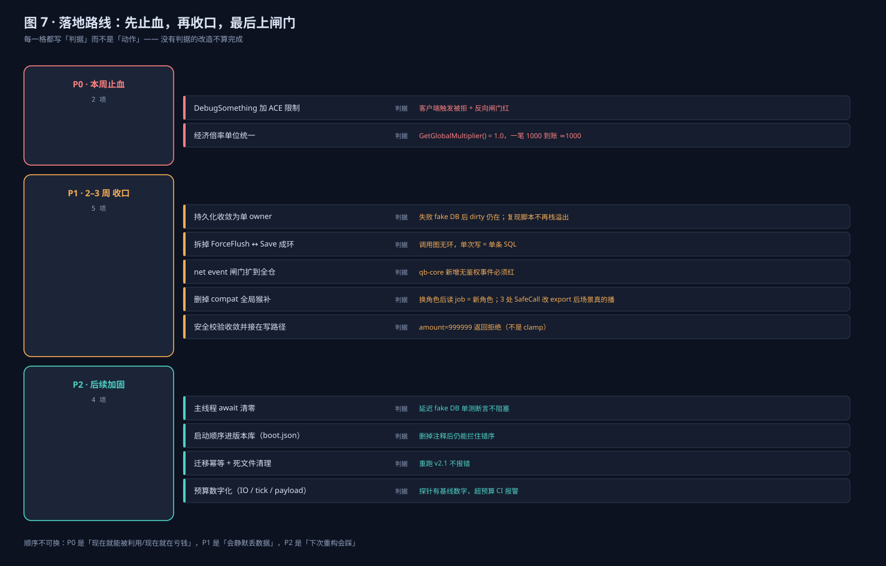

# 2026-11 基石加固计划（P0 / P1 / P2）

> **类型**：plan（什么时候做什么） ｜ **判据优先**：每项都写"怎么算做完"，不写"我做了"
> **依据**：`docs/engineering/STANDARDS.md`（TS-1…TS-13）与 `docs/engineering/FOUNDATION-AS-IS.md` 的实测缺口
> **执行方式**：Hermes 开发 → Claude Code 独立验收（只读，逐条打勾或打叉）

## 0. 范围与非目标

**做**：把钱、存档、事件三条主链路的正确性缺口补上，并把闸门范围推到与标准一致。

**不做**：不重写业务资源、不动 `[qb]` 的目录结构、不在本阶段引入新表、不追求 128 槽压测。

## 1. 阶段总览

| 阶段 | 时长 | 目标 | 出口判据 |
|---|---|---|---|
| **Step 0 前置** | 立刻 | 恢复工作树 git 元数据（`E:/T-City` 目录当前缺失，分支/提交/回滚/`release_check` 密钥扫描全部失效） | `git status` 可用；`release_check.py` 能扫到跟踪文件 |
| **P0 止血** | 本周 | 现在就能被利用 / 现在就在算错钱的两处 | 两个 P0 判据全绿 + 闸门反向用例 + 改动前的红输出留档 |
| **P1 收口** | 2–3 周 | 存档单写者、闸门扩面、死代码清除 | 覆盖率数字上升 + 真机判据 |
| **P2 加固** | 后续 | 预算数字化、启动可复现、迁移幂等 | 探针有基线、重跑迁移不报错 |

## 2. P0（本周，2 项）

### P0-1 引擎层无鉴权的日志写入口

| 项 | 内容 |
|---|---|
| 问题 | `QBCore:DebugSomething` 是 `RegisterServerEvent`，`tbl` / `indent` / `resource` 全由客户端给，服务端直接 `print`。任意客户端可无限刷控制台、用深层表放大内存与 IO。 |
| 证据 | qb-core/server/debug.lua:28-32；同文件 :234-243 已硬阻断三个废弃物品事件，说明作者知道这类风险 |
| 改动面 | 1 个文件（qb-core/server/debug.lua），仅加守卫与 `indent` 上限，不改对外签名 |
| 规则 | 只允许控制台（`source == 0`）与持有 `qb.debug` ACE 的玩家；`indent` 钳到 8 |
| 测试 | 新增 `tests/architecture/test_engine_event_guards.py`：静态断言守卫与钳制存在；**反向用例**：喂一个剥掉守卫的副本必须判红 |
| 真机判据 | 客户端 `TriggerServerEvent('QBCore:DebugSomething', {}, 50)` 后控制台无输出；服务端 `QBCore.Debug` 仍可打印 |
| 回滚 | 单文件 revert，无数据影响 |

### P0-2 经济倍率单位二义

| 项 | 内容 |
|---|---|
| 问题 | 同一个 convar `economy_reward_scale` 被两套单位读取：整数读者按 `/100`（core_economy、qb-shops、economy-dashboard），浮点读者直接当倍率（custom-economy）。cfg 里写的是 `1.0`，至少一边必然错，最多可差 100 倍。 |
| 证据 | core_economy/server/main.lua:116；qb-shops/server/main.lua:41；economy-dashboard/server/main.lua:211；custom-economy/config.lua:25；configs/modules/economy.cfg:5 |
| 决策 | 统一为**浮点倍率**（`1.0 = 1x`），因为它与 cfg、文档、自定义配置三处一致；整数百分号写法在本仓没有被任何写入方使用 |
| 改动面 | 3 个读取点改为 `GetConvarFloat`、1 处 cfg 注释写明单位、`getGlobalMultiplier` 加可测边界；**外加运维面**：`T-CityLite.base/docs/DELIVERY_MANUAL.md` 里 `/100` 的公式说明与 `80 / 120` 的示例命令（不迁移就会把「打八折」执行成「80 倍」） |
| 测试 | 新增 `tests/unit/layer1_core/test_economy_multiplier.py`：用 Lua 沙箱加载真实文件（stub `exports` / `CreateThread` / convar），断言 `1.0 → 1.0`、`0.8 → 0.8`、未设置 → `1.0`、`0` 或负数 → `1.0` |
| 真机判据 | 固定 heat=1、bonus=1、倍率=1.0 后，`baseReward=1000` 的钱包 delta 精确 `+1000`；`exports['core_economy']:GetGlobalMultiplier()` 返回 `1.0` |
| 回滚 | 三行读取点 revert，无数据影响 |

## 3. P1（2–3 周，5 项）

> 顺序按 Claude Code 复核调整：**先拆环，再收口**。环就在待收敛的那个池里
> （`persistence_manager.lua` 的 ForceFlush 调 `Player.Functions.Save(true)` 后无条件清脏），
> 先合并 owner 会把递归接到唯一写者上；且 P1-1 的「失败保留 + ack」依赖 P1-2 的返回值。
>
> **2026-11-01 更新**：P1-2 与 P1-1 已落地（存档收敛到 qb-core 的 `Store`，delegate 无池 / 无定时器 / 不回调 Save），
> 红绿输出与真机证据见 `docs/engineering/2026-11-foundation-p1-evidence.md`；P1-3 / P1-4 / P1-5 未开始。

| # | 任务 | 判据 | 状态 | 主要风险 |
|---|---|---|---|---|
| P1-2 | **先做**：拆掉 `ForceFlush → Save(true)` 这条环，改为 `Store.SaveNow(player, reason)` | 等价复现脚本从 stack overflow 变单次写 | ✅ 2026-11-01（evidence §2→§3） | 与 qb-core 上游 `Save` 语义耦合 |
| P1-1 | **后做**：存档收敛为单一 owner：一个池、一个定时器、失败保留 + 退避 + ack | 失败 fake DB 后 dirty 仍在且 `failed_flushes` 增长；停服刷盘有 ack | ✅ 2026-11-01（evidence §1、§4） | 停机时阻塞刷盘可能拖慢关服 |
| P1-3 | net event 闸门扩到 qb-core 与全仓，存量按三批登记 | 分三批：① 引擎层（qb-core）100% ② `[custom]` ≥ 80% ③ `[qb]` 登记为带 `expires` 的债务。**基线 JSON 提交入库**，预算只许非增 | 🟡 2026-11-01 第 1 步：基线入库 + ① 100%（15/15）+ ③ 59 个资源登记；② 48%（64/134）未达 80%，见 `docs/engineering/2026-11-foundation-net-events-baseline.md` | 全仓 1102 次注册、918 个未覆盖，一次性 ≥80% 不现实，必须分阶段 |
| P1-4 | 删掉 compat 的全局猴补，缓存收回框架内部 | 离线单测：换角色后同 tick 读 job 得新值；静态断言 compat 不再赋值 `QBCore.Functions.GetPlayer`；3 处 `Bus.SafeCall` 改 export 且含 `GetResourceState` 守卫 | ⬜ 未开始 | **实测 988 处 / 185 文件**引用 `QBCore.Functions.GetPlayer`（含测试 mock），必须连测试基础设施一起迁移，不能一刀切 |
| P1-5 | 安全校验收敛一份并接进写路径（拒绝语义，不是 clamp） | `amount=999999` 返回拒绝；5,000,000 上限只剩一处 | ⬜ 未开始 | 拒绝语义可能打断现有业务流程 |

## 4. P2（后续，4 项）

| # | 任务 | 判据 |
|---|---|---|
| P2-1 | 主线程 `Citizen.Await` 清零（patron_service 优先） | 延迟 fake DB 单测断言不阻塞 |
| P2-2 | 启动顺序进版本库（boot.json → cfg 生成 + 依赖先于使用闸门） | 删掉顺序注释后闸门仍能拦住错序 |
| P2-3 | 迁移幂等 + 版本号唯一（现存 v3.11 / v3.12 各两条重号） | 重跑全部迁移不报错；重号被判红 |
| P2-4 | 预算数字化（IO/min、tick 阻塞、payload 字节） | 探针输出基线数字，超预算 CI 报警 |

## 5. 交付标准（DoD）

一次改动只有同时满足下面七项才算交付：

1. **代码**：改动面之外零 diff；`[qb]` 下遵循最小 diff 原则。
2. **测试**：先红后绿——**改动前的红输出要留档**（贴进 PR 或本条目的验证段），否则无法证明测的是新代码；
   新增闸门必须有反向用例；`pytest tests/unit tests/architecture` 全绿。
3. **文档**：`CHANGELOG.md` 有条目；受影响的手册/施工图同步；标准页与图纸不出现断链。
4. **闸门**：`release_check.py` 通过；闸门被放宽时必须在 PR 描述里写 `gate-change:` 与理由。
5. **闸门不许自我放宽**：`net_events_allowlist` / `query_allowlist` / `gate_coverage_budget.json` 的 diff
   必须是"条目减少或预算下降"；新增债务必须带 `owner` + `expires`，由 CI 校验而不是靠人看。
6. **配置与语义变更要有回滚演练**：改单位/改默认值这类变更，必须同一批里给出"改动前后的实际取值"
   （`server.cfg` 是 gitignored，只有运行时才能证明），并写清回滚命令。
7. **验收人可复现**：判据必须是"只读能复现"的形状（离线测试或带时间戳的控制台 transcript）；
   需要玩家在线的判据要显式标注，不能默认验收人能做到。

## 6. 验收方式（Claude Code 独立验收）

每阶段结束跑一次只读验收，输入是**判据**而不是改动说明，逐条给 `通过 / 不通过 / 未验证`：

1. 按判据表逐条复核代码与测试，指出证据位置（`path:line`）。
2. 反向验证：亲手构造一个错误形状，确认对应闸门会红。
3. 检查有没有"为过闸门而改闸门"：对比闸门文件与 allowlist 的 diff。
4. 输出一张表 + 一句结论；不通过项必须给最小修复建议。

## 7. 风险与依赖

| 风险 | 处理 |
|---|---|
| 工作树 git 元数据目录（`E:/T-City`）当前缺失，分支/提交无法执行 | 先恢复仓库元数据再提交；本阶段所有改动先留在工作树并逐条登记 |
| 热更新期间改 `core_economy` 会让进行中的奖励计算中断 | 改动后 `restart` 对应资源并复跑真机判据 |
| 闸门扩面会产生大量存量登记 | 分三批 + `expires`，预算只许下降 |
