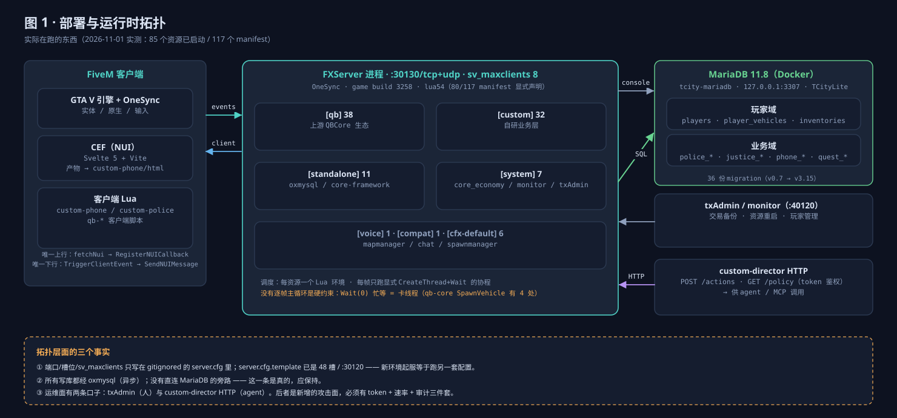
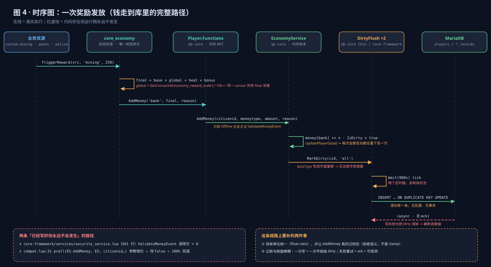
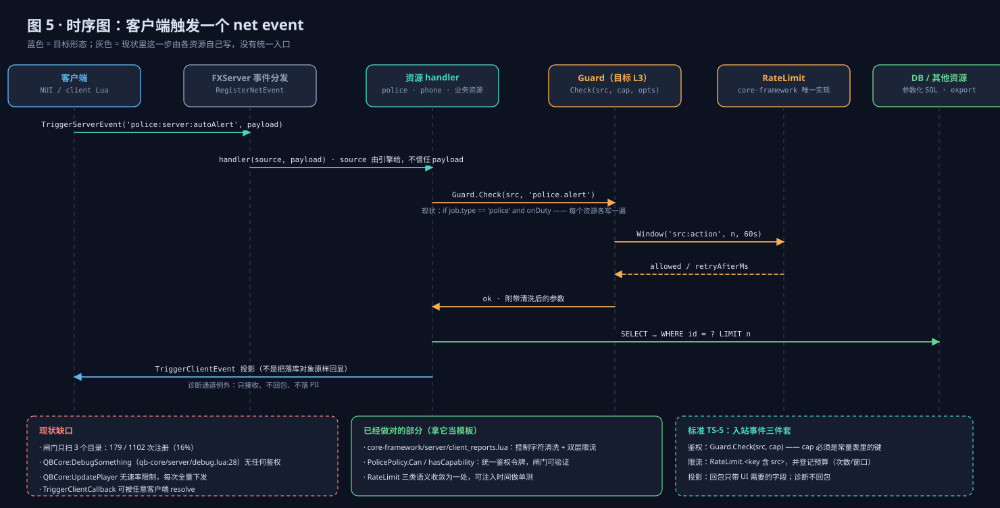
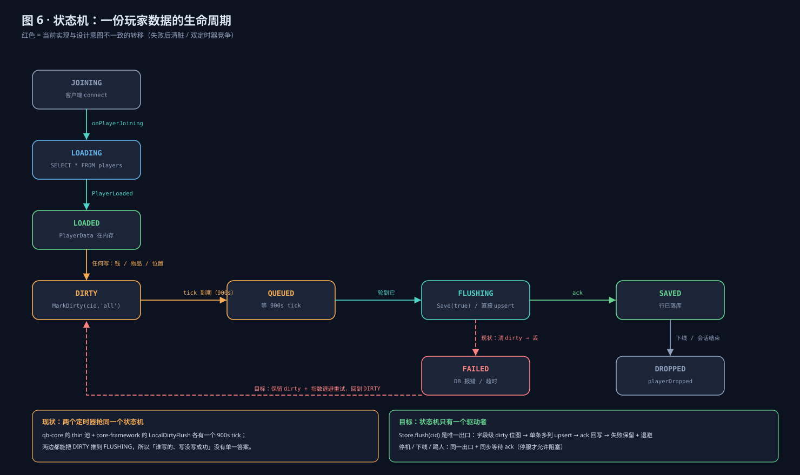
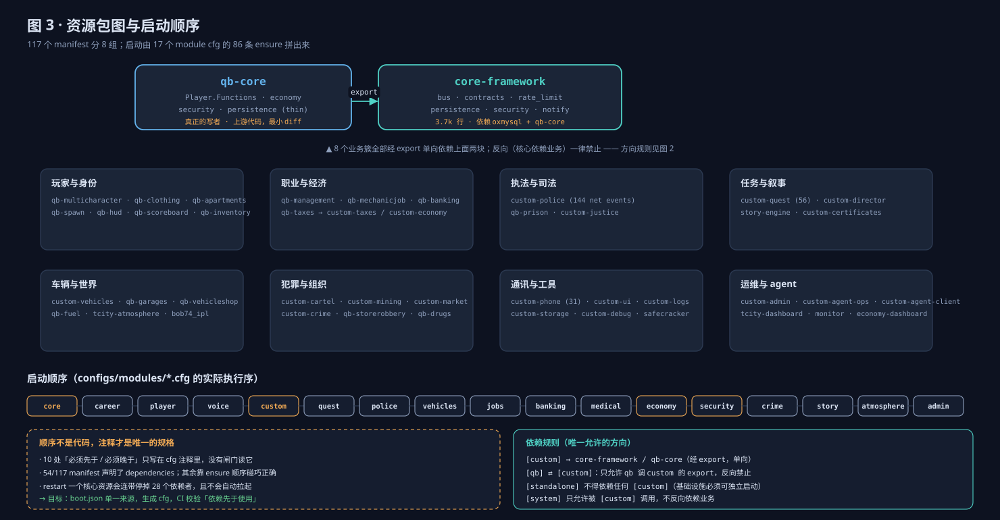

# 基石现状（AS-IS）— 组件、三条主链路、已知缺口

> **类型**：manual（描述现在是什么，跟随代码，90 天复审）
> **数据时点**：2026-11-01 本机实测（FXServer 8 槽、85 个资源在跑、117 个 manifest）
> **配套**：目标形态见 `docs/engineering/FOUNDATION-TO-BE.md`，施工顺序见 `docs/engineering/2026-11-foundation-plan.md`

## 1. 部署拓扑

| 面 | 实体 | 入口 |
|---|---|---|
| 客户端 | GTA V + CEF（Svelte 5，产物进 custom-phone 的 html/） | `fetchNui` → `RegisterNUICallback` |
| 服务端 | FXServer `:30130`，`sv_maxclients 8`，OneSync，lua54（80/117 manifest 显式声明） | net event / export / 命令 |
| 数据 | MariaDB 11.8（Docker，`127.0.0.1:3307`），oxmysql 异步驱动 | 参数化 SQL |
| 运维 | txAdmin / monitor、custom-director 的 HTTP（`/actions`、`/policy`，token 鉴权） | 人工与 agent 两条口子 |

配置现实：端口、槽位、license、DB DSN 只写在 gitignored 的 server.cfg（不入库，CI 里不存在）；
`server.cfg.template` 已是 48 槽 / `:30120`，与实跑漂移。

## 2. 组件清单

| 层 | 文件（资源内相对路径） | 行数 | 状态 |
|---|---|---|---|
| 服务总线 | core-framework/bus.lua | 231 | 每资源 include 一份的私有注册表，不是跨资源总线 |
| 契约占位 | core-framework/contracts.lua | 214 | 5 个 Phase2-3 服务返回常量 |
| 经济便利层 | core-framework/services/economy_service.lua | 168 | 与 qb-core 的同名实现并存 |
| 安全 | core-framework/services/security_service.lua | 561 | 运行期调用方 0（只有 export 与注册） |
| 限流 | core-framework/server/rate_limit.lua | 163 | 三类语义收敛，实现正确 |
| 持久化 | `T-CityLite.base/resources/[qb]/qb-core/server/services/persistence_manager.lua`（Store） + `T-CityLite.base/resources/[standalone]/core-framework/services/persistence_manager.lua`（delegate） | 432 / 135 | **单写者**：Store 持有唯一脏池、定时器、写库语句；delegate 只转发（2026-11-01 起） |
| 兼容层 | core-framework/compat.lua | 124 | 全局猴补 `QBCore.Functions.GetPlayer/Notify/AddMoney` |
| 奖励网关 | [system]/core_economy/server/main.lua | 279 | 热度只存内存；倍率单位与读者冲突 |
| 玩家账本 | qb-core 的 player.lua + services/economy_service.lua | ~1600 | **真正生效的写者** |

## 3. 三条主链路

### 3.1 钱（奖励发放）

要点：`TriggerReward` → `Player.Functions.AddMoney` → qb-core 的 `EconomyService` → 内存 + 事件 → DirtyFlush。
两处**已写好但运行期不发生**：框架版 `ValidateMoneyEvent` 零调用；`compat.lua` 的 AddMoney 参数错位恒回退。
倍率单位二义：整数读者（`core_economy`、qb-shops、economy-dashboard 都按 `÷100`）与浮点读者
（custom-economy 的 `RewardScale`）共用 `economy_reward_scale`，而 cfg 写的是 `1.0`。

### 3.2 事件（客户端触发）

要点：`RegisterNetEvent` → 资源 handler → 各资源自己判职业 → 参数化 SQL → 投影回包。
现状（2026-11-01 起）：扫描器 `net_event_scan.py` 覆盖全仓 441 个服务端事件；
引擎层（qb-core 15 个）100% 已鉴权或登记，其余按资源登记为带 `expires` 的债，
新增未鉴权事件由基线棘轮拦下。已修：`QBCore:DebugSomething` 的 ACE 守卫、
`TriggerClientCallback` 的归属校验（只允许被问的玩家回答）。仍欠：`QBCore:UpdatePlayer` 无限流；
`[custom]` 覆盖率 64%（86/134，目标 80%）。

### 3.3 数据（玩家存档）

要点：脏池、定时器、写库语句都只在 qb-core 的 `Store` 一份（2026-11-01 起）。
刷盘走 `Store.SaveNow`：**成功才清脏**，失败保留 + 指数退避 + `failed_flushes` 计数，
停服/资源停止刷盘返回 ack（`attempted / ok / failed / duration_ms`）。
core-framework 的 `persistence_manager.lua` 已降级为 delegate —— 不再持有脏池、不再起定时器、
不再回调 `Player.Functions.Save(true)`。那条 `ForceFlush → Save(true) → ForceFlush` 的环
曾在同一个 Lua state 里复现 399,964 层栈溢出，现在由 `tests/unit/layer1_core/test_persistence_single_owner.py` 钉住。
仍缺：字段级 dirty 位图与幂等键（见 STANDARDS TS-6）。

## 4. 资源分组与启动

117 个 manifest 分 8 组；启动由 17 个 module cfg 的 86 条 ensure 拼出来，10 处"必须先于/必须晚于"
只写在注释里，没有任何闸门读它。

## 5. 已知缺口（按证据排序）

| 缺口 | 实测 | 影响 |
|---|---|---|
| ~~持久化所有权分裂~~（2026-11-01 已修） | 单池 / 单定时器 / 失败保留 + 退避 + ack | 剩余：字段级位图、幂等键 |
| ~~net event 治理~~（2026-11-01 起有基线） | 引擎层 15/15 已覆盖；全仓 441 个服务端事件入基线，317 个未登记按资源登记债务 | `[custom]` 64% < 80%，到期 2027-03-31 |
| 安全防火墙不在路径上 | 561 行零调用 | 钱路径只剩"调用方自觉" |
| 经济倍率单位二义 | 3 个整数读者 + 2 个浮点读者 | 商店价与奖励可能差 100 倍 |
| NUI 回调无闸门 | 218 处 / 34 文件 | 客户端消息信任边界缺失 |
| 迁移不幂等 / 版本重号 | v3.11、v3.12 各两条 | 重跑迁移会中断 |

修法与顺序见 `docs/engineering/2026-11-foundation-plan.md`。
