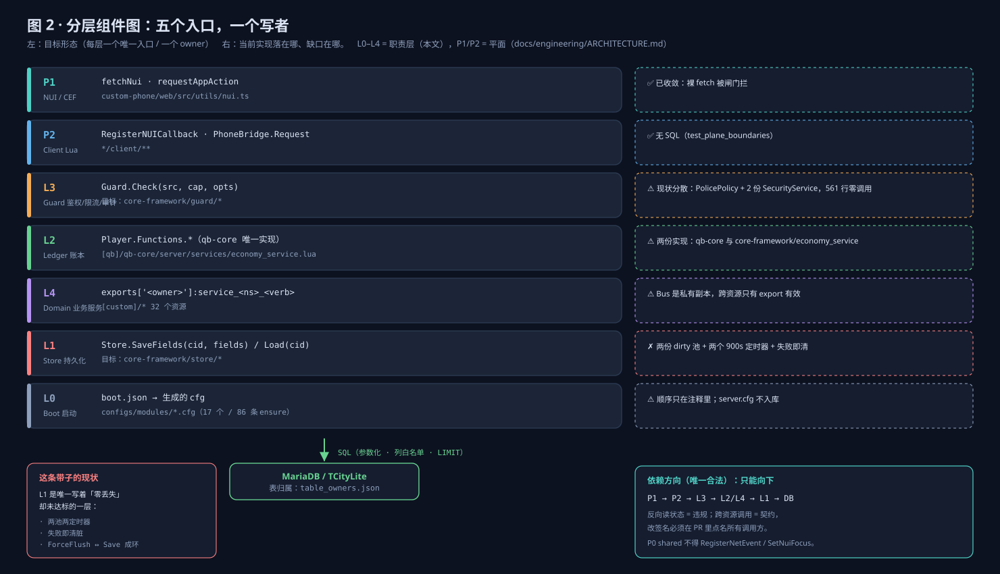

# 基石目标形态（TO-BE）— 五层、单写者、可验收的预算

> **类型**：spec（要做什么、怎么验收） ｜ **现状对照**：`docs/engineering/FOUNDATION-AS-IS.md`
> **规范条文**：`docs/engineering/STANDARDS.md`（TS-1…TS-13）

## 1. 一张图

五层、每层一个唯一入口、每层一个 owner。依赖只能向下，跨资源只走 export。

| 层 | 唯一入口 | owner | 替换掉的东西 |
|---|---|---|---|
| L0 Boot | `boot.json` → 生成的 cfg | 运维 | 17 个 cfg 里散落的 86 条 ensure 与 10 条注释 |
| L1 Store | `Store.SaveFields` / `Store.Load` | core-framework | 两套 persistence_manager |
| L2 Ledger | qb-core `Player.Functions.*` | qb-core | core-framework 的第二份 economy_service |
| L3 Guard | `PolicePolicy.Can` + `RateLimit.*` | core-framework | 各资源手写的职业判断、561 行死防火墙 |
| L4 Domain | `exports['<owner>']:service_<ns>_<verb>` | 各业务资源 | `Bus.SafeCall`（跨资源不可达） |

## 2. 三条硬规则

1. **一份数据一个写者。** 表与内存状态都只有一个 owner；跨资源写必须走 owner 的 export。多写者要登记。
2. **跨资源只走 export。** 调用前三件事：`GetResourceState` 判定、`pcall` 包裹、错误码返回。
   Lua export 是同步调用，**没有超时**；超时只发生在事件请求/响应门面上。
3. **入站事件三件套。** 鉴权（cap 必须是常量表里的键）、限流（key 含 `src`，预算可查）、投影（只回 UI 字段）。

## 3. 性能预算（写进数字，8 → 48 槽）

| 指标 | 预算 | 观测方式 |
|---|---|---|
| 每玩家 DB 写 | ≤ 1 次 / 分钟（非强制）+ 下线 1 次 | oxmysql 调用点计数 |
| 单次刷盘阻塞 | < 50ms（8 人批），< 5ms / 人 | `GetGameTimer` 差值 |
| 单事件 payload | ≤ 1 KB；全量 PlayerData 下发做 100–250ms 合并 | 出站封装处计数 |
| 主线程同步等待 | 0 处 `Citizen.Await` 在热路径 | 静态扫描 + 运行时探针 |
| 忙等 | 所有 `Wait(0)` 循环必须有 deadline | 静态扫描 |

## 4. 数据流的目标形态

- 写：`Domain → Ledger（钱/物品）→ Store.MarkFields(cid, {money=true})`，不直接碰 SQL。
- 刷：`Store.flush(cid)` 是唯一出口，字段级位图 → 单条多列 upsert → **成功才清位** → 失败退避重试。
- 停机：同一出口 + 同步等待 ack（只有停服允许阻塞）。
- 重放：写动作带幂等键，`TriggerReward` 重复调用不双发。

## 5. 目标资源分组

8 个业务簇全部经 export 单向依赖 core-framework / qb-core；`[standalone]` 不得依赖任何 `[custom]`。

## 6. 验收方式

每个阶段结束后必须同时满足：

1. `pytest tests/unit tests/architecture` 全绿，且新增闸门有反向用例（喂错误形状必须红）。
2. 覆盖率数字只许上升：net event 闸门与 SQL 闸门的扫描范围按棘轮扩大，登记为债务的条目带 `expires`。
3. 真机判据逐条可复现（例如奖励到账 ≈ 基础值 × 倍率、换角色后读到的 job 是新角色的）。
4. `CHANGELOG.md` 有对应条目，`release_check.py` 通过。

路线与阶段划分见 `docs/engineering/2026-11-foundation-plan.md`。
