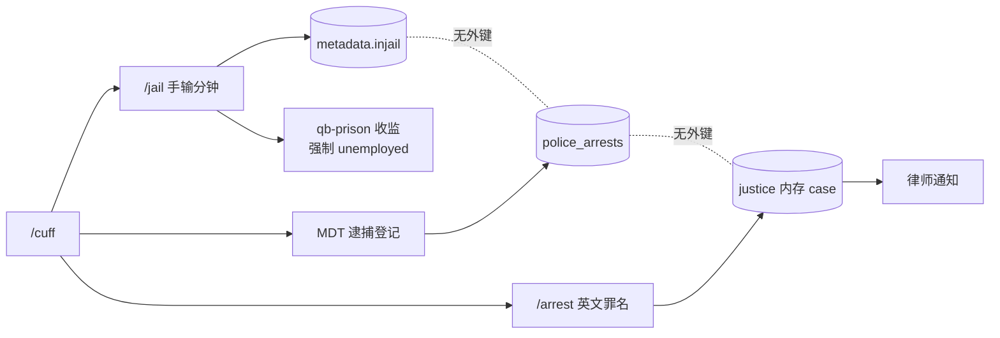

# T-City 警察 / 罪犯 / 律师 流程审计（FLOW_INTERNAL）

> 内部流程审计，**只读**。基线 `master @ 4603d4b`（2026-10-24），代码未改动。
> 证据统一写作 `路径:行号`（相对 `T-CityLite.base/resources/`）；未写资源前缀的 `server/*.lua`、`client/*.lua`、`shared/*.lua` 均指 `custom-police/`。运行期旁证取自 `/tmp/fxserver.log`（30120 在跑，在线 1 人）。
> 相关文档：[STATUS.md](STATUS.md)（已交付能力）、[DESIGN.md](DESIGN.md)（目标态）、[audit-current.md](audit-current.md)（**历史审计，早于 P0–P3，结论已过期，勿引用其"零持久化"结论**）。

**计数口径**：一步 = 一次点击 / 一条命令 / 一次表单提交；不含跑图、等待、RP 对话。共用的"上勤 + 开手机"计入每条流程。

---

## 0. 一页结论

| # | 结论 | 证据 |
|---|---|---|
| 1 | 三条流程里**只有"警察→监狱"能端到端跑通**；罚单收不到钱，法庭/律师零入口 | §3 B1、B2 |
| 2 | 一次逮捕要**录 3 遍**：`/jail` 手输刑期、MDT 逮捕登记、`/arrest` 注册案件，三处互不链接 | `custom-police/server/interactions.lua:131`、`custom-police/server/p3_cases.lua:145`、`custom-justice/server/arrest.lua:11` |
| 3 | 罚单通知里**没有罚单号**，手机**没有付款页**，唯一入口 `/paycitation <id>` —— 平民不知道 id，等于死路 | `server/p1.lua:58`、`custom-phone/client/main.lua:870` |
| 4 | 出狱后职业被强制改成 `unemployed`，**无任何恢复路径**（只有管理员 `police_release`） | `qb-prison/server/main.lua:11-14`、`server/p2_system.lua:114` |
| 5 | 警察**不能自己建警情**：手机 911 只发通知，MDT 没有"建单"动作，唯一写入口是平民 `/911` | `custom-phone/server/main.lua:953-978`、`server/apps/police_mdt.lua:130-221` |

**建议走方案 B（平衡）**，先做 3 件事：一次逮捕录入、出狱恢复职业、罚单闭环。详见 §5、§6。

---

## 1. 三条角色流程

### 1.1 警察：巡逻 → 接警 → 逮捕 → 入狱（12 步）

| # | 谁操作 | UI / 命令 | 数据表 | 能跳过？ | 强扮演？ | 依据 |
|---|---|---|---|---|---|---|
| 1 | 警察 | 警局站点 3D 文本 `[E]` 上勤 | `players.job.onduty`、`police_units` | 否（MDT 需 onduty） | 弱 | `custom-police/client/job.lua:509-521`、`server/p0.lua:242-256` |
| 2 | 警察 | 手机动态 App「🛡️ MDT」 | — | 否（唯一接警 UI） | 弱 | `custom-phone/server/apps/police_mdt.lua:30-34`、`server/phone_apps.lua:34-48` |
| 3 | 警察 | 「接警」tab（**手动刷新**才有新单） | `police_incidents` | 否 | 弱 | `PoliceMDT.svelte:51-63,298-327`、`server/p0.lua:118-137` |
| 4 | 警察（派单需 grade≥2） | 「派单」下拉选单位，或只点「前往」 | `police_incidents`、`police_incident_units`、`police_units` | 是（跳过派单，自己前往） | 弱 | `server/p0.lua:139-157`、`shared/policy.lua:9-10` |
| 5 | 警察 | 「到场」 | `police_incidents`、`police_units` | 否 | 弱 | `server/p0.lua:159-181` |
| 6 | 警察 | `/checkid <id>` → 聊天栏打出 CID | `players`（经 custom-documents） | 否（MDT 查人只认 citizenid） | 中 | `server/commands.lua:354-394`、`server/p0.lua:192-197` |
| 7 | 警察 | `/cuff`（需 `handcuffs` 物品） | `players.metadata.ishandcuffed` | 否 | 强 | `server/commands.lua:207-215`、`client/interactions.lua:261-283` |
| 8 | 警察 | `/escort` + 「塞进车」 | —（纯实体附着） | 是（可步行押解） | 强 | `client/interactions.lua:216-226,192-202` |
| 9 | 警察 | `/jail` → qb-input 填分钟（标签写 "Time in Months"） | `players.metadata.injail`、`criminalrecord` | 否 | 中 | `server/commands.lua:228-236`、`client/interactions.lua:140-164`、`locales/en.lua:83` |
| 10 | 警察 | 「清场」 | `police_incidents.status=cleared`、`police_units` | 是 | 弱 | `server/p0.lua:159-181` |
| 11 | 警察 | 「逮捕」tab：cid + 罪名 + 可选 incident/case id | `police_arrests` | 是 | 弱 | `server/p3_cases.lua:145-162`、`PoliceMDT.svelte:480-493` |
| 12 | 警察 | `/arrest <id> <英文罪名>`（如 `robbery,theft`） | justice 内存 `activeCases` + 律师通知 | 是 | 中 | `custom-justice/server/arrest.lua:147-162` |

**→ 12 步。其中第 9 / 11 / 12 步是同一件事的三次录入**，且三者互不写对方的数据（见 §2 F2、§3 B4）。

### 1.2 罪犯：被捕 → 服刑 → 出狱（9 步）

| # | 谁操作 | UI / 命令 | 数据表 | 能跳过？ | 强扮演？ | 依据 |
|---|---|---|---|---|---|---|
| 1 | 罪犯 | 被铐动画 + 通知；手机/背包/下车被禁 | `metadata.ishandcuffed` | 否 | 强 | `client/interactions.lua:355-383,386-447` |
| 2 | 警察 | 被押解 / 塞进车 | — | 是（可步行） | 强 | `client/interactions.lua:285-307` |
| 3 | 警察 | `/jail` 提交刑期 | `metadata.injail`、`criminalrecord{hasRecord,date}` | 否 | 中 | `server/interactions.lua:131-155` |
| 4 | 系统 | 随机点传送 + 换囚服 + 物品清空（另发 $80 现金） | `metadata.jailitems`、`qb-inventory` | 否 | 中 | `qb-prison/client/main.lua:225-275`、`qb-prison/server/main.lua:20-30` |
| 5 | 系统 | **强制改职业 `unemployed`**，只给一行通知 | `players.job` | 否（且不可逆） | 中 | `qb-prison/server/main.lua:11-14` |
| 6 | 罪犯 | `/prison` 查剩余刑期 | — | 是 | 弱 | `qb-prison/client/main.lua:216-223` |
| 7 | 罪犯 | 电工点按 `E` 干活 8 秒 → 减 2 分钟（60s CD） | 客户端 `jailTime` → `prison:server:SetJailStatus` | 是 | 中 | `qb-prison/client/main.lua:372-408` |
| 8 | 罪犯 | 自由门按 `E`（刑期=0）或刑满 5 秒自动释放 | `metadata.injail=0` | 否 | 中 | `qb-prison/client/main.lua:277-309,344-369,410-435` |
| 9 | 系统 | 归还物品 + 传送到狱外 + 重载皮肤（**不恢复职业**） | `metadata.jailitems`、`players.job` | 否 | 弱 | `qb-prison/client/main.lua:301-308`、`qb-prison/server/main.lua:32-44` |

**罚单在这里彻底断掉**：罪犯只收到一条 `phone_notifications`（`你收到一张罚单` + 金额 + 原因 + 警官 CID），**没有罚单号、没有 `app_id`、手机里没有"我的罚单"页**，而唯一的支付入口要求 `id`：

- 通知正文不含 id：`custom-police/server/p1.lua:58`
- 通知未写 `app_id`（点击不深链）：`custom-police/server/p1.lua:23-25`
- 唯一付款入口：`custom-phone/client/main.lua:870-884`（`/paycitation <id>`）→ `custom-phone/server/main.lua:1389-1402` → `custom-police/server/p1.lua:120-139`

### 1.3 律师 / 法官：通知 → 接案 → 开庭（6 步，后 3 步不存在）

| # | 谁操作 | UI / 命令 | 数据表 | 能跳过？ | 强扮演？ | 依据 |
|---|---|---|---|---|---|---|
| 1 | 律师 | 上线（该职业无 onduty 概念） | `players.job` | — | — | `custom-justice/server/arrest.lua:59-65` |
| 2 | 系统 | 警察跑 `/arrest` 后收到 notify + 地图标到法院 | justice 内存 `activeCases` | 是（警察不跑就没有） | 中 | `custom-justice/server/arrest.lua:66-78`、`custom-justice/client/main.lua:23-36` |
| 3 | 律师 / 法官 | `/cases` 列内存案件（重启即失） | 无（纯内存） | 是 | 弱 | `custom-justice/server/trial.lua:118-155`、`custom-justice/server/main.lua:25-41` |
| 4 | 律师 | **接案：无任何入口**（`lawyerAcceptCase` 全仓库零调用方） | 无 | **断** | — | `custom-justice/server/arrest.lua:98` |
| 5 | 法官 | **开庭：无任何入口**（`startTrial` 全仓库零调用方；无 `/trial`、无法院交互） | 无 | **断** | — | `custom-justice/server/trial.lua:9` |
| 6 | 警察/法官 | `/paylawyer <id>` 手动给律师 500（无出庭、无计费规则） | `players.money` | 是 | 弱 | `custom-police/server/commands.lua:511-528` |

**→ 律师与法官目前只是 `/cases` 的读者**：没有接案、没有开庭、没有报酬闭环。`Config.Justice.Lawyer.feeBase/feePerMinute/cooldownMinutes` 从未被任何代码读取（`custom-justice/config.lua:46-51`）；`Reductions.lawyer_defense` 只在 `trial.lua:48` 被读，而 `trial.lua` 的开庭事件没有任何调用方 —— 30% 减刑永远不会发生。

### 1.4 两条日常支线：罚单（6 步）与报告（4 步）

| # | 谁操作 | UI / 命令 | 数据表 | 能跳过？ | 强扮演？ | 依据 |
|---|---|---|---|---|---|---|
| 1 | 警察 | 站点 `[E]` 上勤 | `players.job`、`police_units` | 否 | 弱 | `client/job.lua:509-521` |
| 2 | 警察 | 手机「🛡️ MDT」 | — | 否 | 弱 | `PoliceMDT.svelte:244-257` |
| 3 | 警察 | 切「罚单」tab | — | 否 | 弱 | `PoliceMDT.svelte:355-357` |
| 4 | 警察 | `/checkid` 或询问取得 citizenid | `players` | 否 | 中 | `server/commands.lua:354-394` |
| 5 | 警察 | 填表提交：cid + 金额 + 车牌(可选) + 原因 | `police_citations`、`phone_notifications` | 否 | 弱 | `server/p1.lua:37-60`、`PoliceMDT.svelte:358-364` |
| 6 | 警察 | 口头告知对方 | — | 是 | 中 | — |

**→ 6 步（开具）。收款 0 步：没有入口**（B1）。

| # | 谁操作 | UI / 命令 | 数据表 | 能跳过？ | 强扮演？ | 依据 |
|---|---|---|---|---|---|---|
| 1 | 警察 | 站点 `[E]` 上勤 | `players.job`、`police_units` | 否 | 弱 | `client/job.lua:509-521` |
| 2 | 警察 | 手机「🛡️ MDT」 | — | 否 | 弱 | `PoliceMDT.svelte:244-257` |
| 3 | 警察 | 切「报告」tab | — | 否 | 中 | `PoliceMDT.svelte:371-373` |
| 4 | 警察 | 填表提交：标题 + 正文（+ 可选警情 id） | `police_reports` | 否 | 中 | `server/p1.lua:77-97`、`PoliceMDT.svelte:374-379` |

**→ 4 步。案件关联为 0 步：表单没有 `case_id` 字段**（B5）。

---

## 2. 摩擦点清单（按体验影响排序）

| ID | 摩擦点 | 证据 | 玩家感受 | 修复成本 |
|---|---|---|---|---|
| F1 | 现场查人必须先手抄 `citizenid` | `server/commands.lua:354-394`（只把 CID 打到聊天栏）、`server/p0.lua:192-197`（只按 citizenid 查）、`PoliceMDT.svelte:333` | "人就在我面前，我得切聊天栏抄一串 citizenid，抄错一位就查不到" | 低 |
| F2 | 一次逮捕录 3 遍（刑期 / 逮捕表 / 案件） | `server/interactions.lua:131-155`、`server/p3_cases.lua:145-162`、`custom-justice/server/arrest.lua:11-92` | "抓一个人要打两条命令再切手机填一次表，还得先停车" | 中 |
| F3 | 刑期手输，且标签写 "Time in Months" 实为分钟 | `client/interactions.lua:144-157`、`locales/en.lua:81-83` | "填 30 以为是 30 个月；没人知道该填多少，全看警员心情" | 低 |
| F4 | 罚单全靠手填，金额无白名单 | `PoliceMDT.svelte:27,355-369`、`server/p1.lua:41-46`（1–50000 任意数） | "同样的超速，老警开 200，我开 2000；每次都要问 CID" | 低 |
| F5 | 手机 911 热线**不建单**，MDT 又**没有建单按钮** | `custom-phone/server/main.lua:953-978`（只发通知）、`server/apps/police_mdt.lua:130-221`（无 create_incident）、`server/p0.lua:280-283`（唯一写入口是平民 `/911`） | "有人打 911，挂断就没了；我想自己补一张单都做不到" | 中 |
| F6 | 车辆盗窃等自动警报不进 MDT 接警列表 | `custom-police/server/main.lua:167-179`（只发临时托盘，无 DB）、`custom-vehicles/server/main.lua:202,210,306` | "撬车有弹窗，接警列表却空的；事后查不到出警记录" | 中 |
| F7 | 案件详情永远是 0 / 0 / 0（报告、证据挂不上） | `PoliceMDT.svelte:29-30,371-383`（表单无 `case_id`）、`server/p3_cases.lua:193-198` | "建了案，点开只有标题；我写的报告和证据都不在里面" | 中 |
| F8 | 登记证据必须手填警情号，否则 `missing_case` | `server/p2_evidence.lua:44`、`PoliceMDT.svelte:385-393` | "登记一颗弹壳，要我猜警情编号" | 低 |
| F9 | 单位列表不过滤下班/离线，派单也不校验目标状态 | `server/p0.lua:56-75`（无 status 过滤）、`server/p0.lua:139-157`（不校验目标）；对比 agent 路径 `server/p2_system.lua:65-67` 反而有校验 | "派给老张，他早下班了，单子卡在'已派单'直到清场" | 低 |
| F10 | 通缉有三套事实源（warrants / bolos / `metadata.wanted`） | `server/p3_cases.lua:129-143`、`server/p3_cases.lua:73-81`、`custom-main/server/dispatch.lua:71` | "HUD 上他是两星通缉，MDT 里搜不到任何令状" | 高 |
| F11 | `/fine` 与 MDT 罚单并行，且 `/fine` 无记录无审计 | `server/commands.lua:269-310`（即时扣款 + qb-banking，无 `police_citations`、无 `police_audit`） | "老警用 /fine 收钱，账上什么都没有；同一次执法两种说法" | 低 |
| F12 | 搜查令「批准」按钮对 Sergeant 可见，但必然 `rank_too_low` | `PoliceMDT.svelte:470-475`（无 grade 判断）、`shared/policy.lua:24`（`warrant.approve` 要 grade≥3） | "点了批准弹权限不足，到底谁能批？" | 低 |
| F13 | 审计 tab 对所有人渲染，点开才报错 | `PoliceMDT.svelte:254,495-502`、`server/p0.lua:229-237` | "点进去一片红，还以为系统坏了" | 低 |
| F14 | 逮捕不要求"已铐"：服务端只查职业 + 2.5m | `server/interactions.lua:131-141` | "（对罪犯）我没被铐就被直接送监，前面的 RP 白演" | 低 |
| F15 | MDT 无推送、无搜索、单页 50 条 | `PoliceMDT.svelte:51-63,241`（仅 onMount + 手动刷新）、`server/p1.lua:72` | "新单要手动点刷新；找上周那张单只能往下翻" | 低–中 |

---

## 3. 断点清单

| ID | 断点 | 证据 | 后果 | 严重度 |
|---|---|---|---|---|
| B1 | **罚单收款闭环断**：通知无 id、无 `app_id`、手机无付款页、无"我的罚单"列表 | `server/p1.lua:23-25,58`、`custom-phone/client/main.lua:870-884` | 每一张罚单都收不到钱；`police_citations.status` 永远 `unpaid`，`paid_at` 永远空 | **P0** |
| B2 | **律师接案 / 开庭零入口** | `custom-justice/server/arrest.lua:98`、`custom-justice/server/trial.lua:9`（全仓库无客户端触发） | 司法线止步于"通知"，法庭/辩护/量刑整套配置死代码 | **P0**（对重扮演方案） |
| B3 | **出狱失业**：`SetJailStatus` 强改 `unemployed`，释放链无恢复 | `qb-prison/server/main.lua:11-14`、`qb-prison/client/main.lua:277-309`；唯一恢复是控制台/ACE `police_release`（`server/p2_system.lua:114-133`） | 警察坐一次牢就失去职业与等级，需管理员手动救 | **P0** |
| B4 | **`/arrest` 与 `/jail` 分离**：案件 ≠ 服刑 ≠ 逮捕记录 | `custom-justice/server/arrest.lua:11-92`（只建内存案件）、`server/interactions.lua:131-155`（只写 metadata）、`server/p3_cases.lua:145-162`（只写表） | 有案底的人可能没坐牢，坐牢的人可能没有案底 | **P0** |
| B5 | **报告/证据无法挂案件**（表单无 `case_id`）→ 案件是空壳 | `PoliceMDT.svelte:29-30,371-383`（表单无 `case_id` 字段）；API 本身支持（`server/p1.lua:85-89`），只是 UI 从不传 | `police_cases` 只是一行标题，`GetCaseDetail` 永远 0 报告 0 证据 | P1 |
| B6 | **两套监狱 + 重连双入口** | `custom-justice/server/main.lua:138-151`（任何 inmate 都发 `justice:client:enterPrison`）与 `custom-justice/server/prison.lua:75-87`（再发 `prison:client:Enter`）同时命中 | 重连时可能被传到 justice 假坐标（`1685,2500,45`）并出现两套倒计时 | P1 |
| B7 | **接线入口断**：911 通话不建单、MDT 无建单、`autoAlert` 不入库 | 同 F5/F6 | `police_incidents` 只能由平民 `/911` 或 agent 创建，警察无法补录 | P1 |
| B8 | **通缉无单一事实源** | 同 F10 | 令状/通缉/BOLO 互相看不见，无法做"拦截即显示" | P1 |
| B9 | **刑期无上限**（`/jail` 无 clamp） | `server/interactions.lua:131-155` 直接写入；对比 `custom-justice/server/prison.lua:17-18` 有 120 分钟上限 | 任意警员可判任意刑期，绕过司法上限 | P1（安全） |
| B10 | **审计页权限**：权限正确（grade≥3）但 UI 不隐藏；同时 `GetUnits`/`GetIncidents` 走 App 层 `audience`，无 `PolicePolicy` | `shared/policy.lua:27`、`server/p0.lua:229-237`、`server/p0.lua:56-75,118-137` | 低阶警员反复撞墙；单位/警情读接口没有独立 cap（目前靠 App 门禁兜底） | P2 |
| B11 | **两套案件编号 / 两套状态机** | `police_cases.case_no = CASE-YYYY-NNNNNN`（`server/p3_cases.lua:22-24`）vs justice `CASE-0001` 内存（`custom-justice/server/main.lua:19-20`） | 同一案件两个号，无法对账 | P2 |

---

## 4. 精简机会（按 收益/成本 排序）

| 序 | 机会 | 做法（最小改动） | 收益 | 成本 | 以此砍掉 |
|---|---|---|---|---|---|
| 1 | 出狱恢复职业 | 入狱时快照 `job.name/grade` 到 `metadata.jailjob`，`prison:client:Leave` 与 `UnjailPerson` 两条释放路径都恢复 | 5 | 低 | B3 |
| 2 | 罚单闭环 | 通知写 `app_id='police_mdt'` + 正文带 `#id`；手机加"我的罚单"查询 + 付款按钮（复用 `PayCitation`） | 5 | 低 | B1 |
| 3 | 罪名下拉 + 自动刑期 | MDT 逮捕表单改成 `Config.Justice.Crimes` 多选（服务端算 `total_minutes` + `fine`），不再手输分钟 | 4 | 低 | F3、B9 |
| 4 | 现场人员选择器 | MDT 加 `nearby` 查询（服务端按 `GetPlayers` + 距离 ≤5m），一次点击带入 citizenid | 4 | 低 | F1、F4 |
| 5 | 逮捕一键 | `RegisterArrest` 内部完成：写 `police_arrests`（带 incident/case）→ 调 `JusticeService.Imprison` → 通知律师；`/jail` 降级为退役别名 | 5 | 中 | F2、B4 |
| 6 | 单位过滤 + 派单校验 | `GetUnits` 加 `status <> 'off_duty'`（或标记 stale）；`P.AssignUnit` 复用 `Sys.AssignUnit` 的状态校验 | 3 | 低 | F9 |
| 7 | 删重复入口 | 下线 `/fine`（转调 `IssueCitation`）、`/911p`（转 `CreateIncident` 导出）、justice 的 E 键减刑菜单、`justice:client:enterPrison` 路径 | 3 | 低–中 | F11、B6 |
| 8 | 案件上下文 | MDT 顶部一个"当前警情 / 当前案件"选择器，之后报告/证据/逮捕自动带 id（前端 session state，不改表） | 4 | 中 | F7、F8、B5 |
| 9 | 接线补全 | 手机 911 通话 → `CreateIncident`；`autoAlert` → `CreateIncident`；MDT 加"手动建单"动作 | 3 | 中 | F5、F6、B7 |
| 10 | 通缉单源 | `police_warrants` 为唯一事实源，`metadata.wanted` 降为只读缓存，`/clearwanted` 转调令状撤销 | 2 | 高 | F10、B8 |

**明确不建议做的"精简"**：不要为了减少表去合并 `police_evidence` 与 `police_reports`（保管链需要独立主键）；不要给罚单接 `phone_invoices`（custom-phone 会丢弃 invoice，见 `DESIGN.md` §2.4）。

---

## 5. 三个方案

### 方案 A — 极简（只保留 巡逻-接警-逮捕-入狱）

| 保留 | 砍掉 | 新增 | 风险 |
|---|---|---|---|
| 上勤、MDT 单位/接警、`/cuff`、`/escort`、一次逮捕动作、qb-prison 服刑/出狱、出狱恢复职业 | 罚单、报告、证据、案件、BOLO、搜查令、审计 tab、`/arrest`、`/fine`、`/911p`、律师通知、法庭、人员/车辆查询 | ① MDT「逮捕」按钮（选罪名 → 自动刑期 → 写 `police_arrests` → 送监）② 出狱恢复职业 ③ 关闭警情时自动生成一行处置记录 | 警察没有收入与记录手段；`/arrest` 砍掉后律师彻底没上游；日后要补回罚单需重做 UI |

改动文件 ≈ **9**：`custom-police/server/{p3_cases,interactions,commands}.lua`、`custom-police/config.lua`、`custom-phone/server/apps/police_mdt.lua`、`custom-phone/web/src/apps/PoliceMDT.svelte`、`qb-prison/server/main.lua`、`qb-prison/client/main.lua`、1 个迁移。

### 方案 B — 平衡（A + 罚单 / 报告 / 证据 / 案件）✅ 推荐

| 保留 | 砍掉 | 新增 | 风险 |
|---|---|---|---|
| A 的全部，加：罚单、报告、证据（保管链）、案件（含详情聚合）、BOLO；审计 tab 保留 grade≥3 | `/jail` 手输（降级为内部实现）、`/fine`、`/911p`、`/arrest` 命令（转导出）、justice 内置监狱与 E 键减刑、`metadata.wanted` 写入 | ① 逮捕一键（罪名白名单 → 自动刑期 → `police_arrests` + 送监 + 律师通知）② 案件上下文（报告/证据/逮捕自动挂 `case_id`）③ 罚单模板 + 通知带 id + 手机付款页 ④ 出狱恢复职业 ⑤ 911/autoAlert → 建单 ⑥ 单位过滤 + 派单校验 | `police_arrests` 需加 `minutes/reason/status` 字段（迁移）；律师仍未闭环（只通知，不接案）——是可接受的中间态 |

改动文件 ≈ **13**：A 的 9 个 + `custom-police/server/p1.lua`、`custom-phone/server/main.lua`、`custom-phone/web/src/App.svelte`、新建 `custom-phone/web/src/apps/MyFines.svelte`（迁移复用 A 的那一条，不新增）。

### 方案 C — 重扮演（B + 法庭 / 律师 / 专精）

| 保留 | 砍掉 | 新增 | 风险 |
|---|---|---|---|
| B 的全部，加：律师 App（接案/阅卷/收费）、法官量刑页（`startTrial` 入口）、保释、社区服务/减刑、搜查令执行流转、部门专精（SWAT/CID/TRAFFIC 视图） | 内存 `activeCases`（改落库）、`/paylawyer` 手发钱 | ① `justice_cases` / `justice_inmates` 持久化表 ② 律师接案 + 出庭 + 计费（`feeBase + feePerMinute`）③ 法院内交互点触发开庭 ④ 判词与减刑规则落地 ⑤ 令状执行状态机 | 需要法官/律师同时在线才有戏，小服务器排班难；表与状态机翻倍；与 `police_cases` 的编号必须统一（否则 B11 恶化） |

改动文件 ≈ **25**：B 的 13 + `custom-justice/server/{main,trial,arrest,prison}.lua`、`custom-justice/client/main.lua`、`custom-justice/config.lua`、`custom-phone/web/src/apps/{LawyerApp,JudgePanel}.svelte`（+ App 路由）、`custom-police/server/{p0,p2_system}.lua`、2 个迁移与对应测试。

**取舍建议**：现在三条流程的真实使用频率是 **接警 ≫ 逮捕 ≫ 罚单 ≫ 案件 ≫ 法庭**。A 会让警察"抓人没有产出"，C 会在没人当法官时变成空转。B 把 90% 的日常动作收敛到"一次逮捕 + 一张罚单 + 一份报告"，同时给 C 留好接口（`police_arrests.case_id`、律师通知已存在）。

---

## 6. 建议的下一步 3 件事

1. **一次逮捕录入**（收益最大）：MDT「逮捕」→ 罪名白名单（复用 `Config.Justice.Crimes`）→ 服务端算刑期/罚金 → 写 `police_arrests`（带 `incident_id`/`case_id`）→ `JusticeService.Imprison` → 通知律师；`/jail` 与 `/arrest` 降级为兼容别名。落地位置 `custom-police/server/p3_cases.lua`、`custom-phone/server/apps/police_mdt.lua`、`PoliceMDT.svelte`、`custom-justice/server/arrest.lua`（补导出）。
2. **修出狱失业 + 罚单闭环**（体验最痛）：入狱快照职业、两条释放路径恢复；罚单通知带 `#id` 与 `app_id`，手机加"我的罚单 + 付款"。
3. **案件上下文 + 通道合并**：MDT 顶部"当前警情/案件"，报告/证据/逮捕自动带 id；下线 `/fine`、`/911p`、justice 内置监狱；911 与 `autoAlert` 统一走 `CreateIncident` 导出。

---

## 7. 附录 A — 入口速查（谁在触发什么）

| 入口 | 类型 | 位置 | 权限 | 备注 |
|---|---|---|---|---|
| `/911 <文本>` | 客户端命令（平民） | `custom-police/client/p0.lua:11-23` | 无（无频率限制） | **唯一**平民建单途径 |
| `custom-police:server:911` | net 事件 | `server/p0.lua:280-283` | 仅校验 payload 类型 | 无去重/限流 |
| 手机 911 热线 | NUI → 回调 | `custom-phone/server/main.lua:953-978` | 在线 LEO 收通知 | **不建单**，也不发起真实通话 |
| `police:server:autoAlert` | net 事件 | `custom-police/server/main.lua:167-179` | **无鉴权**（注释自承） | 只发临时托盘；任何客户端可伪造 |
| `/911p` | 命令 | `server/commands.lua:530-544` | LEO + onduty | 走旧 `qb-phone:client:addPoliceAlert` |
| `/jail` | 命令 → 客户端交互 | `server/commands.lua:228-236` → `client/interactions.lua:140-164` | LEO + onduty | 无刑期上限、不写任何案卷 |
| `/arrest` | 命令 | `custom-justice/server/arrest.lua:147-162` | `job.name=='police'`（**不查 onduty**） | 只建内存案件 + 通知律师 |
| `/paycitation` | 客户端命令 | `custom-phone/client/main.lua:870-884` | 本人罚单 | 需已知 id，无 UI |
| `/prison` | 命令 | `qb-prison/client/main.lua:216-223` | 在押者 | — |
| `police_release` | 控制台命令 | `custom-police/server/p2_system.lua:114-133` | ACE `police.release` | 唯一能恢复职业的路径 |
| MDT 动作 | PhoneApps action | `custom-phone/server/apps/police_mdt.lua:130-221` | App `audience` + `PolicePolicy` | 无 `create_incident` |

## 附录 B — 流程 → 数据表

| 流程 | 表 | 谁写 | 是否为唯一事实源 |
|---|---|---|---|
| 上勤/单位状态 | `police_units` | `p0.syncDuty`、`SetUnitStatus` | 是（但含 stale 行） |
| 接警/派单 | `police_incidents`、`police_incident_units` | `CreateIncident`、`AssignUnit` | 是（自动警报不入库） |
| 罚单 | `police_citations` | `p1.IssueCitation` | 是（`/fine` 并行、不入库） |
| 报告 | `police_reports` | `p1.CreateReport` | 是（`case_id` 无 UI 入口） |
| 证据 | `police_evidence`、`police_evidence_chain` | `p2_evidence` | 是 |
| 案件 | `police_cases` | `p3_cases.CreateCase` | 与 justice `CASE-0001` 并存（B11） |
| 逮捕 | `police_arrests` | MDT/`Sys.Jail` | 否（`/jail` 不写） |
| 通缉/BOLO | `police_warrants`、`police_bolos` | `p3_cases` | 否（`metadata.wanted` 并存） |
| 服刑 | `players.metadata.injail`、`jailitems`、justice 内存 | qb-prison / justice | 否（两套） |
| 审计 | `police_audit` | 所有敏感读写 | 是（`actor_kind` 区分 player/agent） |

## 附录 C — 本次未验证

- 未实机点击 MDT（只读代码 + 运行日志），UI 交互路径按代码推断。
- 未查数据库（不接触服务器），`police_citations` 实际 paid 比例、`police_arrests` 行数均未采样。
- `/tmp/fxserver.log:514` 有一条旁证：`[custom-director] ❌ execution failed id=25 type=police_assign_unit err=police_rejected`。`AssignUnitSystem` 的拒绝分支有 4 个（`incident_not_found` / `unit_not_found` / `unit_off_duty` / `audit_unavailable`，`server/p2_system.lua:63-68`），日志未带原因，**根因未确证**；与 F9（单位状态不一致）方向一致，但不要据此断言。

---

- 当前总步数（逮捕/罚单/报告）：**12 / 6 / 4**（合计 22；其中逮捕有 3 步是同一事件的三次录入）
- 最大摩擦点：**一次逮捕录 3 遍 + 现场手抄 citizenid**（F2 / F1）
- 最大断点：**罚单收款闭环断**（通知无 id、无付款入口；结构性断点是开庭/律师零入口）
- 最值得合并的两步：**MDT 逮捕登记 + `/jail` 手输刑期** → 一次「逮捕并送监」；其次 **报告/证据手填 incident_id/case_id** → 「当前案件上下文」
- 推荐方案：**B**
- 预计改动文件数：**13**（方案 B：9 个存量文件 + 4 个新增/改动文件，复用 1 条迁移）
