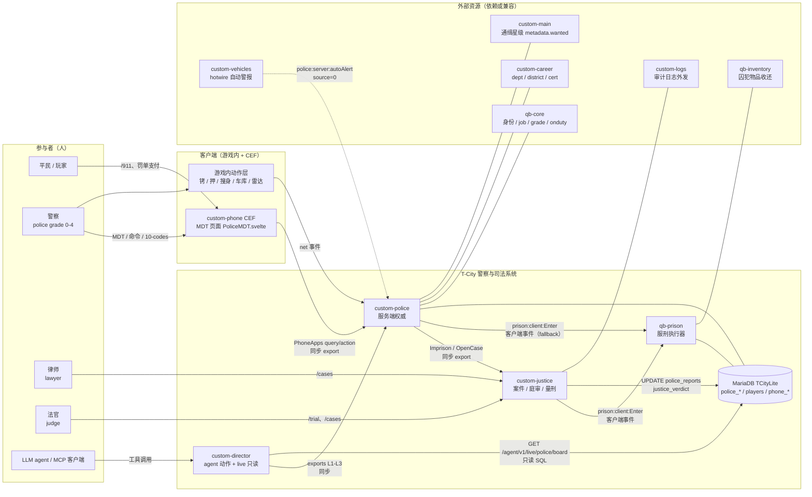
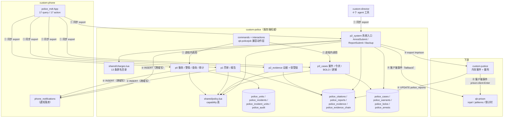

# 警察系统架构总览（00 Overview）

> **性质**：架构基线（as-built，读代码得出），不是目标态。
> **基线**：分支 `master`，基线提交 `568acd2`（2026-10-24）；**当前复评 HEAD `3bbcab3`**。正文保留基线快照，post-baseline 变化集中在 §3.2/§4.1/§6/§7.4。
> **证据口径**：`路径:行号`。未写前缀的 `server/*.lua` / `client/*.lua` / `shared/*.lua` 指
> `T-CityLite.base/resources/[custom]/custom-police/`；`migrations/` 指 `T-CityLite.base/migrations/`；
> `custom-phone/`、`custom-justice/`、`custom-director/`、`qb-prison/` 均为
> `T-CityLite.base/resources/` 下的资源短名。文档中的"目标态"一律标注为 `DESIGN`。
>
> **姊妹文档**：[01-domain-model.md](01-domain-model.md)（限界上下文 / 聚合 / 不变量 / 统一语言）。
> **已有资料**：[DESIGN.md](../DESIGN.md)（目标态）、[STATUS.md](../STATUS.md)（已交付）、
> [TECH_DEBT.md](../TECH_DEBT.md)（已知债）、[FLOW_INTERNAL.md](../FLOW_INTERNAL.md)（流程审计与断点）、
> [B_PLAN.md](../B_PLAN.md)（已拍板的方案 B 落地计划）、[OPTIMIZATION_PLAN.md](../OPTIMIZATION_PLAN.md)（P6 批次）。
>
> **本稿不重复** DESIGN 的功能清单、STATUS 的交付表、FLOW_INTERNAL 的 12 步流程与 F/B 编号。
> 只回答四个问题：系统由什么组成、谁拥有什么数据、请求怎么流动、边界在哪里。

---

## 1. 一句话架构

警察玩法 = **1 个服务端权威**（`custom-police`）+ **1 个手机 UI**（`custom-phone` 的 `police_mdt` App）
+ **2 个下游执行器**（`custom-justice` 负责量刑、`qb-prison` 负责刑期执行）
+ **1 个自动化入口**（`custom-director` 的 4 个 agent 工具）。

所有执法数据都写 MariaDB（**13 张 `police_*` 表**：基线 12 + `police_write_intents`；迁移 `v2.8–v3.11`），另加 justice 的 `justice_sentences`（v3.8，服务端计时权威）。
**例外**：justice 的案件（`activeCases`）只存在于内存，重启即丢（`custom-justice/server/main.lua:7-12`，TD-02）；**囚犯剩余时间自 `2ae3da4` 起已落库**，不再只靠内存。

权威链是**单向**的：客户端只表达意图，服务端做身份、权限、金额、刑期、状态的复算。
唯一的客户端权威残留是**客户端坐标**（`/911` 仍照单全收）。`prison` 客户端的入狱动作已降级为 UI：`SetJailStatus` 只投影服务端剩余（`2ae3da4`）。

---

## 2. C4 L1 — 系统上下文



### 2.1 参与者

| 参与者 | 与系统的关系 | 关键证据 |
|---|---|---|
| 平民/玩家 | `/911` 建警情、`/paycitation` 缴罚单、被查/被抓/被罚 | `client/p0.lua:11-23`、`custom-phone/client/main.lua:872-884` |
| 警察 | 在勤、接警、派单、查询、开单、逮捕；唯一有完整 capability 的角色 | `shared/policy.lua:6-47` |
| 律师 | 只读 `/cases` + 收 500 元 `/paylawyer`；**无接案入口** | `custom-justice/server/trial.lua:297-334`、`server/commands.lua:501-518` |
| 法官 | `/trial`、`/cases`；判决是唯一合法的量刑入口 | `custom-justice/server/trial.lua:231-253` |
| agent | 只经 `custom-director` 动作；不可审批、不拿 PII | `custom-director/server/policy.lua:29-67`、`custom-director/server/live_api.lua:483-502` |

### 2.2 外部系统

| 系统 | 提供什么 | 缺它会怎样 | 证据 |
|---|---|---|---|
| `qb-core` | 玩家、`job.grade.level`、`onduty`、`metadata` | 硬依赖，资源不可用 | `server/p0.lua:5,17-29` |
| `oxmysql` | DB 访问（`MySQL.*.await`） | 硬依赖 | `fxmanifest.lua:45`、`shared/insert_id.lua` |
| `custom-career` | `dept` / `district` / `certs` | 降级：`police_units.dept` **从不被写入**，MDT 永远显示表默认 `PATROL` | `migrations/v2.8_police_p0.sql:7-19`、`server/p0.lua:70`、`server/commands.lua:155-178`（`/setdept` 只写 career） |
| `custom-main` | `metadata.wanted` 星级 + 内存 `WantedPlayers` | 通缉星级消失，但令状/BOLO 不受影响 | `custom-main/server/dispatch.lua:2,71,103-154` |
| `custom-vehicles` | hotwire 警报 → `autoAlert`（`source=0`） | MDT 少一类临时托盘 | `custom-vehicles/server/main.lua:202,210,306`、`server/main.lua:198-237` |
| `qb-inventory` | 囚犯物品收/还 | 入狱丢物品 | `qb-prison/server/main.lua:20-44` |
| `custom-logs` | 入狱/出狱/判决的外部日志 | 只影响旁路留痕 | `custom-justice/server/prison.lua:56-64`、`trial.lua:86-91` |

### 2.3 三条上下文级事实

1. **信任边界在服务端 exports，不在 NUI**。手机 App 注册表只决定"磁贴是否显示"
   （`custom-phone/server/phone_apps.lua:39-52`），所有 rank/状态复检在 `custom-police`
   （`shared/policy.lua:40-47`，每个 handler 首行调用）。
2. **身份三源**：`job.name/grade`（qb-core）、`onduty`（qb-core）、`police_units.status`（custom-police）。
   三者可互相矛盾，是 TD-01 的根（`server/p0.lua:262-298` vs `client/p0.lua:7-9`）。
3. **同一业务有三条并行入口**：玩家路径（MDT/命令）、系统路径（`p2_system.lua` 的 `*System` 导出）、
   兼容路径（`qb-policejob:*` 事件名与 `police:server:JailPlayer`）。三者校验强度不同（见 §7）。

---

## 3. C4 L2 — 容器与组件



通道编号对应 §3.3：① 同步进程内调用 ② 数据库共享 ③ 跨资源同步 export ④ 客户端事件往返。

### 3.1 资源职责 / 通道 / 数据所有权（一句话）

| 资源 | 职责（一句话） | 主要通道 | 拥有的数据 | 明确不拥有 |
|---|---|---|---|---|
| `custom-police` | 警察域唯一服务端权威：勤务、警情、单据、案件、审计 | 服务端 exports + net 事件 + SQL | 13 张 `police_*` 表（基线 12 + `police_write_intents`；`police_arrests` 是 legacy，但仍有 2 个写入点：`server/p2_system.lua:118-121`、`server/p3_cases.lua:197-201`） | 判决、刑期执行、通缉星级、job/grade |
| `custom-phone` | 终端 UI；`police_mdt` App 是 MDT 唯一载体 | `PhoneApps.Query/Action` → export | `phone_*`（含 `phone_notifications`，**被 police 跨域写入**） | 任何 `police_*` 表、任何权限判定 |
| `custom-justice` | 案件生命周期 + 量刑公式 + 服刑计时 + 律师通知 | 服务端 export（`Imprison`/`OpenCase`/`AdjustSentence`/`ReleaseSentence`）+ net 事件 | **内存** `activeCases`/`inmates`；**DB** `justice_sentences`（服刑权威）与 `police_reports.justice_verdict` 投影 | 服刑执行、物品、执业记录 |
| `qb-prison` | 唯一刑期执行器：收监、倒计时、工作减刑、释放、物品收还 | 客户端事件 + `metadata.injail`/`jailitems` | `players.metadata`（injail/jailitems/criminalrecord）**与 `players.job`（入狱强制 `unemployed`）** | 量刑、逮捕记录 |
| `custom-director` | agent 动作代理（风险分级 + 人审）+ live 只读感知 | export（动作）/ SQL（看板） | `agent_actions`/`agent_denials`；经 `Player.Functions` **借写** `players.job/metadata`（非 owner） | 执法数据本身；`agent_effects`（归 `custom-agent-client`） |
| `qb-core` | 玩家数据与职业/职级/在勤真相 | 事件 + `Player.Functions` | `players` | 警情与执法文书 |
| `players`（表） | 玩家数据的唯一 owner | `Player.Functions`（多数）+ 裸 SQL（`custom-career`） | owner = `qb-core`；**7 个资源直写**（qb-core + career/prison/justice/police/custom-main/director） | 警情与执法文书 |
| `custom-main` | 通缉星级（原生 5 星在逃） | `metadata.wanted` + 内存表 | `metadata.wanted`、`metadata.criminalrecord` | 令状/BOLO |
| `custom-vehicles` | 车辆偷窃/警报生产方 | `TriggerEvent('police:server:autoAlert', ...)`（`source=0`） | 车辆状态 | 警情记录 |

### 3.2 `custom-police` 内部组件边界

| 文件 | 行数 | 职责 | 对外入口 |
|---|---|---|---|
| `server/p0.lua` | 613 | 勤务状态、警情（含 disposition/stale）、人员/车辆查询、审计查询 | 11 个 export（`server/p0.lua:601-611`）+ 2 个自有 net 事件 + 2 个 qb-core 同步事件 + 2 个掉线/启动 handler |
| `server/p1.lua` | 200 | 罚单开具/查询/支付（抢占式）、报告创建/查询 | 6 个 export（`194-199`） |
| `server/p2_evidence.lua` | 99 | 证据登记 + 保管链 | 3 个 export（`96-98`） |
| `server/p3_cases.lua` | 278 | 案件、BOLO、令状、逮捕记录、案件聚合详情 | 11 个 export（`267-277`） |
| `server/p2_system.lua` | 994 | 系统/agent 入口、`ArrestSubmit`/`ReportSubmit`（幂等账本）、NPC 支援、`police_release` | 7 个 export（`950-956`）+ 1 命令（`961`） |
| `server/p4_npc.lua` | 455 | NPC 警情：模板生成、场景推送、结算、调度器 | 4 个 export（`450-453`）+ 1 事件 + 1 命令 |
| `server/commands.lua` | 534 | qb-policejob 兼容命令（cuff/fine/checkid/911p/paylawyer…） | 命令面（无 export） |
| `server/interactions.lua` | 244 | 押解/塞车/搜身/legacy 入狱 | net 事件 |
| `server/vehicle.lua` | 191 | 扣押、车牌标记（内存 `Plates`）、直升机 | 命令 + net 事件 |
| `shared/policy.lua` | 56 | 21 个 capability 的纯函数判定 | `PolicePolicy.Can/Grade/IsPolice` |
| `shared/charges.lua` | 92 | 13 条罪名（id/label/minutes/fine），与 justice `Config.Justice.Crimes` 同源同值 | `PoliceCharges.List/Get/Sum` |
| `shared/npc_callouts.lua` | 188 | 4 个 NPC 警情模板 + 固定坐标 + 调度常量（8min/30%/max1/80m/300m/60s） | `NPCCallouts.Get/Ids/RandomId` |

> 组件间**不通过事件解耦**：`p0/p1/p2_*/p3` 各自 `exports(...)`，上层（手机 App、director）
> 直接按名字取用。这带来一个可测的契约面（见 `T-CityLite.base/tests/agent/lua/`），
> 代价是没有统一的 `MdtCall` 门面——DESIGN §3.3 计划过，实际未实现，
> 手机 App 直接逐个转发 export（`custom-phone/server/apps/police_mdt.lua:35-276`）。

### 3.3 通道清单

| # | 通道 | 方向 | 一致性 | 证据 |
|---|---|---|---|---|
| ① | 服务端 export（进程内同步） | phone/director → police；police → justice | 强一致（同 tick 返回结果） | `custom-phone/server/apps/police_mdt.lua:199-226`、`custom-director/server/main.lua:1189-1220`、`server/p2_system.lua:604-606` |
| ② | 共享 MariaDB | police ↔ justice（verdict 回写）、director → police 表（只读） | 最终一致 / 只读快照 | `custom-justice/server/trial.lua:39-49`、`custom-director/server/live_api.lua:484-492` |
| ③ | net 事件（客户端 → 服务端） | 客户端 → police | 逐条重校验 | `server/p0.lua:294-303`、`server/main.lua:198-237` |
| ④ | 客户端事件（服务端 → 客户端） | police/justice → 玩家客户端 → 再回写服务端 | **最终一致，且可被客户端篡改** | `custom-justice/server/prison.lua:47` → `qb-prison/client/main.lua:225-261` |
| ⑤ | 通知落库 + 推送 | police → `phone_notifications` → 客户端 | 最终一致（推送失败不回滚） | `server/p0.lua:100-114`、`server/p1.lua:22-36` |
| ⑥ | HTTP（live 只读） | agent/MCP → director → DB | 只读快照 | `custom-director/server/live_api.lua:480-502,530` |

---

## 4. 关键数据流

### 4.1 主链：911 → incident → MDT → assign → arrest → justice → qb-prison → release

| 步 | 触发 | 服务端落点 | 通道 | 证据 |
|---|---|---|---|---|
| 1 | 平民 `/911 <文本>` | `P.CreateIncident` → INSERT `police_incidents` | net 事件 → export | `client/p0.lua:11-23` → `server/p0.lua:300-303` → `77-116`（INSERT 在 `88-91`） |
| 2 | 通知在勤警察 | 逐人 INSERT `phone_notifications(app_id='police_mdt')` + 客户端推送 | ⑤ | `server/p0.lua:100-114` |
| 3 | 警员打开 MDT「Dispatch」 | `GetUnits` / `GetIncidents` 读表 | ① | `custom-phone/server/apps/police_mdt.lua:65-76` → `server/p0.lua:56-75,118-137` |
| 4 | 派单 | `AssignUnit`：写关联表 + 单位 `assigned` + 警情 `assigned` + 审计 | ① | `custom-phone/server/apps/police_mdt.lua:173-178` → `server/p0.lua:139-157` |
| 5 | 前往 / 到场 / 清场 | `SetIncidentStatus`：改警情状态，同步单位状态；清场时把所有单位置 `available` | ① | `custom-phone/server/apps/police_mdt.lua:230-247` → `server/p0.lua:159-181` |
| 6 | 逮捕提交 | `ArrestSubmit`：先写 `police_reports(kind='arrest')`，再可选 case/citation/evidence/justice case | ① | `custom-phone/server/apps/police_mdt.lua:199-203` → `server/p2_system.lua:336-662`（report `448-455`） |
| 7 | 送监 | `exports['custom-justice']:Imprison` → `ApplySentence` 写 `justice_sentences`；失败才退化为 `metadata.injail` + `prison:client:Enter` | ③ 然后 ④ | `server/p2_system.lua:738-757`、`custom-justice/server/prison.lua:41-49` |
| 8 | justice 收押 | `justice_sentences` 落库（权威）→ 写内存 `Inmates`（缓存）+ `SetMetaData('injail')`（投影）+ `prison:client:Enter` | DB + ④ | `custom-justice/server/prison.lua:22-92`（`76-84`）、`sentence.lua:91-135` |
| 9 | qb-prison 收监 | 白名单校验 → 传送/囚服 → 客户端回写 `SetJailStatus` → **强制 `unemployed`** → 清空背包存 `jailitems` | ④ + metadata | `qb-prison/client/main.lua:225-261` → `qb-prison/server/main.lua:5-30` |
| 10 | 服刑 / 减刑 | 客户端 `jailTime` 只是 UI；服务端 `WorkReduction` 校验冷却后调 `AdjustSentence`，`SetJailStatus` 从 `ends_at` 投影 | ③ + ④ | `qb-prison/server/main.lua:14-50,187-213`、`sentence.lua:160-178` |
| 11 | 出狱 | `prison:client:Leave` / `UnjailPerson`：`injail=0` + 归还物品 + 传送；**不恢复职业** | ④ | `qb-prison/client/main.lua:277-320`、`qb-prison/server/main.lua:32-44` |
| 12 | 法庭（可选并行） | 法官 `/trial <caseId>` → `ResolveCase` → `Imprison(replace=true)` 重算 `ends_at` → 异步回写 `justice_verdict` | 命令 + ③ + ② | `custom-justice/server/trial.lua:184-204,231-253`（`persistVerdict` `30-49`） |

**这条链上的三个结构性问题（基线）**（证据见对应文档，此处只标注位置）：

- **入狱有两条互不引用的事实链**：`ArrestSubmit` 立即送监（`server/p2_system.lua:604-614`）
  与 `/trial` 判决再次送监（`custom-justice/server/trial.lua:188-190`）；
  去重只靠 `metadata.injail > 0` 短路（`custom-justice/server/prison.lua:32-35`、
  `server/p2_system.lua:360`），没有"逮捕记录 ↔ 判决"的关联约束。
  **post-baseline**：两条路径现在都落到同一 `justice_sentences` 行（`add` vs `set`），判决可改刑期；"两条链"仍在，但不再互相覆盖（`sentence.lua:91-135`、`trial.lua:184-204`）。
- **第 9 步毁掉职业**：`qb-prison/server/main.lua:11-14`，且释放链无恢复
  （`qb-prison/client/main.lua:277-309`），唯一恢复是控制台 `police_release`
  （`server/p2_system.lua:820-839`）——[FLOW_INTERNAL.md](../FLOW_INTERNAL.md) B3。
- **第 7 步的 fallback 绕过 justice**：`SetMetaData('injail')` 直写 + 客户端入狱，
  不经量刑、不留 justice 囚犯记录（`server/p2_system.lua:610-613`）。

### 4.2 次链：agent → director → custom-police exports

| 步 | 触发 | 落点 | 审批 | 证据 |
|---|---|---|---|---|
| 1 | MCP 工具调用 | `apply_police_incident`（L1）/`apply_police_assignment`（L2）/`apply_police_jail`（L3） | L1 自动，L2/L3 人审 | `tools/agent_tools.json`（4 个 police 工具）、`custom-director/server/policy.lua:50-67` |
| 2 | director 执行 | `CreateIncidentSystem` / `AssignUnitSystem` / `JailSystem` | 审批已在第 1 步完成 | `custom-director/server/main.lua:1189-1220` |
| 3 | police 校验 + 落库 + 审计 | 数据校验（状态、上限、存在性）→ 写表 → `police_audit(actor_kind='agent', actor_citizenid='agent:<id>')` | — | `server/p2_system.lua:31-38,57-123` |
| 4 | 只读感知 | `GET /agent/v1/live/police/board`（单位状态 + 开放警情，无 PII） | live token | `custom-director/server/live_api.lua:483-502,530` |

边界：agent **不能审批**（审批走 admin token，与 agent token 不同），**拿不到 sensitive PII**，
`police_incident_create` 的描述字段是 untrusted 文本（见 [DESIGN.md](../DESIGN.md) §6.5、§7.6）。

### 4.3 支链：罚单闭环

```
警官 MDT → issue_citation / arrest_submit(自动带罚单)
   → police_citations(unpaid) + phone_notifications(app_id='banking', 正文含 #id)
平民 → 手机 Banking「我的罚单」 → phone:server:payCitation → exports:PayCitation
   → 校验归属 + 状态 → RemoveMoney('bank') → status='paid'
```

证据：`server/p1.lua:38-64`（开具）、`59-62`（通知带 `#id`）、`137-156`（支付）；
`custom-phone/server/main.lua:1391-1412`（手机侧回调）；`custom-phone/client/main.lua:872-884`（`/paycitation`）。

> 这是**唯一一处 `custom-police` 直接改玩家钱包**的路径（`server/p1.lua:150`）。
> 另一条 `/fine` 命令走 `RemoveMoney` + `qb-banking` 且**不写 `police_citations`、不写审计**
> （`server/commands.lua:259-303`）——[FLOW_INTERNAL.md](../FLOW_INTERNAL.md) F11。

---

## 5. 边界与"不负责"清单

### 5.1 `custom-police` 负责 / 不负责

| 关注点 | 归属 | `custom-police` 的边界 |
|---|---|---|
| 谁在勤、什么状态、挂哪个警情 | **自己** | 权威表 `police_units`；但 `onduty` 真相在 qb-core，二者会分叉 |
| 警情队列与派单 | **自己** | 唯一写入口是 export/事件；自动警报（`autoAlert`）不入库 |
| 罚单、报告、证据、案件、令状、BOLO | **自己** | 只存记录，不产生法律后果 |
| 逮捕记录 | **自己（已合并）** | 事实源是 `police_reports(kind='arrest')`，`police_arrests` 为 legacy |
| 审判、量刑、减刑比例 | `custom-justice` | **不判决、不量刑**：只把罪名 id 交给 `Imprison` |
| 刑期执行、囚服、物品收还、越狱、刑满释放 | `qb-prison`（执行）+ `custom-justice`（`justice_sentences` 权威计时） | **不管理囚犯**：只触发 `prison:client:Enter`/`UnjailPerson` 与 `ReleaseSentence` |
| 通缉星级（5 星在逃、雷达定位） | `custom-main` | **不写 `metadata.wanted`**；只读来做展示（`server/p0.lua:232`） |
| job / grade / onduty | `qb-core` | 只读；`SetJob` 仅出现在 `police_release` 的恢复分支（`server/p2_system.lua:831-835`） |
| dept / district / cert | `custom-career` | 只读 |
| 通知投递与已读 | `custom-phone` | 只 `INSERT phone_notifications` + 发客户端事件 |
| 车辆所有权与扣押状态 | `player_vehicles` / qb-garages | 只写 `state/depotprice`（`server/vehicle.lua:52-58`） |
| 铐/押/搜身/雷达/车库等现场表现 | 本资源的 client 脚本（qb-policejob 兼容） | 服务端只做 LEO 与距离校验 |

### 5.2 明确不做（当前基线）

- 不做客户端权威：金额、刑期、罪名、派单目标一律服务端复算（`shared/charges.lua` + `server/p2_system.lua:378-380,313-328`）。
- 不做第二块 MDT 平板 / F11 界面（DESIGN §9.6）；车载屏只做只读镜像。
- 不做 `plate_flags` 治理与 ANPR 重构（DESIGN §9.10）；BOLO 用 report 标签 + legacy 表双读。
- 不做武器登记、bodycam、监狱外保释金结算、律师计费（DESIGN §9）。
- **不做跨部门数据共享矩阵**：库里只有一个 LSPD。

### 5.3 谁都不能做

| 禁止项 | 现状 | 证据 |
|---|---|---|
| 客户端直调入狱（非白名单资源） | 有白名单 | `qb-prison/client/main.lua:227` |
| 客户端直改 `injail` | **已修**：`SetJailStatus` 忽略客户端值，改查 `justice_sentences` 剩余；justice 不可用时 clamp 0..120 | `qb-prison/server/main.lua:14-50` |
| 客户端伪造警情 | 已加 LEO + cooldown（曾无鉴权） | `server/main.lua:198-237` |
| 客户端伪造逮捕 | 服务端校验铐/距离/在押/罪名白名单 | `server/p2_system.lua:352-380` |
| agent 审批自己的动作 | 策略层禁止 | `custom-director/server/policy.lua`（`requires_approval`）+ AGENTS.md §4 |

---

## 6. 信任边界与安全姿态

| 入口 | 身份校验 | 权限校验 | 审计 | 备注 |
|---|---|---|---|---|
| MDT query/action | `PhoneApps` 校验 job+onduty（`custom-phone/server/phone_apps.lua:39-52`） | `PolicePolicy.Can`（每个 handler） | **9 个写审计**（lookup.citizen/vehicle、case.detail、case.view、evidence.view、evidence.chain、bolo.view、warrant.view、arrest.view；仅前 3 个 fail-closed），**5 个完全不写**（GetUnits/GetIncidents/GetAudit/GetCitations/GetReports） | 见 §7.1 A-13 |
| 查询（人/车） | 同上 | `lookup.citizen` / `lookup.vehicle`（grade≥1） | **fail-closed**：审计失败即拒绝返回（`server/p0.lua:183-190`） | PII 分档未实现，返回字段固定 |
| 逮捕 | qb-core 玩家 | `arrest.create`（grade≥1）+ 物理前置 | 成功后审计（含 citation/evidence）；审计失败返回 `audit_unavailable` 但判决已生效（`p2_system.lua:795-797`） | **现在**：可选 `idempotency_key`，无键仍不幂等（`p2_system.lua:146-267`） |
| 系统/agent | 无玩家 source，actor id 来自 director | director 策略 | `actor_kind='agent'` | `Sys.Jail` 的审计失败**仍不阻断**（`p2_system.lua:118-121`） |
| `source=0` 事件 | 视为受信服务端 | 无 | 视入口而定 | `server/main.lua:203`、`server/p2_system.lua:821` |
| live HTTP | Bearer live token + 限流 | 只读 | 无 | `custom-director/server/live_api.lua:504-530` |

**审计表结构承载不了"拒绝"**：`police_audit` 只有
`actor_citizenid/actor_kind/action/target/detail(500)`（`migrations/v2.8_police_p0.sql:50-63`），
没有 `result` 列；拒绝分支在写审计前就 `return`（如 `server/p0.lua:141-142`）。
DESIGN §7.4 要求的 `result='denied'` 目前无处落库。

---

## 7. 当前架构问题（只列结论，长文见原文档）

### 7.1 已知债（来自 TECH_DEBT / FLOW_INTERNAL）

| 编号 | 问题 | 关键证据 | 详见 |
|---|---|---|---|
| A-01 | 勤务双状态：`onduty` 与 `police_units.status` 都可写、互不约束 | `server/p0.lua:262-298` vs `client/p0.lua:7-9` | TD-01（高） |
| A-02 | 非 `off_duty` 不要求在勤：`setStatus` 只查 `isPolice`，不查 `onduty` | `server/p0.lua:45-54,294-298` | [01-domain-model.md](01-domain-model.md) §10 INV-01 |
| A-03 | justice 案件/囚犯零持久化，重启即丢，`CASE-0001` 会重置 | `custom-justice/server/main.lua:7-12,18-20` | TD-02（中） |
| A-04 | 案件号两套：`police_cases.case_no=CASE-YYYY-NNNNNN` vs justice `CASE-0001` | `server/p3_cases.lua:40-42`、`custom-justice/server/main.lua:20` | TD-03（中） |
| A-05 | 入狱即失业且不可逆 | `qb-prison/server/main.lua:11-14` | B3（P0） |
| A-06 | 一次逮捕三处录入的残留：legacy `police:server:JailPlayer` 仍在（客户端入口已删，仅 `source=0`），但因先做坐标校验会走到 `DropPlayer(src=0)`，实际是**死路径** | `server/interactions.lua:139-183` | TD-06、B4 |
| A-07 | 罚单两套收费路径：`police_citations` vs `/fine`（无记录无审计） | `server/p1.lua:38-64` vs `server/commands.lua:259-303` | F11 |
| A-08 | 通缉三源：令状 / report BOLO 标签 / `metadata.wanted` | `server/p0.lua:210-232`、`server/p3_cases.lua:91-125`、`custom-main/server/dispatch.lua:71` | F10、B8 |
| A-09 | 派单不校验目标单位状态（玩家路径），系统路径才校验 | `server/p0.lua:139-157` vs `server/p2_system.lua:84-86` | F9 |
| A-10 | 单位关联无 `left_at`、无"唯一 primary"，历史不可回放 | `migrations/v2.8_police_p0.sql:41-49` | §7.3 第 4 条 |
| A-11 | 拒绝行为不留审计（表结构缺 `result`） | `migrations/v2.8_police_p0.sql:50-63` | §6 末段 |
| A-12 | 服务端信任客户端坐标：`/911` 用 payload 的 x/y/z | `client/p0.lua:16-21` → `server/p0.lua:87-91` | DESIGN §2.3 未落地 |
| A-13 | 罚单/报告等敏感读无审计、无失败阻断（与查询路径不一致） | `server/p1.lua:79-92,116-133`、`server/p2_evidence.lua:67-94` | §6 |

### 7.2 依赖与启动顺序

- 启动顺序 `qb-prison → custom-police → custom-justice`（`configs/modules/police.cfg:4-11`），
  与 `custom-justice` 的 manifest 依赖（含 `custom-police`、`qb-prison`）一致
  （`custom-justice/fxmanifest.lua:19-25`）。
- **依赖声明成环、但一侧从不调用**：justice 的 manifest 依赖 `custom-police`（硬依赖），
  而运行时只由 police 调 justice 的 `Imprison`/`OpenCase`（`server/p2_system.lua:566,605`）；
  justice 侧没有任何 `exports['custom-police']` 引用。
- `custom-police` 对 justice/prison 都是**软依赖**：调用包在 `pcall` 里，失败退化
  （`server/p2_system.lua:604-614`）；但退化路径本身不审计、不入库。

### 7.3 文档与代码漂移（本次基线新发现，影响重构口径）

| # | DESIGN / 旧文档口径 | 代码实际 | 证据 |
|---|---|---|---|
| 1 | 所有创建类表带 `UNIQUE(idem_key)` 幂等键（DESIGN §5.1/§5.2） | **现在**：`police_write_intents.idem_key` 是唯一幂等账本（不是业务表的列）；业务表仍无 `idem_key`，只有 `agent_actions.idempotency_key` | `migrations/v3.9_police_write_intents.sql`、`migrations/v2.3_agent_actions.sql:28,38` |
| 2 | 案件表名 `police_case_files`（DESIGN §5.2.8） | 实际 `police_cases` | `migrations/v3.1_police_p2.sql:2` |
| 3 | 令状有 `type/scope/probable_cause/expires_at`，区分逮捕令/搜查令 | 只有 `citizenid/reason/status` → **搜查令无法表达范围与期限**；`warrant.approve` 实为 grade≥3 | `migrations/v3.1_police_p2.sql:31-43`、`shared/policy.lua:24`、`server/p3_cases.lua:138-171` |
| 4 | `police_incident_units` 有 `role`（primary/backup）与 `left_at` | 只有 `role`（且代码从不写，恒为默认 `primary`）与 `joined_at` | `migrations/v2.8_police_p0.sql:41-49`、`server/p0.lua:149-152` |
| 5 | 逮捕独立表 `police_arrests` 为事实源（DESIGN §5.2.11） | `kind='arrest'` 的 report 才是事实源；`GetArrests` 只读 report，`police_arrests` 只在案件详情里 UNION；但该表**仍有 2 个写入点**（`Sys.Jail`、legacy `RegisterArrest`） | `migrations/v3.4_police_arrest.sql:14`、`server/p3_cases.lua:208-230,249-258`、`server/p2_system.lua:118-120`、`server/p3_cases.lua:197-201` |
| 6 | agent 建警情 L2 需审批、派单 L3（DESIGN §6.5） | 建警情 **L1 自动执行**、派单 L2、入狱 L3 | `custom-director/server/policy.lua:50-67` |
| 7 | 罚单通知深链到 `police_mdt`（`B_PLAN.md:84`） | 实际 `app_id='banking'`（进入 Banking「我的罚单」），正文已带 `#id` | `server/p1.lua:59-62`、`server/p2_system.lua:283-291` |
| 8 | 敏感读一律审计且 fail-closed（DESIGN §7.4） | 仅 `lookup.*` 与 `case.detail` fail-closed；其余为 best-effort 或完全不审 | `server/p0.lua:183-190`、`server/p3_cases.lua:242-244` vs `server/p1.lua:79-92` |
| 9 | 部门同步到 `police_units.dept`（DESIGN §1.2） | `dept` 列**没有任何写入点**；`/setdept` 只调 `custom-career:SetPlayerDepartment`，MDT 单位列表恒为 `PATROL` | `server/commands.lua:155-178`、`server/p0.lua:70`（对比 `server/p0.lua:45-54` 不写 dept） |

> 这些漂移不是"代码错了"，而是**文档承诺了一组不存在的约束**。
> 01-domain-model 的不变量表以代码为准，并在"目标态"一栏标注差异。

---

### 7.4 post-baseline 状态（`3bbcab3`）

| 债 | 基线时 | 现在 | 证据 |
|---|---|---|---|
| A-01 勤务双状态 | 高 | ✅ 已收敛（`bb64d87`）：`police_units.status` 为状态、`onduty` 为投影 | `server/p0.lua:406-425,567-599` |
| A-02 非 off_duty 不要求在勤 | 存在 | ✅ 已修：busy/任务态要求 `onduty=true`；10-8/10-7 走投影 | `server/p0.lua:567-599` |
| A-03 justice 案件零持久化 | 重启即丢 | ❌ 未修（`CASE-0001` 回绕仍在）；**囚犯**已落 `justice_sentences` | `custom-justice/server/main.lua:7-20`、`sentence.lua` |
| A-04 案件号两套 | 存在 | ❌ 未修 | `p3_cases.lua`、`main.lua:18-20` |
| A-05 入狱即失业不可逆 | 存在 | ✅ 仍是产品决策“不恢复”；但已不再阻断服役 | `STATUS.md:47` |
| A-06 legacy JailPlayer 死路径 | 存在 | ❌ 未修 | `interactions.lua:139-186` |
| A-07 罚单两套收费 | 存在 | ❌ 未修（`PayCitation` 已抢占式） | `p1.lua:146-193`、`commands.lua:259-311` |
| A-08 通缉三源 | 存在 | ❌ 未修 | `p0.lua:354-376` |
| A-09 派单不校验目标单位 | 存在 | ⚠️ 部分：incident 状态有守卫、重复分配幂等；**仍不校验目标 `available/onduty`** | `p0.lua:212-257` |
| A-10 关联行无 `left_at` | 存在 | ❌ 未修（仍只增不删） | `p0.lua:247-250` |
| A-11 拒绝不留审计 | 存在 | ❌ 未修 | `police_audit` 无 result 列 |
| A-12 信任客户端坐标 | 存在 | ❌ 未修 | `p0.lua:154-158` |
| A-13 敏感读无审计 | 存在 | ⚠️ 部分：逮捕内 citation/evidence 已补；读路径仍缺 | `p2_system.lua:766-797` |
| 新增：幂等账本无 TTL | — | ⚠️ `done` 永不过期；只有惰性清理 200 条/天 | `p2_system.lua:196-201` |
| 新增：NPC 警情生成绕过 backup 预算 | — | ⚠️ `client/npc_callouts.lua:192,210` 独立生成；无 ack/重发 | 见 02 §8、07 FIT-07 |

---

## 8. 后续重构切入点（只指方向，不含方案）

| # | 切入点 | 为什么先做 | 相关上下文 |
|---|---|---|---|
| 1 | 勤务单一状态机（`OffDuty/Available/Busy` + 任务派生态） | 派单、MDT 花名册、权限三处都读它；TD-01 高 | Duty/Dispatch |
| 2 | 逮捕单入口 + `report=arrest` 作为入狱唯一凭证 | 现在有 4 条入狱路径，去重只靠 `injail>0` | Records + Custody |
| 3 | justice 落库（`justice_cases` / `justice_verdicts`） | 判决只写 report 镜像，重启后案件不可追溯 | Justice |
| 4 | 通缉单源（令状） | 三源互相看不见，拦截不可用 | Records + 外部 `custom-main` |
| 5 | 案件编号类型统一（BIGINT vs 字符串） | 已在临时方案里被绕过（`justice_case_id` 只返回不关联） | Records + Justice |

---

## 9. 复核方法

```bash
# 资源与表
grep -n "CREATE TABLE" T-CityLite.base/migrations/v2.8_police_p0.sql \
  T-CityLite.base/migrations/v2.9_police_p1.sql T-CityLite.base/migrations/v3.0_police_evidence.sql \
  T-CityLite.base/migrations/v3.1_police_p2.sql
# 入口面
grep -rn "exports(" T-CityLite.base/resources/\[custom\]/custom-police/server/
grep -rn "RegisterNetEvent" T-CityLite.base/resources/\[custom\]/custom-police/server/
# 通道面
grep -rn "custom-police" T-CityLite.base/resources/\[custom\]/custom-phone/server/apps/police_mdt.lua
grep -rn "exports\['custom-police'\]" T-CityLite.base/resources/\[custom\]/custom-director/server/main.lua
# 文档漂移
grep -rn "idem_key" docs/police/DESIGN.md; grep -rn "idem" T-CityLite.base/migrations/
```

---

**一句话总结**：警察域的服务端权威已经收敛到 `custom-police`，
但**权威的边界止于"记录"**——判决、刑期、通缉星级、职业状态仍在四个外部资源里，
而它们与 police 的交接全部是**客户端往返或共享表**。重构的杠杆点不在新增功能，
而在把 A-01/A-02（勤务双状态）、A-04（案件号两套）、A-05（判罚不可逆）
收敛为单一勤务状态机、单一编号与可逆后果。
