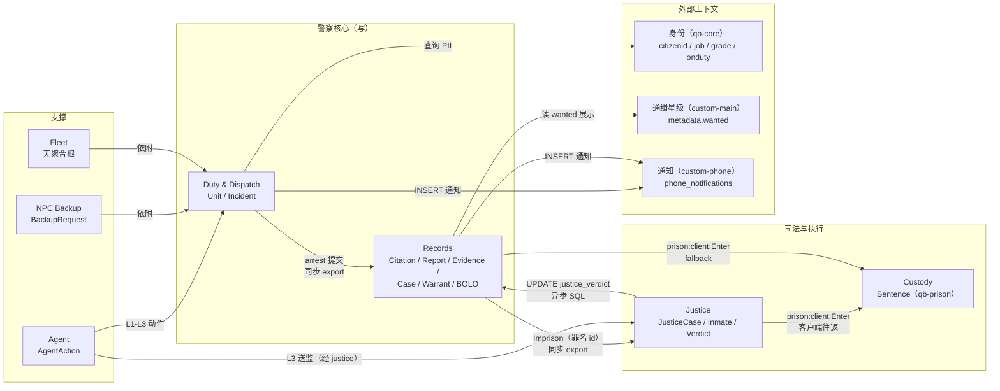

# 警察系统领域模型（01 Domain Model）

> **性质**：as-built 领域模型（读代码得出），面向**后续重构与新增玩法**，不是理想设计。
> **基线**：`master @ 568acd2`（2026-10-24）。证据口径同 [00-overview.md](00-overview.md)：
> 未写前缀的 `server/*.lua` 指 `T-CityLite.base/resources/[custom]/custom-police/`；
> `migrations/` 指 `T-CityLite.base/migrations/`。
> **不重复** [DESIGN.md](../DESIGN.md) 的表定义与功能清单；DESIGN 是目标态，本稿是现状。
>
> **读法**：`AR` 聚合根、`E` 实体、`VO` 值对象、`INV` 不变量。
> "现状"列：`✅` 成立 / `⚠️` 部分成立或依赖调用路径 / `❌` 不成立（代码允许违反）。

---

## 1. 上下文地图

### 1.1 七个限界上下文

| 上下文 | 聚合根 | 持久化 | 主要代码 | 主要消费方 |
|---|---|---|---|---|
| **Duty & Dispatch** | `Unit`、`Incident` | `police_units`、`police_incidents`、`police_incident_units`、`police_audit` | `server/p0.lua`、`client/p0.lua`、`client/job.lua` | MDT、director、所有执法动作的前置 |
| **Records** | `Citation`、`Report`、`Evidence`、`Case`、`Warrant`（+ legacy `Bolo`） | `police_citations`、`police_reports`、`police_evidence(_chain)`、`police_cases`、`police_warrants`、`police_bolos`、`police_arrests`(legacy) | `server/p1.lua`、`server/p2_evidence.lua`、`server/p3_cases.lua` | MDT 四页、justice（只读语义）、审计 |
| **Justice** | `JusticeCase`、`Inmate` | **内存**（`activeCases` / `inmates`）+ `police_reports.justice_verdict` 镜像 | `custom-justice/server/{main,trial,prison,arrest}.lua` | 法官、律师、qb-prison |
| **Custody** | `Sentence`（由 qb-prison 持有） | `players.metadata.injail` / `jailitems` / `criminalrecord` | `qb-prison/{server,client}/main.lua` | 囚犯、出狱、物品收还 |
| **Fleet** | **无**（见 §6） | `player_vehicles.state`（外部表）+ 内存 `Plates` | `server/vehicle.lua`、`client/job.lua` | 警察本人 |
| **NPC Backup** | `BackupRequest` | **无**（内存，按会话） | `server/p2_system.lua:172-272`、`client/backup.lua` | 请求者客户端 |
| **Agent** | `AgentAction`（director） | `agent_actions` + `police_audit` 副本 | `custom-director/server/{policy,main,live_api}.lua`、`server/p2_system.lua` | LLM/MCP |

### 1.2 上下文映射关系

| 上游 | 下游 | 机制 | 传递内容 | 一致性 | 证据 |
|---|---|---|---|---|---|
| custom-phone（MDT） | Duty/Records | 服务端 export（进程内） | 玩家 source + 参数 | **强一致**（同 tick 返回） | `custom-phone/server/apps/police_mdt.lua:65-276` |
| custom-director（agent） | Duty/Records/Custody | export `*System(actorId, …)` | agent id + 参数 | **强一致** | `custom-director/server/main.lua:1189-1220` |
| Duty/Dispatch | Records | 进程内函数调用 | 逮捕上下文（incident/case/罪名） | **强一致**（但用补偿删除代替事务） | `server/p2_system.lua:126-136,458-481` |
| Records | Justice | export `Imprison` / `OpenCase` | citizenid、分钟、罪名 id | 强一致调用，**结果易失**（内存） | `server/p2_system.lua:566,605` |
| Justice | Custody（qb-prison） | 客户端事件往返 | src + 分钟 | **最终一致**，可被客户端重放/篡改 | `custom-justice/server/prison.lua:43-47` → `qb-prison/client/main.lua:225-261` |
| Records | Custody | 客户端事件（fallback）+ `UnjailPerson` | src + 分钟 | 最终一致 | `server/p2_system.lua:610-613,827` |
| Justice | Records | 异步 `UPDATE police_reports … WHERE justice_case_id` | verdict JSON + status | **最终一致**（best-effort，失败只打日志） | `custom-justice/server/trial.lua:39-49` |
| Duty/Records | custom-phone | `INSERT phone_notifications` + 客户端事件 | 标题/正文/`app_id` | 最终一致（推送失败不回滚） | `server/p0.lua:100-114`、`server/p1.lua:22-36` |
| custom-vehicles | Duty | `TriggerEvent('police:server:autoAlert')`（`source=0`） | 坐标 + 文本 | 异步，**不入库** | `custom-vehicles/server/main.lua:202,210,306`、`server/main.lua:198-237` |
| custom-main | （只被读） | 无调用，共享 `metadata.wanted` | 1–5 星 | **无一致性契约** | `server/p0.lua:232`、`custom-main/server/dispatch.lua:71` |
| custom-director | Duty/Records | 只读 SQL（live 看板） | 状态计数 + 警情摘要 | 只读快照 | `custom-director/server/live_api.lua:484-492` |

---

## 2. Duty & Dispatch（勤务与调度）

### 2.1 聚合与要素

| 类型 | 名称 | 标识 | 关键属性 | 证据 |
|---|---|---|---|---|
| **AR** | `Unit`（单位） | `citizenid` | `callsign`、`dept`、`status`、`incident_id` | `migrations/v2.8_police_p0.sql:7-19` |
| **AR** | `Incident`（警情） | `id` | `code`、`title`、`description`、`priority`、`status`、坐标、`created_by` | `migrations/v2.8_police_p0.sql:21-39` |
| **E** | `Assignment`（警情-单位关联） | (`incident_id`,`citizenid`) | `role`（恒为默认 `primary`）、`joined_at` | `migrations/v2.8_police_p0.sql:41-49`、`server/p0.lua:149-152` |
| **VO** | `UnitStatus` | — | `off_duty/available/busy/unavailable/assigned/enroute/on_scene` | `server/p0.lua:8-11` |
| **VO** | `IncidentStatus` | — | `open/assigned/enroute/on_scene/cleared/closed` | `server/p0.lua:12-15` |
| **VO** | `TenCode` | — | 10-8→available、10-6→busy、10-7→**off_duty** | `client/p0.lua:7-9` |
| **VO** | `Priority` | — | 1..3，服务端 clamp | `server/p0.lua:84-85` |
| **VO** | `Callsign` | — | ≤16 字符，取自 `metadata.callsign` | `server/p0.lua:49,297` |
| **VO** | `Dept` | — | `PATROL/TRAFFIC/CID/SWAT`，DB 默认 `PATROL`；**无写入点** | `config.lua:12-17`、`migrations/v2.8_police_p0.sql:9`、`server/p0.lua:70` |

### 2.2 不变量

| 编号 | 不变量 | 现状 | 证据 | 违反后果 |
|---|---|---|---|---|
| INV-D1 | `Unit.status` 必须属于枚举，否则拒绝 | ✅ | `server/p0.lua:46` | — |
| INV-D2 | 一个 `citizenid` 只有一行单位 | ✅ | 主键 `citizenid`（`migrations/v2.8:11`） | 花名册重复 |
| INV-D3 | 派单需要 grade ≥ 2 | ✅ | `server/p0.lua:141` + `shared/policy.lua:9` | 低阶警员可指挥 |
| INV-D4 | grade < 2 的警员只能改自己参与的警情 | ✅ | `server/p0.lua:166-169` | 任意改单 |
| INV-D5 | 同一 (incident, citizenid) 只有一条关联 | ✅ | 复合主键 + `ON DUPLICATE KEY`（`server/p0.lua:149-152`） | 重复出勤计数 |
| INV-D6 | 警情 `cleared/closed` 时摘除全部单位并置 `available` | ✅ | `server/p0.lua:176-178` | 单位卡在旧单 |
| INV-D7 | `off_duty` 必须清空 `incident_id` | ✅ | `server/p0.lua:50,268` | 幽灵出勤 |
| INV-D8 | 被派单单位必须是 `available` | ❌ | 玩家路径不校验（`server/p0.lua:139-157`）；系统路径校验（`server/p2_system.lua:84-86`） | 派给下班/忙碌的警员（F9） |
| INV-D9 | **非 `off_duty` ⇒ `job.onduty = true`** | ❌ | `setStatus` 只查 `isPolice`，不查 `onduty`（`server/p0.lua:45-54,294-298`）；`syncDuty` 又会覆盖（`262-270`） | 状态与在勤分叉（TD-01，本稿 INV-01） |
| INV-D10 | 警情状态只沿定义好的迁移前进 | ❌ | `SetIncidentStatus` 只校验枚举成员，任意跳转（`server/p0.lua:159-173`） | 未派单直接 `closed`、关闭后可再改 |
| INV-D11 | 一个警情最多一个 `primary` 单位 | ❌ | 从不写 `role`（`server/p0.lua:149-152`），多行都是默认 `primary` | 主责不明 |
| INV-D12 | 一个单位同时只挂一个警情 | ⚠️ | `incident_id` 单列保证"当前"，但关联表可留多行无 `left_at` | 历史参与不可回放 |
| INV-D13 | 警情坐标不由客户端提供 | ❌ | `/911` 传客户端坐标（`client/p0.lua:16-21` → `server/p0.lua:87-91`） | 假坐标污染调度 |
| INV-D14 | `Unit.dept` 反映真实部门 | ❌ | 无任何写入点（`server/p0.lua:45-54` 不含 `dept`）；`/setdept` 只写 `custom-career`（`server/commands.lua:171`） | MDT 永远显示 `PATROL`（00 §7.3 第 9 条） |

---

## 3. Records（记录）

### 3.1 聚合与要素

| 类型 | 名称 | 标识 | 关键属性 | 证据 |
|---|---|---|---|---|
| **AR** | `Citation`（罚单） | `id` | `citizenid`、`officer_citizenid`、`amount`、`reason`、`status`、`charge_id`/`base_amount`/`report_id` | `migrations/v2.9:2-16`、`v3.4:51-63` |
| **AR** | `Report`（报告 / 逮捕记录） | `id` | `kind`(`report`/`arrest`)、`incident_id`、`case_id`、`charges` JSON、`is_bolo` 三件套、`subject_citizenid`、`justice_case_id`、`justice_verdict` | `migrations/v2.9:18-31`、`v3.4:14-38`、`v3.5:10`、`v3.6:5`、`v3.7:10-18` |
| **AR** | `Evidence`（证据） | `id` / `exhibit_no` | `incident_id`、`report_id`、`case_id`、`label`、`status`、`collected_by` | `migrations/v3.0:2-19` |
| **E** | `EvidenceChainEntry`（保管链项） | `id` | `evidence_id`、`action`、`actor_citizenid`、`note` | `migrations/v3.0:21-31` |
| **AR** | `Case`（案件档案） | `id` / `case_no` | `title`、`summary`、`status`、`lead_citizenid` | `migrations/v3.1:2-15` |
| **AR** | `Warrant`（令状） | `id` | `citizenid`、`reason`、`status`、`requested_by`、`approved_by` | `migrations/v3.1:31-43` |
| **AR**（legacy） | `ArrestRecord`（旧逮捕表） | `id` | `citizenid`、`officer_citizenid`、`charges`（自由文本）、`incident_id`、`case_id` | `migrations/v3.1:45-56`；仍有 2 个写入点（`server/p2_system.lua:118-120`、`server/p3_cases.lua:197-201`），读只在案件详情 UNION（`server/p3_cases.lua:249-258`） |
| **AR**（legacy） | `Bolo`（布控） | `id` | `kind`、`target`、`reason`、`status` | `migrations/v3.1:17-29` |
| **VO** | `Charge`（罪名） | `id` | `label`、`baseMinutes`、`fine` | `shared/charges.lua:13-31`（与 `custom-justice/config.lua:9-30` 同值） |
| **VO** | `Money` | — | `INT UNSIGNED`；罚单上限 50000 | `migrations/v2.9:7`、`server/p1.lua:46` |
| **VO** | `ExhibitNo` | — | `EX-%06d` | `server/p2_evidence.lua:30-32` |
| **VO** | `CaseNo` | — | `CASE-YYYY-NNNNNN` | `server/p3_cases.lua:40-42` |
| **VO** | `CitationStatus` | — | `unpaid/paid/void` | `migrations/v2.9:8` |
| **VO** | `WarrantStatus` | — | `requested/approved/denied/executed/expired` | `migrations/v3.1:35` |
| **VO** | `BoloTag` | — | `is_bolo` + `bolo_kind` + `bolo_target` | `migrations/v3.4:24-36` |

> **`Report` 是"记录的瑞士军刀"**：既是叙述报告，又是逮捕事实源（`kind='arrest'`），
> 还承载 BOLO 标签（`is_bolo`）与判决镜像（`justice_*`）。
> 这是当前最重的聚合，也是重构时最该拆的（见 §9 的一致性风险）。

### 3.2 不变量

| 编号 | 不变量 | 现状 | 证据 | 违反后果 |
|---|---|---|---|---|
| INV-R1 | 开罚单需 grade ≥ 1，且被罚 citizenid 存在 | ✅ | `shared/policy.lua:13`、`server/p1.lua:48-49` | 假罚单 |
| INV-R2 | 罚单金额有上下界 | ⚠️ **两条规则**：独立路径 1..50000（客户端传，`server/p1.lua:43-46`）；逮捕路径 `base×0.8..1.2`（服务端算，`server/p2_system.lua:313-328`） | 同概念两套金额语义 | 同罪不同价 |
| INV-R3 | 罚单只能本人付，且只能付一次 | ✅ | `server/p1.lua:146-147`，`UPDATE … AND status='unpaid'`（`153`） | 盗付/重复扣款 |
| INV-R4 | 证据必须挂到 incident / report / case 至少一个 | ✅ | `server/p2_evidence.lua:44` | 孤立证据 |
| INV-R5 | 证据登记必须产生首条保管链 | ⚠️ | 登记后调 `chain(...)`（`server/p2_evidence.lua:62`），但内部 `pcall` 吞错（`22-28`） | 有证据无链 |
| INV-R6 | 保管链只追加，不覆盖 | ⚠️ | 无 `UPDATE`；但补偿回滚会 `DELETE`（`server/p2_system.lua:459-466`） | 链被删 |
| INV-R7 | 报告若带 `case_id`，案件必须存在 | ✅ | `server/p1.lua:102-106`、`server/p2_system.lua:394-398` | 悬挂引用 |
| INV-R8 | 罪名必须来自目录 | ⚠️ | `ArrestSubmit` 走 `PoliceCharges.Sum`（`server/p2_system.lua:368-379`）；legacy `RegisterArrest` 收自由文本（`server/p3_cases.lua:194-196`） | 同一字段两种合法性 |
| INV-R9 | 令状审批单向、不能自审 | ⚠️ | 状态迁移单向（`server/p3_cases.lua:165-168`）；**未禁止审批自己申请的令状** | 自批令状 |
| INV-R10 | BOLO kind ∈ {person, vehicle} | ✅ | `server/p3_cases.lua:77` | — |
| INV-R11 | `case_no` 唯一 | ⚠️ | 唯一索引（`migrations/v3.1:14`）但先插 NULL 再 UPDATE（`server/p3_cases.lua:51-57`） | 短窗口 NULL 号 |
| INV-R12 | 金额由服务端计算 | ❌（独立路径） | 客户端直接传 `amount`（`server/p1.lua:43`） | 任意金额罚单（F4） |
| INV-R13 | 所有记录写操作留审计 | ✅ | 每个写函数均 `audit(...)`（`p1:58,112`、`p2_evidence:63`、`p3:58,87,153,169,204`） | — |
| INV-R14 | 所有敏感读留审计 | ❌ | **9 个写审计**（lookup.citizen/vehicle、case.detail、case.view、evidence.view、evidence.chain、bolo.view、warrant.view、arrest.view；仅前 3 个 fail-closed，其余忽略返回值）；**5 个完全不写**（`GetUnits/GetIncidents/GetAudit/GetCitations/GetReports`） | 批量翻档案无痕（A-13） |
| INV-R15 | 幂等：重复提交返回同一 id | ❌ | `police_*` 全表无幂等键（对比 `agent_actions.idempotency_key`） | 重复点按生成多条记录 |

---

## 4. Justice（司法）

### 4.1 聚合与要素

| 类型 | 名称 | 标识 | 关键属性 | 证据 |
|---|---|---|---|---|
| **AR** | `JusticeCase` | `CASE-%04d`（进程内计数） | `suspect`、`officers`、`lawyers`、`judge`、`crimes`、`verdict`、`status` | `custom-justice/server/main.lua:18-38` |
| **AR** | `Inmate` | `citizenid` | `sentenceMinutes`、`startTime`、`crimes`、`reductions`、`qbPrison`、`offline` | `custom-justice/server/main.lua:10-12`、`prison.lua:23-39` |
| **VO** | `Verdict` | `caseId` | `baseMinutes`、`finalMinutes`、`fine`、`lawyerReduction`、`firstOffenseReduction`、`mode`、`hasLawyer` | `custom-justice/server/trial.lua:170-182` |
| **VO** | `Mode` | — | `trial` / `plea` | `trial.lua:126-127` |
| **VO** | `Reduction` | — | `lawyer_defense 0.30`、`first_offense 0.20`、`good_behavior 0.15`、`community_service 0.25`、`snitch 0.40` | `custom-justice/config.lua:35-41` |
| **VO** | `JusticeCharge` | `id` | `label`、`baseMinutes`、`maxMinutes`、`fine`、`category` | `custom-justice/config.lua:9-30` |

### 4.2 不变量

| 编号 | 不变量 | 现状 | 证据 | 违反后果 |
|---|---|---|---|---|
| INV-J1 | 只有 `job.name=='judge'` 能开庭 | ✅ | `trial.lua:236-239`（命令）、`206-212`（事件） | — |
| INV-J2 | 认罪协议需 police grade≥2，且当前无在线法官 | ✅ | `trial.lua:266-278` | 警察替代法官 |
| INV-J3 | 一个案件只能结一次 | ✅ | `trial.lua:131-133`（`case_closed`） | 重复量刑 |
| INV-J4 | 刑期由服务端算，`finalMinutes ≥ 5` | ✅ | `trial.lua:155,161` | 客户端改刑期 |
| INV-J5 | 入狱由服务端执行（不由嫌疑人客户端） | ✅ | `trial.lua:187-190` | 客户端自发入狱 |
| INV-J6 | 案件标识全局唯一且稳定 | ❌ | 内存计数器，重启重置（`main.lua:7-8,18-20`） | 判决指向错误案件（TD-02） |
| INV-J7 | 案件必须绑定在线嫌疑人 | ⚠️ | `OpenCase` 要求嫌疑人在线（`main.lua:72-73`）；`CreateCase` 用 `GetPlayer(suspectSrc)`（`22`） | 离线嫌疑人无法立案 |
| INV-J8 | **判决只由 justice 写** | ✅ | 唯一写入点 `persistVerdict`（`trial.lua:30-49`）；`police` 侧无任何 `justice_verdict` 写语句 | 判决被警察侧覆盖 |
| INV-J9 | 判决罚金会被执行 | ❌ | `verdict.fine` 只计算与展示（`trial.lua:179`）；justice 全资源无 `AddMoney/RemoveMoney` | 罚金只存在于内存 |
| INV-J10 | 律师辩护减刑需要真实接案 | ❌ | `hasLawyer` 依赖 `AssignLawyer`；唯一调用方 `justice:server:lawyerAcceptCase`（`arrest.lua:98-142`）**无任何客户端触发** | 30% 减刑永不发生（FLOW_INTERNAL §1.3） |
| INV-J11 | 减刑不可重复、不可自报 | ⚠️ | 去重（`prison.lua:123-128`）；但 `justice:server:requestReduction` 无职业/在押校验（`104-118`） | 在押者可自选 40% 减刑 |

---

## 5. Custody（羁押 / 服刑）

### 5.1 聚合与要素

| 类型 | 名称 | 标识 | 关键属性 | 存储 | 证据 |
|---|---|---|---|---|---|
| **AR** | `Sentence`（刑期执行） | `source`（在线）/ `citizenid` | 剩余分钟、开始时间、来源（judge/arrest） | `players.metadata.injail` + 客户端 `jailTime` | `qb-prison/server/main.lua:5-18`、`qb-prison/client/main.lua:225-275` |
| **E** | `SeizedItems` | `source` | 入狱前背包快照 | `players.metadata.jailitems` | `qb-prison/server/main.lua:20-44` |
| **VO** | `CriminalRecord` | — | `{ hasRecord, date }` | `players.metadata.criminalrecord` | `server/interactions.lua:177-182` |
| **VO** | `Minutes` | — | 1..120 | 各处 clamp | `custom-justice/server/prison.lua:17-18`、`server/p2_system.lua:104,137-138`、`server/interactions.lua:166` |
| **VO** | `CustodyEntry` | — | 白名单资源 | `prison:client:Enter` | `qb-prison/client/main.lua:227` |

### 5.2 不变量

| 编号 | 不变量 | 现状 | 证据 | 违反后果 |
|---|---|---|---|---|
| INV-C1 | 入狱只能由受信资源/服务端发起 | ❌ | `prison:client:Enter` 有白名单（`qb-prison/client/main.lua:227`），但 `prison:server:SetJailStatus` **无来源校验**（`qb-prison/server/main.lua:5-18`） | 任意客户端可改自己 `injail` |
| INV-C2 | 入狱即失去职业 | ✅（有意，但是债） | `qb-prison/server/main.lua:11-14` | 出狱后无业（B3） |
| INV-C3 | 刑期 ∈ [1,120] | ✅ | 四个入口都 clamp（见上表） | — |
| INV-C4 | 已在服刑时不重置刑期 | ✅ | `custom-justice/server/prison.lua:32-35` + `server/p2_system.lua:360` | 洗刑期 |
| INV-C5 | 入狱只在 `jailitems` 为空时清空背包 | ✅ | `qb-prison/server/main.lua:24-29` | 重复清包 |
| INV-C6 | 释放归还全部物品 | ✅ | `qb-prison/server/main.lua:32-44` | 丢物品 |
| INV-C7 | 释放恢复入狱前职业 | ❌ | 释放链无恢复（`qb-prison/client/main.lua:277-320`）；唯一恢复是 `police_release`（`server/p2_system.lua:820-839`） | 警察永久失业 |
| INV-C8 | 服刑状态只有一个事实源 | ❌ | 三份：`metadata.injail`、justice `Inmates`、客户端 `jailTime` | 双计时/双入口（B6） |
| INV-C9 | 判决与服刑可对账 | ❌ | 无 `justice_sentences` 类表；`police_reports.justice_verdict` 只是镜像 | 无法回答"这人为何在押" |

---

## 6. Fleet（车队与装备）

### 6.1 聚合与要素

| 类型 | 名称 | 标识 | 关键属性 | 存储 | 证据 |
|---|---|---|---|---|---|
| **AR** | **无** | — | 警车不持久化：生成走 qb-core 回调，不留领域记录 | 无 | `client/job.lua:135-196`（`TakeOutVehicle`/`MenuGarage`，生成在 `:138`） |
| **E**（外部） | `ImpoundRecord` | `plate` | `state`、`depotprice`、`body`、`engine`、`fuel` | `player_vehicles`（车辆上下文所有） | `server/vehicle.lua:52-58` |
| **E**（内存） | `PlateFlag` | `plate` | `isflagged`、`reason` | 进程内 `Plates` | `server/vehicle.lua:20-28,101-136` |
| **VO** | `Plate` | — | 大写、≤12 | 各处 normalize | `server/vehicle.lua:85-90`、`server/p0.lua:240` |
| **VO** | `DepotPrice` | — | 拖车费 | `player_vehicles.depotprice` | `server/vehicle.lua:54` |
| **VO** | `HeliCert` | — | `pilot_license`（**未校验**） | 无 | `client/job.lua:478-501` |

### 6.2 不变量

| 编号 | 不变量 | 现状 | 证据 | 违反后果 |
|---|---|---|---|---|
| INV-F1 | 只有 LEO 能取警车/装备 | ✅ | qb-policejob 原有 `job.type=='leo'` 校验（如 `server/main.lua:151`） | — |
| INV-F2 | 扣押必须写 `player_vehicles.state` | ✅ | `server/vehicle.lua:52-58` | 扣押不生效 |
| INV-F3 | 车牌标记持久化 | ❌ | 内存 `Plates`，重启即丢（`server/vehicle.lua:20-28`） | ANPR 标记消失（A5/A6） |
| INV-F4 | 直升机需要飞行执照 | ❌ | 客户端无校验（`client/job.lua:478-501`） | 任何警察可开（A12） |
| INV-F5 | 载具生成必须服务端校验/审计 | ⚠️ | 警车走 `QBCore:Server:SpawnVehicle` 回调（`client/job.lua:138,490`），NPC 支援车纯客户端 `CreateVehicle`（`client/backup.lua:204`）；**两条路都不写领域记录、不审计** | 无出车台账 |

> **结论**：Fleet 目前是**无聚合根的支撑上下文**——没有"警车"这个领域对象，
> 只有三处副作用（生成、扣押、标记），且生成与标记都不持久化。新增车队玩法时，
> 必须先决定"警车是否需要身份（plate↔unit↔incident）"，否则只会继续堆客户端脚本。

---

## 7. NPC Backup（警力支援）

### 7.1 聚合与要素

| 类型 | 名称 | 标识 | 关键属性 | 存储 | 证据 |
|---|---|---|---|---|---|
| **AR** | `BackupRequest` | `BU-<src>-<ts>-<seq>` | 归属 citizenid、创建时间 | 内存 `backupUnits[cid][id]` | `server/p2_system.lua:174-177,206-216` |
| **VO** | `Cooldown` | — | 60s / 人 | 内存 `backupCooldown` | `server/p2_system.lua:172,201-203` |
| **VO** | `UnitCap` | — | 同时 2 个单位/人 | 同上 | `server/p2_system.lua:173,204` |
| **E**（投影） | `NpcUnit` | 客户端实体 | 1 车 + 2 警员 | 客户端 | `client/backup.lua:204-221` |

### 7.2 不变量

| 编号 | 不变量 | 现状 | 证据 |
|---|---|---|---|
| INV-B1 | 请求者必须 police + `incident.update`（含 onduty） | ✅ | `server/p2_system.lua:197` |
| INV-B2 | 冷却 60s、上限 2 单位 | ✅ | `server/p2_system.lua:201-204` |
| INV-B3 | 审计失败必须回滚预留槽与冷却 | ✅ | `server/p2_system.lua:220-229` |
| INV-B4 | 只有请求者能结束自己的单位（防误释放他人槽位） | ✅ | `server/p2_system.lua:248-262` |
| INV-B5 | 掉线释放全部槽位 | ✅ | `server/p2_system.lua:266-272` |
| INV-B6 | 状态不持久化（重启即空） | ✅（有意） | 内存表，无 SQL |
| INV-B7 | 每请求固定 1 车 2 人 | ⚠️ 客户端实现，服务端不校验 | `client/backup.lua:204-221` |

---

## 8. Agent（自动化）

### 8.1 聚合与要素

| 类型 | 名称 | 标识 | 关键属性 | 存储 | 证据 |
|---|---|---|---|---|---|
| **AR** | `AgentAction` | `action_id` | `type`、`risk`、`status`、`params`、`result`、`preview` | `agent_actions`（director） | `custom-director/server/policy.lua:29-155`、`custom-director/server/main.lua:1300-1310` |
| **E** | `PoliceAuditEntry`（副本） | `police_audit.id` | `actor_kind='agent'`、`actor_citizenid='agent:<id>'` | `police_audit` | `server/p2_system.lua:31-38` |
| **VO** | `RiskLevel` | — | `L1..L4` | 策略表 | `custom-director/server/policy.lua:29-155` |
| **VO** | `Approval` | — | `requires_approval`、`auto_execute`、`blast_radius` | 策略表 | 同上 |
| **VO** | `ActorId` | — | `action:<action_id>` / `agent:<id>` | 调用参数 | `custom-director/server/main.lua:1191-1211` |

### 8.2 不变量

| 编号 | 不变量 | 现状 | 证据 |
|---|---|---|---|
| INV-A1 | 动作必须在策略表登记，否则拒绝 | ✅ | `custom-director/server/policy.lua:406` |
| INV-A2 | L2+ 必须人审；agent token 不能审批 | ✅ | `custom-director/server/policy.lua:1527-1529` |
| INV-A3 | agent 写入必须留 `actor_kind='agent'` 审计 | ⚠️ | `Sys.CreateIncident`/`Sys.AssignUnit` fail-closed（`server/p2_system.lua:65,87`）；`Sys.Jail` **忽略**审计结果（`118-121`） |
| INV-A4 | agent 不接触 PII | ✅ | 看板只回 callsign/dept/status + 警情摘要（`custom-director/server/live_api.lua:484-492`） |
| INV-A5 | agent 不能指派离线/下班单位 | ✅ | `server/p2_system.lua:84-86` |
| INV-A6 | 建警情需人审（DESIGN §6.5） | ❌ | 实际 `risk='L1'`、`auto_execute=true`（`custom-director/server/policy.lua:62-67`） |

---

## 9. 上下文映射与共享标识

### 9.1 共享 ID

| ID | 类型/格式 | 生成者 | 出现位置 | 生命周期 | 风险 |
|---|---|---|---|---|---|
| `citizenid` | `VARCHAR(50)` | qb-core | 全部 `police_*`、`players` | 永久 | 唯一跨域主键，但无外键 |
| `incident_id` | `BIGINT UNSIGNED` | `police_incidents.id` | `police_incident_units`、`police_reports`、`police_evidence`、`police_citations`、`police_arrests` | 永久 | 弱引用，可指向已删/已关单 |
| `case_id` | `BIGINT UNSIGNED` | `police_cases.id` | `police_reports.case_id`、`police_evidence.case_id`、`police_arrests.case_id` | 永久 | 与 `justice_case_id` 语义混淆（TD-03） |
| `case_no` | `CASE-YYYY-NNNNNN` | `server/p3_cases.lua:40-42` | UI / 审计 | 永久 | 与 justice `CASE-0001` 长得像、语义不同 |
| `justice_case_id` | `CASE-%04d`（字符串） | justice 内存计数器 | `police_reports.justice_case_id` | **进程内**，重启重置 | 悬垂引用；`case_id` 无法写入字符串（`server/p2_system.lua:580-595`） |
| `report_id` | `BIGINT UNSIGNED` | `police_reports.id` | `police_evidence.report_id`、`police_citations.report_id` | 永久 | — |
| `evidence_id` / `exhibit_no` | BIGINT / `EX-%06d` | `police_evidence` | `police_evidence_chain.evidence_id` | 永久 | `exhibit_no` 先 NULL 后 UPDATE（`server/p2_evidence.lua:56-61`） |
| `citation id` | `BIGINT UNSIGNED` | `police_citations.id` | 罚单通知正文 `#id` | 永久 | 通知表无 `citation_id` 列，只有文本 |
| `request_id` | `BU-<src>-<ts>-<seq>` | `server/p2_system.lua:206-207` | 客户端 `SpawnBackup`/`backupEnded` | 会话内 | 重启丢，客户端持有过期 id 无害 |
| `action_id` | `BIGINT` | `agent_actions.id` | `police_audit.detail` / `actor_citizenid` | 永久 | — |

### 9.2 一致性矩阵

| 关系 | 强度 | 保障手段 | 缺口 |
|---|---|---|---|
| MDT action → police 写 | **强一致** | 同步 export，先校验后写 | 无幂等键，重复提交生成重复记录 |
| `ArrestSubmit` 内部（report + citation + evidence + case） | **强一致（补偿式）** | 先写 report，后续失败逐条 `DELETE`（`server/p2_system.lua:458-481`） | oxmysql 无 `transaction`，不是真事务（同文件 `126-136` 注释自承） |
| police → justice 送监 | 强一致调用 | `pcall` + 返回值判定 | justice 状态内存化，失败即漂移 |
| justice → qb-prison | **最终一致** | 客户端事件 + `metadata.injail` | 客户端可重放；服务端 `SetJailStatus` 无鉴权 |
| justice → `police_reports` 判决镜像 | **最终一致** | 异步 `CreateThread` + best-effort | 失败只打日志（`trial.lua:45-47`） |
| police → 通知 | 最终一致 | 先插表再推 | 推送失败不回滚；离线可见靠表 |
| police ↔ `metadata.wanted` | **无契约** | 只读展示 | 两域各自写自己的事实 |
| director live 看板 | 只读快照 | 直接 SQL | 与主库同源但无事务隔离需求 |

---

## 10. 核心不变量清单（跨上下文）

> 这 14 条是"重构时不能默默破坏"的底线。每条给出**当前是否成立**与**唯一的权威位置**。
> 编号 `INV-xx` 与上文各上下文的 `INV-D/R/J/C/F/B/A` 是索引关系，不是重复。

| 编号 | 不变量 | 现状 | 权威位置 | 若被破坏 |
|---|---|---|---|---|
| **INV-01** | 单位状态非 `off_duty` 时，`job.onduty` 必须为 true；反之 `onduty=false` 必须落到 `off_duty` | ❌ | 应唯一在 `PoliceDuty.SetState`（当前分散：`server/p0.lua:45-54,262-298`） | 派单给下班的人；MDT 花名册不可信（TD-01） |
| **INV-02** | 派单目标必须 `available`（或主管强制 + 理由 + 审计） | ⚠️ 仅系统路径 | `server/p2_system.lua:84-86` | 警情卡在"已派单"（F9） |
| **INV-03** | 入狱必须有一份 `kind='arrest'` 的报告作为凭证 | ❌ | `server/p2_system.lua:448-455`（唯一合规路径） | 无案底服刑、有案底不服刑（B4） |
| **INV-04** | 判决（`justice_verdict` / `justice_status`）只能由 justice 写 | ✅ | `custom-justice/server/trial.lua:30-49` | 判决被执法侧改写 |
| **INV-05** | 刑期 ∈ [1,120] 分钟，由服务端按罪名目录计算 | ✅ | `shared/charges.lua` + `server/p2_system.lua:378-380` | 任意刑期（B9 已修） |
| **INV-06** | 罪名 id 必须来自目录（`police` 与 `justice` 同值） | ⚠️ | `shared/charges.lua:13-31`、`custom-justice/config.lua:9-30` | 双份目录漂移后静默丢罪 |
| **INV-07** | 罚单金额由服务端算，且在目录价的 ±20% 内 | ❌ | `server/p2_system.lua:313-328`（只覆盖逮捕路径） | 任意金额（F4） |
| **INV-08** | 证据必须至少挂 incident/report/case 之一，并产生首条保管链 | ⚠️ | `server/p2_evidence.lua:44,62` | 孤立证据/断链 |
| **INV-09** | 保管链只追加 | ⚠️ | `police_evidence_chain`（无 UPDATE），补偿删除例外 | 证据链被篡改 |
| **INV-10** | 敏感读必须写审计；写失败则拒绝返回 | ⚠️ 仅 `lookup.*` / `case.detail` | `server/p0.lua:183-190`、`server/p3_cases.lua:242-244` | 无声翻档案（A-13） |
| **INV-11** | 拒绝/越权行为也要留痕 | ❌ | 无处落库（`police_audit` 无 `result` 列） | 无法事后追责（A-11） |
| **INV-12** | 入狱/出狱由服务端与白名单资源控制 | ⚠️ | `qb-prison/client/main.lua:227`（进入）vs `qb-prison/server/main.lua:5-18`（无校验） | 任意改 `injail` |
| **INV-13** | 通缉只有一个事实源 | ❌ | 应唯一在 `police_warrants`（`status='approved'`） | 三套状态互相看不见（F10/B8） |
| **INV-14** | agent 不能审批、不能拿 PII、每次写入留 `actor_kind='agent'` | ⚠️ | `custom-director/server/policy.lua`、`server/p2_system.lua:31-38` | agent 越权（`Sys.Jail` 不 fail-closed） |

---

## 11. 统一语言（Ubiquitous Language）

### 11.1 术语表

| 中文 | English | 代码标识 | 精确定义 | 不要用它表示 |
|---|---|---|---|---|
| 警情 | incident / call | `police_incidents`，代码 `code`（如 `911`） | 一次接警或自建事件，是**派单的最小单位** | 案件、报告 |
| 派单 | assign | `incident.assign` | 把警情的**主责**交给某个单位 | 通知、广播 |
| 前往 / 到场 | enroute / on scene | `enroute` / `on_scene`（10-17 / 10-23） | 单位的现场进度 | 在勤状态 |
| 清场 / 关单 | clear / close | `cleared` / `closed` | 现场结束 / 记录归档 | 结案（司法） |
| 单位 | unit | `police_units`，代码 `Unit` | **一名在勤警员** + 警号 + 状态 | 载具、NPC 小队 |
| 在勤 | on duty | `job.onduty`，10-41/10-42 | 是否上班 | `available`（可接单） |
| 状态 | status | `UnitStatus` | 10-8/10-6/10-7 + 任务派生态 | `onduty` |
| 报告 | report | `police_reports.kind='report'` | 叙述性文书（含 BOLO 标签） | 逮捕记录 |
| 逮捕记录 | arrest record | `police_reports.kind='arrest'` | 一次逮捕的**事实凭证** + 罪名 + 刑期 | `/cuff` 动作、`/arrest` 命令 |
| 罚单 | citation | `police_citations` | 债务记录（可付/可作废） | 判决罚金 |
| 罚款 | fine | `verdict.fine` | 判决附带的金额（**当前不执行**） | 罚单金额 |
| 案件 | case | `police_cases`（`CASE-YYYY-NNNNNN`） | 警方的调查档案 | 法庭案件 |
| 司法案件 | justice case | `CASE-0001`（内存） | 法庭审理单元 | 警方案件号 |
| 令状 | warrant | `police_warrants` | 法律授权（**当前只支持人身**） | BOLO、通缉星级 |
| 布控 / 协查 | BOLO | `police_reports.is_bolo` + legacy `police_bolos` | 注意通告，**无法律后果** | 通缉 |
| 通缉 | wanted | **三义，禁止单用** → §11.2 | — | — |
| 刑期 | sentence | `minutes` | 分钟（不是月） | 罚金 |
| 羁押 / 服刑 | custody / inmate | `metadata.injail`、`Inmates` | 在押状态与剩余时间 | 逮捕 |
| 罪名 | charge | `PoliceCharges` id | 目录项（13 条，双侧同值） | 自由文本罪名 |
| 职级 / 警种 / 证书 | grade / dept / cert | qb-core `job.grade.level`、`custom-career` | 权限门槛 / 专精 / 硬门槛 | 三者互换 |

### 11.2 "wanted" 的三义（必须在 UI 与接口中分开）

| 语义 | 载体 | 谁写 | 法律后果 | 证据 |
|---|---|---|---|---|
| ① **令状通缉**（court order） | `police_warrants.status='approved'` | 警察申请 + grade≥3 审批 | 有：可据此逮捕 | `server/p3_cases.lua:138-171`、`shared/policy.lua:23-24` |
| ② **星级在逃**（GTA 原生 wanted level） | `players.metadata.wanted`（1–5） | `custom-main` 原生警察移交 | 弱：影响 HUD 与雷达，不是令状 | `custom-main/server/dispatch.lua:53-71` |
| ③ **协查标签**（BOLO） | `police_reports.is_bolo=1`（+ legacy `police_bolos`） | 警察（grade≥2） | 无：只是注意通告 | `server/p3_cases.lua:72-125`、`server/p2_system.lua:717-731` |

代码里已明确要求**不要合并**（`server/p0.lua:210-213` 的注释），
查询结果也分成 `warrants` / `bolo` / `active_wanted` 三个字段（`server/p0.lua:228-234`）。
**新增玩法时禁止再引入第四个 `wanted` 字段或单一 `wants` 布尔。**

附带第二个歧义：**"arrest" 也有三义**——① 动作（`/cuff` → 押送）、
② 记录（`report.kind='arrest'`，或 legacy `police_arrests`）、③ 旧命令 `/arrest`
（在 justice 里立案，`custom-justice/server/arrest.lua:147-162`）。
建议：`arrest` 只指记录；动作统一叫 `detain`；`/arrest` 要么改名要么下线。

### 11.3 慎用 / 禁用

| 词 | 问题 | 建议 |
|---|---|---|
| `wanted`（不带限定） | 三义 | 用 `warrant` / `wanted_level` / `bolo` |
| `case`（不带限定） | 警方档案 vs 法庭案件 | 用 `police_case` / `justice_case` |
| `jail`（作动词） | 与 `imprison`/`custody` 混用 | 记录用 `sentence`，动作 `imprison`，状态 `in_custody` |
| `fine` 指罚单 | 与判决罚金冲突 | 罚单 = `citation` |
| `unit` 指载具 | 与在勤单位冲突 | 载具 = `vehicle` / `patrol_vehicle` |
| `record`（泛称） | 可指报告/案底/记录 | 明确 `report` / `criminal_record` / `audit` |

---

## 12. 与既有文档的偏差（建模口径）

详细对照见 [00-overview.md §7.3](00-overview.md#73-文档与代码漂移本次基线新发现影响重构口径)，这里只列**影响领域模型**的四条：

| # | 偏差 | 对建模的影响 |
|---|---|---|
| 1 | DESIGN 假设 `idem_key` 幂等键，代码零实现 | 所有"创建型"聚合都缺幂等不变量（INV-R15），重构时要么补列，要么在应用层做去重 |
| 2 | DESIGN 的 `police_warrants` 有 `type/scope/expires_at`，实际只有 `citizenid` | **搜查令在当前模型里无处安放**；令状上下文只能表达"人身逮捕令" |
| 3 | DESIGN 把 `police_arrests` 当事实源，实际 `report(kind='arrest')` 才是 | 逮捕聚合的根是 `Report`，`police_arrests` 只能作为历史兼容视图 |
| 4 | DESIGN 的 agent 权限等级（建单 L2 / 派单 L3）与实际（L1 / L2 / L3）不同 | Agent 上下文的 `RiskLevel` 以 `custom-director/server/policy.lua` 为准 |

---

**一句话总结**：当前模型有 7 个上下文、14 个聚合根（含 2 个 legacy 表与 2 个支撑上下文），
但**真正被强一致保护的只有 Records 内部的补偿式写入**；
Duty 的状态、Justice 的案件、Custody 的刑期都各自持有"半份真相"。
重构的最小切口是 INV-01（勤务单状态）+ INV-03（逮捕单凭证）+ INV-04（判决单写者）——
其余不变量都可以在这三条之上下沉为派生规则。
