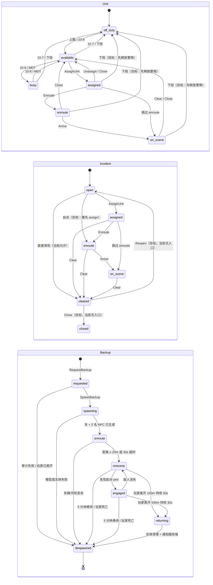
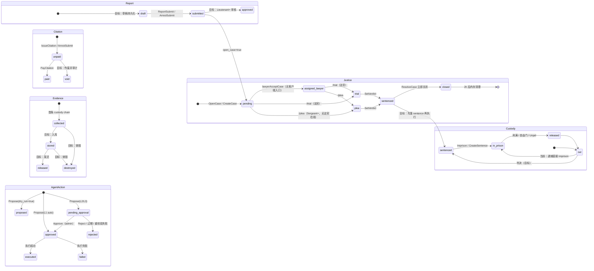

# 02 状态机（执勤 / 警情 / 文书 / 司法 / 在押 / NPC 支援 / Agent / NPC 警情）

> **基线与现状**：本文是 **基线快照（`568acd2`）+ post-baseline 注记**，当前 HEAD 为 `3bbcab3`（2026-10-24）。
> 未标“现在”的表格/图仍是基线事实，保留不删；每节新增的 **`x.6 post-baseline`** 小节给“基线时 / 现在”两列与 file:line / commit 证据。
> 已实施：SM-01 `bb64d87`、SM-02 `5c2d3ca`+`9481074`、SM-03 部分 `f690230`、SM-05 `2ae3da4`+`f690230`；SM-09 为新增（`a52d2ca`+`3bbcab3`）。本文件只读代码后写成，**未改代码、未连数据库、未碰 FXServer**。
>
> 路径简写（下文所有 `文件:行号` 均按此展开）：
>
> - `custom-police/` = `T-CityLite.base/resources/[custom]/custom-police/`
> - `custom-justice/` = `T-CityLite.base/resources/[custom]/custom-justice/`
> - `custom-phone/` = `T-CityLite.base/resources/[custom]/custom-phone/`
> - `custom-director/` = `T-CityLite.base/resources/[custom]/custom-director/`
> - `qb-prison/` = `T-CityLite.base/resources/[qb]/qb-prison/`
>
> **基线时** = `568acd2` 的实际行为；**现在** = `3bbcab3` 的实际行为；**目标** = 重构后应满足的契约。迁移表优先于图：图只给全局关系，所有守卫、写入、审计、失败分支以表为准。
> 正文里的“当前”一律指**基线快照**；`post-baseline` 小节里的“现在”才代表 HEAD。
>
> 未带资源前缀的短名（如 `p0.lua`、`main.lua`、`trial.lua`、`prison.lua`）按所在小节所属资源展开；`custom-justice/server/main.lua` 与 `qb-prison/*/main.lua` 不混用。
> 相关文档：[STATUS.md](../STATUS.md)、[TECH_DEBT.md](../TECH_DEBT.md)、[B_PLAN.md](../B_PLAN.md)、[FLOW_INTERNAL.md](../FLOW_INTERNAL.md)。注意 `FLOW_INTERNAL` 是 P0–P2 之前的审计：`/jail` 手输、罚单无付款页、`/arrest` 三处录入等结论已被后续代码覆盖；本文件只在当前代码仍能复现时引用它（手机 911 不建单、`/fine` 并行、单位列表不过滤在线）。

**状态机索引**

| ID | 对象 | 权威源（HEAD `3bbcab3`） | 主要表 | 结论（基线时 → 现在） |
|---|---|---|---|---|
| SM-01 | Officer Duty / Unit | `police_units.status` 单写入口 + `job.onduty` 投影 | `police_units`、`police_audit` | **已实施（`bb64d87`）**：10-8/10-7 经 `SetJobDuty` 投影、OnJobUpdate 保留任务态、掉线释放、启动 sweep、grade1 自派、`cleared→closed`、MDT 下班可见。基线“6 种非法组合”不再可达 |
| SM-02 | Incident | `police_incidents.status` + transition 表 + `disposition` | `police_incidents`、`police_incident_units` | **已实施（`5c2d3ca`/`9481074`）**：from/to 守卫、`closed` 可达、5 种 disposition、45min stale sweep（60s 周期）、`GetIncidents` 排除 `closed` |
| SM-03 | Arrest / Report / Citation / Evidence | `police_reports` 为锚点 + `police_write_intents` 幂等账本 | `police_reports`、`police_citations`、`police_evidence`、`police_write_intents` | **部分实施（`f690230`）**：`idempotency_key`/`done`/`pending`、`open_case` cap、citation/evidence 独立审计、支付抢占；仍缺事务、`done` 无 TTL、`open_case` 孤儿不可回滚 |
| SM-04 | Justice Case | **custom-justice 内存**（+ v3.7 投影） | 无（判决 best-effort 回写 `police_reports.justice_verdict`） | **未动**：重启即丢；`CASE-0001` 回绕；`27c2619` 只补 `justice_case_id` / v3.7 投影，不构成持久化 |
| SM-05 | Custody | **`justice_sentences.ends_at`（DB 时钟）** | `justice_sentences`、`players.metadata.injail`（投影） | **已实施（`2ae3da4` + `f690230`）**：服务端计时/离线计刑、15s sweep、`SetJailStatus` 不信客户端、trial `replace`、工作减刑服务端化 |
| SM-06 | NPC Backup Unit | 服务端只记“占位 ID”（每警员 ≤2） | 无（仅 `police_audit` 一条 request） | **部分实施**（MVP 保留）：掉线释放已补；服务端仍无状态机/TTL/结束审计/全局 cap |
| SM-07 | Agent Action | `agent_actions` 表 | `agent_actions`、`agent_denials`、`police_audit` | **未动**：仍是全仓库最完整的生命周期；`Sys.Jail` 补偿仍未补 |
| SM-09 | NPC Callout | 服务端 `police_incidents.npc_template` + 客户端场景 | `police_incidents`、`police_incident_units`、`police_audit` | **新增 MVP（`a52d2ca`/`3bbcab3`）**：scheduled→created→assigned→scene_ready→resolved/closed/stale；服务端 8min/30%/max1，客户端 300m/60s/End 清理 |

---

## 0. 两张总图（细节看各节迁移表）

> Mermaid 的嵌套 `state` 只表达“同一个图里有多个对象”；对象之间没有画出全部箭头，跨对象关系在表里说明。图 1 对应现场链，图 2 对应文书/司法/在押/agent 链。

**图 1 — 现场链：Unit、Incident、NPC Backup**



**图 2 — 文书/司法/在押/Agent 链**

> 图里没有画 **SM-09 NPC Callout**：它复用 `Incident` 的 `open→assigned→enroute→on_scene→closed` 迁移，只额外挂一个 `npc_template` 标记与客户端场景；状态与守卫见 §8。



---

## 0.1 一页结论（按修复优先级）

| 序 | 结论 | 证据 | 影响 |
|---|---|---|---|
| 1 | `job.onduty` 与 `police_units.status` 是两个独立事实源；`10-7` 只写 units、不清 onduty，`10-8` 只写 units、不上勤；`OnJobUpdate` 又会把 `assigned/enroute/on_scene` 覆盖回 `available` | `custom-police/server/p0.lua:45-54,262-276`、`custom-police/client/p0.lua:1-9`、`client/job.lua:508-523` | 权限、MDT 显示、派单、看板各读一套；出现“在勤但不可接单”“下班但仍能执法” |
| 2 | 警察被送监时 `qb-prison` 把职业改成 `unemployed`；`syncDuty` 对非 police 直接 return，`playerDropped` 也因 `isPolice` 判断跳过 → `police_units` 留下永久幽灵单位 | `qb-prison/server/main.lua:5-18`、`custom-police/server/p0.lua:262-289`、`custom-director/server/live_api.lua:483-492` | 看板/派单出现已入狱、已失业的“在勤”单位 |
| 3 | Incident 的 `cleared` 被当作关闭（释放单位、写 `closed_at`），但 `closed` 没有任何代码路径；`GetIncidents` 只排除 `closed`，清场后警情永远留在队列/看板 | `custom-police/server/p0.lua:118-137,159-181`、`custom-phone/web/src/apps/PoliceMDT.svelte:202,313` | 接警列表越积越多；统计无法定义“已结案” |
| 4 | 逮捕/报告/罚单/证据没有数据库事务；`ArrestSubmit` 用“先写 report，失败再删除”补偿，删除本身可能失败；`open_case` 在 justice 内存里无法回滚 | `custom-police/server/p2_system.lua:125-136,448-623` | 半写逮捕、孤儿 justice 案件、重复提交 |
| 5 | `ArrestSubmit` 先立即送监；之后 `/trial`、`/plea` 的 `Imprison` 因 `metadata.injail > 0` 直接返回，**判决不改变正在服的刑期** | `custom-police/server/p2_system.lua:604-614`、`custom-justice/server/prison.lua:30-35`、`trial.lua:185-192` | 法庭/认罪协议对刑期是装饰性的 |
| 6 | 在押计时由 qb-prison **客户端**递减并回写；`prison:server:SetJailStatus` 不校验来源/数值；离线时间不服刑；qb-prison 出狱不清理 `JusticeService.Inmates` | `qb-prison/client/main.lua:344-369`、`qb-prison/server/main.lua:5-18`、`custom-justice/server/prison.lua:80-98,146-179` | 改刑期/刷减刑/幽灵囚犯；安全与一致性双输 |
| 7 | `RequestBackup` 服务端只有“按 citizenid 的 requestId 集合”，没有状态、TTL、结束原因；客户端崩溃/静默失败会把名额占住直到掉线 | `custom-police/server/p2_system.lua:172-272`、`custom-police/client/backup.lua:425-519` | 支援名额泄漏；无法度量成功率 |
| 8 | Agent 生命周期是全仓库最完整的（幂等键、TTL、自审拒绝、重校验）；但 police 动作在 director 之外还有一条 `Sys.Jail` 兜底路径，失败时仍写 `police_arrests` 并返回成功表 | `custom-director/server/main.lua:1345-1665`、`custom-police/server/p2_system.lua:99-123` | agent L3 可能“记录成功、实际未入狱” |

**post-baseline 状态（`3bbcab3`）**：第 1 条（duty 双源）由 `bb64d87` 收敛；第 2 条（入狱后幽灵单位）由 `bb64d87` 的 `syncDuty`/掉线释放 + 启动 sweep 覆盖；第 3 条（`closed` 不可达/清场不归档）由 `5c2d3ca`/`9481074` 修复；第 4 条（无事务/幂等）由 `f690230` 部分修复（幂等账本，仍无事务）；第 5 条（判决不改刑期）由 `2ae3da4` 的 `replace` 模式修复；第 6 条（客户端计时）由 `2ae3da4` 把 `ends_at` 收归 DB 修复；第 7 条（NPC 支援无 TTL）**未修**，仅补了掉线释放；第 8 条（`Sys.Jail` 兜底）**未修**。逐条证据见各节 `x.6 post-baseline`。

---

## 1. SM-01 Officer Duty / Unit

### 1.1 状态与权威源

| 状态 | 当前含义 | 谁可以写 | 目标含义 |
|---|---|---|---|
| `off_duty` | 下班；`incident_id` 应为空 | `syncDuty`、`SetUnitStatus`、`playerDropped` | 唯一“下班”状态；`job.onduty=false` 的投影 |
| `available` | 在勤可接单 | `syncDuty`、`SetUnitStatus` | 在勤、无任务、可被派单 |
| `busy` | 手动忙碌 | `SetUnitStatus`（10-6/MDT） | 在勤、暂不接新单；不得带 `incident_id` |
| `assigned` | 已有警情 | `AssignUnit`（玩家/agent） | 任务派生：已派单但未出发 |
| `enroute` | 前往中 | `SetIncidentStatus` | 任务派生：已出发 |
| `on_scene` | 到场 | `SetIncidentStatus` | 任务派生：已到场 |
| `unavailable` | enum 中存在，但没有任何入口写入；看板把它过滤掉 | 无 | 目标：明确“不可用（装备/休息/离线）”并给原因；否则从 enum 删除 |

**当前权威源是分裂的**：

- `police_units.status` 可被 `P.SetUnitStatus`、`syncDuty`、`AssignUnit`、`SetIncidentStatus`、`playerDropped` 五处直接写（`custom-police/server/p0.lua:45-54,153,171-178,262-270,282-289`）。
- `players.job.onduty` 由 qb-core 的 `QBCore:ToggleDuty` 写，`OnJobUpdate` 单向同步到 `police_units`（`custom-police/server/p0.lua:272-276`）。
- MDT 的 `me` 先用 `onduty` 推一个状态，再用 `GetUnits` 覆盖显示（`custom-phone/server/apps/police_mdt.lua:38-64`）；派单/看板读 `police_units`；权限读 `onduty`（`custom-police/shared/policy.lua:40-47`）。三套读法。

### 1.2 迁移表

| From | To | 触发者 / 入口 | 校验（当前 → 目标） | 写入 / 事件 | 审计 | 失败 / 回退 |
|---|---|---|---|---|---|---|
| ∅ | `off_duty` | 玩家加载 `QBCore:Server:PlayerLoaded` → `syncDuty` | 当前：police 且 `onduty=false` 才写；目标：加载时从权威状态重建，不在事件里“猜” | `police_units` upsert（`p0.lua:262-270`） | **无** | DB 异常直接抛事件错误；目标：失败记 `unit.sync_failed`，保留旧值并告警 |
| `off_duty` | `available` | 警局 `[E]` → `QBCore:ToggleDuty` → `OnJobUpdate` → `syncDuty`；或 10-8 / MDT | 当前：无校验、无审计；10-8 不要求 `onduty=true`；目标：`SetDuty(true)` 是唯一入口，先校验 police + 未在押 + 未被禁用 | 写 `players.job.onduty=true`（qb-core）+ `police_units.available`；10-8 只写后者 | 10-8 走 `unit.status`；**上勤本身无审计** | 任一写入失败会留下另一套旧值；目标：单事务/补偿，失败回滚并审计 `unit.duty` |
| `available` | `busy` | 10-6 / MDT「10-6 忙碌」 | 当前：仅 `isPolice` + enum；不要求在勤；目标：必须在勤、无 `incident_id`、可带原因/到期时间 | `police_units.status='busy'` | `unit.status`（`p0.lua:52`） | DB 失败被忽略仍返回 true；目标：affectedRows=1 才成功 |
| `busy` | `available` | 10-8 / MDT | 同上 | `police_units.status='available'`；当前会清 `incident_id` | `unit.status` | 同上 |
| `available` | `assigned` | MDT 派单（grade≥2）`P.AssignUnit`；agent `Sys.AssignUnit` | 玩家路径：incident 存在 + 目标字符串非空；**不校验目标单位存在/在勤/是否已有警情**；agent 路径校验 unit 存在且非 `off_duty`（`p2_system.lua:84-86`）；目标：目标必须 `available`、无活动 incident、同一 incident 幂等 | `police_incident_units` upsert + `police_units.assigned` + `police_incidents.assigned` | `incident.assign` | 对不存在的 unit，`UPDATE` 影响 0 行仍返回成功；目标：`unit_not_found`/`unit_busy` |
| `assigned` | `enroute` | MDT「前往」`SetIncidentStatus('enroute')` | 当前：actor 已在该 incident（`police_incident_units`）或 grade≥2；**不校验 from 状态、不校验 incident 存在**；目标：只允许 `assigned→enroute`，且只改 actor 自己的 unit | `police_incidents.status` + `UPDATE police_units ... WHERE incident_id=?`（会改该 incident 的所有 unit） | `incident.status` | 不存在 incident 也返回成功；目标：`incident_not_found`/`invalid_transition`，失败不改任何行 |
| `enroute` | `on_scene` | MDT「到场」 | 同上；目标：只允许 `enroute→on_scene`，写 `on_scene_at` | 同上 | `incident.status` | 同上 |
| `assigned` | `on_scene` | MDT「到场」 | 当前允许跳过 `enroute`；目标：允许，但审计 `skipped_enroute` | 同上 | `incident.status` | 同上 |
| `assigned/enroute/on_scene` | `available` | `SetIncidentStatus('cleared'/'closed')` | 当前：actor 已分配或 grade≥2；目标：清场只释放 actor 的 unit；只有最后一个 unit 释放后才允许 incident `closed` | `police_units.status='available'`, `incident_id=NULL`；`police_incidents` 状态 | `incident.status` | 把所有挂在该 incident 的单位都改成 `available`，会覆盖别人手动 `busy`；目标：逐 unit 释放，冲突则保留并告警 |
| `available/busy/assigned/enroute/on_scene` | `off_duty` | 10-7 / MDT「10-7」/ 警局下班 | 当前：`syncDuty` 只在 `onduty` 变 false 时写；10-7 不清 `onduty`；目标：统一 `SetDuty(false)`，先释放 incident（回 `open`），再写 `off_duty` | `police_units.off_duty`；`syncDuty` 仅在 off_duty 清 `incident_id`；10-7 不清 | 10-7 走 `unit.status`；下班同步无审计 | 10-7 后 `onduty=true`，仍可通过 `PolicePolicy`、MDT 仍可见；目标：单一入口 + fail-closed |
| 任意 | `off_duty` | `playerDropped`（`p0.lua:282-289`） | 当前：仅当 `isPolice(data)` 时写；如果玩家已被 qb-prison 改成 `unemployed`，直接跳过 → 幽灵行 | `police_units.off_duty`, `incident_id=NULL` | 无 | 目标：无论当前 job 都释放；同时把其 incident 回 `open`（无其他 unit 时）并审计 `unit.drop` |
| 任意 | `off_duty` | 目标：`Sweep()` 心跳/在线检查 | 当前：无；目标：`updated_at` 超过 N 分钟且不在线 → `off_duty`，审计 `unit.stale` | `police_units` | `unit.stale` | 目标：不删行，保留历史；`GetUnits` 默认只返回在线/最近心跳 |

### 1.3 `job.onduty` × `police_units.status`：当前合法组合

| `job.onduty` | `police_units.status` | 怎么产生 | 后果 |
|---|---|---|---|
| true | `available` | 正常上勤 + 10-8 | 正常 |
| true | `busy` / `assigned` / `enroute` / `on_scene` | 正常 | 正常（但这几个状态也会被 `syncDuty` 覆盖，见下） |
| true | `off_duty` | 10-7 / MDT 10-7（只写 units） | **最危险**：MDT 仍可见、所有 `PolicePolicy.Can` 仍通过、看板/`GetUnits` 显示下班；派单与权限打架 |
| false | `available` | 未上勤直接 10-8；或上勤后 qb-core 掉 onduty 但 units 未同步 | 单位显示可派，但所有 action 返回 `not_on_duty`；MDT App 被 audience 挡住 |
| false | `off_duty` | 正常下班 | 正常 |
| false | `assigned/enroute/on_scene` | 玩家在任务中被改成 `unemployed`（入狱）或 `syncDuty` 未覆盖 | 幽灵单位；看板 `status <> off_duty` 仍显示 |
| true | `available` + `incident_id` 非空 | 玩家在 `assigned` 时触发了 `SetJob`（升职/降职）→ `syncDuty` 写 `available`，但 `syncDuty` 只在 `off_duty` 清 `incident_id` | 单位“可接单”但还挂在旧警情；再次派单会产生双 incident |

**根因**：`syncDuty` 是“任何 JobUpdate 都把状态重置为 available/off_duty”的 last-writer-wins（`p0.lua:262-270`）；`SetUnitStatus` 又是另一条写路径（`p0.lua:45-54`）；`playerDropped` 的 `isPolice` 早退让“已改职业”的行永远留下（`p0.lua:282-289`）。

### 1.4 目标模型（TD-01 的落地契约）

**建议放置**：先放 `custom-police` 服务端（它拥有 `police_units` 与所有调用方），通过 export 暴露；等 EMS/其他部门也要用时再上提 `core-framework`/Bus。不要一开始就跨资源拆服务，避免又一次双写。

```lua
-- 目标 API（名字可改，语义不变）
PoliceDuty.SetDuty(citizenid, on)        -- on=true → Available；false → OffDuty；同步 qb-core 投影
PoliceDuty.SetManual(citizenid, state, meta) -- available|busy|unavailable，meta={reason,until}
PoliceDuty.Assign(citizenid, incidentId) -- available → assigned
PoliceDuty.Mark(citizenid, incidentId, state) -- assigned → enroute → on_scene
PoliceDuty.Release(citizenid, reason)    -- 任意 → available|off_duty，原子释放 incident
PoliceDuty.Sweep()                       -- 掉线/心跳/超时
```

**不变量**（必须可测试）：

1. `status ∈ {off_duty, available, busy, unavailable, assigned, enroute, on_scene}`。
2. `on_duty ⇔ status ≠ off_duty`；`job.onduty` 只是投影，任何入口不得单独写它。
3. `incident_id ≠ NULL ⇔ status ∈ {assigned, enroute, on_scene}`；`available/busy/unavailable/off_duty` 必须为 NULL。
4. 一个 unit 同时最多一个活动 incident（DB 唯一约束或服务层锁）。
5. 一个 incident 在 `assigned/enroute/on_scene` 时至少有一个 unit；`open` 时没有强制 unit。
6. 每次迁移校验 from 状态；非法迁移返回 `invalid_transition`，不写任何行。
7. 每次迁移写一条 `police_audit`，并检查 `affectedRows=1`；审计失败对写操作 fail-closed。
8. 掉线/失业/入狱都必须走 `Release`，不得依赖 `syncDuty` 的 `isPolice` 分支。

**`syncDuty` 的处置**：改成只做“登录时从 `police_units` 投影到 `job.onduty`”和“job 变成非 police 时强制 `Release(...,'job_changed')`”，不再在每次 JobUpdate 写 `available`。`QBCore:ToggleDuty` 触发的 `OnJobUpdate` 要么被 duty 服务识别为“自己发起的投影”而忽略，要么 qb-core 改为调用 `PoliceDuty.SetDuty`。

### 1.5 超时 / 掉线

- **当前**：无心跳、无 TTL；`GetUnits` 直接 `SELECT * FROM police_units LIMIT 100`，名字只对在线玩家填充（`p0.lua:56-75`），离线行显示空名但状态仍参与看板。
- **当前**：`playerDropped` 在 job 已变时早退（`p0.lua:282-289`）；`syncDuty` 对非 police 早退；两者叠加造成永久幽灵行。
- **目标**：`Sweep` 每 30–60s 跑一次：不在线且 `updated_at` 超过 10 分钟 → `off_duty` + `unit.stale`；在线但 `updated_at` 超过 5 分钟无心跳 → 标记 `stale` 但不改状态（避免误伤），看板显示 stale。`GetUnits` 默认过滤 `stale`/离线，`include_offline=true` 才返回全量。掉线时立即 `Release`，不等待 Sweep。

### 1.6 post-baseline 实施状态（**已实施**，`bb64d87`）

| 项 | 基线时（`568acd2`） | 现在（`3bbcab3`） | 证据 |
|---|---|---|---|
| 10-8 上勤 | 只写 `police_units.status`，`onduty` 仍 false | `SetUnitStatusForSource('available')` 先 `SetJobDuty(true)`，投影失败返回 `duty_failed` | `custom-police/server/p0.lua:585-592` |
| 10-7 下班 | 只写 units，`onduty` 仍 true；MDT 仍可用 | 先 `SetJobDuty(false)`，失败返回 `duty_failed`；同步写 `off_duty` | `custom-police/server/p0.lua:574-583` |
| `OnJobUpdate` | 把 `assigned/enroute/on_scene` 覆盖回 `available` | 只在**新行或当前是 `off_duty`** 时写 `available`；busy/任务态保持 | `custom-police/server/p0.lua:406-425` |
| 非 police / 入狱改职业 | `syncDuty` 早退，留下幽灵单位 | 非 police 一律 `takeUnitOffDuty`，清 `incident_id` | `custom-police/server/p0.lua:409-412,75-78` |
| 掉线 | 只改 unit，`isPolice` 为假时跳过；incident 永远 assigned | `QBCore:Server:PlayerDropped` + `playerDropped` 双入口；释放 unit，若无其他 unit 则 incident 回 `open`，审计 `unit.drop`/`incident.unassign` | `custom-police/server/p0.lua:442-484` |
| 启动 sweep | 无 | `onResourceStart` 10s 后把“不在线但非 off_duty”的行扫成 `off_duty`，审计 `unit.stale` | `custom-police/server/p0.lua:486-504,543-551` |
| grade1 自派 | 硬阻断（`incident.assign` 要 grade2） | grade1 且 `onduty=true` 可把 `open/assigned` 的警情派给**自己**；派给别人仍 `rank_too_low` | `custom-police/server/p0.lua:216-226,236` |
| `cleared` | 不进 `closed`，队列残留 | `cleared`/`cancelled` 归档为 `closed` 并写 disposition；`SetIncidentStatus` 走 transition 表 | `custom-police/server/p0.lua:267-310` |
| MDT 下班可见 | App `audience.onduty=true` 把下班警员挡在外面 | MDT app 保留“下班可见”，仅 `jobs={'police'}`，权限仍逐 action 复检 | `custom-phone/server/apps/police_mdt.lua:1-3,32-36` |

**不变量对齐**：`INV-1`（非 off_duty ⇒ onduty）现在由两个 duty 入口强制；`INV-2`（`incident_id` 只属于任务态）由 `upsertUnit` 的 `IF(... IN (...), NULL, incident_id)` 保证（`p0.lua:67-73`）；`INV-8` 的两套状态不再由 `job.onduty` 单独驱动。

**仍未做**：`unavailable` 仍无写入入口；`GetUnits` 仍不过滤离线行（仅启动/掉线时清扫）；心跳/`updated_at` stale 标记未实现（只有启动 sweep，没有在线心跳超时）。

---

## 2. SM-02 Incident

### 2.1 状态

| 状态 | 当前含义 | 允许的下一状态（目标） |
|---|---|---|
| `open` | 已建单，无人接 | `assigned`、`cleared`（取消，需原因）、`closed`（重复/无效单，需原因） |
| `assigned` | 至少一个 unit | `enroute`、`on_scene`、`open`（全部释放）、`cleared` |
| `enroute` | 至少一个 unit 在途 | `on_scene`、`assigned`（退回）、`cleared` |
| `on_scene` | 至少一个 unit 到场 | `cleared`、`assigned`（全部退回） |
| `cleared` | 现场处置完成，待归档 | `closed`、`open`（重开） |
| `closed` | 归档；只读 | `open`（重开，需 Lieutenant+ 与原因） |

当前代码只把 `cleared` 当终点：`closed` 无入口，`cleared` 也不会自动归档。

### 2.2 迁移表

| From | To | 触发者 / 入口 | 校验（当前 → 目标） | 写入 / 事件 | 审计 | 失败 / 回退 |
|---|---|---|---|---|---|---|
| ∅ | `open` | 平民 `/911` → `custom-police:server:911` → `P.CreateIncident`；agent `Sys.CreateIncident` | 当前：玩家路径只校验 `player` 存在、title 非空；无频率/去重/坐标合法性；agent 路径 audit 先写、失败 fail-closed；目标：`source` 枚举（civilian/officer/npc/agent/auto）、每 citizen 30s 1 条、同标题+坐标 5 分钟去重、坐标有限且在 GTA 范围内 | `police_incidents` insert；给在勤警察写 `phone_notifications` + `phone:client:newNotification`（`p0.lua:96-114`）；agent 广播（`p2_system.lua:40-54`） | 玩家路径 `incident.create`（审计失败仍返回成功）；agent `incident.create` 失败即拒绝 | DB 插入失败返回 `db_error`；通知写失败不回滚（可接受，但目标要记 `incident.notify_failed`）；`/911` 无审计失败处理 |
| `open` | `assigned` | MDT 派单 `P.AssignUnit`；agent `Sys.AssignUnit` | 当前：incident 存在 + grade≥2；不校验 unit；agent 校验 unit 非 off_duty；目标：incident 必须 `open`（或同 incident 幂等），unit 必须 `available`，且一个 unit 只能有一个活动 incident | `police_incident_units` upsert、`police_units.assigned`、`police_incidents.assigned` | `incident.assign` | 玩家路径对不存在 unit 仍成功；目标：`unit_not_found`/`unit_off_duty`/`unit_busy`；失败不写任何行 |
| `assigned` | `enroute` | MDT「前往」`SetIncidentStatus` | 当前：actor 已分配或 grade≥2；无 from 状态校验、无 incident 存在校验；目标：仅 `assigned→enroute`，只改 actor 自己的 unit | `police_incidents.status`；`UPDATE police_units SET status='enroute' WHERE incident_id=?`（会改所有 unit） | `incident.status` | DB 0 行也返回成功；目标：`incident_not_found`/`invalid_transition`；单 unit 更新 |
| `enroute` | `on_scene` | MDT「到场」 | 同上；目标：仅 `enroute→on_scene`，写 `on_scene_at` | 同上 | `incident.status` | 同上 |
| `assigned` | `on_scene` | MDT「到场」 | 当前允许跳过；目标：允许，审计带 `skipped_enroute` | 同上 | `incident.status` | 同上 |
| `open/assigned/enroute/on_scene` | `cleared` | MDT「清场」`SetIncidentStatus('cleared')` | 当前：actor 已分配或 grade≥2；无 from 校验；不要求报告/处置码；目标：`on_scene→cleared` 优先；`open→cleared` 只允许“误报/重复单”并要原因；`assigned/enroute→cleared` 允许但记原因 | `police_incidents.status`, `closed_at=NOW()`；所有挂该 incident 的 unit → `available`、`incident_id=NULL`；`police_incident_units` 保留历史 | `incident.status` | 会把其他 unit 的 `busy` 覆盖成 `available`；目标：逐 unit 释放；关闭动作不影响手动 busy 的单位 |
| `cleared` | `closed` | **当前无入口**；目标：MDT「归档」/自动 Sweep（Lieutenant+ 或超时） | 目标：`cleared` 且 ≥N 分钟（建议 30）或手动；写 `cleared_at`/`closed_at`；不删行 | `police_incidents.status='closed'`, `closed_at=NOW()` | `incident.close` | 目标：`invalid_transition`；归档失败不改状态 |
| `cleared` | `open` | 目标：重开 | 目标：Lieutenant+、原因必填、清 `closed_at`/`cleared_at` | `police_incidents.status='open'` | `incident.reopen` | 当前无入口；`closed_at` 在重开时不会清（`IF(?,NOW(),closed_at)` 保留旧值） |
| 任意 | `closed` | 目标：无效单/重复单直接关闭 | 目标：`open→closed` 需 grade≥3 + 原因；`assigned+` 不允许直接关闭，必须先释放 | 同上 | `incident.close` | 当前 `closed` 不可达；目标补审计 |
| 任意 | `stale`（目标新增标记，不改 status） | 目标：Sweep | 目标：`open/assigned` 超过 30 分钟无 unit 活动 → 标记 stale + 提升优先级；不自动关闭 | `police_incidents.stale_at` 或单独表 | `incident.stale` | 当前无超时；警情永久 `assigned` |

### 2.3 当前实现的硬缺口

1. **`closed` 不可达**：MDT 只发 `cleared`（`PoliceMDT.svelte:313`），服务端没有 `closed` 调用。`GetIncidents` 默认 `WHERE status NOT IN ('closed')`（`p0.lua:124-125`），所以 `cleared` 仍出现在接警列表；live board 也只排除 `closed`（`custom-director/server/live_api.lua:489-491`）。结果：清场后的单永远在队列里。
2. **无 from/to 守卫**：`P.SetIncidentStatus` 接受任意合法 enum，从 `closed` 可以回到 `enroute`；grade≥2 可以不分配就直接改任意 incident（`p0.lua:159-181`）。
3. **不校验 incident 存在**：`UPDATE ... WHERE id=?` 影响 0 行仍返回成功。
4. **清场释放所有单位**：`UPDATE police_units SET ... WHERE incident_id=?` 会把同警情的其他单位一起改成 `available`，覆盖 `busy`。
5. **`closed_at` 语义混用**：`cleared` 就写 `closed_at`，重开时 SQL 保留旧值；没有 `cleared_at` 列，无法算“现场时长”。
6. **无超时/无自动升级**：`assigned` 的单位掉线后，incident 永远 `assigned`（见 SM-01 掉线分支）。
7. **手机 911 不建单**：`phone:server:triggerHotlineCall` 只给在勤警察发通知（`custom-phone/server/main.lua:952-980`），不写 `police_incidents`；MDT 也没有 `create_incident` action（`custom-phone/server/apps/police_mdt.lua:166-275`）。F5/B7 仍成立。
8. **通知不带 incident id**：`phone_notifications.content` 只有 description，没有 `#id` 或深链参数（`p0.lua:96-112`），点进 MDT 也无法定位到单。

### 2.4 目标 API / 不变量

```lua
Incident.Create(actor, source, data, idempotencyKey)
Incident.Assign(actor, incidentId, citizenid)
Incident.Mark(actor, incidentId, state)   -- enroute|on_scene
Incident.Clear(actor, incidentId, disposition, reason)
Incident.Close(actor, incidentId, reason)
Incident.Reopen(actor, incidentId, reason)
Incident.Sweep()
```

- `source ∈ {civilian, officer, npc, agent, auto}` 落库；`created_by` 保留 actor id。
- 所有迁移用条件 UPDATE：`WHERE id=? AND status=?`；`affectedRows=0` → `invalid_transition` 或 `not_found`。
- `police_incident_units` 加 `role`、`assigned_at`、`released_at`、`release_reason`；单位释放写历史，不物理删。
- `cleared` 需要 `disposition`（`report`/`citation`/`arrest`/`no_action`）才能关闭；B_PLAN 的“记录覆盖率 ≥70%”直接基于这个字段。
- `closed_at` 只在 `closed` 写；新增 `cleared_at`、`on_scene_at`、`enroute_at`（或统一 `police_incident_events` 表）。
- 通知正文带 `#<incident_id>`；MDT 收到 `phone:client:newNotification` 后自动 refresh，或服务端直接推 `police:client:IncidentCreated`。

### 2.5 超时 / 掉线

- **当前**：无任何超时；`playerDropped` 只改 unit，不改 incident，`police_incident_units` 仍保留该 citizenid，incident 保持 `assigned`/`enroute`。
- **目标**：`playerDropped` → `Unit.Release(cid,'drop')` → `Incident.OnUnitReleased`：如果该 incident 没有其他活动 unit，状态回 `open` 并清 `police_incident_units.released_at`，审计 `incident.unassign`；`assigned` 超过 10 分钟无人 `enroute` → `incident.no_response` 通知调度；`on_scene` 超过 2 小时无更新 → stale 标记，不自动关闭。

### 2.6 post-baseline 实施状态（**已实施**，`5c2d3ca` + `9481074`）

**transition 表**（代码里的 `INCIDENT_TRANSITIONS`，`custom-police/server/p0.lua:19-26`）：

| From | 允许的 To | 说明 |
|---|---|---|
| `open` | `assigned`、`closed` | 未派单可直接误报归档 |
| `assigned` | `enroute`、`open`、`closed` | `open` = 全部释放/取消派单 |
| `enroute` | `on_scene`、`assigned`、`closed` | 可退回 |
| `on_scene` | `closed` | 只能归档 |
| `cleared` | `closed` | 仅兼容历史行；新写入不再产生 `cleared` |
| `closed` | ∅ | 终态 |

同状态重试 = 幂等成功（`p0.lua:288-292`），不再写第二行审计；非法迁移返回 `invalid_transition`（`p0.lua:293-296`）。

| 项 | 基线时 | 现在 | 证据 |
|---|---|---|---|
| from/to 守卫 | 任意 enum 可跳转，`closed` 不可达 | 表驱动迁移 + 条件 UPDATE；`cleared/cancelled/closed` 统一归档为 `closed` | `p0.lua:259-310` |
| 关闭处置码 | 无 `disposition` | `disposition ∈ {cleared,cancelled,false_alarm,stale,arrest}`；非法返回 `invalid_disposition`；写 `closed_by`/`closed_reason`/`last_activity_at` | `p0.lua:27-29,267-277,298-306`、`migrations/v3.10_police_incident_disposition.sql` |
| stale | 无超时，警情永久 `assigned` | 45 分钟无活动（`COALESCE(last_activity_at, created_at)`）→ `closed` + `disposition='stale'` + `closed_reason='stale_timeout'`，批量上限 50，每 60s 扫一次（启动 15s 后首跑） | `p0.lua:506-541`（`SweepStaleIncidents` 导出在 `:608`） |
| `GetIncidents` | 排除 `closed` 但 `cleared` 永远在队列 | 只允许按 `open/assigned/enroute/on_scene` 过滤；默认 `status NOT IN ('closed')`，返回行显式带 `disposition` / `npc_template` | `p0.lua:32-34,185-210` |
| 派单幂等 | 重复分配写第二行 | 同 incident + 同 unit 且状态仍活动 → `idempotent=true`，不写审计；`ON DUPLICATE KEY UPDATE joined_at=joined_at` | `p0.lua:237-256` |
| 清场释放 | 一条 `UPDATE ... WHERE incident_id` 把所有单位改 `available`，覆盖手动 busy | 只释放 `assigned/enroute/on_scene`；`busy` 只清 `incident_id` 保留 busy | `p0.lua:89-100,307` |
| 掉线释放 | incident 不变 | 无其他 unit 时回 `open` + `incident.unassign` 审计 | `p0.lua:442-459` |
| `closed_at` 语义 | `cleared` 也写 `closed_at` | `closed_at` 只在 `closed` 写；`last_activity_at` 承担 SLA 心跳 | `p0.lua:298-306`、v3.10 |

**仍未做**：30s/5min 去重限流、通知正文带 `#id`、手机 911 建单、`police_incident_units.released_at`（关联行仍只增不删，靠 `police_units.incident_id` 表达“当前”）；`stale` 是 `disposition` 而不是独立 `status`（与基线“目标新增标记”不同，但满足“自动归档”的验收）。

---

## 3. SM-03 Arrest / Report / Citation / Evidence

### 3.1 对象与状态

| 对象 | 状态 | 当前是否会写入 | 目标 |
|---|---|---|---|
| `police_reports(kind='report')` | `draft` / `submitted` / `approved` | 只写 `submitted`（`p1.lua:107-113`、`p2_system.lua:733-740`）；`draft`/`approved` 无入口 | `draft` 持久化（自动保存）；`submitted` 后可 `approved`（Lieutenant+）；`approved` 后不可改，只能追加 addendum |
| `police_reports(kind='arrest')` | 同上（借用 report.status） | 只写 `submitted`（`p2_system.lua:448-455`）；没有“已送监/已判决”状态 | 增加 `arrest_status ∈ {submitted, jailed, failed, closed}` 或独立 `police_arrest_operations`，不得用 `report.status` 混表达 |
| `police_citations` | `unpaid` / `paid` / `void` | 只写 `unpaid`（`p1.lua:51-63`、`p2_system.lua:520-533`），`PayCitation` 写 `paid`（`p1.lua:153`）；`void` 无入口 | 增加 `void`（grade≥3 + 原因）与 `voided_at`；支付失败/重复支付要有幂等键 |
| `police_evidence` | `collected` / `stored` / `released` / `destroyed` | 只写 `collected`（`p2_evidence.lua:53-64`、`p2_system.lua:536-558`）；其余状态无入口 | 要么实现四态迁移 + 保管链，要么把 enum 缩成 `collected`，不要留“看起来支持”的假状态 |
| `police_evidence_chain` | append-only | 首条 `collected` 自动写（`p2_evidence.lua:62`、`p2_system.lua:549-553`） | 每次状态变更追加一条；禁止 UPDATE/DELETE |

### 3.2 迁移表

| From | To | 触发者 / 入口 | 校验（当前 → 目标） | 写入 / 事件 | 审计 | 失败 / 回退 |
|---|---|---|---|---|---|---|
| ∅ | `draft` | 目标：MDT 打开表单/自动保存 | 当前：不存在；表单只在客户端内存，关页即丢（`PoliceMDT.svelte:470-490`） | 目标：`police_reports(status='draft')` 或独立 drafts 表 | 目标：`report.draft`（可合并，避免噪声） | 目标：自动保存失败提示但不阻塞填写 |
| `draft` | `submitted` | `ReportSubmit`（grade≥1、在勤） | 当前：title≥3、body≥10；incident/case 存在；可选 evidence/BOLO；目标：同 + `draft_id` 幂等键 + 提交时重校验权限/目标在线性 | `police_reports` insert；可选 `police_evidence` + `police_evidence_chain(collected)`；BOLO 是 report 字段（`is_bolo/bolo_*`） | `report.create`、`evidence.register`、`bolo.create`；任一审计失败回滚 report/evidence（`p2_system.lua:781-794`） | `db_error`/`audit_unavailable`；回滚用 DELETE，可能二次失败留下孤儿；目标：事务/幂等 |
| ∅ | `submitted`（kind=`arrest`） | `ArrestSubmit`（grade≥1、在勤） | 当前全部前置：目标在线、`ishandcuffed`/`isdead`/`inlaststand`、≤5m、`injail=0`、charge 1–8 且白名单、incident/case 存在、`create_case` 要 grade≥2、BOLO 要 grade≥2、citation 金额 0.8–1.2×、evidence label 非空、`open_case` **无 grade 校验**（`p2_system.lua:336-446`） | report（kind=arrest, status=submitted）+ 可选 case + citation + evidence + `justice_case_id`，最后 `Imprison` | 只有 `arrest.register`、`case.create`、`bolo.create`；**没有** `report.create`、`citation.issue`、`evidence.register` | 逐段 rollback（DELETE），但 `open_case` 内存案件无法回滚，`jail_failed` 时可能留下孤儿案；audit 失败在送监后只返回 `ok=false, jailed=true`（`p2_system.lua:615-651`） |
| `submitted` | `approved` | 目标：Lieutenant+ 审核 | 当前：无入口 | 目标：`status='approved'`、`approved_by/at` | 目标：`report.approve` | 当前不存在；`approved` enum 是死值 |
| `unpaid` | `paid` | 平民手机「我的罚单」→ `PayCitation` | 当前：本人、`status='unpaid'`、bank 扣款成功；**先扣款再条件 UPDATE，且不检查 affectedRows**（`p1.lua:143-155`） | `police_citations.status='paid'`, `paid_at` | `citation.pay` | 并发两次可各扣一次钱、两次都成功；目标：先 `UPDATE ... WHERE status='unpaid'` 抢占，再扣款，失败回滚；或支付幂等键 |
| `unpaid` | `void` | 目标：grade≥3 作废 | 当前：无入口 | 目标：`status='void'`, `voided_by/at/reason` | 目标：`citation.void` | 当前罚单永远 `unpaid` 或 `paid`，无法纠错 |
| `collected` | `stored/released/destroyed` | 目标：证据管理页 | 当前：无入口；`RegisterEvidence` 只写 `collected` | 目标：`police_evidence.status` + `police_evidence_chain` 追加 | 目标：`evidence.store/release/destroy` | 当前 `status` enum 四值但只有一值可达 |

### 3.3 原子性矩阵（`ArrestSubmit` 当前顺序）

| # | 步骤 | 表 / 外部 | 当前失败处理 | 目标 |
|---|---|---|---|---|
| 1 | 写 report（锚点） | `police_reports` | 失败 → `db_error`，未写其他 | 事务内第一步；失败整体回滚 |
| 2 | 可选建 `police_cases` + 回填 `case_no` | `police_cases` | 失败 → `rollback()` 删 report，返回 `case_create_failed`/`db_error` | 同事务；`case_no` 由序列/触发器生成，避免“先 insert 再 update” |
| 3 | 回填 `report.case_id` | `police_reports` | 失败 → rollback | 直接带 `case_id` 插入，减少一步 |
| 4 | 可选 citation | `police_citations` | 失败 → rollback 删 report/case | 同事务；写 `report_id` 外键；独立 `citation.issue` 审计 |
| 5 | 可选 evidence + chain | `police_evidence`、`police_evidence_chain` | 失败 → rollback 删 evidence/chain/citation/case/report | 同事务；`exhibit_no` 用 insert id 直接生成，避免再 update；独立审计 |
| 6 | 可选 `open_case` | custom-justice **内存** | 失败 → rollback；成功但后续失败 → **无法回滚** | 不放在事务内；改为“落库 `justice_cases` + outbox 事件”，或接受 `open_case` 在送监成功后异步创建并补偿 |
| 7 | 回填 `justice_case_id` | `police_reports` | 失败 → rollback（但内存案件已建） | 落库外键；失败重试/outbox |
| 8 | `Imprison` | custom-justice → metadata/qb-prison | justice 失败 → 兜底 `SetMetaData('injail')` + `prison:client:Enter`（`p2_system.lua:610-613`）；兜底成功则继续并返回 `ok=true`，但 justice 无 Inmate/Case；兜底也失败才 rollback + `jail_failed` | 用 `justice_sentences` 表 + 事务状态机；送监是 commit 后动作，用 outbox 重试，禁止第二条隐式送监路径 |
| 9 | 通知罚单 | `phone_notifications` | `pcall`，失败只打印 | 保持 best-effort，但写 `citation.notify_failed` 审计/指标 |
| 10 | 审计 | `police_audit` | 失败 → `ok=false, jailed=true`（已送监） | 审计与业务同事务，或先写 intent；不得出现“成功但无审计”的静默 |

### 3.4 目标契约（可直接开 Issue）

1. **幂等键**：`police_reports` 加 `idempotency_key CHAR(64) NULL UNIQUE`。`ArrestSubmit` 计算
   `sha256(officer_citizenid|subject_citizenid|incident_id|sorted(charge_ids)|citation_amount|create_evidence|open_case)`；同键同参返回原结果（`report_id`/`citation_id`），不同参返回 `idempotency_conflict`。`ReportSubmit` 同理（title+body+incident+case+evidence 标记）。
2. **事务**：当前 oxmysql 没有 `transaction` export（`p2_system.lua:125-136` 注释自承）。两条路：
   - 给 oxmysql 加 `transaction`（或单独连接执行 `START TRANSACTION/COMMIT/ROLLBACK`），**不要**在连接池上用多条 `.await` 假装事务；
   - 若短期不能改后端，建 `police_write_intents(id, kind, payload, status, attempts, last_error, created_at, updated_at)`，按 `intent → report_written → children_written → sentenced → done/failed` 推进，服务端启动时 `Sweep` 未完成 intent。所有“删除补偿”改成“标记 failed + 人工/自动重试”，不物理删审计痕迹。
3. **金额校验**：`B_PLAN.md` 要求“金额必须在 base×0.8–1.2；越界被拒”，当前 `deriveCitationAmount` 是**静默 clamp**（`p2_system.lua:313-328`）。改为：客户端滑轨只做 UI，服务端对越界返回 `amount_out_of_range`；`IssueCitation`（独立罚单）也必须接罪名目录并做同样校验，不能保留 1–50000 任意金额（`p1.lua:46`）。
4. **`open_case` 权限**：UI 写“Sergeant+”（`PoliceMDT.svelte:894-896`），服务端只检查 `case.create` 用于 `create_case`，`open_case` 完全不查（`p2_system.lua:399-404,564-578`）。加 `PolicePolicy.Can(actor,'case.create')` 或新 cap `case.open`。
5. **审计补齐**：逮捕内的 citation/evidence 要写 `citation.issue`、`evidence.register`；`report.create` 也要写（当前 kind=arrest 完全没有）。审计失败策略要统一：送监前 fail-closed，送监后写 `arrest.audit_failed` 并返回 `jailed=true` 的可恢复错误。
6. **犯罪记录**：新逮捕路径不再写 `players.metadata.criminalrecord`（只有 legacy `police:server:JailPlayer` 写，`custom-police/server/interactions.lua:178-182`）。要么在 `ArrestSubmit` 写，要么明确“犯罪记录 = police_reports”，并让 MDT 查询改读 reports；不要留一个永远不更新的 metadata。
7. **证据状态**：不打算做入库/发还/销毁，就把 enum 缩成 `collected`，避免 UI/查询以为有四态；要做就补 `evidence.store/release/destroy` 入口与 chain。

### 3.5 超时 / 掉线

- **提交没有超时/取消令牌**：`ArrestSubmit`/`ReportSubmit` 在入口捕获 `actor`/`targetPlayer`，之后一路 `.await`；如果警官在写 report 后掉线，请求仍会继续写 citation/evidence 并送监，审计 actor 仍是该 citizenid。当前没有“actor 掉线则中止”的检查，也没有客户端 request id 可取消。
- **目标在提交中掉线**：`ArrestSubmit` 只在入口检查 target 在线；后续 `Imprison` 可能走 offline 分支（见 SM-05），导致“记录在、人自由”。目标：在送监前再查一次 `GetPlayerByCitizenId`，离线则回滚并返回 `target_offline`，或落 `justice_sentences` 等登录结算。
- **DB `.await` 没有 statement timeout**：任一 await 卡住时，HTTP/phone 请求会一直挂起；客户端关闭手机不会取消服务端协程。目标：给 oxmysql 配置 query timeout，并在服务端加整体 deadline（例如 10s），超时走失败/补偿。
- **重复点击/网络重试**：没有幂等键，客户端 `submitting` 只防 UI 层重复；换设备/重连/重试仍会重复写。目标：`idempotency_key` + 唯一索引（见 3.4）。
- **审计失败**：`ReportSubmit` 在送监前审计失败会回滚；`ArrestSubmit` 在送监后审计失败只能返回 `ok=false, jailed=true`，没有补偿。目标：审计与业务同事务，或先写 intent；至少把 `jailed=true` 作为明确的可恢复状态返回给 UI。

### 3.6 post-baseline 实施状态（**部分实施**，`f690230`）

| 项 | 基线时 | 现在 | 证据 |
|---|---|---|---|
| 幂等键 | 无；双击写第二份 report/citation | `ArrestSubmit`/`ReportSubmit` 接受 `params.idempotency_key`（`^[A-Za-z0-9_-]{8,128}$`）；先 claim 再写，异常/业务失败删键，成功写 `done` + `result_json` | `custom-police/server/p2_system.lua:154-267,469,828`、`migrations/v3.9_police_write_intents.sql` |
| 重复调用语义 | 无 | `done` 重放首次结果；`pending` 返回 `in_progress`；格式错返回 `invalid_idempotency_key`；同键不同参不会重新执行（仍返回首次结果，**没有** `idempotency_conflict`） | `p2_system.lua:179-266` |
| 幂等账本 | 无表 | `police_write_intents(idem_key PK, action, status pending/done/failed, result_json, created_at)`；索引 `idx_actor_created`、`idx_created` | v3.9 |
| `open_case` 权限 | 服务端完全不查 grade | 与 `create_case` 同门槛：`PolicePolicy.Can(actor,'case.create')`（≥2），失败 `case_forbidden` | `p2_system.lua:531-537` |
| 审计补齐 | kind=arrest 不写 `report.create`/`citation.issue`/`evidence.register` | 送监成功后统一补 `citation.issue`/`evidence.register`/`arrest.register`（+ 可选 `bolo.create`/`case.create`），任一失败返回 `audit_unavailable` + `jailed=true` | `p2_system.lua:766-797` |
| 支付抢占 | 先扣钱再条件 UPDATE，不检查 affectedRows；并发双扣 | 先 `UPDATE ... WHERE status='unpaid'` 抢占（affectedRows=1 才继续），再 `RemoveMoney`；扣款失败回滚 `paid→unpaid` | `custom-police/server/p1.lua:146-193` |
| 事务 | 无（oxmysql 无 `transaction`），靠反向 DELETE | **仍无**；`rollback()` 仍是反向 DELETE（chain→evidence→citation→case→report） | `p2_system.lua:127-136,591-614` |
| `open_case` 回滚 | 内存案件无法删 | **仍无**；`OpenCase` 在 report 之后、送监之前，`jail_failed` 时孤儿案件留给法官关闭 | `p2_system.lua:694-712,749-757` |
| `done` 账本 TTL | — | **有风险**：`done` 行永不过期，只有 `created_at < NOW()-1 DAY` 的**全部状态**行被惰性删 200 条/次；删除后同键重放会重新执行（失去幂等），而 `done` 无 `result_json` 时直接 `db_error` | `p2_system.lua:196-201,253-258` |
| 金额校验 | `deriveCitationAmount` 静默 clamp | **仍静默 clamp**（`base×0.8~1.2`）；`IssueCitation` 独立路径仍接受 1..50000 任意金额 | `p2_system.lua:436-451`、`p1.lua:40-72` |
| `/fine` 旁路 | 扣钱不写表、不审计 | **未修** | `custom-police/server/commands.lua:259-311` |

**结论**：可重试性从“无”变成“按键去重 + 结果重放”，但**不是事务**；崩溃窗口仍可能留下半写，`open_case` 孤儿与账本 TTL 是两个明确的剩余风险（FIT-04/FIT-05/04 D-16 跟踪）。

---

## 4. SM-04 Justice Case

### 4.1 内存 vs 持久化（当前事实）

- `activeCases` 是 `custom-justice/server/main.lua:7-8` 的模块级 table；`caseCounter` 是进程内数字，重启从 0 开始，案件号 `CASE-0001` 会**回绕**（`main.lua:18-21`）。
- `JusticeService.Inmates` 同样是内存（`main.lua:10-12`）。
- 唯一持久化是判决 best-effort 回写：`UPDATE police_reports SET justice_verdict=?, justice_status=? WHERE justice_case_id=?`（`custom-justice/server/trial.lua:30-49`）。
- `police_reports.justice_case_id` 是 `VARCHAR(32)`（`migrations/v3.6_police_justice_case.sql`），justice 案件号是 `CASE-0001` 字符串；`police_reports.case_id` 是 `BIGINT`（police_cases），两者语义不同（TD-03）。
- **重启回绕覆盖**：重启后新 `CASE-0001` 判决会 `UPDATE ... WHERE justice_case_id='CASE-0001'`，把上一轮所有 `CASE-0001` 报告的 `justice_verdict` 一起改写。严重度高于 TD-02 原文。

### 4.2 状态

| 状态 | 当前写入点 | 目标状态机 |
|---|---|---|
| `pending` | `CreateCase`/`OpenCase` 初始（`main.lua:25-35,67-93`） | `pending`：已立案，待律师/开庭 |
| `assigned_lawyer` | `AssignLawyer`（`main.lua:43-51`）；唯一调用方是 net event `justice:server:lawyerAcceptCase`（`arrest.lua:98-119`），**无客户端/UI 触发** | `lawyer_assigned`：律师接案（事件层校验 lawyer job + `status=pending`；目标再补一案一律师/审计） |
| `trial` | **从未写入**；`ResolveCase` 直接 `sentenced` | `in_trial`：法官开庭，记录开始时间/法官 |
| `plea` | 不是状态，只是 `mode='plea'` | `plea_pending` 或作为 `in_trial` 的 `mode` 字段；不要伪装成状态 |
| `sentenced` | `SetVerdict`（`main.lua:53-59`） | `sentenced`：判决已下，等待送监 |
| `closed` | `ResolveCase` 在送监后立即写（`trial.lua:192`） | `closed`：刑期已开始/结束；`closed_at` 明确 |
| `cancelled`（目标） | 无 | 撤销/并案，需原因与审计 |

### 4.3 迁移表

| From | To | 触发者 / 入口 | 校验（当前 → 目标） | 写入 / 事件 | 审计 | 失败 / 回退 |
|---|---|---|---|---|---|---|
| ∅ | `pending` | 逮捕 `open_case=true` → `JusticeService.OpenCase`；legacy `/arrest` → `CreateCase` | 当前：suspect/officer 在线；officer job police/judge；crime id 在 `Config.Justice.Crimes`；不校验警员 grade；目标：officer 有 `case.create`、suspect 在线或允许离线立案、crime 至少 1 条、生成 DB 主键 | 内存 `activeCases`；`caseCounter+1`；`CASE-%04d` | **无 police_audit**；只有 custom-logs（若有） | 返回 false；`ArrestSubmit` 会回滚警察侧记录，但内存案件可能已建（`OpenCase` 内部 CreateCase 后返回）；目标：插入失败不建内存 |
| `pending` | `assigned_lawyer` | `justice:server:lawyerAcceptCase` → `AssignLawyer` | 当前：事件层校验 lawyer job + case 存在 + `status=pending`；`AssignLawyer` 本身不再校验；目标：加一案一律师、写 `case.lawyer_citizenid`、审计 | `case.lawyers` append；`status` | 无 | 无客户端/UI 入口，实际不可达；目标：律师 App/命令，`case.lawyer_assign` |
| `pending/assigned_lawyer` | `trial/sentenced` | `/trial`（judge job）或 `justice:server:startTrial` 事件（judge） | 当前：只拒绝 `sentenced/closed`；不要求 `assigned_lawyer`、不要求被告在线、不要求已开庭；目标：`status ∈ {pending, lawyer_assigned}`，法官 job + 在勤，写 `in_trial` 后计算 | `SetVerdict` → `status=sentenced`；`Imprison`；随后 `status=closed` | 无 police_audit；`custom-logs` 有“审判判决” | 判决后 `Imprison` 失败**不回滚**判决/案件；目标：先落库 verdict，再 outbox 送监，失败可重试 |
| `pending/assigned_lawyer` | `sentenced` | `/plea`（police grade≥2，且无在线法官） | 当前：grade≥2、无在线法官；不要求案件状态、不要求被告同意/在线；目标：same + `plea_offer` 记录（谁提出、被告是否接受）、案件状态 | 同上；`final=max(5,floor(base*0.6))`（`trial.lua:153-155`） | 无 police_audit；custom-logs“认罪协议” | 当前 `/plea` 可在逮捕已送监后执行，刑期不变（见 SM-05） |
| `sentenced` | `closed` | `ResolveCase` 立即 | 当前：无条件立即 closed；目标：`sentenced → in_custody` 由 custody 接管，`closed` 在释放后 | 内存 `status='closed'` | 无 | 关闭后 2h 清理线程按 `createdAt` 删除（`main.lua:158-168`），不是按 `closedAt` |
| `closed` | ∅ | 清理线程 | 当前：`status=='closed'` 且 `now-createdAt>7200`；重启全丢 | 内存 delete | 无 | 无持久化；重启后 `/cases` 空、`/inmates` 空 |
| 任意 | `cancelled` | 目标：法官/Sergeant+ 撤销 | 当前：无 | 目标：`status='cancelled'`, `reason` | 目标：`case.cancel` | 当前无法撤销错误案件 |

### 4.4 目标模型

**表**（建议）：

```sql
justice_cases (
  id BIGINT UNSIGNED PK AUTO_INCREMENT,
  case_no VARCHAR(32) NOT NULL UNIQUE,      -- 展示号，可由 id 派生；不要用内存计数器
  police_case_id BIGINT UNSIGNED NULL,      -- 可选：police_cases.id
  police_report_id BIGINT UNSIGNED NULL,    -- 锚点：police_reports.id（kind='arrest'）
  suspect_citizenid VARCHAR(50) NOT NULL,
  lead_officer_citizenid VARCHAR(50) NOT NULL,
  lawyer_citizenid VARCHAR(50) NULL,
  judge_citizenid VARCHAR(50) NULL,
  status ENUM('pending','lawyer_assigned','in_trial','plea_pending','sentenced','closed','cancelled') NOT NULL,
  opened_at DATETIME NOT NULL,
  closed_at DATETIME NULL,
  version INT NOT NULL DEFAULT 0
);
justice_verdicts (
  id BIGINT UNSIGNED PK,
  case_id BIGINT UNSIGNED NOT NULL,
  mode ENUM('trial','plea') NOT NULL,
  base_minutes INT NOT NULL,
  final_minutes INT NOT NULL,
  fine INT NOT NULL,
  reductions JSON NULL,
  actor_citizenid VARCHAR(50) NULL,         -- 法官或认罪协议警员
  created_at DATETIME NOT NULL,
  UNIQUE KEY uniq_case_mode (case_id, mode)  -- 一案一判，重试幂等
);
justice_case_events (id, case_id, from_status, to_status, actor, detail, created_at);
```

**契约**：

- 所有状态迁移 `UPDATE ... WHERE id=? AND status=?`；`affectedRows=0` → `invalid_transition`，不写 verdict。
- `/trial` 与 `/plea` 必须先 `UPDATE status='in_trial'/'plea_pending'` 抢占，成功才计算/送监；避免双击双判。
- `police_reports.justice_case_id` 改为 `justice_case_ref BIGINT`（或保留 `justice_case_id` 仅做展示号，另加 `justice_case_ref`），禁止用字符串做 `WHERE` 回写（TD-03）。
- 判决不再直接 `Imprison`；写 `justice_verdicts` + `justice_sentences`（见 SM-05），由 custody 服务消费。
- 所有迁移写 `police_audit`（`case.open/trial/plea/sentence/close/cancel`），actor_kind 区分 player/agent。
- 与 `police_cases` 二选一：要么 `justice_cases.police_case_id` 外键，要么废弃 `police_cases` 只保留 report 关联；不要继续两个 `CASE-*` 号并存（B11）。

### 4.5 超时 / 掉线

- **当前**：案件不依赖在线；但 `OpenCase` 要求 suspect 在线（`main.lua:72-73`），`ResolveCase` 对离线 suspect 走 `Imprison` offline 分支（见 SM-05 缺口）；`/cases` 只列内存；重启即空。
- **目标**：案件可离线存在；`in_trial` 超过 30 分钟无判决 → `pending` + 审计 `case.trial_timeout`；法官/律师掉线不影响案件，只清 `judge_citizenid/lawyer_citizenid` 并审计。

---

## 5. SM-05 Custody

### 5.1 两套计时器（当前）

| 计时器 | 位置 | 权威性 | 同步 |
|---|---|---|---|
| qb-prison `jailTime` | **客户端** `qb-prison/client/main.lua:344-369` | 实际决定自由门/自动释放 | 每分钟 `TriggerServerEvent('prison:server:SetJailStatus', jailTime)`（`client:363`） |
| `players.metadata.injail` | 服务端 qb-core | 重连时恢复的“剩余分钟” | 由客户端事件写（`qb-prison/server/main.lua:5-18`） |
| `JusticeService.Inmates` | custom-justice 内存 | `/inmates`、减刑、`sentenceComplete` 校验 | 入狱时写（`prison.lua:12-53`）；qb-prison 正常出狱**不清理** |

### 5.2 状态

| 状态 | 当前 | 目标 |
|---|---|---|
| `out` | 无 active sentence | `out` |
| `sentenced` | 只存在于 `ResolveCase` 内部一拍：`SetVerdict` 后立即 `Imprison`，没有独立持久状态 | `sentenced`：有 `justice_verdicts` 行、sentence 未开始/待执行；custody 的唯一入口 |
| `in_prison` | `metadata.injail>0` 且 qb-prison 客户端 `inJail=true` | `in_prison`：有 active sentence，`ends_at` 由服务端算 |
| `released` | `metadata.injail=0` + 传送出狱 | `released`：释放记录（时间/原因/操作者） |
| `offline_inmate` | `JusticeService.Inmates[cid].offline=true` | 合并进 `in_prison`（在线/离线只是展示态，不是状态机状态） |

### 5.3 迁移表

| From | To | 触发者 / 入口 | 校验（当前 → 目标） | 写入 / 事件 | 审计 | 失败 / 回退 |
|---|---|---|---|---|---|---|
| `out` | `sentenced` | `ResolveCase` → `SetVerdict`（`/trial`、`/plea`） | 当前：没有独立状态，判决后同一调用栈立即 `Imprison`；目标：先落 `justice_verdicts`，sentence 待创建；同一 case 不允许二次判决 | 目标 `justice_verdicts`；当前只有内存 verdict | 目标 `case.sentence`；当前仅 custom-logs | `SetVerdict` 无条件写；目标用 `status` 条件更新，重复判决 `invalid_transition` |
| `sentenced` | `in_prison` | `JusticeService.Imprison` / custody `CreateSentence` | 当前：判决后立即 `Imprison`，已 `injail>0` 则不改刑期；目标：按 verdict 幂等创建 sentence，`ends_at=start+final`，已有 active sentence 走 `AdjustSentence` | 目标 `justice_sentences` + `metadata.injail` + `prison:client:Enter` | 目标 `custody.imprison`；当前仅 custom-logs | 失败重试/outbox；不得二次 `Imprison` 静默 return |
| `out` | `in_prison` | `JusticeService.Imprison`（ArrestSubmit 即时刑、agent `Sys.Jail`、无 verdict 的兜底） | 当前：sentence 1–120（`prison.lua:17-18`）；已 `injail>0` 直接返回 true 不重置；目标：服务端创建 sentence 行，幂等（同 report 不重复送监） | `JusticeService.Inmates`；`metadata.injail`；`TriggerClientEvent('prison:client:Enter')`（`prison.lua:43-53`）；qb-prison 再写 `metadata` + `players.job='unemployed'`（`qb-prison/server/main.lua:9-14`） | 仅 `custom-logs`“入狱”；**无 police_audit** | `Imprison` 失败由调用方兜底；ArrestSubmit 兜底 metadata+Enter（`p2_system.lua:610-613`）；qb-prison 客户端未加载时 metadata 已写，重连再进 |
| `in_prison` | `in_prison`（每分钟） | qb-prison 客户端 timer | 当前：无服务端校验；客户端可把 `jailTime` 改成任意值后 `SetJailStatus`；目标：服务端只接受“最近一次结算前”的幂等 tick，或完全由服务端 sweep | 客户端 → `SetJailStatus` → `metadata.injail` | 无 | **安全缺口**：任意客户端可 `TriggerServerEvent('prison:server:SetJailStatus', 0)` 把 metadata 清零；客户端 `jailTime` 仍在，但重连/资源重启后按 0 恢复 → 绕过剩余刑期。`qb-prison/server/main.lua:5-18` 无来源/数值校验 |
| `in_prison` | `in_prison`（劳动减刑） | 客户端电工点 E，8s 后 `jailTime-2` + `SetJailStatus` | 当前：仅客户端 60s CD；服务端不校验；目标：服务端 `justice_sentences` 校验工作点距离/冷却/剩余刑期，扣减写事件 | 客户端 `jailTime`；`SetJailStatus` | 无 | 可伪造减刑；配合重连可绕过剩余刑期。目标：服务端权威 |
| `in_prison` | `released` | 刑满客户端 timer → `SetJailStatus(0)` → 5s → `prison:client:Leave`；或自由门 E（`jailTime=0`） | 当前：客户端判断；服务端无 release 校验；目标：服务端 `ends_at<=NOW()` 才允许，release 幂等 | `metadata.injail=0`、`jailitems` 归还、teleport、`players.job` 不变（仍是 unemployed） | 无 police_audit；`custom-logs`“出狱” | 出狱后 `JusticeService.Inmates` 不清理（qb-prison 不调用 `ReleaseInmate`）；`/inmates` 显示 0 分钟但仍在册 |
| `in_prison` | `released` | `police_release` 控制台/ACE `police.release` | 当前：`SetMetaData('injail',0)` + `UnjailPerson` + 可选 SetJob；目标：服务端 release + 审计 | metadata、teleport、可选 job | 仅 console print；无 police_audit | 唯一能恢复职业的路径；与 qb-prison 释放路径重复 |
| `in_prison` | `released` | 目标：Sweep/管理端强制释放 | 当前：无 | 目标：`justice_sentences.status='released'` | 目标：`custody.release` | 当前无统一释放服务 |
| `in_prison` | `out`（掉线） | 玩家断线 | 当前：客户端 timer 停；`metadata.injail` 保留最后值；重连 `qb-prison/client:74-79` 用 metadata 重新 Enter；离线时间**不**计刑 | metadata 保留 | 无 | 重连后剩余刑期 = 断线时值；离线 8 小时不减刑；这是“逃刑”还是“离线不服刑”取决于产品定义，当前未声明 |
| `out`（offline inmate） | `in_prison` | 离线被判 → 玩家登录 | 当前：`JusticeService.Imprison` 对离线只写 `Inmates{offline=true}`，**不写 metadata**；`prison.lua:80-98` 登录时若 qb-prison 已启动则**不触发** justice Enter；qb-prison 读 `metadata.injail=0` → 直接自由 | 无 | 无 | **刑期丢失**：记录显示在押，玩家实际在外；目标：login 时由 sentence 服务补写 metadata/Enter |
| `in_prison` | `in_prison`（二次逮捕） | 再次 ArrestSubmit | 当前：`metadata.injail>0` → `already_jailed`（`p2_system.lua:360-361`）；`Imprison` 也 early-return | 无 | 无 | 防止洗刑期，但判决/加刑无法叠加；目标：sentence 累加或明确拒绝 |

> **附带安全缺口（同一根因：服务端不拥有在押状态）**：`prison:server:SaveJailItems` / `GiveJailItems` / `ResetJailItems` 都是无参数 net event，不校验调用者是否在押（`qb-prison/server/main.lua:20-51`）。`SaveJailItems` 在 `jailitems` 为空时快照当前物品并 `AddMoney('cash',80)`；`GiveJailItems` 归还快照后清空；客户端循环“Give → Save”可重复拿 $80。`CheckChance` 的 `GotItems` 也是内存，资源重启后可再次抽手机（`qb-prison/server/main.lua:110-121`）。目标：这些事件只允许服务端内部调用（不注册 net event），或校验 active sentence + 幂等键；奖励一次性落库。

### 5.4 目标模型

```sql
justice_sentences (
  id BIGINT UNSIGNED PK,
  citizenid VARCHAR(50) NOT NULL,
  source_kind ENUM('arrest','trial','plea','agent','admin') NOT NULL,
  source_report_id BIGINT UNSIGNED NULL,
  verdict_id BIGINT UNSIGNED NULL,          -- justice_verdicts.id（trial/plea 时）
  minutes INT NOT NULL,
  reductions JSON NULL,
  started_at DATETIME NOT NULL,
  ends_at DATETIME NOT NULL,
  status ENUM('active','released','escaped','void') NOT NULL,
  released_at DATETIME NULL,
  released_by VARCHAR(64) NULL,
  release_reason VARCHAR(120) NULL,
  KEY idx_active (citizenid, status)          -- 唯一 active 由服务层条件更新/锁保证
);
```

- **服务端唯一计时**：`ends_at = started_at + minutes - reductions`；`Sweep` 每 30–60s 扫 `status='active' AND ends_at<=NOW()` → `ReleaseSentence(id,'expired')`。
- **登录**：从 `justice_sentences` 算 `remaining = max(0, ends_at-now)`；写 `metadata.injail=remaining` 并触发 qb-prison Enter（或直接由服务端 teleport）。离线时间自然计入，不需要客户端 timer。
- **qb-prison 降级为表现层**：客户端不再拥有 `jailTime` 的权威；`SetJailStatus` 改名为内部 `SyncRemaining`，只接受服务端下发的值；自由门/自动释放改为请求服务端 `RequestRelease`（服务端校验 `ends_at`）。
- **劳动减刑**：服务端事件 `custody:server:workCompleted`，校验在押、剩余、60s 冷却、距离；写 `reductions` 与 `justice_case_events`。
- **释放**：`ReleaseSentence` 幂等（`UPDATE ... WHERE status='active'`），归还物品、teleport、清 `metadata.injail`、写审计 `custody.release`；是否恢复职业是产品决策（STATUS 明确“不做恢复职业”），但必须在释放时明确写 `job` 不变并记录，不要让玩家以为会自动恢复。
- **与 justice 的关系**：`justice_verdicts` 只写判决；`justice_sentences` 消费判决。逮捕的即时刑期是 `source_kind='arrest'` 的 sentence；trial/plea 若要改判，必须 `AdjustSentence(id, new_minutes)`：`UPDATE ends_at = started_at + new_minutes`，并写 `custody.adjust`，不能再次 `Imprison`（当前就是再次 `Imprison` 被 early-return，所以判决无效）。

### 5.5 超时 / 掉线

- **当前**：离线时间不计；客户端崩溃最多丢 1 分钟同步；服务端重启后 `JusticeService.Inmates` 全丢，qb-prison 仍按 metadata 继续；客户端资源重启从 metadata 恢复（`qb-prison/client:74-79,120-129`）。
- **目标**：所有时间以 `ends_at` 为准；服务端重启不影响；客户端崩溃只影响 UI，重连由服务端补发剩余；Sweep 兜底释放；审计 `custody.release` 带 `reason='expired'|'admin'|'escape'`。

### 5.6 post-baseline 实施状态（**已实施**，`2ae3da4` + `f690230`）

| 项 | 基线时 | 现在 | 证据 |
|---|---|---|---|
| 权威计时 | qb-prison 客户端 `jailTime` + `metadata.injail` | `justice_sentences.ends_at`（MySQL `DATE_ADD(NOW())`）；`metadata.injail` 只是投影 | `custom-justice/server/sentence.lua:91-135,249-267`、`migrations/v3.8_justice_sentences.sql` |
| 离线计刑 | 离线时间不服刑 | `ends_at` 由 DB 时钟推进，离线自然计刑；登录把剩余分钟投影回 metadata | `sentence.lua:42-52`、`prison.lua:106-178` |
| 客户端伪造 | `SetJailStatus` 不校验来源/数值 | 服务端**忽略客户端 jailTime**，改查 `custom-justice:RemainingSeconds`；justice 不可用才走 legacy 且 clamp 到 0..120 | `qb-prison/server/main.lua:14-50` |
| 判决改刑期 | `Imprison` 见 `injail>0` 直接 return，判决无效 | trial/plea 用 `replace=true` → `ApplySentence(..., 'set')` 重算 `ends_at`；逮捕用 `add` 叠加 | `custom-justice/server/prison.lua:39,43-49`、`trial.lua:184-204`、`sentence.lua:106-122` |
| 自动释放 | 客户端 timer / 自由门 | `ExpireSweep` 每 15s + 启动 1s 后扫 `status='active' AND ends_at<=NOW()`，置 `expired`、清 Inmates、`metadata.injail=0`、`UnjailPerson` | `sentence.lua:183-243` |
| 工作减刑 | 客户端 `jailTime-2` 后回写 | 客户端只发 `prison:server:WorkReduction`；服务端校验在押、1..5 分钟、55s 冷却，调 `AdjustSentence(cid,-n)`，`ends_at=GREATEST(NOW(), ends_at-n)` | `qb-prison/server/main.lua:187-213`、`sentence.lua:160-178` |
| 释放幂等 | 无 | `Release` 只在 `status='active'` 时更新，返回是否真的迁移；`/unjail`、`police_release` 都调 `ReleaseSentence` | `sentence.lua:139-154`、`custom-police/server/commands.lua:235-246`、`p2_system.lua:969-978` |
| 物品托管防刷 | `Save/Give/Reset` 可循环刷 $80 | 只在 `injail>0` 时收物，`JailItemsSeized` 一句一次、`JailItemsRestored` 释放后一次 | `qb-prison/server/main.lua:52-110`、f690230 |

**关于“未提交 work/release 修复”**：qB-prison 的劳动减刑/物品防刷在任务描述里预期为未提交；实际它们已随 `f690230` 一起提交（`qb-prison/server/main.lua:52-110,187-213`），`git status` 对这两个文件无未提交差异。本文按 HEAD 记为已实施。

**仍未做**：`justice_sentences` 没有 `case_id` 外键（只有 `VARCHAR(32)` 展示号）、没有 audit 行（只有 `print`/custom-logs）、`release_reason` 不落库；`Inmates` 仍是内存缓存（可由 `justice_sentences` 重建，但代码没有重建函数）；qb-prison 客户端仍保留 `jailTime` 作为 UI 变量（不再是权威）。

---

## 6. SM-06 NPC Backup Unit

### 6.1 当前分层

| 层 | 谁拥有 | 状态 | 代码 |
|---|---|---|---|
| 服务端配额 | `custom-police` | `backupUnits[citizenid][requestId]=true`、`backupCooldown[cid]`、`backupSource[src]` | `p2_system.lua:172-272` |
| 客户端实体 | 请求者客户端 | `pending[requestId]` → `active[requestId] = {phase='driving'/'foot', combat, peds, vehicle, ...}` | `client/backup.lua:28-30,183-261,425-495` |
| 持久化 | 无 | 仅 `police_audit` 一条 `backup.request` | `p2_system.lua:225` |

服务端**不知道**单位是否生成、是否到场、是否在战斗、是否清理；只保存一个占位 ID，等客户端 `police:server:backupEnded` 释放。

### 6.2 迁移表

| From | To | 触发者 / 入口 | 校验（当前 → 目标） | 写入 / 事件 | 审计 | 失败 / 回退 |
|---|---|---|---|---|---|---|
| ∅ | `requested` | MDT「请求支援」→ `request_backup` → `RequestBackup` | 当前：`incident.update`（grade≥1、在勤）；60s 冷却；每 citizenid 最多 2；先占位再 audit；audit 后重查玩家 | `backupUnits`、`backupCooldown`、`backupSource`；`TriggerClientEvent('police:client:SpawnBackup')` | `backup.request`（target=cid, detail=requestId） | 权限/冷却/上限返回 `not_police`/`cooldown`/`limit`；audit 失败释放占位并回滚冷却；玩家在 audit 期间离开 → 释放占位 |
| `requested` | `spawning` | 客户端收到 `police:client:SpawnBackup` | 当前：客户端校验字符串、去重；服务端无 ack；目标：客户端 3s 内回 `backupAck(requestId,'spawning')`，否则服务端释放 | 客户端 `pending[requestId]=true` | 无 | 模型加载失败/车辆创建失败/2 ped 失败 → `notifyServerEnded` |
| `spawning` | `enroute` | 车辆 + 2 名 NPC 生成成功 | 当前：客户端状态；服务端不感知；目标：ack `enroute` | 客户端 `active[requestId]`，phase=`driving` | 无 | 实体缺失 → cleanup + 结束 |
| `enroute` | `onscene` | 距玩家 ≤20m 或 30s escort timeout | 当前：`beginFoot`（`backup.lua:349-363`）；目标：ack `onscene` | 客户端 `phase='foot'`；车停下、ped 下车 | 无 | 司机死亡/车消失 → cleanup |
| `onscene` | `engaged` | 发现敌对 ped（`findEnemies`） | 当前：客户端判定；目标：ack `engaged`（只用于指标，不做权限） | 客户端 `combat=true`、`TaskCombatPed` | 无 | 敌人消失 → 回 `onscene` |
| `engaged` | `onscene` | 敌人清空 | 当前：`updateFoot` 清任务 | 客户端 `combat=false` | 无 | — |
| `onscene/engaged` | `returning` | 玩家离开 150m 持续 30s | 当前：直接 cleanup（没有 returning 状态）；目标：先 `returning`，再 cleanup | 客户端 `outOfRangeAt` | 无 | 玩家回来 → 取消计时 |
| `任何` | `despawned` | 5 分钟寿命 / 玩家死亡 / 无存活 ped / 车辆丢失 / 资源 stop / 玩家掉线 | 当前：`cleanup(requestId, true)` 通知服务端；服务端 `backupEnded` 只释放自己的 requestId | 客户端删实体的 blip/vehicle/peds；服务端删占位 | **无结束审计** | 服务端 `playerDropped` 清 `backupUnits[cid]` 与 `backupSource[src]`（`p2_system.lua:266-272`） |
| `requested/spawning` | `despawned` | 玩家在 audit 期间离开；模型/实体失败 | 当前：`releaseReservation` + `notifyServerEnded` | 释放占位/冷却 | 仅 request 审计 | 无 TTL；客户端静默失败（Lua 错误/卡死）不会发 `backupEnded` → 占位直到掉线 |
| 任何 | `despawned` | 目标：服务端 TTL / 心跳丢失 | 当前：无 | 目标：`expires_at` 到点强制释放 | 目标：`backup.expire` | 目标：Sweep 每 10–15s；释放前通知客户端清理 |

### 6.3 当前实现的硬缺口

1. **服务端无生命周期**：`backupUnits` 只是一个 set，没有 `state/spawned_at/expires_at/last_ack`；服务端无法回答“这个单位在哪、是否到场、是否战斗”。
2. **无 TTL**：客户端 5 分钟寿命只在客户端；如果客户端 Lua 卡死/异常，`backupEnded` 永不发送，服务端名额一直占着，直到 `playerDropped`（`p2_system.lua:266-272`）。玩家挂机在线时上限永久 -1。
3. **无生成确认**：服务端 `TriggerClientEvent` 后立即认为成功；模型缺失/实体创建失败只靠客户端回报，服务端没有超时兜底。
4. **无结束审计/指标**：只有 `backup.request`；无法算成功率、平均存活时长、战斗率、异常结束原因。
5. **上限是“每警员 2 个”，不是全局**：48 人同时请求可生成 96 个 NPC；GTA_MOD_RESEARCH 建议“同时 2 个 NPC 单位”是全局/场景级，当前没有全局 cap（目标 ≤6，见 §6.4）。
6. **实体只在请求者客户端生成**：其他玩家是否看到取决于 OneSync 实体所有权/范围，服务端没有校验；这是设计取舍，但必须在文档/UI 说明“支援是本地表现”，否则会被当成全服单位。
7. **`request_id` 不落库**：MDT 只显示一个字符串（`PoliceMDT.svelte:349-367`），刷新/重进后无法追踪。

### 6.4 目标契约

- 新增 `police_backup_units`（可先内存 + 定时落库）：
  `id/request_id, officer_citizenid, source, state, spawned_at, expires_at, last_ack_at, ended_at, end_reason, entity_count`。
- 客户端在每个阶段 ack：`police:server:backupAck(requestId, phase)`；服务端只接受自己名下、状态可迁移的 ack，写 `backup.ack` 审计（可采样，避免刷）。
- 服务端 Sweep：
  - `requested` 超过 10s 无 `spawning` ack → `expired`；
  - `spawning/enroute/onscene/engaged` 超过 `expires_at`（5 分钟）→ `expired`；
  - 玩家掉线 → 立即 `released`，并通知客户端清理（如果还在）。
- 全局 cap **≤6 个活动单位/全服**（ADR-0003），2 个/警员；超限返回 `global_limit`。
- 结束审计：`backup.spawned`、`backup.engaged`（可选采样）、`backup.ended`（reason: `timeout|dead|left|resource_stop|spawn_failed|expired`）。
- 指标：请求成功率、生成成功率、平均存活秒数、战斗单位占比、异常结束率；全部可从 `police_audit` + `police_backup_units` 算。

### 6.5 超时 / 掉线

- **当前**：客户端 5 分钟 `UNIT_LIFETIME_MS`、150m/30s 离开、30s escort timeout（`backup.lua:21-24,436-468,482-484`）；服务端只在 `playerDropped` 清（`p2_system.lua:266-272`）。
- **目标**：服务端 TTL 是最终兜底；客户端计时只是体验优化；任何“客户端不再发消息”的情况都能在 ≤15s 释放名额。

### 6.6 post-baseline 实施状态（**部分实施**，MVP 保留）

| 项 | 基线时 | 现在（`3bbcab3`） | 证据 |
|---|---|---|---|
| 服务端状态 | 只有 `backupUnits[cid][requestId]=true` 的占位集合 | **仍是占位集合**；没有 `state/spawned_at/expires_at/last_ack` | `custom-police/server/p2_system.lua:295-300` |
| TTL | 无 | **仍无**；只有客户端 5 分钟寿命 + `playerDropped` 释放 | `p2_system.lua:371-395`、`client/backup.lua:436-468` |
| 生成确认 | 无 ack | **仍无**：`TriggerClientEvent('police:client:SpawnBackup')` 后即认为成功 | `p2_system.lua:364` |
| 掉线释放 | `playerDropped` 清 `backupUnits[cid]` | 保留并加了来源校验（`backupSource`），按 session 释放 | `p2_system.lua:387-395` |
| 结束审计 | 只有 `backup.request` | **仍只有 request**；无 `backup.ended`/`expired`/指标 | `p2_system.lua:348` |
| 全局 cap | 无（只限每人 2） | **仍无**；48 人满编理论上限 96 单位 | `p2_system.lua:296-327` |

**结论**：SM-06 仍是 **MVP**——服务端管权限/冷却/每人上限/requestId 归属，客户端管实体与生命周期。FIT-07 的“走预算接口”对 backup 成立，但新增的 NPC 警情在 `client/npc_callouts.lua` 里另开了一条 `CreateVehicle`/`CreatePed` 路径（见 SM-09），所以 07 把 FIT-07 降为 PARTIAL。

---

## 7. SM-07 Agent Action

### 7.1 状态与权威源

`agent_actions` 是唯一事实源（`custom-director/server/main.lua`），状态集合由 `AgentPolicy.STATUSES` 定义（`custom-director/server/policy.lua:166-173`）。

| 状态 | 进入条件 | 是否终态 | 说明 |
|---|---|---|---|
| `proposed` | `Propose(..., dry_run=true)` | 是（dry-run 不执行） | 只做 normalize/preview/policy，落一行 `proposed`；用于“预演” |
| `pending_approval` | 非 dry-run 且 `requires_approval=true` | 否 | L2/L3；`expires_at = now + ttl_seconds`（默认 900s，`main.lua:56`） |
| `approved` | 非 dry-run 且 `requires_approval=false`（L1）立即；或人审通过 | 否 | 人审通过后立即执行；执行前会重新 normalize/preview/check |
| `executed` | 执行成功 | 是 | `completeApproved('executed')` |
| `failed` | 执行失败 | 是 | `completeApproved('failed')`，`error` 落库 |
| `rejected` | 人审拒绝 / 过期 / 审批时重校验失败 | 是 | `rejectPending`；过期由 `expirePendingApprovals` 扫（`main.lua:286-295`） |

### 7.2 迁移表

| From | To | 触发者 / 入口 | 校验（当前 → 目标） | 写入 / 事件 | 审计 | 失败 / 回退 |
|---|---|---|---|---|---|---|
| ∅ | `proposed` | `Propose(dry_run=true)` | normalize + preview + CheckPolicy；不执行 | `agent_actions` insert status=proposed | `agent_actions` 行；policy 拒绝写 `agent_denials` | 不执行，无补偿 |
| ∅ | `pending_approval` | `Propose`（L2 `police_assign_unit`、L3 `police_jail_player`） | 同上 + `RequiresApproval`；idempotency key 唯一 | `agent_actions` + `expires_at` | 同上 + `agent_denials`（拒绝） | DB 失败 `db_error`；幂等键冲突 `idempotency_conflict` |
| ∅ | `approved` → `executed/failed` | `Propose`（L1 `police_incident_create`） | 同上 + 自动执行 | `agent_actions` insert approved → `executeAction` → `executed/failed` | `agent_actions` + `police_audit`（actor_kind=agent） | 执行失败写 failed；无自动重试 |
| `pending_approval` | `approved` | `AgentActions.Approve(id, approver)`（admin token；不得自审） | 非自审；`status='pending_approval'`；未过期；重新 normalize/preview/CheckPolicy（世界可能变了）；条件 UPDATE 抢占 | `agent_actions.status='approved'` + `approved_by/at`；随后执行 | `agent_actions`；`police_audit` | 过期 → `rejected/expired`；重校验失败 → `rejected` + `agent_denials`；执行失败 → `failed` |
| `pending_approval` | `rejected` | `AgentActions.Reject` / 过期 sweep / 审批时重校验失败 | 非自审；status 必须 pending；过期检查；原因 ≤255 | `agent_actions.status='rejected'` + `approved_by/at` + `error` + `result` | `agent_actions`；拒绝写 `agent_denials` | 已变更 status → `invalid_status`；不执行 |
| `approved` | `executed` | `executeAction` 成功 | 执行器返回 `true` | `agent_actions.result`、`executed_at` | `agent_actions` + 业务审计 | 无 |
| `approved` | `failed` | 执行器返回 false | 错误码/消息落库 | `agent_actions.error/result` | `agent_actions` + `police_audit`（若已写） | 无补偿；L3 jail 可能半写（见下） |

### 7.3 police 动作映射（L1/L2/L3）

| 动作 | 风险 | 审批 | 执行器 | 服务端校验 | 失败语义 |
|---|---|---|---|---|---|
| `police_incident_create` | L1 | 否，自动 | `Sys.CreateIncident`（`p2_system.lua:57-74`） | title 3–120、code、priority 1–3、audit 先写；无坐标（agent 建单不带 x/y/z） | `police_unavailable`/`police_rejected`/`db_error` → `failed` |
| `police_assign_unit` | L2 | 是 | `Sys.AssignUnit`（`p2_system.lua:77-95`） | incident 存在、unit 存在且非 `off_duty`、audit 先写 | 返回非 table → `police_rejected` → `failed` |
| `police_jail_player` | L3 | 是 | `Sys.Jail`（`p2_system.lua:99-123`） | target 在线、minutes 1–120、reason≥3；**不要求上铐/距离**（agent 路径）；justice 失败走 metadata 兜底；无论 justice 成败都写 `police_arrests` 并返回成功表 | `citizen_offline` → `failed`；justice 失败仍返回成功（兜底），但记录可能只写 `police_arrests` → 需补 `jail_fallback` 审计/状态 |

### 7.4 不变量

1. **幂等**：`idempotency_key` 唯一；同键同参返回原行，不同参 `idempotency_conflict`；重试不得重复执行。
2. **自审拒绝**：`isSelfApproval` 覆盖 `agent:<id>`、`agent:<id>:approver` 等形式（`main.lua:1505-1513`）。
3. **审批时重校验**：世界在 propose→approve 之间会变（玩家离线、上限调整、资源停止），必须重新 `Normalize/Preview/CheckPolicy`；失败 → `rejected` + denial 审计。
4. **过期**：`expires_at` 只对 `pending_approval` 生效；过期在 List/审批时扫，状态 `rejected`、`error='expired'`。
5. **禁止 agent 审批**：admin token 与 agent token 分离；代码层再查自审。
6. **审计双写**：`agent_actions`（生命周期）+ `police_audit(actor_kind='agent')`（业务动作）；拒绝写 `agent_denials`（只存参数名/hash，不存值）。
7. **补偿**：L3 jail 若 justice 失败但 `police_arrests` 已写，当前仍返回成功；目标：要么把 `police_arrests` 作为 intent 等 justice 成功再 commit，要么返回 `ok=false, fallback=true` 并让审批人看到。

### 7.5 超时 / 掉线

- **当前**：审批 TTL 900s；执行无超时（MySQL `.await` 可能长时间阻塞，director 没有 statement timeout）；agent 不是玩家，无“掉线”概念；目标玩家离线会导致审批时重校验失败（`citizen_offline`/`not_found`）。
- **目标**：执行器加超时/重试上限；失败写 `failed` 并保留 intent 供人工重放；`police_jail_player` 的 justice/metadata 兜底要显式状态，不要用“返回 table 即成功”掩盖。

---

## 8. SM-09 NPC Callout（新增，MVP）

> 基线时**不存在**；`a52d2ca` 落地服务端/客户端，`3bbcab3` 暴露模板并打磨 scene prompt。它与 SM-06 的区别：SM-06 是“警员请求的 NPC 支援”，SM-09 是“服务端主动生成的 NPC 警情”。

### 8.1 状态与权威源

| 状态 | 含义 | 权威源 | 证据 |
|---|---|---|---|
| `scheduled` | 调度器的一次评估：在勤 ≥1、无活动 NPC 警情、`math.random() < 0.30` | 服务端 `autoLoop`（内存，不落库） | `custom-police/server/p4_npc.lua:368-390`、`shared/npc_callouts.lua:22-29` |
| `created` | 已 INSERT `police_incidents`，`npc_template` 非空；已写审计并通知在勤警员 | `police_incidents.npc_template` | `p4_npc.lua:100-146`、`migrations/v3.11_police_npc_callout.sql` |
| `assigned` | 走 SM-02 的普通派单（grade1 自派 / grade2 指派） | `police_incident_units` + `police_units.incident_id` | `p0.lua:212-257` |
| `scene_ready` | 被派单位 `on_scene` **或** 任一在勤警员距坐标 ≤80m；服务端推 `police:client:NpcCallout`，客户端建场景 | 服务端内存 `spawned[incidentId]` + 客户端 `scene` | `p4_npc.lua:252-358,345-350`、`shared/npc_callouts.lua:27` |
| `resolved` | 警员上报 `resolved/arrest/false_alarm/failed` → 复用 P0 `SetIncidentStatus('cleared', disposition)` | `police_incidents.status='closed'` + `disposition` | `p4_npc.lua:171-243` |
| `closed` | P0 关闭路径：`closed_at`、`closed_by`、释放单位、`incident.close` 审计 | `police_incidents` | `p0.lua:298-310` |
| `stale` | 45 分钟无活动被 SM-02 sweep 归档，`disposition='stale'`；或警员上报 `failed`（映射 `stale`） | `police_incidents.disposition='stale'` | `p0.lua:506-532`、`p4_npc.lua:22-29` |

### 8.2 迁移表

| From | To | 触发者 / 入口 | 校验 | 写入 / 事件 | 审计 | 失败 / 回退 |
|---|---|---|---|---|---|---|
| ∅ | `scheduled` | `autoLoop`（启动 30s 后，每 8min） | `onDutyCount() >= 1`；`activeNpcCount() < MAX_ACTIVE(1)`；`math.random() < 0.30` | 无（纯内存评估） | 无 | 任一条件不满足直接跳过，不产生记录 |
| `scheduled` | `created` | `CreateNpcCallout(templateId, officerSrc?)`（调度器 / `npc_callout` 控制台 / export） | 模板存在；玩家 source 必须是 police + `onduty`；`MAX_ACTIVE` 未满；模板固定坐标存在 | `police_incidents`（含 `npc_template`、coords）；`phone_notifications` + `phone:client:newNotification` + `police:client:policeAlert` | `npc.callout.create`（system 或 player） | `invalid_template`/`player_not_found`/`not_police`/`not_on_duty`/`limit_reached`/`no_location`/`db_error`；不写半行 |
| `created` | `assigned` | 普通派单（MDT/agent） | 同 SM-02：incident 必须 `open/assigned`；grade1 只能派自己 | `police_incident_units` + unit/incident 状态 | `incident.assign` | `invalid_transition`/`rank_too_low`/`incident_not_found` |
| `assigned` | `scene_ready` | `sceneWatcher`（每 3s） | 仅当候选是 `on_scene` 或距坐标 ≤80m；候选必须仍 police + onduty | 内存 `spawned[id]={source}`；`police:client:NpcCallout(incidentId, templateId, {x,y,z,heading})` | 无（`print`） | 无客户端 → 不推、不标记；等下一次 watcher |
| `scene_ready` | `resolved` | 客户端上报 `police:server:NpcCalloutResult(incidentId, outcome, notes)` | `incident.update`；`npc_template` 必须非空；grade<2 必须是该 incident 的成员；outcome ∈ {resolved,arrest,failed,false_alarm} | 复用 P0 close：`status='closed'`、disposition 映射（`resolved→cleared`、`arrest→arrest`、`failed→stale`、`false_alarm→false_alarm`）、释放单位、`closed_reason='npc_callout:<outcome>'` | `incident.close`（P0）+ `npc.callout.resolve` | `not_police`/`invalid_incident`/`invalid_outcome`/`incident_not_found`/`not_npc_callout`/`not_assigned`/`close_failed` |
| `resolved` | 奖励 | `SubmitResult` | 只有**本次真正执行 close**（非 `idempotent`）才发奖 | `AddMoney('bank', 500, 'npc_callout')`（best-effort，pcall） | 与 `npc.callout.resolve` 同批 | 发奖失败不回滚关闭；重复上报关闭返回 `idempotent=true`，**不二次发奖** |
| `created/assigned/scene_ready` | `stale` | SM-02 `SweepStaleIncidents` | 45 分钟无 `last_activity_at` | `status='closed'`、`disposition='stale'`、`closed_by='system'` | `incident.stale`（system） | 与普通警情共用；NPC 场景由 watcher 检测到 `status='closed'` 后推 `NpcCalloutEnd` |
| `scene_ready` | `closed`（外部关闭） | MDT 清场 / stale sweep / 他人关闭 | — | 同 SM-02 | `incident.close`/`incident.stale` | watcher 在 3s 内发现行不再活动 → `NpcCalloutEnd` 清理实体 |

### 8.3 客户端场景生命周期

| 项 | 值 / 行为 | 证据 |
|---|---|---|
| 构建入口 | `police:client:NpcCallout` → 校验 id/template/坐标 → `buildScene`（车辆/ped/受害者/嫌疑人/店员/场景） | `custom-police/client/npc_callouts.lua:528-560` |
| 放弃半径 | 玩家离场景中心 **300m** 持续 **60s** → `cleanupScene('distance')` | `client/npc_callouts.lua:23-24,493-503`、`shared/npc_callouts.lua:28-29` |
| 服务端结束 | `police:client:NpcCalloutEnd` → `cleanupScene('server_end')`；资源 stop → `cleanupScene('resource_stop')`；新场景替换 → `replaced` | `client/npc_callouts.lua:562-575` |
| 上报 | 场景受控后 `TriggerServerEvent('police:server:NpcCalloutResult', incidentId, outcome, 'scene_controlled')` | `client/npc_callouts.lua:419` |
| 生成实体 | `CreateVehicle` + `CreatePed`（**只有客户端**，服务端不生成、不传送） | `client/npc_callouts.lua:192,210` |

### 8.4 风险与缺口

1. **AI 跑出场景**：嫌疑人 `flee_or_fight` 可能跑出 300m 放弃圈；客户端只按“玩家离场景中心”计时，不按 NPC 位置，也不重新 `TaskGoToCoord` 拉回。表现是“警员还在，场景实体已清”。目标：给 ped 加 leash / 按 NPC 最远距离触发重定位。
2. **场景不重发**：`spawned[incidentId]` 一旦置位，watcher 不再推给第二个警员；客户端 `buildScene` 失败只清本地（`build_failed`），服务端仍认为已推送，直到 `playerDropped` 或警情关闭。目标：ack + 超时重发/改派。
3. **奖励只给关闭者**：`resolved` 的 $500 只发给上报者；另一名警员从 MDT 关单不会发奖，也没有“参与人”记录。
4. **无服务端生命周期表**：`spawned` 是内存 map，重启后所有场景丢失；警情还在，watcher 会重新推给仍在场/新到场的单位（这算恢复），但旧客户端可能残留实体直到资源 stop。
5. **依赖 SM-02 的 stale**：NPC 警情最大滞留时间 = 45 分钟，与普通警情相同；`MAX_ACTIVE=1` 意味着一个卡住的 NPC 警情会让调度器 45 分钟不再生成新警情。

---

## 9. 跨状态机不变量（重构验收用）

| ID | 不变量 | 基线违反点（`568acd2`） | 现在（`3bbcab3`） | 验收方式 |
|---|---|---|---|---|
| INV-1 | 任何 `status≠off_duty` 的单位，其 `job.onduty=true` | 10-8 未上勤、10-7 未清 onduty、入狱后幽灵行 | ⚠️ 两个 duty 入口强制投影；**但 `AssignUnit` 仍不校验目标 `onduty/available`**，grade≥2 可把下班单位设成 `assigned` | SQL 对账 + 单元测试 |
| INV-2 | 任何 `incident_id≠NULL` 的单位，`status∈{assigned,enroute,on_scene}` | `syncDuty` 写 available 时保留 incident_id；清场把所有单位设 available | ✅ `upsertUnit` 对手动状态清 `incident_id`；清场只释放任务态，busy 只清链接 | SQL 约束/服务层断言 |
| INV-3 | 任何 `assigned/enroute/on_scene` 的 incident，至少一个活动 unit | 掉线后 unit 释放但 incident 不变 | ✅ 掉线释放：无其他 unit → incident 回 `open` + `incident.unassign` | 定时对账 + `incident.unassign` |
| INV-4 | 任何 `cleared` 的 incident 必须有 `disposition`；`closed` 不可再迁移到活动态 | `cleared` 无处置码、`closed` 不可达 | ✅ transition 表 + `disposition` 枚举；`closed` 终态 | 状态守卫 + 测试 |
| INV-5 | 每次状态迁移 `affectedRows=1` 且写一条审计 | 多处 `UPDATE` 不检查结果、`syncDuty` 无审计 | ❌ 多数 `UPDATE` 仍不检查 affectedRows；`audit()` 返回值在 p0/p1/p3 仍被丢弃 | 代码审计 + 故障注入 |
| INV-6 | 同一次逮捕重试不产生第二份 report/citation/evidence | 无幂等键；并发可重复 | ⚠️ 带 `idempotency_key` 的调用可去重/重放；无键调用仍可重复，且 `done` 无 TTL | 并发测试 + 唯一索引 |
| INV-7 | 判决必须能改变正在服的刑期，或明确“判决仅记录” | `Imprison` early-return 使判决无效 | ✅ trial/plea 用 `replace=true` 重算 `ends_at` | 集成测试：arrest→trial→ends_at 变化 |
| INV-8 | 在押剩余时间只由服务端时钟决定，客户端不可写 | `SetJailStatus` 无校验 | ✅ `SetJailStatus` 只投影 `justice_sentences` 剩余；客户端值仅在 justice 不可用时 clamp 兜底 | 安全测试：客户端伪造 0 分钟 |
| INV-9 | 任何跨资源内存（justice cases/inmates、backup 配额）重启后可恢复或可安全丢弃 | 案件/囚犯全丢，backup 配额静默重置 | ⚠️ 服刑可由 `justice_sentences` 恢复（登录投影）；**案件仍全丢**、backup 配额仍静默重置 | 重启演练 + 对账 |
| INV-10 | NPC 支援名额在客户端无响应 ≤15s 内释放 | 无服务端 TTL | ❌ 仍只有 `playerDropped` 兜底；无 TTL/ack | 故障注入：杀客户端 Lua |

### 9.1 建议重构顺序（按依赖/风险，含现状）

1. **SM-01（P0）**：`PoliceDuty` 单写入口 + `Release` 掉线/失业/入狱 + `Sweep`；把 `syncDuty` 改成投影/清理。→ **已落地 `bb64d87`**（未抽独立 service，逻辑集中在 `p0.lua`；仍缺 `AssignUnit` 的目标在勤校验）。
2. **SM-05（P0）**：`justice_sentences` + 服务端时钟 + `ReleaseSentence`；把 qb-prison 客户端降级为 UI。→ **已落地 `2ae3da4`（+`f690230` work/release）**。
3. **SM-03（P0/P1）**：幂等键 + 事务/outbox + 补齐 citation/evidence/report 审计 + `open_case` 权限。→ **部分落地 `f690230`**：幂等键/审计/`open_case` cap 已做；**事务/outbox 未做**，`done` TTL、`open_case` 孤儿仍是风险。
4. **SM-02（P1）**：from/to 守卫 + `closed` + 掉线释放 + stale。→ **已落地 `5c2d3ca`/`9481074`**。
5. **SM-04（P1）**：`justice_cases`/`justice_verdicts` 落库 + 案件号不自增回绕 + 判决接 `AdjustSentence`。→ **判决已接 `replace`，但案件仍内存**；下一步只剩持久化。
6. **SM-06（P1/P2）**：服务端状态 + ack + TTL + 结束审计。→ **未做**。
7. **SM-07（P2）**：给 `Sys.Jail` 补 fallback 状态/审计，统一 police action 的失败语义。→ **未做**。
8. **SM-09（P2）**：NPC 警情 MVP 已落地；下一步补 ack/重发、AI leash、服务端场景状态。

---

## 10. 附录：审计动作清单（HEAD 实际写入 `police_audit` 的 action）

| action | 触发 | 目标/详情 | 代码 |
|---|---|---|---|
| `unit.status` | 10-8/10-6/10-7、MDT set_status、`SetUnitStatus` | target=status, detail=nil | `p0.lua:119,581,590,597` |
| `unit.drop` / `unit.stale` | 掉线释放 / 启动 sweep | target=`off_duty` | `p0.lua:458,501`（`actor_kind='system'`） |
| `incident.create` | 玩家/agent/NPC 警情建单 | target=id, detail=title/template | `p0.lua:161`、`p2_system.lua:65`、`p4_npc.lua:134` |
| `incident.assign` | 派单（玩家/agent） | target=id, detail=unit | `p0.lua:255`、`p2_system.lua:87` |
| `incident.status` / `incident.close` | 前往/到场 / 清场归档 | target=id, detail=status/disposition | `p0.lua:323,308` |
| `incident.unassign` / `incident.stale` | 掉线回开 / 45min sweep | target=id | `p0.lua:455,528`（system） |
| `lookup.citizen` / `lookup.citizen.result` | 人员查询（审计失败 fail-closed） | target=cid | `p0.lua:331,371` |
| `lookup.vehicle` / `lookup.vehicle.result` | 车辆查询 | target=plate | `p0.lua:331,389` |
| `case.create` / `case.view` / `case.detail` | 案件 | target=case_no/id | `p3_cases.lua:58,68,242` |
| `bolo.create` / `bolo.view` / `bolo.clear` | BOLO | target=target/id | `p3_cases.lua:87,123,134`、`p2_system.lua:771` |
| `warrant.request` / `warrant.decide` / `warrant.view` | 令状 | target=cid/id | `p3_cases.lua:153,169,185` |
| `arrest.register` / `arrest.view` | 逮捕 | target=cid | `p3_cases.lua:204,228`、`p2_system.lua:121,792` |
| `citation.issue` / `citation.pay` | 罚单 | target=cid/id | `p1.lua:67,190`、`p2_system.lua:781` |
| `report.create` / `report.view` | 报告 | target=id | `p1.lua:121`、`p2_system.lua:932`（view 无审计） |
| `evidence.register` / `evidence.view` / `evidence.chain` | 证据 | target=exhibit/id | `p2_evidence.lua:63,79,92`、`p2_system.lua:787,935` |
| `backup.request` | NPC 支援请求 | target=cid, detail=requestId | `p2_system.lua:348` |
| `npc.callout.create` / `npc.callout.resolve` | NPC 警情生成 / 结算 | target=id, detail=template/outcome | `p4_npc.lua:134,234` |

**基线缺失项中已补**：`unit.drop`/`unit.stale`、`incident.close`/`incident.unassign`/`incident.stale`、逮捕内的 `citation.issue`/`evidence.register`；**仍缺**：`unit.duty`（上勤本身）、`incident.reopen`、`report.approve`、`citation.void`、`evidence.store/release/destroy`、`case.trial/plea/sentence/close`、`custody.imprison/release/adjust`（justice 侧仍只写 `print`/custom-logs）、`backup.spawned/ended/expire`。
