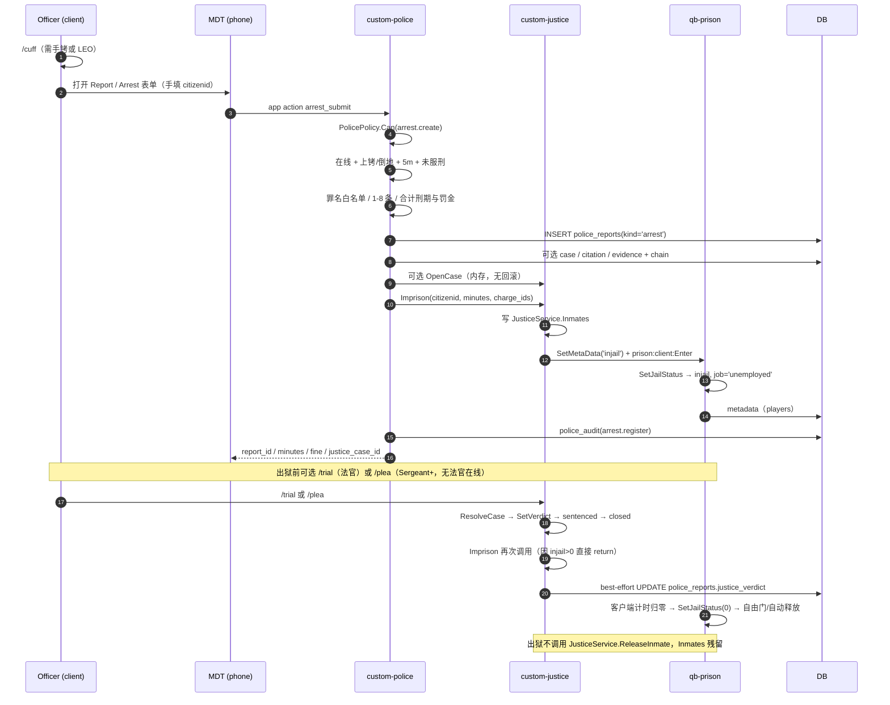
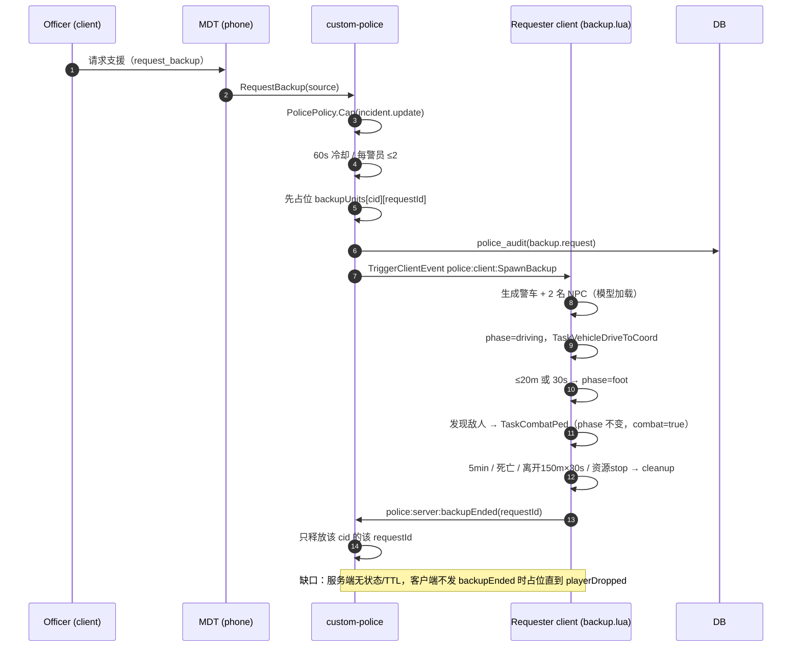

# 08 端到端场景（验收基线）

> 基线 `master @ 568acd2`（2026-10-24）。只读代码 + 现有文档，未改代码、未连数据库、未碰 FXServer。
> 路径简写同 [02-state-machines.md](02-state-machines.md)：`custom-police/`、`custom-justice/`、`custom-phone/`、`custom-director/` 指 `T-CityLite.base/resources/[custom]/` 下资源；`qb-prison/` 指 `T-CityLite.base/resources/[qb]/qb-prison/`。
> 未带资源前缀的短名（如 `p0.lua`、`main.lua`、`trial.lua`、`prison.lua`）按所在小节所属资源展开；`custom-justice/server/main.lua` 与 `qb-prison/*/main.lua` 不混用。
>
> 判定：✅ 当前实现能满足；🟡 主链路能跑但有明确缺口；❌ 不满足/无自动恢复。每条场景末尾给“当前实现是否满足/缺口”，并标注状态机编号（SM-01…SM-07，见 02）。
>
> 说明：本文件按“当前代码事实”写，不把 `B_PLAN.md` 的目标当成已实现；`B_PLAN` 只用于对照验收标准。`FLOW_INTERNAL.md` 是 P0–P2 前审计，`/jail`、罚单付款页等结论已过期；只在当前代码仍可复现时引用（手机 911 不建单、`/fine` 并行、单位列表不过滤）。

**场景索引**

| # | 场景 | 当前判定 | 主缺口 | 优先修 |
|---|---|---|---|---|
| 1 | 单人巡逻：10-8 → 911 → 到场 → 罚单 → 报告 | 🟡 | grade1 无法自派；`cleared` 不是 `closed`；911 通知无 incident id；罚单不挂 incident | SM-01/02/03 |
| 2 | 逮捕：上铐 → ArrestSubmit → 送监 → trial/plea → 出狱 | 🟡 | 无事务/幂等；判决不改变已服刑期；出狱不恢复职业（已拍板）；无犯罪记录写入 | SM-03/04/05 |
| 3 | NPC 支援：请求 → 生成 → 到场 → 战斗 → 回收 → 名额释放 | 🟡 | 服务端无生命周期/TTL/结束审计；客户端静默失败会占名额 | SM-06 |
| 4 | 失败：客户端崩溃、掉线、DB 超时、重复提交、资源重启 | ❌ | 多数路径无自动恢复；重复提交无幂等；重启丢内存案件 | 全部 |
| 5 | 权限：平民、grade1、Sergeant、Lieutenant、agent L1/L2/L3 | 🟡 | 读路径无 cap；`set_status` 不校验在勤；`open_case` 绕过 grade；L3 可绕过上铐/距离 | SM-01/03/07 |

---

## 0. 两张时序图

**图 1 — 场景 2：逮捕 → 司法 → 在押**



**图 2 — 场景 3：NPC 支援**



---

## 1. 场景 1 — 单人巡逻：10-8 → 911 → 到场 → 罚单 → 报告

### 1.1 入口与前置

- 1 名警察在线，job=`police`；假设 grade=1（Officer）；如果要“自己派自己”，需要 grade≥2（见 1.2 第 4 步）。
- 警局勤务点 `[E]`（`custom-police/client/job.lua:780-793`）或 MDT/命令 10-8。
- 平民用 `/911` 建单（`custom-police/client/p0.lua:11-23`）；手机 911 热线只通知、不建单（`custom-phone/server/main.lua:952-980`）。

### 1.2 逐步流程（状态 → 写入 → 审计）

| # | 谁 | 入口 / 动作 | 状态迁移 | 数据写入 | 审计 | 失败/备注 |
|---|---|---|---|---|---|---|
| 0 | 警察 | 警局 `[E]` → `QBCore:ToggleDuty` | SM-01：`off_duty→available` | `players.job.onduty=true`；`police_units` upsert（`p0.lua:262-276`） | **无** | 上勤本身不审计；DB 失败会只改一边 |
| 1 | 警察 | 10-8 / MDT「10-8 在勤」 | `×→available` | `police_units.status='available'`（`p0.lua:45-54`） | `unit.status` | 不要求 `onduty=true`：未上勤也能把单位改成 available；MDT 仍不可用（`policy.lua:42`） |
| 2 | 平民 | `/911 <text>` → `custom-police:server:911` | SM-02：`∅→open` | `police_incidents` insert；给在勤警察写 `phone_notifications` + 推送（`p0.lua:77-116`） | `incident.create` | 无频率/去重；通知正文无 `#id`；手机热线不建单 |
| 3 | 警察 | 手机 MDT → Dispatch 页 | 读 | `GetIncidents`（只排除 `closed`，`p0.lua:118-137`） | 无（读不审计） | MDT 仅在 onMount/手动刷新时拉取；无服务端推送（`PoliceMDT.svelte:66-69,225-235`） |
| 4 | 警察 | 派单 / 前往 | SM-02：`open→assigned`；SM-01：`available→assigned` | `police_incident_units` + `police_units.assigned` + `police_incidents.assigned`（`p0.lua:139-157`） | `incident.assign` | **grade1 死锁**：`incident.assign` 要 grade≥2（`policy.lua:9`）；`enroute` 又要求“已分配或 grade≥2”（`p0.lua:169`）。单人 grade1 无法自派 |
| 5 | 警察 | 前往 / 到场 | SM-02：`assigned→enroute→on_scene`；SM-01 同上 | `police_incidents.status` + `UPDATE police_units ... WHERE incident_id=?`（`p0.lua:159-181`） | `incident.status` | 若第 4 步没 assign（grade2 自派），unit 的 `incident_id` 为空 → 到场只改 incident，不改自己的 unit，状态脱节 |
| 6 | 警察 | `/checkid` / MDT 查人 | 读 | `LookupCitizen`（`p0.lua:192-235`）；审计失败 fail-closed | `lookup.citizen` + result | MDT 仍要手输 citizenid（无 nearby 选择器，`PoliceMDT.svelte:82,364`） |
| 7 | 警察 | Report 页「罚单」→ `issue_citation` | SM-03：`∅→unpaid` | `police_citations` insert（`p1.lua:38-64`） | `citation.issue` | 金额 1–50000 任意；**不挂 incident**（UI 不传 `incident_id`）；不校验罪名/基准价；可 `/fine` 并行（`server/commands.lua:259-310`，无记录/审计） |
| 8 | 警察 | Report 页「提交报告」→ `report_submit` | SM-03：`∅→submitted` | `police_reports` insert；可选 evidence + chain、BOLO 标签（`p2_system.lua:672-797`） | `report.create`、`evidence.register`、`bolo.create` | 审计失败会回滚 report/evidence；正文/标题校验 3/10 字；可挂 incident/case |
| 9 | 警察 | Dispatch 页「清场」 | SM-02：`*→cleared`；SM-01：unit→available | `police_incidents.status='cleared'` + `closed_at=NOW()`；该 incident 的所有 unit → available（`p0.lua:159-181`） | `incident.status` | **`closed` 不可达**；`cleared` 仍被 `GetIncidents`/看板返回；会把其他 unit 的 busy 覆盖 |
| 10 | 系统 | 归档/统计 | 无 | 无 | 无 | 没有 `closed_at`/`disposition` 可用于“已结案”指标 |

### 1.3 失败与回退

- **911 重复/刷单**：`/911` 无频率限制，`P.CreateIncident` 只校验 title（`p0.lua:77-116`）；同一人连点会生成多条。目标：30s 1 条 + 5 分钟同标题/坐标去重（SM-02）。
- **通知失败**：写 `phone_notifications` 在 incident 插入之后；单条写失败不会回滚 incident，且无失败审计。
- **第 4/5 步失败**：`P.AssignUnit`/`P.SetIncidentStatus` 不检查 `affectedRows`；对不存在/已关闭的 incident 仍可能返回成功（`p0.lua:139-181`）。目标：条件 UPDATE + `affectedRows=1`。
- **grade1 无人可派**：见上；临时绕过只能靠 grade2 上线或直接改 DB（不推荐）。这是“单人巡逻”场景的硬阻断。
- **清场不归档**：`cleared` 后没有 `close` 入口；队列越积越多；看板 `status NOT IN ('closed')` 仍显示 `cleared`（`custom-director/server/live_api.lua:489-491`）。
- **罚单与警情脱节**：`issue_citation` 不接受 `incident_id`（`PoliceMDT.svelte:377-383`、`police_mdt.lua:222-225`），所以“记录覆盖率”无法按警情统计；`/fine` 又不写表，形成三套事实。
- **报告覆盖**：报告可挂 incident，但清场不要求报告；B_PLAN 的“报告/关闭警情 ≥70%”缺 `disposition` 字段无法计算。

### 1.4 可观测指标（当前即可查）

```sql
-- 1) 单位状态分布 + 非法组合（TD-01）
SELECT status, COUNT(*) FROM police_units GROUP BY status;
SELECT u.citizenid, u.status, JSON_UNQUOTE(JSON_EXTRACT(p.job,'$.onduty')) AS onduty
FROM police_units u JOIN players p ON p.citizenid=u.citizenid
WHERE (u.status='off_duty' AND JSON_UNQUOTE(JSON_EXTRACT(p.job,'$.onduty'))='true')
   OR (u.status<>'off_duty' AND JSON_UNQUOTE(JSON_EXTRACT(p.job,'$.onduty'))<>'true');

-- 2) 未结警情账龄（cleared 也是“未结”）
SELECT id, status, priority, TIMESTAMPDIFF(MINUTE, created_at, NOW()) AS age_min
FROM police_incidents WHERE status NOT IN ('closed') ORDER BY age_min DESC;

-- 3) 建单→派单→到场（来自 police_audit，detail=状态）
SELECT i.id,
       MIN(CASE WHEN a.detail='assigned' THEN a.created_at END) AS assigned_at,
       MIN(CASE WHEN a.detail='enroute' THEN a.created_at END) AS enroute_at,
       MIN(CASE WHEN a.detail='on_scene' THEN a.created_at END) AS on_scene_at
FROM police_incidents i
LEFT JOIN police_audit a
  ON a.action='incident.status' AND a.target=CAST(i.id AS CHAR)
GROUP BY i.id;

-- 4) 罚单有据率 / 支付率
SELECT SUM(reason IS NOT NULL AND reason<>'')/COUNT(*) AS reason_rate,
       SUM(status='paid')/COUNT(*) AS paid_rate
FROM police_citations;

-- 5) 报告覆盖率：以 cleared 警情为分母（当前没有 closed）
SELECT
  (SELECT COUNT(DISTINCT incident_id) FROM police_reports WHERE incident_id IS NOT NULL) /
  NULLIF((SELECT COUNT(*) FROM police_incidents WHERE status='cleared'),0) AS coverage;
```

**目标值**（来自 `B_PLAN.md:110-118`）：报告覆盖率 ≥70%、罚单 reason 非空 ≥95%、`on_scene→arrest` ≤90s、开庭/认罪协议 ≥2/周、滑轨使用 10–30%。当前只能算 1)–4)；5) 的分母不稳（`closed` 不可达）。

### 1.5 当前实现是否满足

- ✅ 10-8/10-6/10-7、911 建单、罚单、报告、证据、BOLO、清场、审计都有代码路径。
- 🟡 主链路能演示，但：
  1. **grade1 单人不能接警**（`p0.lua:169` + `policy.lua:9`）——直接阻断“单人巡逻”。
  2. `10-7` 不改 `onduty`（`client/p0.lua:7` + `p0.lua:294-298`），`10-8` 不要求在勤；SM-01 的非法组合会出现。
  3. 911 通知无 incident id、MDT 无推送，必须手动刷新（F15）。
  4. `cleared` 不是 `closed`，清场后队列不清空（`p0.lua:124-125`）。
  5. 罚单不挂 incident、金额不接罪名目录；`/fine` 仍并行且不入库（B1/F11 的残留）。
  6. 上勤/下班无审计。
- **结论**：作为“能开单、能写报告”的演示 ✅；作为“单人可闭环、可审计、可统计”的生产流程 ❌。先修 SM-01（解 grade1 死锁 + 单一状态），再补 SM-02 的 `closed`/disposition。

---

## 2. 场景 2 — 逮捕：上铐 → ArrestSubmit → 送监 → trial/plea → 出狱

### 2.1 入口与前置

- 警察 grade≥1、在勤；目标在线；已上铐/倒地/濒死；双方距离 ≤5m；目标 `metadata.injail=0`（`p2_system.lua:336-366`）。
- `/cuff` 由 `police:server:CuffPlayer` 校验距离/手铐/职业（`custom-police/server/interactions.lua:27-40`）。
- MDT Arrest 表单**仍要手填 citizenid**（`PoliceMDT.svelte:560,834-906`；错误文案“请填写目标 citizenid”），B_PLAN 的“自动带入”未实现。

### 2.2 逐步流程

| # | 谁 | 入口 / 动作 | 状态迁移 | 写入 | 审计 | 失败/备注 |
|---|---|---|---|---|---|---|
| 0 | 警察 | `/cuff` | 目标 `ishandcuffed` | `players.metadata.ishandcuffed`（client/server 事件） | 无 | 距离 >2.5m DropPlayer；无手铐且非 LEO 拒绝 |
| 1 | 警察 | MDT → Report → Arrest | — | 无（纯前端） | 无 | 手填 cid；无 nearby 选择器；表单关闭即丢 |
| 2 | 警察 | 提交 → `arrest_submit` → `ArrestSubmit` | SM-03：`∅→submitted(kind=arrest)`；SM-04：可选 `∅→pending`；SM-05：`out→in_prison` | 见 2.3 顺序 | `arrest.register`（+ `case.create`/`bolo.create` 可选） | 无幂等/无事务；错误码返回 UI 但不落库 |
| 3 | 系统 | `custom-justice:Imprison` | SM-05：`out→in_prison` | `JusticeService.Inmates`；`metadata.injail`；`prison:client:Enter` | 仅 `custom-logs`“入狱” | 已在服刑 → `true` 但不重置（防洗刑期） |
| 4 | 系统 | qb-prison `prison:client:Enter` | 同上 | `metadata.injail`、`jailitems`、`players.job='unemployed'`（`qb-prison/server/main.lua:5-18,20-30`） | 无 | 强制失业；STATUS 明确“不做恢复职业” |
| 5 | 囚犯 | 客户端计时/电工 | `in_prison→in_prison` | 每分钟 `SetJailStatus(jailTime)`；工作 -2min（`qb-prison/client/main.lua:344-408`） | 无 | 客户端可伪造 `SetJailStatus(0)`；离线时间不服刑 |
| 6 | 法官 | `/trial <case>`（job=judge） | SM-04：`pending/assigned_lawyer→sentenced→closed` | `SetVerdict`（内存）；`Imprison`；`police_reports.justice_verdict` best-effort（`trial.lua:124-200`） | 仅 `custom-logs`“审判判决”；**无 police_audit** | 只能在 `open_case` 时才有案件；`Imprison` 因 `injail>0` 直接 return，**刑期不变** |
| 7 | 警官 | `/plea <case>`（grade≥2，且无在线法官） | 同上（mode=plea） | `final=max(5,floor(base*0.6))`；`Imprison`（同上无效） | 仅 `custom-logs`“认罪协议” | 无“被告同意”记录；UI/命令无二次确认 |
| 8 | 系统/囚犯 | 刑满/自由门/Unjail | SM-05：`in_prison→released` | `metadata.injail=0`、归还 jailitems、teleport（`qb-prison/client/main.lua:277-340`） | 无 police_audit；`custom-logs`“出狱” | 不恢复职业；不清理 `JusticeService.Inmates`；`/inmates` 残留 |
| 9 | 管理员 | `police_release`（ACE） | 同上 | metadata 0 + Unjail + 可选 SetJob（`p2_system.lua:820-839`） | 仅 console print | 唯一能恢复职业的路径；与正常出狱重复 |

### 2.3 `ArrestSubmit` 实际写入顺序与补偿

| 序 | 写 | 失败时当前行为 |
|---|---|---|
| 1 | `police_reports(kind='arrest', status='submitted', charges JSON, subject, officer, incident/case)` | 返回 `db_error` |
| 2 | 可选 `police_cases` + `case_no` | `rollback()` 删 report；返回 `case_create_failed`/`db_error` |
| 3 | 回填 `report.case_id` | rollback |
| 4 | 可选 `police_citations`（`report_id`、`charge_id`、`base_amount`） | rollback |
| 5 | 可选 `police_evidence` + `police_evidence_chain(collected)` | rollback |
| 6 | 可选 `OpenCase`（justice 内存） | rollback 警察侧；**内存案件无法删** |
| 7 | 回填 `justice_case_id` | rollback 警察侧 |
| 8 | `Imprison` | justice 失败 → 兜底 `SetMetaData('injail')` + `prison:client:Enter`（`p2_system.lua:610-613`）；兜底成功则记录成功但 justice 无 Inmate；兜底失败才 rollback + `jail_failed`。若已送监、后续仅 audit 失败，返回 `ok=false, jailed=true`（`p2_system.lua:646-651`） |
| 9 | 罚单通知 | `pcall`，失败打印，不回滚 |
| 10 | `police_audit` | 失败 → `ok=false, jailed=true`；已服刑不回滚 |

**结论**：顺序是“先写记录、最后送监、失败反向 DELETE”，不是事务；DELETE 本身失败会留下孤儿。`open_case` 是跨资源内存写，无法回滚（`p2_system.lua:125-136,448-623`）。

### 2.4 失败 / 回退

- **重复提交/双击**：无幂等键；两个并发请求都能通过前置（都在 `metadata.injail=0` 时），各写一份 report/citation/evidence；第二个 `Imprison` 可能 early-return 但记录已经重复。顺序重试通常会被 `already_jailed` 挡住，但 UI 看到失败、实际第一次已成功。
- **目标在提交过程中掉线**：`targetPlayer` 是开始时捕获的；中途掉线且 QBCore 已无该玩家时，`Imprison` 走 offline 分支（`prison.lua:21-28`），只写 `Inmates{offline=true}`，不写 `metadata`；重连时 qb-prison 已启动 → 不触发 justice Enter，qb-prison 读 `metadata.injail=0` → **刑期丢失**（SM-05）。
- **`open_case` 失败**：回滚警察侧；若 `OpenCase` 已插入内存但 `update report.justice_case_id` 失败，内存案件成孤儿。
- **送监失败**：justice 失败先走 `SetMetaData('injail')` + `prison:client:Enter` 兜底；兜底成功则记录成功但 justice 无 Case/Inmate（第二条隐式送监路径）；只有兜底也失败才回滚并返回 `jail_failed`。若 `open_case` 已成功，案件仍在 `/cases`（法官可手动关）。
- **audit 失败**：已送监时返回 `ok=false`，UI 显示失败但人已在监狱；重试会 `already_jailed`。
- **出狱**：不恢复职业（产品决策，`STATUS.md:47`）；不写 `criminalrecord`（新路径仅在 legacy `interactions.lua:178-182` 写）；不清理 justice `Inmates`。
- **法庭**：`ArrestSubmit` 已送监；`/trial`/`/plea` 的 `Imprison` 不改变刑期。若 `open_case=false`（默认 false，`PoliceMDT.svelte:126`），根本没有案件可审。

### 2.5 可观测指标

```sql
-- 逮捕量（按天）与刑期分布
SELECT DATE(created_at) d, COUNT(*) arrests
FROM police_reports WHERE kind='arrest' GROUP BY d ORDER BY d DESC;

SELECT id, subject_citizenid, JSON_EXTRACT(charges,'$[*].minutes') AS charge_minutes,
       justice_case_id, JSON_UNQUOTE(JSON_EXTRACT(justice_verdict,'$.mode')) AS mode,
       JSON_UNQUOTE(JSON_EXTRACT(justice_verdict,'$.finalMinutes')) AS final_minutes
FROM police_reports WHERE kind='arrest' ORDER BY id DESC LIMIT 50;

-- on_scene → arrest（按 incident 关联）
SELECT r.id, TIMESTAMPDIFF(SECOND, a.created_at, r.created_at) AS secs
FROM police_reports r
JOIN police_audit a
  ON a.action='incident.status' AND a.target=CAST(r.incident_id AS CHAR) AND a.detail='on_scene'
WHERE r.kind='arrest' AND r.incident_id IS NOT NULL;

-- 罚单（若逮捕同时开单）
SELECT COUNT(*) total, SUM(status='paid') paid FROM police_citations;
```

**缺口**：失败错误码（`target_not_cuffed`/`too_far`/`jail_failed`）只回给 UI，不落 `police_audit`，无法算失败率；`trial/plea` 没有独立表/审计，只能从 `justice_verdict` JSON 猜；出狱没有审计表。

### 2.6 当前实现是否满足

- ✅ 一次逮捕主链路可跑：上铐校验、罪名白名单、自动刑期/罚金、report/citation/evidence/case 可选、送监、audit 都有。
- 🟡/❌ 关键缺口：
  1. **无事务/无幂等**：并发/重试会产生重复记录；补偿 DELETE 可能失败（SM-03）。
  2. **判决不改变刑期**：先送监 + `Imprison` early-return，`/trial`/`/plea` 对刑期无效果（`prison.lua:30-35`、`trial.lua:189`）。
  3. **出狱不恢复职业**是已拍板决定，但必须告知玩家与客服；否则“警察坐牢即失业”仍是 B3 的体验问题。
  4. **无 `criminalrecord` 写入**；MDT 也没有前科读取，记录只剩 `police_reports`。
  5. **`open_case` 无 grade 校验**：UI 写“Sergeant+”，服务端不校验（`p2_system.lua:399-404,564-578`）。
  6. **逮捕内 citation/evidence 无独立审计**；audit 失败在送监后返回失败，语义混乱。
  7. **B_PLAN 的“自动带入目标”未实现**：仍需手填 citizenid（F1）。
- **结论**：可演示“抓人→入狱→出狱”，不可安全重试、不可审计判决、不可用判决改刑期。先修 SM-03 幂等/事务 + SM-05 服务端刑期，再让判决通过 `AdjustSentence` 生效。

---

## 3. 场景 3 — NPC 支援：请求 → 生成 → 到场 → 战斗 → 回收 → 名额释放

### 3.1 入口与前置

- 警察 grade≥1、在勤；`RequestBackup` 用 `incident.update`（`p2_system.lua:191-204`）。
- 60s 冷却；每 citizenid 最多 2 个活动 request（`p2_system.lua:172-204`）。
- 客户端 `backup.lua` 只负责实体；服务端只负责配额/审计（`p2_system.lua:165-171` 注释）。

### 3.2 逐步流程

| # | 层 | 动作 | 状态 | 写入/事件 | 审计 | 失败 |
|---|---|---|---|---|---|---|
| 1 | 服务端 | MDT `request_backup` → `RequestBackup` | `requested` | 占位 `backupUnits[cid][requestId]`、`backupCooldown[cid]=now`、`backupSource[src]=cid` | `backup.request` | 权限 `not_police`；`cooldown`；`limit`；audit 失败释放占位并回滚冷却 |
| 2 | 服务端 | `TriggerClientEvent('police:client:SpawnBackup', src, requestId)` | `requested→spawning`（仅客户端） | 事件 | 无 | 玩家在 audit 期间离开 → 释放占位 |
| 3 | 客户端 | `police:client:SpawnBackup` → `spawnBackup` | `spawning` | `pending[requestId]=true`；加载 `police/police2` + `s_m_y_cop_01/hwaycop`；生成车 + 2 ped | 无 | 模型不存在 → `notifyServerEnded`；车/2 ped 失败 → 清理 + 结束 |
| 4 | 客户端 | 车生成成功 | `spawning→enroute` | `active[requestId]`，`phase='driving'`；`TaskVehicleDriveToCoord` | 无 | 司机死亡/车消失 → cleanup |
| 5 | 客户端 | 距玩家 ≤20m 或 30s | `enroute→onscene` | `beginFoot`：停车、ped 下车、`phase='foot'` | 无 | 无 |
| 6 | 客户端 | 发现敌人 | `onscene→engaged`（逻辑上） | `combat=true`、`TaskCombatPed` | 无 | 敌人消失 → 回 `onscene` |
| 7 | 客户端 | 玩家离开 150m 持续 30s / 5min 寿命 / 玩家死亡 / 无存活 ped / 资源 stop | `*→despawned` | `cleanup(requestId,true)`：删 blip/ped/vehicle；发 `police:server:backupEnded` | **无** | 客户端静默失败不发事件 → 服务端占位不释放 |
| 8 | 服务端 | `police:server:backupEnded` | `despawned` | 只删该 cid 的该 requestId；空则清 `backupUnits[cid]`/`backupSource[src]` | 无 | 未知/他人 requestId 忽略（安全） |
| 9 | 服务端 | 玩家掉线 | `despawned` | `playerDropped` 清 `backupSource[src]` + `backupUnits[cid]=nil` | 无 | 名额释放；但客户端实体随客户端卸载 |

### 3.3 失败 / 回退

- **客户端崩溃/Lua 卡死**：不发 `backupEnded`；服务端无 TTL，名额一直占用，直到 `playerDropped`（`p2_system.lua:266-272`）。如果玩家挂机在线，永久 -1。
- **模型/实体失败**：客户端会 `notifyServerEnded`，服务端释放；但没有审计，无法区分“失败”与“正常结束”。
- **服务端重启**：`backupUnits/backupCooldown/backupSeq` 全丢；客户端可能仍在跑，之后 `backupEnded` 被忽略（服务端 map 空）→ 无害但统计丢失。
- **客户端资源重启**：`onResourceStop` 清理所有 active/pending 并通知服务端（`backup.lua:506-519`）；这是当前最可靠的回收路径。
- **全局上限**：没有；2 个/警员 × N 警察可以生成很多 NPC，超出 GTA_MOD_RESEARCH 的性能预算。
- **“名额释放”**：正常结束/掉线/资源 stop 能释放；静默失败不能。目标：服务端 TTL 兜底（SM-06）。

### 3.4 可观测指标

```sql
-- 请求量（当前只有这一条审计）
SELECT DATE(created_at) d, COUNT(*) requests
FROM police_audit WHERE action='backup.request' GROUP BY d ORDER BY d DESC;

-- 当前无法算：生成成功率、平均存活、战斗率、异常结束率
```

目标指标：请求成功率、生成成功率（`backup.spawned/request`）、平均存活秒数、`engaged` 占比、异常结束原因分布（`timeout|dead|left|resource_stop|spawn_failed|expired`）。

### 3.5 当前实现是否满足

- ✅ 服务端权限/冷却/每警员上限/审计/防伪 requestId（`backupEnded` 只释放自己的）都做了；客户端实体清理覆盖 5min/死亡/离开/资源 stop。
- 🟡 缺口：
  1. 服务端无生命周期、无 ack、无 TTL；客户端静默失败会锁名额（SM-06）。
  2. 无结束审计/指标；无法评估“支援是否有效”。
  3. 无全局上限；只限每警员。
  4. NPC 只在请求者客户端生成；其他玩家可见性未定义，容易被误解为全服单位。
- **结论**：可演示，不可运营（名额泄漏 + 无法度量）。先补服务端 TTL/ack/结束审计，再考虑全局 cap。

---

## 4. 场景 4 — 失败：客户端崩溃、玩家掉线、DB 超时、重复提交、资源重启

### 4.1 故障矩阵

| 故障 | 发生时 | 当前自动处理 | 数据后果 | 手工恢复 | 目标 |
|---|---|---|---|---|---|
| 警察客户端崩溃 | 巡逻/派单后 | `playerDropped` 写 `police_units.off_duty`（仅当 job 仍 police） | incident 仍 `assigned/enroute`；`police_incident_units` 保留该 cid；单位行可能幽灵 | 重新上线后手动清场/重新派单；或用 SQL 修 unit + incident | `Unit.Release` + `Incident.Unassign`，审计 `unit.drop`/`incident.unassign` |
| 囚犯客户端崩溃 | 服刑中 | 无；重连 qb-prison 读 `metadata.injail` 重新 Enter | 剩余刑期 = 最后一次分钟同步值；最多丢 1 分钟；离线时间不计 | 无需；重连继续 | 服务端 `ends_at`；重连按真实剩余 |
| 目标在 ArrestSubmit 中掉线 | 提交的多个 DB await 之间 | `Imprison` offline 分支只写内存 `Inmates{offline=true}`，不写 metadata | 重连后 qb-prison 不 Enter（metadata=0），刑期丢失；report/citation 仍在 | 管理员 `police_release` 或手工补 metadata（不推荐）；案件需人工关 | 落库 sentence + 登录 settlement；ArrestSubmit 对 offline 目标拒绝或转 pending |
| DB 超时/连接池耗尽 | 任意写 | `insertRow/updateRow` 用 `pcall` 包住；`SetIncidentStatus`/`SetUnitStatus` 不检查结果；`PayCitation` 先扣钱再更新 | 半写 report/evidence/citation；孤儿行；支付扣钱但 status 未变；incident 状态未改却返回成功 | 对账 SQL；人工修/删除；无 outbox | 事务或 `police_write_intents`；所有 UPDATE 检查 affectedRows；支付条件更新 |
| 重复提交（双击/网络重试） | ArrestSubmit/ReportSubmit/PayCitation | 无幂等键；ArrestSubmit 顺序重试常被 `already_jailed` 挡住，并发不挡；ReportSubmit 直接重复；PayCitation 可双扣 | 重复报告/罚单/证据；重复扣款 | 人工删重复（危险）；退款 | `idempotency_key` 唯一索引 + UI 按钮禁用 + 服务端返回原结果 |
| `custom-police` 资源重启 | 有人在线 | `police_units` 保留旧状态；`syncDuty` 不重算；`backupUnits` 丢失 | 幽灵单位/名额重置；进行中的 incident 不变 | 重连后 `OnJobUpdate` 可能覆盖为 available；需人工对账 | 启动时 `Sweep`/重建投影；所有内存状态可丢弃 |
| `custom-justice` 资源重启 | 有案件/囚犯 | `activeCases`/`Inmates`/`caseCounter` 全丢；qb-prison 仍按 metadata 计时 | `/cases` 空、`/inmates` 空；判决回写 `CASE-0001` 可能与旧报告冲突 | 无法恢复内存案件；只能从 `police_reports.justice_verdict` 反查 | `justice_cases`/`justice_verdicts`/`justice_sentences` 落库 |
| `qb-prison` 资源重启 | 有囚犯在线 | 客户端 `onResourceStart` 读 metadata 重新 Enter（`qb-prison/client/main.lua:120-129`） | 最多丢 1 分钟；`GotItems` 服务端表重置（可再刷手机） | 重连/重启资源 | 服务端 sentence 表；`GotItems` 落库/幂等 |
| 整服重启 | 全部 | 只保留 DB；内存全丢 | 案件/囚犯/backup 全丢；`police_units` 旧状态；metadata 保留最后值 | 重启后对账 + 人工释放 | 所有关键状态落库；启动时 reconciliation |
| 客户端 Lua 卡死（NPC 支援） | 支援中 | 无服务端 TTL；`playerDropped` 才释放 | 名额锁死；NPC 实体可能残留 | 让玩家重连 | 服务端 TTL + ack（SM-06） |

### 4.2 逐项分析（含代码证据）

**4.2.1 客户端崩溃（警察）**

- `playerDropped` 先 `pd(source)` 再 `isPolice(data)`；若玩家在崩溃前已因入狱被改成 `unemployed`，直接早退（`custom-police/server/p0.lua:282-289`），`police_units` 保留 `assigned/enroute/on_scene`，live board 仍显示。
- 即使仍是 police，`playerDropped` 只改 unit，不改 `police_incidents` 和 `police_incident_units`；incident 永远 `assigned`（SM-02）。
- 目标：`playerDropped` 统一调用 `PoliceDuty.Release(cid,'disconnect')`；`Release` 内部把 incident 回 `open`（若无其他 unit），并写 `police_incident_units.released_at`。

**4.2.2 目标掉线（逮捕中）**

- `ArrestSubmit` 在入口捕获 `targetPlayer`（`p2_system.lua:345-356`）；后续全部用捕获对象。若在 `Imprison` 前掉线：
  - `JusticeService.Imprison` 的 `GetPlayerByCitizenId` 返回 nil → 只写 `Inmates[cid]={offline=true}`，**不写 metadata**（`custom-justice/server/prison.lua:21-28`）。
  - 重连：`prison.lua:80-98` 看到 `offline` → 清标记、设 src、`qbPrison=true`；因为 qb-prison 已启动，**不触发** justice Enter。
  - qb-prison 客户端 `OnPlayerLoaded` 读 `metadata.injail`；仍是 0 → 不 Enter。
  - 结果：玩家自由，`Inmates` 显示在押；`/inmates` 剩下 0 分钟或按 startTime 递减。
- 目标：sentence 落库 + 登录 `Settlement`；或 `ArrestSubmit` 在目标离线时返回 `target_offline`，要求重新上铐再提交。

**4.2.3 DB 超时/错误**

- `insertRow`/`updateRow` 把 `MySQL.*.await` 包在 `pcall`，失败返回 nil/false（`p2_system.lua:154-163`）；`rollback()` 的 DELETE 也在 `pcall` 里（`p2_system.lua:458-481`），所以 rollback 可能“静默失败”，留下 report/citation/evidence 孤儿。
- `P.SetIncidentStatus` 完全不看 `MySQL.update.await` 返回值（`p0.lua:171-178`）；`P.SetUnitStatus` 也不看（`p0.lua:47-53`）。DB 挂了也可能返回成功。
- `PayCitation` 先 `RemoveMoney`，再 `UPDATE ... WHERE status='unpaid'`，不检查 affectedRows（`p1.lua:149-155`）：并发/超时可能扣钱但状态没变，或两次都扣。
- `persistVerdict` 用独立 `CreateThread` + `pcall`，失败只打印（`custom-justice/server/trial.lua:39-48`），判决可能在 DB 中丢失但内存已 closed。
- 目标：事务/outbox + 所有写检查 affectedRows + 支付“条件更新抢占→扣款→失败回滚” + 失败审计（错误码，不含 PII）。

**4.2.4 重复提交**

- `ArrestSubmit` 没有幂等键；`police_reports` 没有唯一约束能表达“同一次逮捕”。并发双击可以写两份 report、两份 citation、两份 evidence；两个 `Imprison` 第二个 early-return，但记录已重复（`p2_system.lua:336-662`）。
- `ReportSubmit` 更直接：每点一次一份 report（`p2_system.lua:672-797`）。
- `PayCitation`：两个并发请求都读到 `unpaid`，都 `RemoveMoney`，都 UPDATE；结果双扣（`p1.lua:143-155`）。
- 目标：`idempotency_key` 唯一索引 + 客户端 request id；支付用 `UPDATE ... WHERE status='unpaid'` 抢占，`affectedRows=1` 才扣钱，扣钱失败回滚 status。

**4.2.5 资源重启**

- `custom-police`：`police_units` 是 DB，状态保留；`syncDuty` 只在 JobUpdate/加载时写，启动后不会主动对账。`backupUnits`/`backupCooldown` 是内存，重启清零（名额“恢复”，但不审计）。
- `custom-justice`：`activeCases`、`Inmates`、`caseCounter` 全丢（`main.lua:6-12`）。重启后 `CASE-0001` 从 0 重新开始；`persistVerdict` 按字符串 `justice_case_id` 更新，可能覆盖上一轮同号报告的判决（`trial.lua:41-43`）。这是当前最隐蔽的数据损坏路径。
- `qb-prison`：客户端 `onResourceStart` 从 `metadata.injail` 恢复（`qb-prison/client/main.lua:120-129`）；服务端 `GotItems` 内存表清零，`prison:server:CheckChance` 可再次触发（小号刷手机）。
- 整服重启：DB 保留 report/citation/case/warrant，内存案件/囚犯/backup 全丢；`police_units` 旧状态保留；玩家 metadata 保留最后值。
- 注意：改 `fxmanifest` 或新增 server 文件必须整服重启（或删 `cache/files/custom-police`），只 `restart` 不会加载新文件（`STATUS.md:36`）。

### 4.3 恢复 runbook（人工）

1. **先取证**：`police_audit` 最近 100 条、`police_units` 非法组合、`police_incidents` 账龄、`/tmp/fxserver.log` 的 `execution failed`/`police_rejected`、客户端报错。
2. **不要删业务行**：report/citation/evidence 是审计证据；重复行应标记/关联而不是物理删。若必须删，先导出并写一条 `police_audit(action='manual_cleanup')`。
3. **幽灵单位**：用未来的 `PoliceDuty.Release`；临时 SQL 只能改 `police_units.status/incident_id`，并同时写 `police_audit`（actor_kind='system'，detail 写原因）。
4. **卡住的 incident**：若 `police_incident_units` 里只有掉线玩家，先写 `released_at`（目标字段；当前没有），再把 incident 回 `open`；不要直接 `closed`（会掩盖未处置）。
5. **刑期异常**：优先用 `police_release`（ACE）而不是直接改 metadata；记录操作者/原因。
6. **重启后**：先对账 `police_units` 与在线玩家 job，再开放接警；`custom-justice` 重启后不要继续用旧 `CASE-*`（会冲突），先确认 `justice_cases` 是否落库（当前没有）。

### 4.4 可观测指标

- **当前可用**：`police_audit`（成功动作）、`/tmp/fxserver.log`（director 失败、police_rejected、autoAlert）、`agent_actions.error`、`agent_denials`。
- **当前不可用**：逮捕/报告/罚单的失败错误码、出狱、支援结束原因、客户端崩溃。UI 只显示错误文本，不回写。
- **目标**：所有写路径失败写 `police_audit(action='<domain>.<action>.failed', detail=error_code)`（不含参数值/PII）；新增指标：`arrest_failure_rate`、`payment_double_debit_total`（应为 0）、`stale_units`、`stuck_incidents`、`backup_leaked_slots`、`custody_release_without_sentence`（应为 0）。

### 4.5 当前实现是否满足

- ❌ 不满足“可恢复”：
  1. 掉线只释放单位，不释放 incident（SM-01/02）。
  2. 目标离线逮捕会丢刑期（SM-05）。
  3. DB 失败静默/半写；无事务/outbox（SM-03）。
  4. 重复提交无幂等；支付可双扣（SM-03）。
  5. justice 内存重启即丢，且 `CASE-0001` 回绕会覆盖旧判决（SM-04）。
- ✅ 已有基础：`pcall` 包裹了部分 DB 写、`ArrestSubmit` 有补偿删除、director 有幂等/TTL/失败落库；可作为重构的参考实现。
- **结论**：当前适合“有人看着的演示服”，不适合无人值守。先做 SM-01 的掉线释放 + SM-05 的落库计时，再做 SM-03 的幂等/事务；否则每次崩溃都要人工修数据。

---

## 5. 场景 5 — 权限：平民、grade1、Sergeant、Lieutenant、agent L1/L2/L3

### 5.1 角色与能力矩阵

| 角色 | 入口 | 需要的 cap / 当前检查 | 实际结果 | 缺口 |
|---|---|---|---|---|
| 平民 | `/911 <text>` | 无 cap；`CreateIncident` 只校验 player + title（`p0.lua:77-116`） | ✅ 可建单；无频率/去重 | 可刷单；通知无 id |
| 平民 | 手机「我的罚单」/付款 | 无 police cap；`GetMyCitations` 只按本人 cid（`p1.lua:69-77`）；`PayCitation` 校验 owner + unpaid（`p1.lua:137-156`） | ✅ 可查/可付自己的 | 并发双扣；无 `void` |
| 平民 | MDT | App `audience={jobs={'police'},onduty=true}`（`police_mdt.lua:30-34`） | ❌ 不可用 | — |
| grade 0 Recruit | MDT | 只要 police+onduty 即可进 App；`me` 返回 grade（`police_mdt.lua:38-64`） | 🟡 可进；具体 action 由 `PolicePolicy` 卡 | `GetUnits`/`GetIncidents` 无 cap；`set_status` 无 cap/在勤检查 |
| grade 1 Officer | 10-8/10-6/10-7 / MDT set_status | `set_status` 只 `isPolice`（`p0.lua:294-298`）；不查 onduty/grade | ✅ 可改自己单位状态 | 10-7 不清 onduty；可把 off_duty 单位改 available |
| grade 1 | 查看单位/警情 | `units.view` 声明 minGrade=1（`policy.lua:7`），但 `GetUnits` 无 `PolicePolicy`（`p0.lua:56-75`）；`GetIncidents` 也无 | 🟡 实际任何在勤警察（含 grade0）都能读 | 读路径没有独立 cap；B10 仍成立 |
| grade 1 | 人员/车辆查询 | `lookup.citizen/vehicle` minGrade=1，审计失败 fail-closed（`p0.lua:183-247`） | ✅ | — |
| grade 1 | 罚单/报告/证据/案件查看/逮捕/BOLO 查看/令状查看 | `citation.issue`、`report.create`、`evidence.register`、`case.view`、`arrest.create`、`bolo.view`、`warrant.view` 都 minGrade=1（`policy.lua:13-26`） | ✅ | 独立 `IssueCitation` 不接罪名/基准价；`open_case` 无 grade 校验 |
| grade 1 | 派单 `incident.assign` | minGrade=2（`policy.lua:9`） | ❌ `rank_too_low` | **单人 grade1 无法自派**：`enroute` 又要求已分配或 grade≥2（`p0.lua:169`） |
| grade 1 | 建案件 `case.create` | minGrade=2（`policy.lua:19`） | ❌ | — |
| grade 1 | BOLO 创建 | minGrade=2（`policy.lua:21`） | ❌ | — |
| grade 1 | 令状申请 | minGrade=2（`policy.lua:23`） | ❌ | — |
| grade 1 | `open_case`（逮捕时同时开庭） | **无 cap 检查**（`p2_system.lua:399-404,564-578`） | ⚠️ 可创建 justice 案件 | UI 写“Sergeant+”（`PoliceMDT.svelte:894-896`）与服务端不符；应加 `case.create` 或 `case.open` |
| Sergeant (grade 2) | 派单/建案/BOLO/令状申请/`/plea` | caps minGrade=2；`/plea` 另有 grade≥2 + 无在线法官（`trial.lua:259-292`） | ✅ | `/plea` 无“被告同意”记录；逮捕已送监时判决无效 |
| Sergeant | 令状批准/审计 | `warrant.approve`、`audit.view` minGrade=3（`policy.lua:24,27`） | ❌ `rank_too_low` | UI 仍显示“批准”按钮（`PoliceMDT.svelte:1119-1122`），F12 未修 |
| Lieutenant (grade 3) | 令状批准/审计/部门/辖区 | `warrant.approve`、`audit.view` minGrade=3；部门/辖区命令要求 grade≥3（`commands.lua:160,184`） | ✅（批准/审计/部门/辖区，均 grade≥3） | 审计页 UI 已按 `isLieutenant` 隐藏（`PoliceMDT.svelte:295-296`），但后端仍正确；`/setjusticedept` 仍要求 judge 或 grade≥4（`custom-justice/server/main.lua:199`），与警察部门命令不同，需在文案区分 |
| Lieutenant | 罚单作废/报告审核/案件撤销 | 目标能力；当前没有 cap/入口 | ❌ | 无 `citation.void`、`report.approve`、`case.cancel` |
| Agent L1 | `police_incident_create` | director risk L1、`requires_approval=false`、自动执行（`policy.lua:62-67`） | ✅ 自动建单 + 广播；`police_audit(actor_kind='agent')` | 无坐标；无人在线也能建（WORLD_ACTION） |
| Agent L2 | `police_assign_unit` | L2、需审批（`policy.lua:50-55`）；`Sys.AssignUnit` 校验 incident/unit 非 off_duty（`p2_system.lua:77-95`） | ✅ 审批后执行 | 审批时重校验世界；unit 可能已变 busy |
| Agent L3 | `police_jail_player` | L3、需审批（`policy.lua:56-61`）；`Sys.Jail` 校验在线、1–120、reason（`p2_system.lua:99-123`） | 🟡 可送监 | **不要求上铐/距离**（agent 路径），与玩家逮捕不一致；justice 失败仍写 `police_arrests` 并返回成功表；无 player source |
| Agent 任意 | 审批自身 | `isSelfApproval` 拒绝 `agent:<id>` 等（`main.lua:1505-1513`） | ✅ 不可自审 | — |
| Agent 任意 | 审批过期 | `ttl_seconds` 默认 900；`expirePendingApprovals` 扫（`main.lua:56,286-295`） | ✅ 过期 `rejected/expired` | 执行无超时 |
| Agent 任意 | 拒绝/策略失败 | `agent_denials` 只存参数名/hash（`main.lua:180-229`） | ✅ | — |
| 只读看板 | `GET /agent/v1/live/police/board` | live token；只返回 callsign/dept/status、incident id/code/title/priority/status（`custom-director/server/live_api.lua:483-503`） | ✅ 无 PII | 读 `police_units` 的 stale/幽灵行会原样暴露（SM-01） |

### 5.2 关键不一致（按严重度）

1. **grade1 单人死锁**：`incident.assign` 要 grade2，`SetIncidentStatus` 又要求“已分配或 grade2”（`policy.lua:9`、`p0.lua:169`）。只有 grade1 在线时，911 单无人能接；这是场景 1 的硬阻断。
2. **`set_status` 不受 `PolicePolicy`**：任何 police（含 off-duty、grade0）都能调用 `custom-police:server:setStatus` 改自己单位状态（`p0.lua:294-298`）；`10-8` 客户端命令也不要求在勤（`client/p0.lua:7`）。这会把 SM-01 的非法组合直接暴露给普通玩家。
3. **`10-7` 不清 `onduty`**：`policy.lua:42` 仍放行所有 action；MDT App audience 仍通过；看板/`GetUnits` 显示 off_duty，权限却按在勤。TD-01 的核心。
4. **`open_case` 绕过 grade**：UI 文案 Sergeant+，服务端只要求 `arrest.create`（grade1）。`OpenCase` 甚至只检查 officer job police/judge，不查 grade（`custom-justice/server/main.lua:77-78`）。
5. **读路径无 cap**：`GetUnits`/`GetIncidents`/`me` 的 units 查询没有 `PolicePolicy`；`units.view` 只是声明，未被执行（B10）。任何在勤警察（含 grade0）可看全量单位/警情。
6. **令状批准按钮**：UI 对所有 grade 渲染，服务端要 grade3（F12）；点击必失败。
7. **agent L3 与玩家逮捕不一致**：agent 可对任意在线玩家送监，不要求上铐/距离；但有 L3 人审 + 审计，风险可接受但必须在文档/审批预览里写明“无物理前置”。
8. **Agent 执行失败语义**：`Sys.Jail` 在 justice 失败时走 metadata 兜底，仍写 `police_arrests` 并返回表；director 认为 `ok=true`。可能出现“police_arrests 有记录、qb-prison 没进”或反之。
9. **部门/辖区命令 grade**：`/setpoliceinfo` 类命令要 grade≥4（`commands.lua:161,186`），而 `Lieutenant` 是 grade3；文案/配置需对齐，否则“副警监不能分配部门”。

### 5.3 当前实现是否满足

- ✅ action 层基本收敛到 `PolicePolicy.Can`，且 `warrant.approve`/`audit.view` 正确要求 grade3；agent 有独立 token、审批、自审拒绝、TTL、denial 审计；平民只能读/付自己的罚单。
- 🟡 缺口：
  1. 读路径（units/incidents）没有独立 cap；
  2. `set_status`/10-codes 不受在勤/职级约束；
  3. grade1 无法自派，单人巡逻不可用；
  4. `open_case` 绕过 grade；
  5. 令状批准 UI 未按 grade 隐藏；
  6. agent L3 与玩家路径的前置不一致，失败语义不透明。
- **结论**：作为“服务端权限表”是及格线以上；作为“所有入口都走同一策略”还不成立。先修 SM-01 的 `SetDuty/SetState` 单入口（顺带解决 2/3/5），再补 `open_case` cap 与读路径 cap。

---

### 5.4 审计与可观测性

- **成功路径**：`police_audit` 记录 `lookup.*`、`citation.*`、`report.create`、`evidence.*`、`case.*`、`arrest.register` 等；audit 失败对 `LookupCitizen`/`LookupVehicle`/`GetCaseDetail` 是 fail-closed（`p0.lua:183-190,242-244`）。
- **拒绝路径**：`PolicePolicy.Can` 只返回 `not_police`/`not_on_duty`/`rank_too_low`，**不写审计**；MDT 只把错误文本显示给玩家（`police_mdt.lua:167-275` 把 `false` 压成 boolean 或错误码）。因此当前无法统计“谁在什么时候被哪条 cap 拒绝” `SELECT action, COUNT(*) FROM police_audit WHERE action LIKE 'policy.%'` 永远为空。
- **Agent**：拒绝写 `agent_denials`（参数名/hash），生命周期写 `agent_actions`；这是当前唯一完整的“拒绝审计”。
- **只读看板**：`live_api.lua:483-503` 只返回 callsign/dept/status 与 incident 摘要，无 citizenid/坐标/叙述；但 stale/幽灵单位会原样暴露（SM-01）。
- **目标**：所有 `PolicePolicy.Can` 失败写 `police_audit(action='policy.denied', target=cap, detail=reason)`（不含参数值）；指标：按 cap 的拒绝率、`not_on_duty` 次数、`rank_too_low` 次数、`audit_unavailable` 次数。验收：任意 grade1 尝试 `warrant.approve` 能在审计里查到一条 `policy.denied`。

## 6. 验收清单（可直接转测试）

| 场景 | 必测 | 通过标准 |
|---|---|---|
| 1 单人巡逻 | grade1 单人在线接 911 | 能派给自己并 `on_scene`；不能依赖 grade2 在线 |
| 1 | 10-7 后尝试 `citation.issue` | 返回 `not_on_duty`，MDT App 不可用；`police_units.status` 与 `onduty` 一致 |
| 1 | 清场 → 归档 | 30 分钟后 `closed`；`police_incidents` 不再出现在 `GetIncidents`/看板；报告覆盖率可算 |
| 1 | 911 连点 5 次 | 只建 1 条（30s 限流 + 去重）；通知正文含 `#id` |
| 2 逮捕 | 双击提交 | 只产生 1 份 report/citation/evidence；第二次返回第一次结果 |
| 2 | 目标在提交中掉线 | 要么拒绝并回滚，要么登录后仍服完刑；不能出现“记录在、人自由” |
| 2 | ArrestSubmit → `/trial` | `ends_at` 按判决变化，或明确返回“判决仅记录”；不能静默无效 |
| 2 | 出狱 | `metadata.injail=0`、`jailitems` 归还、`justice_sentences.status='released'`、审计一条；职业策略明确 |
| 3 NPC 支援 | 杀客户端 Lua / 断网 | 服务端 ≤15s 释放名额；审计 `backup.ended(reason='timeout')` |
| 3 | 6 个警员同时请求 | 全局 cap 生效；不生成超过预算的 NPC |
| 3 | 结束 | 每个 request 有 `spawned/ended` 审计；可算存活时长 |
| 4 失败 | DB 断 10s | 写路径返回 `db_error`，不产生半写；恢复后无孤儿 |
| 4 | `custom-justice` 重启 | `justice_cases/verdicts/sentences` 全在；`CASE-0001` 不与旧报告冲突 |
| 4 | 整服重启 | `police_units` 无非法组合；`/inmates` 与 `justice_sentences` 一致 |
| 5 权限 | grade1 派单/建案/BOLO/令状 | 全部 `rank_too_low`；但可自派（场景 1 修好后） |
| 5 | 10-7 后 MDT action | 全部 `not_on_duty`；不能只靠 UI 隐藏 |
| 5 | `open_case` by grade1 | `case_forbidden`（或明确放开并在 UI 改文案） |
| 5 | agent L2/L3 审批 | 自审拒绝；过期 `rejected/expired`；审批时重校验；失败写 `agent_actions.error` |
| 5 | agent L3 与玩家逮捕 | 文档/预览明确“无上铐/距离”；若要有，则服务端补校验 |
