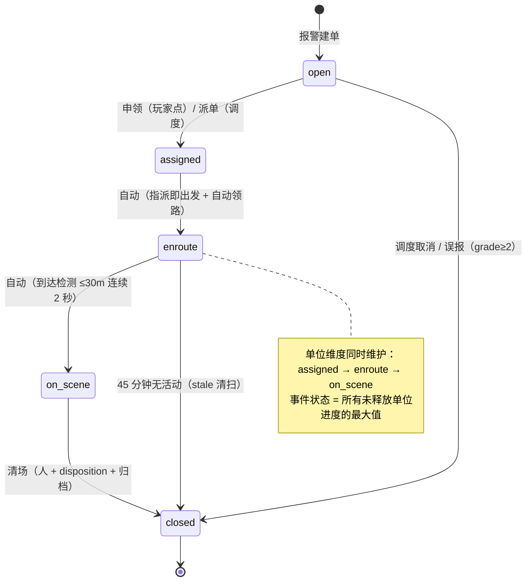
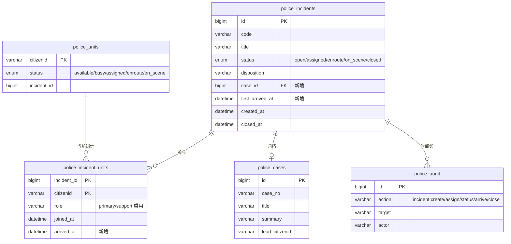
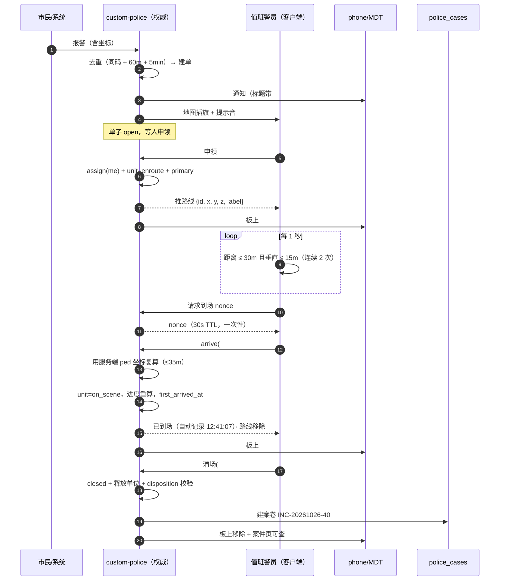

# 10 — 警情全生命周期：自动结算、两个按钮、一条归档线

> **核心命题**: 警情的大部分状态变化**不该由人点按钮**。派单即出发、到场即结算、处理完才清场——
> 人只需要做两个决定：**接不接这张单**，和**案子结束了没有**。
> **适用范围**: custom-police 的 P0 派单层、MDT 调度页、police_cases 归档、45 分钟 stale 清扫。
> **状态**: 设计稿 v2（2026-10-26），实现排入 P5。前端 demo：
> docs/server-design/assets/10-mdt-lifecycle-demo.html

---

## 1. 为什么要改：三个按钮里有两个不该存在

现场观察是「前往 / 到场 / 清场三个按钮，按顺序只有一个能点」。复核代码后发现了更深的结论：
**其中两个按钮描述的是游戏已经知道的事实。**

| 按钮 | 记录的事实 | 谁最清楚 |
|---|---|---|
| 前往 | 我出发了 | 系统——被派单的那一刻就出发了 |
| 到场 | 我到了 | 系统——坐标就在引擎里，30 米内就是到了 |
| 清场 | 案子办完了 | 只有人——抓没抓到、是不是误报，引擎不知道 |

让玩家点前两个，等于让他手动汇报系统已经观测到的事：多一次操作，还能造假（人没到也能点"到场"）。

目标模型因此是：

- 「前往」保留，语义变成**单人申领**（我要这张单），点完自动出发、自动领路；
- 「到场」**删除**，改为客户端检测 + 服务端裁定的自动结算；
- 「清场」保留，只在到场之后出现，点完走清场命令并**归档成案卷**。

---

## 2. 现状复核（都能指到代码）

| # | 事实 | 位置 |
|---|---|---|
| 1 | 三个按钮永远可点；GetIncidents 不返回"当前这个人能做什么" | PoliceMDT.svelte 866–868 行；p0.lua 349–380 行 |
| 2 | open 状态点「前往」**必然失败**：转移表里 open 只能到 assigned / closed | p0.lua 21–27 行（SM-02） |
| 3 | "只有被派遣的能点"只在 grade<2 生效，grade≥2 静默跨单，审计不留接管痕迹 | p0.lua 494 行 |
| 4 | 清场**不归档**：注释说归档在 cases，实际只有 audit；police_cases 从未被警情写过 | p0.lua 31 行；p3_cases.lua 324 行 |
| 5 | disposition 由前端硬编码 cleared：误报 / 逮捕 / 取消无法区分 | PoliceMDT.svelte 434 行 |
| 6 | 多单位是假的：police_incident_units.role 无人读写，markIncidentUnits 按 incident 一把刷 | p0.lua 94–96 行 |

---

## 3. 目标模型

### 3.1 一条警情由四件东西组成

| 名字 | 回答的问题 | 载体 | 谁是权威 |
|---|---|---|---|
| 事件 incident | 发生了什么、在哪、多急 | police_incidents | 状态是**投影** |
| 单位 unit | 谁在去、谁到了、到了多久 | police_units | 状态是**事实**（引擎提供） |
| 动作 action | 此刻谁能做什么 | 判定函数（服务端） | 唯一判定源 |
| 档案 case | 事后怎么查 | police_cases | 结案的产物 |

### 3.2 状态机

四条规则：

1. **assign 与 enroute 合并**：被指派的那一刻就是出发，没有"已受理但没动"的停留。
2. **到场由引擎结算**：检测在客户端跑，裁定在服务端做（见 3.5）。
3. **结案必须有 disposition**：arrest / cleared / false_alarm / cancelled 由人选，stale 由清扫机写。
4. **事件状态是派生值**：recomputeIncidentProgress() 按单位取最大进度写回；删除
   markIncidentUnits 那种"按 incident_id 一把刷全部"的写法。

### 3.3 单位：primary + support

| 角色 | 怎么产生 | 能做什么 |
|---|---|---|
| primary | 第一个申领 / 调度指派 | 推进事件状态、清场 |
| support | 后续「加入」 | 只能改自己的单位状态（自动 enroute / 自动 on_scene） |

事件状态 = max(未释放单位的进度)：有人 on_scene → 事件 on_scene；全部释放 → 结案或回 assigned。

### 3.4 两个按钮的语义

| 按钮 | 出现条件 | 点击后发生什么 |
|---|---|---|
| 前往（申领） | 单子 open 且无人 primary；已有 primary 时变成「加入」 | 原子操作：assign(me) + 单位 enroute + **自动规划路线** + 写审计，不需要第二次点击 |
| 清场 | 我是本单单位且已 on_scene（或 grade≥2） | 弹清场单：选 disposition、填摘要 → closed、释放单位、清除路线、**归档成案卷** |

其余状态没有按钮：没到场不能清场（置灰 + 原因），不是我的单不能清场（置灰 + 原因）。

### 3.5 自动到场：客户端检测，服务端裁定

复用任务系统已验证的 reach 模式（custom-quest 的 quest_checkpoint.lua）：
客户端轮询距离 → 命中后申请 nonce → 服务端复算距离 → 结算。

| 参数 | 值 | 理由 |
|---|---|---|
| 轮询间隔 | 1000 ms | 与任务 checkpoint 一致；每帧一次距离计算，成本可忽略 |
| 到场半径 | 30 m（3D） | 步行/车辆都能触发；不到一个街区 |
| 垂直容差 | 15 m | 高架、楼顶、地下车库不误判 |
| 去抖 | 连续 2 次命中（≈2 s） | 开车路过不算到场 |
| 重置阈值 | 离开 45 m（1.5 倍半径） | 边界抖动不会反复触发（滞回） |
| 服务端宽容 | 35 m | 客户端与服务端位置有 1 tick 差异 |
| 防重放 | 一次性 nonce，30 s TTL，按 source 限流 | 客户端不能伪造第二次到场 |

服务端**不信任客户端坐标**：收到事件后自己用 GetEntityCoords(GetPlayerPed(src)) 重算距离。
客户端只负责说"我觉得我到了"，裁定权在服务端。

**兜底**：检测可能因传送、载具、地形失败。单位详情菜单里保留「手动补录到场」，
服务端仍校验 ≤100 m 并在审计里标 manual=true——自动系统必须有失败出口，
否则一次检测失灵就把整条流程卡死。

### 3.6 自动领路

指派成功后服务端直接向被指派警员的客户端推一条路线，不经过任何按钮：

- 客户端复用 mdtNavigate 的绘制函数：route blip + 距离显示 + 路点；
- 换目标时上一条降级为普通图标（不删除，避免"我还在处理上一单"时标记消失）；
- 到场结算或清场后自动移除；
- 同一单多个单位 → 每个单位各自收到路线。

### 3.7 清场 = 清场命令 + 归档

| disposition | 是否建档 | 说明 |
|---|---|---|
| arrest | 必建档 | 可附涉案 citizenid，档案写处置结果 |
| cleared | 默认建档 | 警员可改摘要；5 分钟不填用模板 |
| false_alarm | 不建档 | 只写 disposition，进统计 |
| cancelled | 不建档 | 记录取消人（调度撤销） |
| stale | 不建档 | 清扫机写入，进统计 |

归档要素：

- case_no = INC-YYYYMMDD-<incident id>，唯一可回查
- title = 警情标题；summary = 模板（时间、地点、报警原文、到场用时、参与单位、处置摘要）
- lead_citizenid = 本单 primary；created_by = 清场人
- police_incidents.case_id 回写 police_cases.id
- 顺带产出 first_arrived_at（首次到场时间）→ 出警时长可以直接 SQL 算

权限错位一并解决：case.create 要求 grade≥2，但 grade 1 的现场警员必须能结案 →
归档由 incident.clear 内部完成，不提升调用者权限；档案内容由系统生成，人只能改摘要。

### 3.8 数据模型

变更清单（最小集，up/down 各一条）：

| 变更 | 目的 |
|---|---|
| police_incidents.case_id BIGINT NULL + INDEX | 警情 → 案卷 |
| police_incidents.first_arrived_at DATETIME NULL | 出警时长统计 |
| police_incident_units.arrived_at DATETIME NULL | 单位级到场时间 |
| police_incident_units.role 真正启用（每单唯一 primary） | 谁能推进主状态 |
| 不新建表 | 时间线复用 police_audit |

### 3.9 可观测性

    [police] inc=#40 claim by=<cid> open->assigned primary=<cid>
    [police] inc=#40 route pushed -> src=3 (auto)
    [police] inc=#40 arrive by=<cid> dist=12.4m after=96s (auto)
    [police] inc=#40 clear  by=<cid> disp=arrest case=12 units=2
    [police] inc=#40 denied action=clear reason=not_on_scene by=<cid>

前四行是流程证据；第五行是"点了没反应"的唯一解释来源。

### 3.10 安全边界

- 前端可被篡改：每条动作在服务端独立复检（allowed_actions 只是展示，不是授权凭证）。
- disposition / status 一律白名单。
- 到场由服务端用 ped 坐标复算，客户端坐标不参与判定。
- override 必须留痕，否则等于没有。
- 归档内容由系统生成，人只能改摘要 → 防止"清场"变成"随便造案卷"。

---

## 4. 整体流程（端到端）

| 步 | 谁触发 | 服务端做什么 | 落库 | 谁能看见 |
|---|---|---|---|---|
| 1 报警 | 市民手机 / 系统事件 / 控制台 / NPC | 去重合并 → 建单 → 通知在勤 + 插旗 | police_incidents | 全部在勤警员（手机 + 地图） |
| 2 派单 | 调度（grade≥2）或本人申领 | assign → 单位 enroute → **推路线** | police_incident_units、police_units、audit | 被派的人（路线）+ 全队（板） |
| 3 出发 | 自动（第 2 步的副作用） | 无 | audit(incident.status) | — |
| 4 到场 | 客户端检测 → 服务端裁定 | 复算距离 → 单位 on_scene → 事件进度重算 | police_units、incident_units.arrived_at、incidents.first_arrived_at | 本人（提示 + 路线消失）+ 全队（板上变「现场」） |
| 5 现场处置 | 警员（逮捕 / 取证 / 罚单 / 笔录） | 各子系统既有路径 | 各自表 + audit | 全队 |
| 6 清场 | 警员（到场后才可点） | disposition 校验 → closed → 释放单位 → **建案卷** → 回写 case_id | police_incidents、police_cases、police_units、audit | 全队（板上消失）+ 案件页（可查） |
| 7 统计 | 系统 | 出警时长 = first_arrived_at − created_at；结案率、误报率按 disposition | 只读 | 管理层 |

---

## 5. 判定表（两按钮版）

| 警情状态 | 点击者 | 前往（申领/加入） | 清场 | 原因文案 |
|---|---|---|---|---|
| open | 任何在勤警员 | **可**（申领 → 自动出发） | 灰 | 「还没到场，不能清场」 |
| open | grade≥2 | 可（可指派他人） | 可（cancelled） | — |
| assigned / enroute | 本单单位 | 灰（已在路上） | 灰 | 「到场后才能清场」 |
| assigned / enroute | 非本单 | 可（加入 → support） | 灰 | 「不是你负责的单」 |
| on_scene | 本单 primary | 灰 | **可** | — |
| on_scene | 本单 support | 灰 | 灰 | 「由现场负责人清场」 |
| closed | 任何人 | — | — | 板上不出现 |

判定结果由服务端 IncidentActionState(actor, incident) 下发（allowed_actions），UI 只渲染；
执行时服务端照旧全量复检。**前端不复制状态机。**

---

## 6. 分阶段计划

| 阶段 | 内容 | 时间盒 | 验收标准 |
|---|---|---|---|
| P5-1 | 申领一体化（assign+enroute+路线）+ 自动到场（检测/nonce/裁定）+ 两按钮门控 | 1–1.5 天 | 单人点「前往」一次到位；开到 30m 内自动变「现场」；不在现场时清场按钮置灰并说明原因 |
| P5-2 | 单位模型 primary/support + 事件状态派生 + 废 markIncidentUnits | 1 天 | 两单位分别 enroute/on_scene 时事件取最大进度；support 不能清场 |
| P5-3 | 清场归档：disposition 五选一、case_id、case_no、模板摘要、first_arrived_at、stale 同路径 | 1 天 | 逮捕清场后案件页查到 INC- 案卷；误报不建档但进统计 |
| P5-4 | override / transfer / 增援单位 | 0.5 天 | 接管留痕；移交后原 primary 变 support |

测试要求（沿用仓库约定）：

- Lua harness 驱动真实 p0：判定表逐格断言；反向校验（把到场距离检查放开到 500m、
  删掉 "not_on_scene 不能清场"，测试必须红）。
- NUI 场景：按钮 disabled + tooltip 文案；点不了时不发 appAction；到场后自动出现清场。
- 架构闸门：allowed_actions 与执行必须同源；到达检测的半径常量必须同时出现在服务端校验分支。
- 现场验收：真人开车到现场，日志出现 arrive(dist=..after=..s)，板上变「现场」。

---

## 7. 前端 demo

docs/server-design/assets/10-mdt-lifecycle-demo.html —— 单文件、无依赖，浏览器直接打开。

覆盖：未申领（可点）→ 申领后自动路线与到达倒计时 →（演示按钮）模拟抵达 → 自动变「现场」
+ 到场用时 → 清场单（disposition + 摘要）→ 归档成 INC- 案号；另一张已被别人申领的单
展示置灰与原因。demo 只演示状态与交互，判定由脚本内 IncidentActionState() 模拟服务端下发。

---

## 8. 仍需拍板

1. **到场半径 30 m / 停留 2 s / 重置 45 m** 是否合适（跑车路过 vs 停在门口的距离感）。
2. **是否保留"到了但没识别"的手动补录**（建议保留，菜单内，≤100 m，审计标 manual）。
3. **清场权限**：只有 primary 能清场，还是本单任何单位都能？（建议只有 primary，support 需先移交）
4. **disposition 五选一是否够**（arrest / cleared / false_alarm / cancelled / stale）。
5. **误报要不要留案卷**（建议不建，只进统计，避免案件库被误报灌满）。
6. **自动到场是否也给提示音**（建议给，但比报警音轻）。

---

## 9. 不做什么

- 不碰 qb-policejob 上游动作层（fine / jail / 驾照）。
- 不新建并行事件模型：police_incidents 仍是唯一事实源，时间线是 audit 的投影。
- 不在前端复制状态机。
- 不为归档新建表：police_cases 已存在，只是没人往里写。
- 不做"到场要下车 / 要走进半径"——先用 3D 距离，观察误报再加条件。
