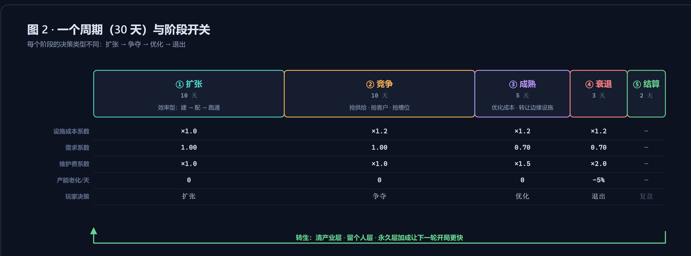
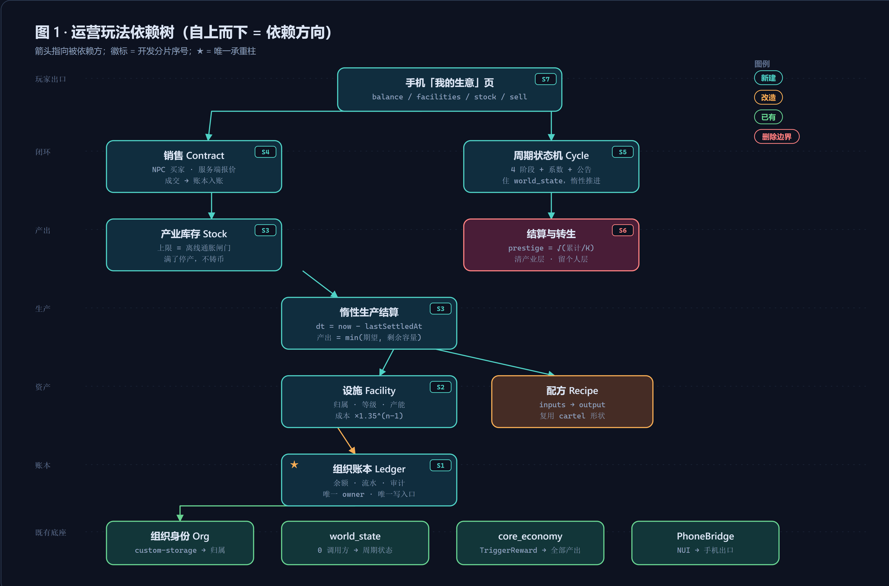
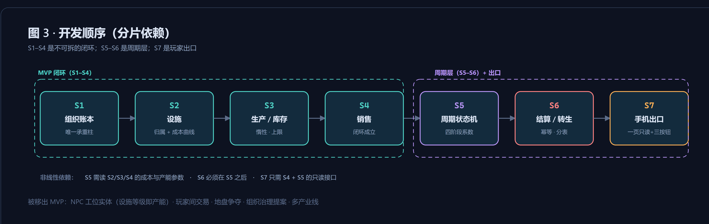

# 12 — 产业运营与组织运营（MVP 基础方案）

> **一句话**：现在的组织只是**准入许可**（门禁、职级、仓库），不是**经营主体**（自己的钱、资产、负债）。
> 这份文档把组织补成经营主体，再用一个 **28 天周期**把它串成「扩张 → 竞争 → 成熟 → 衰退 → 结算 → 下一轮」。
> **结算不是第五阶段**，是衰退结束边界上的一次事件（#387）。
> **本文只定结构与顺序，不写玩法细节**；细则留到 MVP 跑通后的第二轮。
>
> 配图：`docs/server-design/assets/industry-ops/`（依赖树 / 周期 / 分片顺序）。

---

## 0. 结论先讲

| # | 结论 | 依据 |
|---|---|---|
| 1 | **先做组织账本，再做产业**。顺序反了会得到"又一条个人刷钱循环" | 见 §2 第 1 行：qb-banking 有 job/gang 账户但缺四件事，既不能当"零"，也不够用 |
| 2 | **"竞争"不靠 PVP**，靠**有限订单配额**（全服共享 + 单组织 50% 上限） | PVP 破坏 RP 秩序且违规成本高；配额只需一张表，却能让四个阶段全部成立 |
| 3 | **玩家不能当工位**。生产单位是工位，组织成员是**管理者** | 真人有意志，不能被指派工作；同时解决"人少时产业空转" |
| 4 | **离线产出物化、不货币化**：产出进产业库存（满建 12 小时上限，540 单位），必须上线卖出才变现 | 三条通胀闸里最有效的一条 |
| 5 | **结算只清产业层**，个人层（现金/物品/车/房/职级/执照）一个字节都不动 | 全项目风险最高的一次删除，边界必须写在表级 |

---

## 1. 现状：组织有三种身份，第三种只建了一半

| 身份 | 现状 | 证据 |
|---|---|---|
| **准入许可**（门禁、职级、组织仓库、Boss 菜单） | ✅ 有 | 五级模板见 `docs/ORGANIZATION_GUIDE.md`；组织仓库的 `Organizations` 在 `T-CityLite.base/resources/[custom]/custom-storage/config.lua`，25 条（19 职业 + 6 帮派） |
| **管理权**（升降级、招募、退位交接） | ✅ 有 | `T-CityLite.base/resources/[qb]/qb-management/server/sv_org.lua` |
| **经营主体**（自己的钱、资产、负债、能亏能欠） | ⚠️ **半成品** | 见 §2 第 1 行 |

判据只有一条：**有没有一笔钱是"组织的"，能进能出、能亏能欠、可审计、可幂等**。
qb-banking 给了"能进能出"，另外三个词一个都没有。

---

## 2. 双人独立设计的事实纠错表

Hermes 与 Claude Code 各出一版设计、互不看稿，合并时逐条复核。**下面五条是这次最有价值的产出**——
它们不是设计分歧，是底稿事实错了，而错的方向都会让方案做在沙子上。

| # | 我（Hermes）的原判断 | 复核后的实际 | 采信 | 证据 |
|---|---|---|---|---|
| 1 | "组织钱包不存在" | **半成品**：`bank_accounts` 有 `account_type enum('shared','job','gang')` + 唯一键，`AddMoney`/`RemoveMoney` 已导出，罚单与卖车已经在往里打钱；缺的是**负余额保护、幂等 ref、gang 账户预建、异步写** | CC | `banking.sql` 第 1–10 行；qb-banking 的 server.lua 第 143 / 151 / 165 / 688 行 |
| 2 | "`custom-economy` 有自适应 RewardScale 0.8–1.4" | **只有 config，没有实现**：fxmanifest 的 `server_scripts` 是空的，注释写着 "removed — replaced by core_economy" | CC | custom-economy 的 fxmanifest.lua 第 15–17 行；custom-economy 的 config.lua 第 23–34 行 |
| 3 | "组织共 19 条" | **25 条**（19 职业 + 6 帮派） | CC | custom-storage 的 config.lua |
| 4 | "周期状态住 `world_state_service`"（它确实 0 调用方） | **不能住**：唯一键是 `(region_id, state_key)`，全局周期不属于任何 region；`GetRegionState` 只读缓存、**冷缓存返回 nil** 后异步预热 → 权威状态不能靠可能为空的读 | CC | `world_state_service.lua` 第 117–123 行 |
| 5 | "所有产出走 `core_economy:TriggerReward`" | **组织入账走不了**：它第一步就 `GetPlayer(source)`，没有在线玩家直接 `return false`。组织没有 source | CC | core_economy 的 server/main.lua 第 151–152 行 |

第 5 条是最关键的结构后果：**"钱的唯一网关"这个不变量必须拆成"同一套系数、两条出口"**（见 §9），
否则产业收益要么绕过网关（通胀失控），要么根本发不出来。

---

## 3. 参考游戏拆解：哪些能搬

参考 Kittens Game（猫国建设者，放置/经营）。**按"它靠什么制造稀缺"判断，不按像不像**：

| 机制 | 稀缺来源 | 结论 | 在 T-City 的形态 |
|---|---|---|---|
| 库存上限（挂机有积累，仓满即停） | 时间 | ✅ 搬 | 产业库存满建 12 小时满产即停（540 单位）→ 离线不铸币 |
| 建筑价格指数增长 | 资本 | ✅ 搬 | 设施/工位成本 `base × 1.35^(n-1)` |
| 季节性产能波动 | 时间 | ✅ 搬成阶段系数 | 四阶段的产能/价格/配额倍率 |
| 转生（清建筑、留领导力） | 时间 | ✅ 必搬 | 结算折 prestige，永久加成让下一轮更快 |
| 猫口分配（人口即劳动力） | **人力** | ⚠️ 半搬 | 换成工位；组织成员从"工人"变成"管理者" |
| 纯点击 / 单机存档 | — | ❌ 不搬 | 与服务端权威、多人经济直接冲突 |

**一句话**：稀缺来自时间与资本的部分可以直接搬；稀缺来自人力的必须换成工位。

---

## 4. 领域模型（名词先定死）

| 概念 | 定义 | 归属 |
|---|---|---|
| **Org 组织** | 现有 job/gang 字符串的组织视图。**不新建组织表**，`org_id` 就是 job/gang 名 | 已有（`custom-storage` 的 config） |
| **Treasury 组织金库** | 组织的钱：余额 + 幂等流水。唯一写入口 | 新建表 |
| **Facility 设施** | 一处产业：等级 + 工位数 + 配方 + 库存 + `last_tick_at` | 新建表 |
| **Workstation 工位** | 一个产能单位。**MVP 只是设施表的一个整数列**，没有实体 | 设施表一列 |
| **Stock 产业库存** | 设施产出的暂存，有上限。**不是玩家背包** | 设施表一列（MVP） |
| **Recipe 配方** | `inputs → output` + 时长。**形状抄 `custom-cartel`** | config（改造 cartel 形状） |
| **Demand 配额** | 全服共享的城市需求：某商品本阶段能吃多少 | 新建表 |
| **Cycle 周期** | `cycle_no` + 阶段 + 起止绝对时间 | 新建单行表 |

**关键区分：产业库存 ≠ 玩家背包。** 产出进库存，变现要「上线 → 卖出」。
直接把产出塞进背包，设施就等于印钞机，三道闸全废。

---

## 5. 一个周期：四个阶段 + 边界结算



**周期 = 28 天 = 10 + 10 + 5 + 3。** 设计稿早期版本写的是 30 天（10/10/5/3/2），多出的 2 天是"结算窗口"；
#387 已定死：`industry_state.phase` 只有四个枚举值，**结算不是阶段，是阶段边界上的一次事件**
（S7 `SettleCycle`）。加第五阶段会牵动状态机、补推逻辑与探针比较维度，收益不抵成本，
因此代码与文档统一为 28 天。

| 阶段 | 默认时长 | 产能倍率 | 售价倍率 | 配额倍率 | 可购置 | 玩家该做的决策 | 情绪目标 |
|---|---|---|---|---|---|---|---|
| ① 扩张 | 10 天 | 1.25 | 1.00 | 1.00 | 是 | 建设施、堆工位、跑通第一条链 | 涨得快，每天有新解锁 |
| ② 竞争 | 10 天 | 1.00 | 0.95 | 0.85 | 是 | 抢配额、调配方与售价 | 别人在抢我的 |
| ③ 成熟 | 5 天 | 1.00 | 1.10 | 0.70 | 是 | 砍低效工位、保利润 | 赚少了，要想清楚留什么 |
| ④ 衰退 | 3 天 | 0.70 | 0.80 | 0.40 | **否** | 清库存、退出或硬撑 | 该收手了 |

**结算（不是阶段）**：衰退期的 `phase_ends_at` 到点后，S6 先调用 S7 `SettleCycle` 清产业层、写 prestige；
`settled_cycle_no` 到位后才把 `industry_state` 推进到下一周期的扩张期。公告窗口是"结算前 7 天"，
不是一个可以停留的 2 天阶段。

**每个阶段的决策类型必须不同**（扩张 / 争夺 / 优化 / 退出）。只改数值不改决策类型的阶段等于换皮，
玩家第二轮就看穿。

**衰退期必须保留"卖出"**：只关购置不关卖出，否则玩家会卡死在末期。

**推进方式**：权威状态在单行表，以 `os.time` 为准。30 秒一次心跳；`guarded UPDATE` 的
`affected = 1` 是唯一推进许可，副作用只在之后执行；停机跨边界按顺序补推、**不跳段**。
玩家没有任何延长或缩短手段，只有控制台 `industry_setphase`（写审计）。

> 时长是设计取值、**未取证**，必须真人试玩后调；正式数值见 §10。验收时用 convar 把一周期压到分钟。

---

## 6. 依赖树



自上而下 = 依赖方向（箭头指向被依赖方）：

```
UI-Boss（Boss 菜单加一项）/ UI-Phone（DynamicApp 只读快照）
 ├→ UI-Query ─→ Phase, Facility, Stock, Demand, Treasury
 ├→ Sales/Demand ─→ Stock, Treasury, MarketPrice, Phase
 │   └→ Stock ─→ Production ─→ Facility, Recipe, Phase
 │       └→ Facility ─→ Treasury, CostCurve, OrgIdentity
 ├→ Phase 状态机 ─→ industry_state, 服务端时钟
 └→ Settlement ─→ Facility, Stock, Demand, Treasury, Prestige, Audit
     └→ Treasury ─→ OrgIdentity, Ledger
```

| 节点 | 性质 | 说明 |
|---|---|---|
| UI-Boss / UI-Phone | **改造** | Boss 菜单已有动态注入点；手机 `DynamicApp` 是通用 KV 列表 → **不写新 NUI** |
| UI-Query | 新建 | 全仓没有"产业快照"导出，只能读新表 |
| Phase 状态机 | 新建 | 见 §2 第 4 行，**不住 world_state** |
| Facility / Workstation | 新建 | 无组织资产表；工位是设施一列 |
| Stock | 新建 | qb-inventory 要求库存已在内存，且组织仓打开路径本身是坏的（§18 缺陷 1） |
| Production | 新建 | cartel 是会话内 10 秒冷却、输入在玩家背包，**不能离线、不是组织资产** |
| Sales / Demand | **改造+新建** | 价格可复用 market；但 market 的 `Sell` 只认玩家背包，**没有卖家身份** |
| Treasury / Ledger | 新建 | 不复用 players（角色表）、不复用 qb-banking（四缺） |
| Settlement / Prestige | 新建 | 无 cycle 概念、无跨周期组织资产 |
| OrgIdentity / OrgAuth | 已有 | `service_storage_GetOrgConfig` 已登记；Grade 4 `isboss` |
| MarketPrice / GlobalMult | 已有 | market 的 `service_market_GetPrice`、core_economy 的 `GetGlobalMultiplier` |
| Notify / Audit | **改造** | dashboard 只统计玩家 `OnMoneyChange`，**组织入账是通胀盲区**，必须补一条 |
| MoneyToPlayer | 已有 | `Player.Functions.AddMoney` |

**承重柱是"组织金库"**：它没有，上面每个节点都是悬空的。

---

## 7. 开发顺序



**两个里程碑**：**M1 = S1–S5**（可玩的闭环，无周期）→ **M2 = S6 + S7**（周期 + 结算）。

| 片 | 能独立跑通什么 | 验收判据（可命令 / 可观察） | 为什么必须在这个位置 |
|---|---|---|---|
| **S1** 金库地基 | Boss 对组织账户存取、查余额、流水可查；非 Boss 拒绝 | 存 1000 → `SELECT balance FROM org_treasury` = 1000 且 `players.bank` −1000；非 Boss 返回 `not_boss`；余额不足返回 `insufficient_funds`；**重启后余额不变** | 后面每一片都要扣/入账；跳过则设施免费、收入无主 |
| **S2** 设施 / 工位 / 库存 | 买设施 L1、连雇 3 个工位；成本扣账户；上限与指数价生效 | 第 1/2/3 个工位分别扣 `base`、`floor(base×1.35)`、`floor(base×1.35²)`；第 4 个返回 `cap_reached`；审计 3 行 | 生产需要容量与沉没成本；**此时钱只出不进，有 bug 也印不出钱** |
| **S3** 离线生产 | 无人上线也按 tick 产出；仓满/停机超限就停 | convar 把 tick 调到 1 秒 → 库存升到 cap 后冻结；停服 5 分钟重启 → 库存 ≤ cap 且 `last_tick_at` 前进不超过 `max_catchup` | 承重柱；此时产出只进库存、不换钱，安全 |
| **S4** 销售 / 配额 | 一键卖，配额扣减，收入进组织账户，单组织 50% 上限 | 配额 10、价 50 → 卖 10 入账 500×倍率；第 11 件返回 `demand_exhausted`；第二家超 5 件返回 `org_cap_reached`；ledger 一条且 `ref` 唯一；**dashboard 出现 `industry:sale` 流入** | 第一次造钱，必须已有 S2 成本曲线 + S3 库存上限兜底 |
| **S5** 最小 UI | Boss 在菜单完成 S1–S4；成员手机只读快照；非成员看不到 | 菜单值与 SQL 一致；App 只对对应 job/gang 可见；非 Boss 回调返回 `not_boss`；**不新增 NUI 构建** | 读模型在 S2–S4 已稳定；早做会返工两次 |
| **S6** 周期状态机 | 四阶段按绝对时间推进，倍率生效 | convar 压到 60 秒 → 4 分钟走完 4 阶段；每阶段只推进一次；重启从 DB 续跑；无跳段 | 需要 S3/S4 的产出与销售才有东西可调制 |
| **S7** 结算 / 转生 | 周期末算分、写历史与威望、清产业层、保个人层 | 压缩跑完一周期 → facility 0 行、stock 0、treasury 0、prestige +N、结果表 1 行；**`players.money` 不变**；结算中重启不重复入账 | 触碰所有表；早做会锁死 schema |

**S6 与 S7 必须同一个 PR。** 阶段机本身没有"清空"能力：一旦它先上线并回环，库存与账户就跨周期累积，
指数成本与库存上限都拦不住；若强行让 S6 停在末期，线上会卡在衰退期——比延期更糟。

---

## 8. 数据模型

所有新表 owner = 新资源；金额用整数美元。**余额变更与流水插入同事务**，余额 `UPDATE` 带
`balance + delta ≥ 0` 的 `WHERE` 守卫。

| 表 | 关键列 | 唯一约束 / 检查 |
|---|---|---|
| `org_treasury` | `org_id` PK, `balance`, `prestige`, `cycle_no` | `CHECK balance ≥ 0` |
| `org_ledger` | `id`, `org_id`, `delta`, `balance_after`, `reason`, `actor_cid`, `ref`, `cycle_no` | **`UNIQUE(org_id, ref)`**（幂等键） |
| `industry_facility` | `org_id` PK, `level`, `workstations`, `recipe_id`, `stock`, `last_tick_at` | `CHECK workstations ≥ 0`；`stock ≤ cap` |
| `industry_state` | `id` PK, `cycle_no`, `phase`, `phase_started_at`, `phase_ends_at` | `CHECK id = 1`（单行表） |
| `industry_demand` | `cycle_no`, `phase`, `item_name`, `quota_total`, `quota_used` | PK(三列)，`quota_used ≤ quota_total` |
| `industry_sales` | `id`, `org_id`, `cycle_no`, `item_name`, `qty`, `unit_price`, `revenue`, `ref` | **`UNIQUE(org_id, ref)`** |
| `industry_cycle_results` | `org_id`, `cycle_no`, `revenue`, `produced_units`, `score`, `prestige_awarded` | **`UNIQUE(org_id, cycle_no)`**（结算幂等） |
| `industry_audit` | `id`, `org_id`, `actor_cid`, `action`, `payload`, `created_at` | INDEX(org_id, created_at) |

**为什么组织金库不复用现有表**：

| 候选 | 为什么不够 | 证据 |
|---|---|---|
| `players` | 一行 = 一个角色，组织不是角色；`money` 是 JSON，唯一 owner 是 qb-core；无余额约束、无幂等键 | qb-core 的 `PlayerDefaults`；`table_owners.json` 的 owner 块 |
| `qb-banking` 的 `bank_accounts` | `RemoveMoney` 不查余额（可扣成负数）；流水无 `ref` / `cycle`；Add/Remove 在游戏线程 `await`；启动只建 job 账户、**不建 gang 账户**，帮派首次入账直接返回 false | `banking.sql` 第 1–21 行；qb-banking 的 server.lua 第 143 / 151 / 165 / 688 行 |

同 PR 必须同步的四件事（漏一件闸门就红）：

1. `T-CityLite.base/migrations/` 下的新迁移（幂等，可重复执行）
2. `T-CityLite.base/tests/architecture/table_owners.json`（8 张表的 owner，**并把新资源加进扫描清单**——现在只扫 10 个资源，新资源会逃出扫描，覆盖归零）
3. `T-CityLite.base/tests/fixtures/tcity_schema.sql`（测试库 schema）
4. `T-CityLite.base/tests/architecture/service_contracts.json`（若暴露跨资源方法）

---

## 9. 钱出口：同一套系数，两条出口

§2 第 5 行决定了这里不能照抄"一切走 `TriggerReward`"。新的不变量写成三句：

1. **系数只有一个来源**：全局倍率、热度系数、玩家加成必须复用 `core_economy` 的同一套计算，
   不许产业自己写一份"看起来差不多"的公式。
2. **出口有两条**：玩家 → `TriggerReward`（已有）；组织 → 新增 `SettleSale(org_id, item, qty, ref)`，
   它是**全仓唯一一个"无对应玩家扣款"的净增货币点**，因此必须带幂等键、必须写审计、必须出现在 dashboard。
3. **仪表盘必须看见组织钱**：`economy-dashboard` 只统计玩家 `OnMoneyChange`，
   组织入账是通胀盲区——S4 必须同 PR 补一条，否则你会有一个看不见的钱源。
4. **玩家侧也没有逐笔账**（S1 真机对账时实测）：`Player.Functions.AddMoney/RemoveMoney` **不写**
   `bank_statements`，而 `agent_economy_metrics` 只有按职业聚合的四列。所以「这条命令到底有没有
   从个人账户扣钱」在库里**无法证明**，只能靠前后余额对比。S4 若要做对账（或任何纠纷仲裁），
   必须先补一条逐笔流水。

> 注意：`custom-economy` 的"自适应通胀刹车"**并不存在**（§2 第 2 行）。所以产业的净增必须自己埋点，
> 不要假设有一个自动旋钮在兜底。

---

## 10. 数值卡（正式值，#387）

> 本节是**正式配置值**，不是验收 convar。来源：
> `T-CityLite.base/resources/[custom]/custom-industry/config/{facility,production,sales,cycle}.lua`；
> 可执行断言：`T-CityLite.base/tests/unit/layer3_business/test_industry_balance.py`。

### 10.1 目标：单设施净现金回本 8 周

**口径先定死**：S7 每个周期都会清空 `industry_facility` 与 `org_treasury.balance`，设施下个周期要重建。
所以"回本"不能只看 `R / C`（毛收入 / 成本），否则会把一个每轮都在亏钱的方案算成"很快回本"。
本卡用**净现金回本**：

```
C = 设施 baseCost + 首个工位成本
R = 单组织单周期收入
回本周期数 = C / (R − C)
回本周数   = 4 × C / (R − C)      -- 一个周期 28 天 = 4 周
```

目标 **8 周 = 2 个周期** → `R = 1.5C`，即每个周期净利率 50%。

* 6 周需要 `R = 1.67C`，对离线损耗/库存上限太敏感；
* 10 周需要 `R = 1.4C`，净利率只有 40%，一个阶段卖不满就贴近盈亏线；
* 8 周留 50% 净利率，是 MVP 的稳健中点，也给 prestige 留出可见但不过强的空间。

> 旧默认（配额 10 / 单价 $50 / 12 单位每小时）的真实收入是 **$685/周期**，不是 issue 初稿里的 $962：
> 竞争/成熟/衰退的配额倍率 0.85/0.70/0.40 会把每阶段 5 件压成 4/3/2 件。按 $100,000 成本算，
> 旧默认是 **146 个周期**，确实是"机制验证值"。

### 10.2 正式数值表

| 项 | 正式值 | 推导 / 为什么是这个数 |
|---|---|---|
| 周期 | **28 天 = 10/10/5/3** | 结算不是第五阶段，是衰退结束边界上的事件（§5） |
| 设施 `baseCost` | **$50,000** | 不动。满建 10 工位总资本 ≈ **$2,779,505**，落在 §20 的「头部组织 $2–5M」 |
| 工位成本 | `floor(50,000 × 1.35^(n−1))` | 曲线不动：第 1/2/3/4 个 = 50k / 67.5k / 91.1k / 123.0k；第 10 个 744.7k，约为第 1 个的 14.9 倍，保留防垄断 |
| 设施 + 首工位 `C` | **$100,000** | 回本基准 |
| 单工位产能 | **4.5 单位/小时** | 满建 10 工位 = 45 单位/小时；最差阶段（衰退）50% 配额需要 `2,200 / (72h × 0.70) = 43.65`，45 ≥ 43.65，9 工位（40.5）不够 → 10 工位是能吃掉自己一半配额的**最小满建** |
| 生产倍率 | `1.0`；阶段 1.25 / 1.00 / 1.00 / 0.70 | 不动 |
| 单价 | **$50** | 不动，与 `economy_baseline.json` 的 `iron_ore = $50` 对齐；收入缺口由配额 × 产能补，不由抬价补 |
| 每阶段全服配额 | **11,000** | 上限 11,340：满建 10 工位在衰退期产 2,268 件，单组织 50% 上限 `floor(SeedQuota × 0.40 × 0.50)` 不得超过它 → `SeedQuota ≤ 11,340`；取整 11,000 留余量 |
| 单组织每阶段上限 | **5,500 / 4,675 / 3,850 / 2,200** | `floor(floor(11,000 × 配额倍率) × 0.50)`；四阶段合计 **16,225 件/周期** |
| `OrgCapRatio` | **0.5** | 不动；两家组织各吃一半，第二家超 50% 直接拒绝（不截断） |
| `stockCap` | **540** | `10 工位 × 4.5 × 12h = 540`；同时等于 1 工位在成熟期（5 天 × 1.0）的产量。旧值 144 是按 1 工位 × 12/h × 12h 算的，满建 1.2h 就触顶，离线闸门失效 |
| `PrestigeK` | **50,000** | 跟新收入量级缩放：1 工位约 1 点/周期（10 周期到 10 级），满建约 3 点/周期（4 周期到顶）；累计 $5M 正好 10 点 = +20% 封顶。旧 K=500 会让满建一个周期拿 39 点，当轮顶满 |
| 永久加成 | **每级 +2%，上限 +20%** | 不动；只乘产能，不乘售价（S8 契约） |

### 10.3 三档建造的实际数字

| 建造 | 单周期销量 | 单周期收入 `R` | 资本 `C` | 净现金 `R−C` | 净回本 | 日毛利（§10 口径） |
|---|---|---|---|---|---|---|
| 设施 + 1 工位（入门） | 3,196 件 | **$157,540** | $100,000 | $57,540 | **6.95 周** | $5,626/天 |
| 设施 + 4 工位（推荐） | 12,787 件 | **$630,280** | $381,643 | $248,637 | **6.14 周** | $22,510/天 |
| 设施 + 10 工位（满建） | 16,225 件 | **$796,812** | $2,779,505 | −$1,982,693 | 不回本 | $28,457/天 |

读法：

* **入门档**是 issue 的"设施 + 首工位"口径，6.95 周落在 6–10 周目标内；每周期净现金为正。
* **推荐档**同时满足两个验收：净回本 6.14 周、日毛利 $22,510 ∈ §10 的 $15k–$30k。
* **满建档**是**配额饱和上限**，不是利润最优：10 工位刚好能在四个阶段都吃满 50% 配额，
  但 1.35 曲线让重建成本 $2.78M 高于单周期收入 $0.80M，所以它是声望/竞争上限，不是经济最优。
  利润最优在 2–4 工位；这是指数成本曲线的预期结果（§11 的防垄断闸）。

> `日毛利` 按 §10 的旧口径 = 售价 × 产量，**不扣**每周期重建成本；净现金口径见 `R−C` 一列。
> 两者不能混着说：满建日毛利高，但净现金为负。

**与现有收入的相对位置**：现在时薪 $150–300/h、挖矿上限 ~$7k/h。入门档是**被动**收入
（$5,626/天毛利），推荐档 $22,510/天；差额来自资本（$0.10M → $0.38M）与管理（按时卖出、
别让库存触顶），不是来自抬全局倍率。

**不要为了"让产业赚钱"去抬 `core_economy` 的全局倍率**——那是全服旋钮，会连带所有职业一起通胀。
产业收入仍然只从 `SettleSale` 出去，并复用 `core_economy` 的同一套系数（§9）。

---

## 11. 通胀的三道闸

| 闸 | 机制 | 挡住什么 |
|---|---|---|
| 库存上限 | 满建 10 工位 12 小时满产即停（540 单位；§10） | 离线铸币 |
| 指数成本 | 第 n 个工位 × 1.35^(n-1) | 单组织垄断全部产能 |
| 周期清零 | 结算清空产业层 | 跨周期货币存量累积 |

---

## 12. 结算与转生

边界写在**表级**，不写在代码逻辑里：

| 层 | 内容 | 结算时 |
|---|---|---|
| **产业层** | 设施、库存、金库余额、未成交配额 | **全清** |
| **个人层** | 现金、银行、物品、车辆、房产、职级、执照 | **完全保留**（字节级一致） |
| **永久层** | prestige 等级、加成、称号 | 按公式折算 |

清洗范围必须是**显式表清单**，不用通配。执行顺序：`dry-run（只打印将删的行数）` → 人工确认 → 真删 → 写审计。
**同一周期结算跑两次不得重复发**（幂等键 = `(org_id, cycle_no)`）。

结算前 **7 天**必须公告（CityFeed + 手机推送），否则玩家会觉得资产被偷。

---

## 13. 与既有计划的冲突（这一轮必须处理，不能拖）

| 冲突 | 后果 | 处理 |
|---|---|---|
| `docs/plan/jobs-content-roadmap.md` 的 R4（vineyard 种→收→酿→卖、mechanic 改装件） | 照原样做会产生**两套产出经济**（两批配方、两个库存、两个销售口） | R4 的产出链路并入产业单元：同一批配方、同一个库存、同一个销售口 |
| 循环型职业（trucker / garbage / taxi…）现在是**平行的个人收入源** | 产业收益永远显得不值钱，玩家没理由当管理者 | 第二轮把它们变成产业的**岗位**（运库存、清维护）；MVP 不动 |
| 组织仓（`/jobstorage`）**当前是坏的** | 产业若复用组织仓会一起坏 | 先修组织仓（§18 缺陷 1），或 MVP 的产业库存**不进 qb-inventory**，只做账 |
| `governance_proposals` / `organization_rules` 表在、0 写者 | 组织治理是空壳 | MVP 不做；第二轮用"分红比例""招募门槛"两条提案给它第一个写者 |

---

## 14. MVP 明确不做

| 不做 | 一句话理由 |
|---|---|
| NPC 工人 / 顾客实体与寻路 | 工位只是数字；实体化会吃掉全部工期与帧率预算 |
| 多设施 / 多地块 / 跨区物流 | 一组织一设施；多地块要先解决位置、归属、冲突 |
| 玩家间订单簿 / 供货合同 / 股权 | 需要卖家身份与合约表，而 market 没有卖家身份 |
| 把销售写回 market OrderBook | market 的 `Sell` 只认玩家背包，没有组织卖单入口 |
| 自动工资 / 分红 / 组织税 | 先把账本与审计证明，再自动化 |
| 贷款 / 负债 / 破产 | 金库不允许负数；负债会推翻全部约束 |
| 新 NUI 页面 | 用 Boss 菜单 + 手机 `DynamicApp`；新 NUI 要走构建、哈希与基线闸 |
| 与 cartel / mining / vineyard 合并成一套 | 正是 §13 警告的"两套产出经济"；MVP 只用合法商品，不碰毒品链 |
| 世界痕迹 / 编年史展示 | `world_events` 全仓 0 写者，做了也没数据 |
| ~~真实周期长度与数值平衡~~ | **已由 #387 落地**：28 天 + 正式数值卡（§10）；14 天试玩观察单独跟踪，不是合并前置 |

---

## 15. 已接受的缺陷（诚实清单）

| 缺陷 | 为什么接受 | 什么时候补 |
|---|---|---|
| 竞争期没有"对手"，只有配额变少 | 有对手就要 NPC 行为机 + 抢单逻辑，成本翻倍 | 第二轮 |
| 人少时配额抢不起来 | 同上；同 `docs/plan/jobs-content-roadmap.md` 已拍板的"先 NPC 兜底" | 第二轮 |
| 只有一条产业线，玩久了会腻 | MVP 目的是证明通路，不是给内容 | 第二轮按设施类型泛化 |
| 组织入账是新的货币点，杠杆没被长期验证 | 每周期清零 + 配额上限先兜住 | 上线后按数据看 |
| 永久加成保守（+20% 封顶） | power creep 比"不够爽"更难收回；#387 已把 `PrestigeK` 重标到 50,000，满建约 4 个周期到顶 | 第二个周期后评估 |

---

## 16. 架构对照

- **涉及平面**：P3（新资源 server）、P4（8 张新表）、P1/P2（S5 手机只读快照）
- **跨平面契约变化**：
  - 新增 net event：手机快照走 `PhoneBridge.Request` + Boss 菜单，预计 3–4 条，全部按组织成员鉴权并登记
  - 新增跨资源方法：`service_industry_<method>`，登记 `service_contracts.json`
  - 无破坏性变更（不动现有事件签名）

| 宪法条 | 要求 | 满足方式 |
|---|---|---|
| 1 | 服务端权威 | 产出 / 报价 / 结算全在服务端；客户端只上报"我点了卖出" |
| 2 | 钱只走两个出口 | 玩家走 `TriggerReward`；组织走 `SettleSale` 且共用同一套系数（§9） |
| 4 | 新 event 要么鉴权要么登记 | 按组织成员 + Grade 校验，登记 allowlist |
| 5 | 幂等 | 三处幂等键：`org_ledger(org_id, ref)`、`industry_sales(org_id, ref)`、`cycle_results(org_id, cycle_no)` |
| 6 | 表有唯一 owner | 8 张表 owner = 新资源，跨资源只读走 exports |
| 8 | 一次只动一个平面 | S1–S4 在 P3/P4；S5 单独一片动 P1/P2 |
| 9 | 没有测试的修复不算完成 | §17 的 8 条反例是本设计的验收单位 |

---

## 17. 验收的反例（先红后绿）

1. 库存满了继续产出 → `stock` 不超过上限，且不产生任何回执。
2. 结算抹到个人层 → 玩家现金 / 物品 / 车辆在结算前后**字节级一致**。
3. 金库余额不足仍购买 → 拒绝，且 `balance` 不为负。
4. 客户端伪造 `dt` / 伪造产量 → 服务端算出的值不受影响。
5. 一个配额被卖两次 → 第二次拒，且 `quota_used` 不超过 `quota_total`。
6. 同一 `ref` 重复入账 → 第二次拒（幂等）。
7. 结算跑两次 → 不重复发 prestige。
8. 非组织成员调用卖出 → 拒绝 + 审计。

---

## 18. 顺手发现的既有缺陷（独立于本设计，单独排期）

设计过程中读代码发现的真实问题。**「复核」一列只写我真的自己跑过的**：

| # | 缺陷 | 证据 | 复核 |
|---|---|---|---|
| 1 | **组织仓打不开**：传的是字符串库存 id，但 `OpenInventoryById` 把它当玩家 server id，`tonumber` 后为 nil 直接 return | custom-storage 的 server/main.lua 第 69–73 行；qb-inventory 的 server/functions.lua 第 536–539 行 | ✅ 已复核 |
| 2 | `qb-banking` 的 `RemoveMoney` **不查余额**，且 Add/Remove 在游戏线程 `await` | qb-banking 的 server.lua 第 143 / 151 / 165 行 | ✅ 已复核 |
| 3 | `qb-banking` 启动**只建 job 账户，不建 gang 账户** → 帮派首次入账返回 false | qb-banking 的 server.lua 第 688 行 | ✅ 已复核 |
| 4 | `table_owners.json` 只登记了 `world_state` / `world_events`，但 v0.8 建了 **9 张表** → 7 张无 owner，跨表写不被拦 | `tests/architecture/table_owners.json`；`migrations/v0.8_ownership_engine.sql` | ✅ 已复核 |
| 5 | `economy-dashboard` 只统计玩家钱 → 组织入账是通胀盲区（`agent_economy_metrics` 只有 job 维度聚合，无组织维度、无逐笔） | economy-dashboard 的 server/main.lua 第 59–83 行；`SHOW COLUMNS FROM agent_economy_metrics` | ✅ 已复核（S1 真机对账） |
| 6 | `world_events` 全仓 0 写者，上线通知恒为空 | `world_state_service.lua` 第 263–268 行 | ⛔ 未复核 |
| 7 | `custom-market` 价格只在内存、无落盘；重启价格回 base | custom-market 的 server/main.lua 第 25–55 行 | ⛔ 未复核 |
| 8 | market 卖货走 `AddScaled`（工资倍率）而不是奖励倍率 → 同样是"卖东西"，两套倍率 | custom-market 的 server/main.lua 第 270–275 行 | ⛔ 未复核 |
| 9 | `core_economy` 发物品不检查 `AddItem` 返回值 → 背包满时静默丢失 | core_economy 的 server/main.lua 第 187–190 行 | ⛔ 未复核 |
| 10 | `Bus` 自动导出每个 service → 任何资源都能直接写 `world_state`，与"单一写者"声明矛盾 | core-framework 的 bus.lua 第 30–32 行 | ⛔ 未复核 |
| 11 | `production-freeze` 在定义前调用 `getBusServiceList` | production-freeze 的 server/main.lua 第 140 / 144 行 | ⛔ 未复核 |
| 12 | `world_state_service` 把 region key 当 citizenid 传给 `DirtyFlush` | `world_state_service.lua` 第 181–183 行 | ⛔ 未复核 |
| 13 | cartel 的 safecracker 配方没有对应导出 → 小游戏分支永远不生效 | custom-cartel 的 config.lua 第 59 行 | ⛔ 未复核 |
| 14 | **玩家资金没有逐笔账**：`bank_statements` 只由 ATM 路径写，`Player.Functions.AddMoney/RemoveMoney` 不写；dashboard 表只有按职业聚合。任何「这条命令有没有扣钱」都只能靠前后余额对比 | `SHOW TABLES LIKE '%transaction%'`；`bank_statements` 无当日行；`agent_economy_metrics` 列结构 | ✅ 已复核（S1 真机对账） |

> 1–4 影响本设计（组织仓能不能复用、金库能不能借用、新表登记全不全），其余与本设计无关，进 backlog。

---

## 19. 回滚方式

- **代码**：新资源 + convar 开关（**默认关**）。关掉后所有入口返回"产业未开放"，现有玩法零影响。
- **数据**：8 张表保留不读即可（不做破坏性 down 迁移）；周期状态在单行表，清空即回退。
- **运行时**：`restart` 新资源即可，不改动任何现有资源。

---

## 20. 待拍板

| # | 问题 | 结论 | 影响 |
|---|---|---|---|
| 1 | 周期长度 | **已拍板：28 天（10/10/5/3）**，#387 | 结算不是阶段，是衰退结束边界上的事件；30 天的 2 天结算窗口不实现 |
| 2 | 单周期总资本量级 | 满建 10 工位 **$2,779,505**，落在原目标 $2–5M | §10 数值卡的标定基准 |
| 3 | 单设施回本 | **8 周（净现金口径）**，#387 | 入门 1 工位 6.95 周；推荐 4 工位 6.14 周；满建不是利润最优 |
| 4 | MVP 是否包含周期 | **包含**（M1 上线后紧接着 M2） | 不含周期就只是"又一个赚钱系统"，不含"下一轮要不一样"的钩子 |

---

## 21. 变更记录

| 日期 | 变更 |
|---|---|
| 2026-11-24 | 初版：Hermes + Claude Code 双份独立设计合并；§2 五条事实纠错（组织钱包半成品 / custom-economy 无实现 / 25 个组织 / 周期不能住 world_state / 组织入账走不了 TriggerReward） |
| 2026-11-27 | #387 数值卡：周期定 28 天（结算=边界事件）；`UnitsPerHour` 12→4.5、`SeedQuota` 10→11,000、`stockCap` 144→540、`PrestigeK` 500→50,000；1 工位净回本 6.95 周、满建日毛利 $28,457；新增 `test_industry_balance.py` 9 条断言 |
